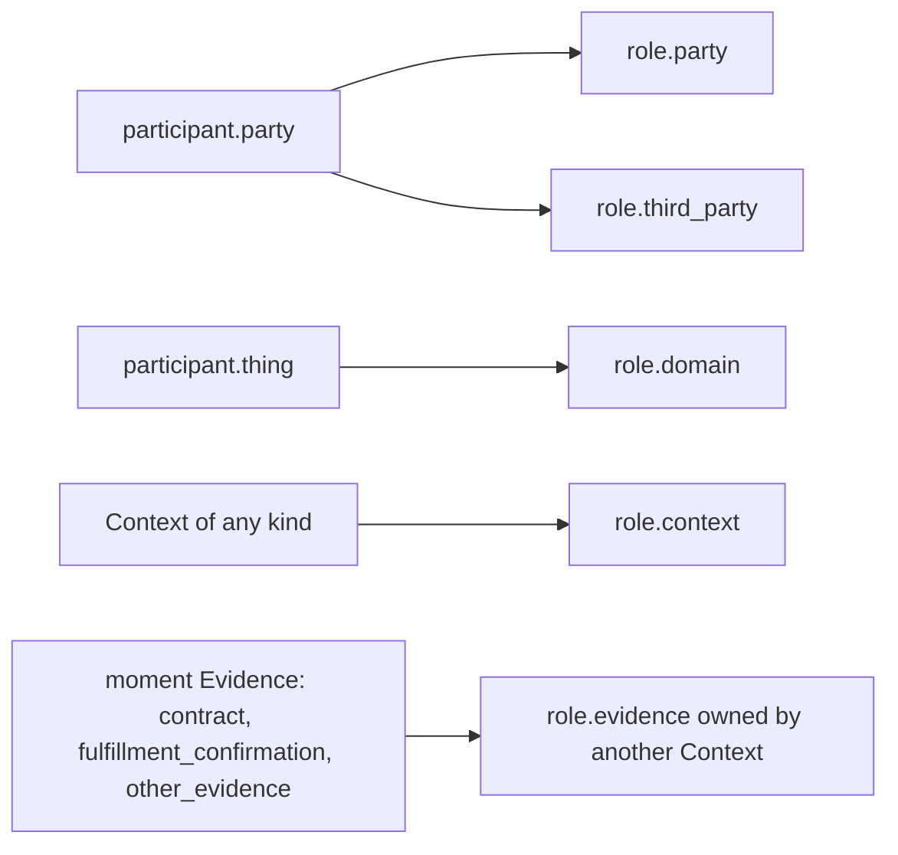

# The Fulfillment Modeling DSL (FM v5)

Fulfillment Modeling describes a business as responsibilities that are claimed
and discharged, not as tables and endpoints. A model is a small graph of
**Contexts**, **Evidence**, **Participants** and **Roles**, joined by two kinds of
relationship and judged by CEL rules.

The model vocabulary is Chinese — the labels a canvas, inspector or review panel
prints are declared beside the ids and are quoted verbatim on this page. This page
is written in English, so a label is always shown as `id` ("Chinese label").

The language is published in three forms that must agree:

- TypeScript types, guards and vocabulary tables in `libs/evidence-schema/src/ast/`;
- JSON Schemas in `libs/evidence-schema/schemas/` (`model`, `entity`,
  `relationship`, `rule`, plus the runtime report schemas);
- `strictValidateDomainModel` in `libs/evidence-schema/src/validation/`, which
  holds every rule that spans more than one object.

The README states the relationship: the types mirror the schemas field for field
and are their executable form (`repo://libs/evidence-schema/README.md#L1-L16`).
Most cross-field constraints are not expressible in JSON Schema, so the validator —
not the schema — is the authority for ownership, responsibility, relationship
endpoints and derivation symmetry.

## One declaration per closed vocabulary

Every closed vocabulary in the language is declared exactly once, as an object
keyed by the id written to disk, with the rest derived from it
(`repo://libs/evidence-schema/src/vocabulary.ts#L1-L61`):

```ts
const KINDS = {
  one: { label: '第一个' },
  two: { label: '第二个' },
} as const satisfies Record<string, { readonly label: string }>;
```

Four helpers read the declaration instead of a second hand-maintained list:
`vocabularyIds` (ordered ids — **declaration order is the reading order**),
`vocabularyLabels` (id → printed label), `vocabularyField` (one field of every
entry, for the tables callers import) and `isVocabularyId` (the guard, derived from
the keys so no validator casts to `string[]`). A type is `keyof typeof
DECLARATION`, so adding a kind flows into the id union, the ordered list, the label
map and every guard at once.

Two copies stay hand-written and must be updated together with a declaration: the
`.json` schemas carry their own `enum` for `category`, `kind` and `domainRole`
(`repo://libs/evidence-schema/schemas/entity.schema.json#L8-L37`), and the prompts
in `libs/evidence-agent-core/src/prompts/` spell the vocabulary out in prose.

| Vocabulary | Owner module | Ids | Read by |
| --- | --- | --- | --- |
| entity categories | `ast/entity.ts` (`ENTITY_CATEGORY_DEFINITIONS`) | `evidence`, `participant`, `role`, `context` | the validator, the inspector registry, the canvas |
| evidence kinds + required time | `ast/entity.ts` (`EVIDENCE_KIND_DEFINITIONS`, `REQUIRED_EVIDENCE_TIME_ATTRIBUTES`) | six, below | validator, lifecycle mapping, canvas colours, inspector select |
| participant kinds | `ast/entity.ts` | `party`, `thing` | validator, inspector select |
| domain component roles | `ast/entity.ts` (`DOMAIN_COMPONENT_ROLE_DEFINITIONS`) | `calculator`, `checker` | validator (`entity.domainRole.thingOnly`, `entity.kind`), `isolate_domain_calculator` operator, draft normalization, domain-naming lint |
| role kinds | `ast/entity.ts` | five, below | validator, inspector select |
| context kinds | `ast/entity.ts` | three, below | validator, inspector select |
| evidence time attributes | `ast/entity.ts` (`EVIDENCE_TIME_ATTRIBUTE_DEFINITIONS`) | `started_at`, `expired_at`, `signed_at`, `confirmed_at`, `created_at` | validator (`attribute.time.notKeyTimestamp`), canvas time badges |
| relationship kinds | `ast/relationship.ts` (`RELATIONSHIP_KIND_DEFINITIONS`) | `plays_role`, `references` | validator, inspector |
| rule kinds + `booleanResult` | `ast/rule.ts` (`RULE_KIND_DEFINITIONS`, `BOOLEAN_RULE_KINDS`) | six, below | validator, derivation symmetry, simulation |
| lifecycle stages | `ast/lifecycle.ts` (`LIFECYCLE_STAGE_DEFINITIONS`) | `rfp`, `proposal`, `contract`, `fulfillment` | canvas swimlane layout |
| workshop steps | `ast/workshop.ts` (`WORKSHOP_STEPS`) | seven, below | desktop `PromptDock`, the agent workflow prompt |
| clause categories + destinations | `ast/clause.ts` (`CLAUSE_CATEGORY_DEFINITIONS`, `CLAUSE_DESTINATION_DEFINITIONS`) | three + three | contract annotator, clause review panel |
| ingestion source kinds | `ast/provenance.ts` (`INGESTION_SOURCE_KIND_DEFINITIONS`) | `contract`, `prd`, `interview`, `blueprint`, `unknown` | draft review panel |
| key data sources | `ast/keyData.ts` (`KEY_DATA_SOURCE_DEFINITIONS`) | eight | key data ledger, sensors, inspector |

The point of the table is ownership: a surface that needs to print a kind label or
enumerate valid kinds imports the module in the owner column. See
[Key data, business time and provenance](./key-data-and-provenance.md) for the key
data vocabulary and the provider decision it encodes.

## Document shape

A document is a manifest plus three flat collections
(`repo://libs/evidence-schema/src/ast/document.ts#L11-L32`):

```jsonc
{
  "manifest": {
    "type": "fm_model",
    "schemaVersion": "5.0",
    "id": "product-procurement-full-lifecycle",
    "name": "商品采购协议完整履约模型",
    "version": "1.1.0",
    "ruleLanguage": "CEL",
    "entryContextRefs": [
      "context.product-sourcing",
      "context.product-procurement",
      "context.product-catalog"
    ]
  },
  "entities": [],
  "relationships": [],
  "rules": []
}
```

The manifest is strict: `type` must be `fm_model`, `schemaVersion` exactly `5.0`,
`ruleLanguage` exactly `CEL`, `version` semver-shaped, `entryContextRefs` a
non-empty unique list whose every id resolves to a Context entity, and
`description` optional but non-empty when present
(`repo://libs/evidence-schema/src/validation/strictValidate.ts#L265-L378`). Any
other manifest field is a `manifest.field` finding — the JSON Schema sets
`additionalProperties: false` for the same reason
(`repo://libs/evidence-schema/schemas/model.schema.json#L1-L40`).

Each collection item must declare its own `type` (`entity`, `relationship`,
`rule`), and a document with zero entities is rejected outright: a model with
nothing in it asserts nothing (`repo://libs/evidence-schema/src/validation/strictValidate.ts#L1857-L1875`).

The in-memory form is `DomainModelDocument`, and `createEmptyDomainModel` /
`EMPTY_MODEL_MANIFEST` are the seeds a new project starts from
(`repo://libs/evidence-schema/src/ast/document.ts#L34-L52`).

## Identifiers and value types

Four grammars keep ids stable and machine-readable
(`repo://libs/evidence-schema/src/ast/id.ts#L1-L20`):

| Kind | Pattern | Example |
| --- | --- | --- |
| domain id | `^[a-z][a-z0-9]*(?:[.-][a-z0-9]+)*$` | `request.payment` |
| attribute name | `^[a-z][a-z0-9]*(?:_[a-z0-9]+)*$` | `confirmed_at` |
| model version | `^[0-9]+\.[0-9]+\.[0-9]+(?:[-+][0-9A-Za-z.-]+)?$` | `1.1.0-rc.1` |
| CEL alias | `^[A-Za-z_][A-Za-z0-9_]*$` | `confirmations` |

Ids are unique **across** entities, relationships and rules, not within each
collection. A duplicate is reported as `id.duplicate` and the second object is not
indexed — so it cannot satisfy any later reference
(`repo://libs/evidence-schema/src/validation/strictValidate.ts#L380-L446`).

`VALUE_TYPES` covers the CEL scalar set plus business conveniences: `bool`, `int`,
`uint`, `double`, `decimal`, `string`, `bytes`, `timestamp`, `duration`, `date`,
`money`, `enum`, `id`, `list`, `map`, `dynamic`
(`repo://libs/evidence-schema/src/ast/values.ts#L1-L19`). Rule bindings use that
same type list, or a reference to a modeled entity with an optional binding
cardinality of `one` or `many`.

## The four entity categories

`ENTITY_CATEGORIES` is the whole ontology: `evidence` ("凭证"), `participant`
("参与方"), `role` ("角色"), `context` ("上下文"). Each category has its own closed
kind vocabulary, and a kind from the wrong category is an `entity.kind` finding
(`repo://libs/evidence-schema/src/ast/entity.ts#L5-L20`,
`repo://libs/evidence-schema/src/validation/strictValidate.ts#L1121-L1193`).

| Category | Kinds | Label |
| --- | --- | --- |
| `evidence` | `rfp`, `proposal`, `contract`, `fulfillment_request`, `fulfillment_confirmation`, `other_evidence` | 询价, 方案, 合同, 履约请求, 履约确认, 其他凭证 |
| `participant` | `party`, `thing` | 参与方, 业务对象 |
| `role` | `party`, `domain`, `third_party`, `context`, `evidence` | 合同角色, 领域角色, 第三方角色, 上下文角色, 凭证角色 |
| `context` | `contract`, `pre_contract`, `domain` | 合同上下文, 前期上下文, 领域上下文 |

Every entity also needs a non-empty `label`, may carry unique non-empty `aliases`,
optional `attributes` and `notes`, and an ingested one may carry `sourceSnippet`
(`repo://libs/evidence-schema/src/validation/strictValidate.ts#L1212-L1238`). A
field outside the entity key set — including a `stage`, which is derived rather
than declared — is an `entity.unknownField` finding
(`repo://libs/evidence-schema/src/validation/strictValidate.ts#L48-L64`).

### Evidence: six kinds, each tied to a business moment

| Kind | Required business time | Context requirement |
| --- | --- | --- |
| `rfp` | `started_at`, `expired_at` | `pre_contract` |
| `proposal` | `started_at`, `expired_at` | `pre_contract` |
| `contract` | `signed_at` | `contract`, and listed in its `rootRefs` |
| `fulfillment_request` | `started_at`, `expired_at` | `contract` |
| `fulfillment_confirmation` | `confirmed_at` | `contract` |
| `other_evidence` | `created_at` | a resolved Context (contract, pre-contract or domain) |

The required-time table is `REQUIRED_EVIDENCE_TIME_ATTRIBUTES`, derived from the
kind declaration (`repo://libs/evidence-schema/src/ast/entity.ts#L32-L80`). Every
attribute whose name is one of the five recognised time names must be declared as a
**required `keyData` timestamp**, and every required time attribute of the kind must
exist — `attribute.time.notKeyTimestamp` and `attribute.time.missing`
(`repo://libs/evidence-schema/src/validation/strictValidate.ts#L447-L631`).

Why so strict: a period and a moment are different claims. Signing happens at an
instant, an offer is valid over a window, and a model that records a window for a
confirmation cannot say when the obligation was discharged.

Every non-contract Evidence must name a `responsibleRoleRef` that resolves to a
Party Role owned by its Context — and, when that Context is a contract Context,
bound by the root contract's `roleRefs`. A pre-contract stage borrows the parties
of its parent Contract, so an enquiry can reuse the buyer role the contract binds
(`repo://libs/evidence-schema/src/validation/strictValidate.ts#L744-L852`).

A Contract is a bilateral agreement, so it is saved together with **exactly two
distinct Party Roles** from its own Context, must itself be the Context's root, and
may only live in a `contract` Context
(`repo://libs/evidence-schema/src/validation/strictValidate.ts#L854-L942`). Actual
players may still be unknown; the two roles are the invariant, not the people.

### Participant: a party outside contexts, a thing inside one — or a domain component

`participant.party` ("参与方") represents a concrete business actor and **must not**
declare `contextRef`: the same buyer participates in many contracts, so pinning it
to one Context would duplicate the entity.

`participant.thing` ("业务对象") is the subject of a trade and must live in a
`domain` Context. A Thing may additionally carry `domainRole`, which says it is not
a traded object at all but the work the domain exists to do
(`repo://libs/evidence-schema/src/validation/strictValidate.ts#L944-L1089`).

### `DOMAIN_COMPONENT_ROLES`: calculator and checker

`DOMAIN_COMPONENT_ROLE_DEFINITIONS` names two roles a Thing can stand for:
`calculator` ("计算器") and `checker` ("检查器")
(`repo://libs/evidence-schema/src/ast/entity.ts#L95-L118`). A pricing band, a
ratio, a tier ladder or an eligibility test is named as a Thing in the Domain
Context instead of becoming a hard-coded number in the Contract, so a rule can own
it.

Two checks keep the field honest: an unknown `domainRole` is an `entity.kind`
finding, and `domainRole` on anything but a `thing` is
`entity.domainRole.thingOnly`. The `isDomainComponent` guard narrows to a Thing
with a domain role (`repo://libs/evidence-schema/src/ast/entity.ts#L303-L331`).

Who writes and reads it:

- the `isolate_domain_calculator` operator creates the Thing with
  `domainRole: intent.calculator.role ?? 'calculator'` inside a Domain Context,
  creating that Context when it is missing
  (`repo://libs/evidence-model-core/src/commands/operators.ts#L552-L601`);
- draft ingestion validates the value against the vocabulary and drops an
  unrecognised one with a note, and the contract reader maps a computing clause to a
  calculator or checker (`repo://libs/evidence-model-core/src/ingestion/readDraftJson.ts#L180-L203`,
  `repo://libs/evidence-model-core/src/ingestion/contractAnnotator.ts#L86-L177`);
- `auditDomainComponentNaming` treats a domain Thing or a `role.domain` as the
  actor whose name must be a capability, not an algorithm
  (`repo://libs/evidence-model-core/src/validation/lintRules.ts#L93-L142`).

The inspector registry's participant group exposes only `kind` and `contextRef`, so
`domainRole` is set by operators and ingestion, not by the property grid
(`repo://libs/evidence-schema/src/inspector/registry.ts#L168-L190`).

### Role: responsibility, never a player

`role.party`, `role.domain`, `role.third_party`, `role.context` and `role.evidence`
describe what a participant or an object may act as. A Role must belong to a
Context and must **not** carry `responsibleRoleRef` or `roleRefs` — those are
Evidence responsibility fields, and letting a Role declare them would create a
second responsibility chain (`repo://libs/evidence-schema/src/ast/entity.ts#L201-L230`,
`repo://libs/evidence-schema/src/validation/strictValidate.ts#L944-L1089`).

An `role.evidence` socket is where a contract depends on an outcome it does not own.
It has no instance and no responsible party of its own; it may declare the
attributes a player must supply, and a rule may bind the Role and read those
attributes. The fixture's `role.payment-proof` plays exactly this part: the WeChat
charge confirmation in another Context plays it, and `rule.payment-completed` binds
both the request, the confirmations and the proof role
(`repo://libs/evidence-schema/tests/fixtures/product-procurement/entities/role-evidence--payment-proof.json#L1-L20`,
`repo://libs/evidence-schema/tests/fixtures/product-procurement/rules/rule--payment-completed.json#L1-L24`).

### Context: contract, pre-contract or domain

A Context must not have `contextRef`; it may have `parentContextRef` (which must
resolve to a Context), and `contract` / `domain` contexts must declare `rootRefs`
with real content. A Contract Context has exactly one root, and it must be an
`evidence.contract` owned by that Context; every root id must be owned by the
Context that lists it. Parent chains may not cycle
(`repo://libs/evidence-schema/src/validation/strictValidate.ts#L633-L742`,
`repo://libs/evidence-schema/src/validation/strictValidate.ts#L1091-L1119`).

## Attributes

An attribute is the unit of business meaning:

```jsonc
{
  "name": "confirmed_at",
  "label": "确认时间",
  "meaning": "卖方确认收款到账时的业务时间。",
  "valueType": "timestamp",
  "required": true,
  "keyData": true
}
```

`name` must be lower snake_case and unique inside the entity; `label` and `meaning`
are mandatory non-empty strings; `valueType`, when present, must be one of the
declared types; `required` and `keyData` must be booleans
(`repo://libs/evidence-schema/src/ast/entity.ts#L168-L196`,
`repo://libs/evidence-schema/src/validation/strictValidate.ts#L447-L631`).

`keyData` is the flag the key data ledger and sensors read: amounts, deadlines,
quantities and time differences must name who provides the value. That vocabulary
and its consequences live on
[Key data, business time and provenance](./key-data-and-provenance.md).

`derivedByRuleRef` is the pointer from an attribute to the derivation that computes
it. It must resolve to a rule, and — enforced in both directions — that rule must
be a `derivation` whose `target` is exactly this entity and attribute, in the same
Context (`repo://libs/evidence-schema/src/validation/strictValidate.ts#L1791-L1847`).
The symmetry is the point: an attribute cannot claim a formula, and a formula
cannot write an attribute that does not point back.

## Relationships

Only two kinds exist: `plays_role` ("扮演角色（Plays Role）") and `references`
("引用（References）"). A relationship needs a `label`, both endpoint refs, and
optional `sourceCardinality` / `targetCardinality`
(`repo://libs/evidence-schema/src/ast/relationship.ts#L1-L59`).

Both endpoints must resolve, and self-relationships are refused. Contract-to-
Contract connections are refused outright, before the kind is even considered: a
chain of contracts is not a responsibility, it is a missing Context
(`repo://libs/evidence-schema/src/validation/strictValidate.ts#L1357-L1420`).

Cardinality is optional but validated when present: `min ≥ 0`, `max` a positive
integer or `"many"`, and `min ≤ max`.

### `plays_role` is direction-checked



The five `plays_role` socket pairs the validator accepts; every other combination is
`relationship.playsRole.endpoints`.

Three built-in pairs are listed in `PLAYS_ROLE_PAIRS`, and two more cases are added
in `isPlaysRolePair` (`repo://libs/evidence-schema/src/validation/strictValidate.ts#L1305-L1355`):

- `participant.party` → `role.party`
- `participant.party` → `role.third_party`
- `participant.thing` → `role.domain`
- any Context → `role.context` (an external Context playing a Context Role)
- a **moment** Evidence → `role.evidence`

"Moments" is a fixed set: `fulfillment_confirmation`, `other_evidence` and
`contract` (`MOMENT_EVIDENCE_KINDS`). Only a settled result can stand behind an
Evidence Role; an obligation that is still running has discharged nothing. A
window kind — `rfp`, `proposal` or `fulfillment_request` — aimed at a
`role.evidence` is rejected with its own finding,
`relationship.playsRole.momentOnly`, and the message names the source kind
(`repo://libs/evidence-schema/src/validation/strictValidate.ts#L1313-L1470`).

A moment playing an Evidence Role must also come from **another** Context: the Role
is the socket, and the player is the implementation behind it. Same-Context play is
still `relationship.playsRole.endpoints`.

The validator's moment set is declared privately in `strictValidate.ts`. The
exported `isEvidenceMoment` helper is narrower — confirmation and other_evidence
only, no contract — so the two are not interchangeable
(`repo://libs/evidence-schema/src/ast/entity.ts#L287-L293`).

### `references` is cross-context only by whitelist

Same-context references are ordinary. Crossing a Context boundary is allowed only
for (`repo://libs/evidence-schema/src/validation/strictValidate.ts#L1470-L1547`):

1. a Contract referencing a Proposal, where the Proposal's Context declares the
   Contract's Context as its `parentContextRef`;
2. Evidence referencing a Thing;
3. Evidence referencing a confirmation or `other_evidence`.

Everything else is `relationship.references.crossContext`. Note the third case: an
Evidence Role is a legal reference **target** in the same Context
(`relationship.references.endpoints` allows a Thing, an Evidence or a
`role.evidence`), but a cross-context `references` to a `role.evidence` is not on
the whitelist. Binding an outside contract's outcome is what `plays_role` is for.

Both endpoints must be entity records (`type: "entity"`); a rule or a relationship
cannot be referenced.

## Rules are CEL, and their kind decides their shape

`RULE_KIND_DEFINITIONS` is `derivation`, `precondition`, `invariant`,
`eligibility`, `completion`, `breach` — 派生规则（Derivation）, 前置条件
（Precondition）, 不变量（Invariant）, 资格判定（Eligibility）, 完成判定
（Completion）, 违约判定（Breach）. Each entry carries `booleanResult` beside the
label, and `BOOLEAN_RULE_KINDS` is a filter over that declaration, so the
result-type requirement is read off the kind instead of a second list
(`repo://libs/evidence-schema/src/ast/rule.ts#L8-L45`).

The shape rules (`repo://libs/evidence-schema/src/validation/strictValidate.ts#L1549-L1688`):

- every kind except `derivation` requires `resultType: "bool"`;
- `resultType`, when present, must be a declared value type;
- a `derivation` **must** declare a `target` (`entityRef` + `attribute`); any other
  kind **must not**, and a target may not carry extra keys;
- `label`, `description` and `expression` must be non-empty, and `contextRef` must
  resolve to a Context;
- `bindings` must be an object (empty is legal), each alias must be a CEL
  identifier, and each binding is either `{ ref, cardinality? }` or `{ type }`.

Reference resolution then checks that every binding `ref` names an existing entity,
and that a derivation's target entity actually has the target attribute
(`rule.target.unresolved`), is pointed back to by that attribute
(`rule.derivation.mismatch`), and sits in the rule's own Context
(`rule.derivation.context`).

The fixture's payment completion rule uses all three parts — a request binding, a
many-cardinality confirmation binding, and a many-cardinality binding to an
Evidence Role whose attributes the expression reads:

```jsonc
{
  "type": "rule",
  "id": "rule.payment-completed",
  "kind": "completion",
  "label": "支付履约完成判断",
  "description": "同一支付申请存在有效期内的支付确认，且外部支付凭证与申请、确认的编号、金额和时间一致时，支付履约完成。",
  "contextRef": "context.product-procurement",
  "bindings": {
    "request": { "ref": "request.payment" },
    "confirmations": { "ref": "confirmation.payment", "cardinality": "many" },
    "proofs": { "ref": "role.payment-proof", "cardinality": "many" }
  },
  "expression": "confirmations.exists(c, c.request_number == request.request_number && c.confirmed_at >= request.started_at && c.confirmed_at <= request.expired_at && proofs.exists(p, p.request_number == request.request_number && p.payment_number == c.payment_number && p.confirmed_at <= c.confirmed_at && p.paid_minor_units == request.requested_minor_units && c.paid_minor_units == p.paid_minor_units))",
  "resultType": "bool"
}
```

The static validator checks that every binding ref exists. It does **not** parse or
evaluate the expression — that is the CEL pass in `evidence-model-core`, described
in [The native check and simulation pipeline](../model/checks-and-simulation.md).

## `LIFECYCLE_STAGE_DEFINITIONS`: a derived stage, never a field

`libs/evidence-schema/src/ast/lifecycle.ts` owns the four moments an 8X Flow
workshop reads a model through, in reading order
(`repo://libs/evidence-schema/src/ast/lifecycle.ts#L13-L83`):

| Stage | Label | Caption | English |
| --- | --- | --- | --- |
| `rfp` | 邀请投标 | 时段：询价、比价、方案征询 | Request for Proposal |
| `proposal` | 投标 | 时段：报价、方案、套餐 | Proposal |
| `contract` | 合同签约 | 时刻：签署生效，权责成立 | Contract |
| `fulfillment` | 履约履行 | 请求是时段，确认是时刻 | Fulfillment |

The stage is **not** a declared model field: `stage` is not in the entity key set,
so writing one on a Context is an unknown-field finding. It is computed instead:

- `lifecycleStageOf(entity)` maps an evidence kind to its stage and returns `null`
  for Participants, Roles and `other_evidence`;
- `lifecycleStageOfContext(context, members)` makes a contract Context the hinge,
  reads a domain Context as `fulfillment`, and takes the **furthest** stage among a
  pre-contract Context's own evidence, defaulting to `rfp`;
- `LIFECYCLE_STAGE_ORDER` is the declaration order and `lifecycleStageRank` turns
  it into a comparable number
  (`repo://libs/evidence-schema/src/ast/lifecycle.ts#L94-L163`).

Why derived: the stage of a Context is a fact about the evidence it holds. A
pre-contract Context that has only an enquiry sits in `rfp` and one that also holds a
quote moves to `proposal`, without anyone editing a field. `other_evidence` has no
stage because a receipt may accompany any moment, so it inherits its Context's lane.

The reader is the canvas: `lifecycleSwimlaneLayout` iterates `LIFECYCLE_STAGES` and
prints `LIFECYCLE_STAGE_LABELS`, `LIFECYCLE_STAGE_CAPTIONS` and
`LIFECYCLE_STAGE_ENGLISH_LABELS` as the lane header
(`repo://libs/evidence-canvas-interaction/src/layout/lifecycleSwimlaneLayout.ts#L150-L210`).
The stage order, the null cases and the furthest-stage rule are pinned by
`lifecycle.spec.ts` (`repo://libs/evidence-schema/src/ast/lifecycle.spec.ts#L28-L129`).
For lane geometry and subtree behaviour see
[Canvas layout, viewport and inspector](../desktop/canvas-and-inspector.md).

## `WORKSHOP_STEPS`: the method's order, not model state

`libs/evidence-schema/src/ast/workshop.ts` owns the seven moves a modeling workshop
walks (`repo://libs/evidence-schema/src/ast/workshop.ts#L1-L83`):

| Rank | `id` | Label |
| --- | --- | --- |
| 1 | `anchor-contract` | 锚定合约与双方 |
| 2 | `pair-fulfillment` | 成对挖掘履约项 |
| 3 | `name-things` | 补上标的物与领域组件 |
| 4 | `invert-dependency` | 反转易变依赖 |
| 5 | `close-breach` | 给违约一条补偿路径 |
| 6 | `trace-key-data` | 让每个数字有来源 |
| 7 | `connect-flow` | 串起业务宏流程 |

Nothing on disk records a step: the module exists so the desktop chips, the workflow
prompt and the operator prompts name the same seven moves in the same order
(`repo://libs/evidence-model-core/src/prompts/workflow.ts#L1-L20`). The module also
provides `isWorkshopStepId`, `workshopStepRank` (one-based) and
`workshopStepFocus`, which renders `【第 N 步 · label】` and returns an empty string
for an unknown id, plus `REVERSE_CONTRACT_MODE` ("无合同逆推") for a session that
starts from receipts rather than an agreement
(`repo://libs/evidence-schema/src/ast/workshop.ts#L54-L100`).

The desktop composer is the reader: `PromptDock` renders one chip per step and
prefixes the message with the focus string
(`repo://apps/desktop/src/renderer/components/agent/PromptDock.tsx#L101-L150`). The
prompt protocol and the full step table live on
[The modeling method as code](../agents/modeling-method.md); this page only records
that the vocabulary is owned by the language package, because a step is a reading
order and not an entity category.

## `CLAUSE_CATEGORIES`: how an agreement is split before modelling

`libs/evidence-schema/src/ast/clause.ts` owns the three readings any real agreement
must be split into, each with a label, an English label, a hint and a destination
(`repo://libs/evidence-schema/src/ast/clause.ts#L1-L135`):

| `id` | Label | Hint | Destination |
| --- | --- | --- | --- |
| `business` | 业务逻辑 | 谁在什么时刻向谁交付什么，决定盈利与成本 | `evidence` ("业务凭证") |
| `domain` | 领域逻辑 | 计价、折算、校验等能写成规则的算法 | `domain-thing` ("领域对象") |
| `boilerplate` | 纯法务条款 | 管辖、免责、送达等不由系统承载的条款 | `none` ("不进模型") |

`CLAUSE_DESTINATION_DEFINITIONS` keeps the destination inside the vocabulary so a
review panel cannot invent a fourth place to put a sentence it does not understand.
`countClausesByCategory` summarises a reading.

The readers are the contract annotator and the review UI: `annotateContractClauses`
classifies each sentence — boilerplate first, then an action verb, then a formula —
and reports, rather than fabricates, the ones it cannot place
(`repo://libs/evidence-model-core/src/ingestion/contractAnnotator.ts#L110-L165`),
while `ClauseSplit` prints per-category counts with `CLAUSE_CATEGORY_LABELS`
(`repo://apps/desktop/src/renderer/components/ingestion/ClauseSplit.tsx#L1-L45`).
The review flow itself is documented in
[Ingestion and patch review](../desktop/ingestion-and-patch-review.md).

## Provenance

`sourceSnippet` is optional on every **entity** and carries the verbatim sentence an
ingested element came from, plus a human-readable locator and the input kind
(`INGESTION_SOURCE_KINDS`: `contract`, `prd`, `interview`, `blueprint`, `unknown`)
(`repo://libs/evidence-schema/src/ast/provenance.ts#L17-L54`). Hand-written models
may omit it; ingested ones keep it so a reviewer can re-read the clause instead of
trusting the extraction.

It is part of the entity key set only — the attribute, relationship and rule key
sets do not include it, so attaching a snippet anywhere else is an unknown-field
finding (`repo://libs/evidence-schema/src/validation/strictValidate.ts#L48-L102`).

## What the static validator deliberately does not do

`strictValidateDomainModel` owns document shape, identifier grammar, category/kind
contracts, reference resolution, context ownership, relationship endpoints and
derivation symmetry. Traceability, key-data providers, scope completeness and CEL
evaluation are separate passes in `evidence-model-core`, not re-implemented here
(`repo://libs/evidence-schema/src/validation/strictValidate.ts#L1849-L1856`).

That boundary is why a model can be **structurally valid** and still fail a check:
structure is necessary, not sufficient. Findings carry a stable `ValidationCode`,
a JSON-pointer-like path and the owning `objectId`, are deduplicated by
code/path/message, and `assertValidDomainModel` throws `DomainModelValidationError`
instead of returning them
(`repo://libs/evidence-schema/src/validation/errors.ts#L1-L134`).

## What the language forbids, in one list

Every row is enforced by `strictValidateDomainModel`; the middle column is the
finding code.

| Forbidden | Code | Why |
| --- | --- | --- |
| a document with no entities | `document.shape` | a model that asserts nothing is not a model |
| a field outside the manifest, entity, attribute, relationship or rule shape (including `stage` on a Context) | `manifest.field`, `entity.unknownField`, `attribute.shape`; malformed or duplicate aliases are `entity.shape` | a typo must be a finding, not silently ignored data |
| duplicate ids across the three collections | `id.duplicate` | references must be unambiguous |
| a duplicate attribute name inside one entity | `attribute.duplicate` | one name, one meaning |
| a kind outside its category's vocabulary, or an unknown `domainRole` | `entity.kind` | the kind vocabularies are closed |
| an entity without a non-empty `label` | `label.missing` | every object needs a business name |
| `contextRef` on a Context, or on a `participant.party` | `entity.contextRef.forbidden`, `entity.participantParty.contextRef` | ownership belongs to objects, not to parties that span contexts |
| `domainRole` on anything but a Thing | `entity.domainRole.thingOnly` | a component is a Thing in a Domain Context |
| a Thing outside a domain Context | `entity.evidenceContext.kind` | the subject of trade is not an obligation |
| `rfp` / `proposal` outside a pre-contract Context | `entity.evidenceContext.kind` | the phase is part of the claim |
| `fulfillment_request` / `fulfillment_confirmation` outside a contract Context | `entity.evidenceContext.kind` | obligations arise from a contract |
| an evidence kind missing its required time attribute | `attribute.time.missing` | the kind cannot be modeled without its clock |
| a recognised time attribute that is not a required `keyData` timestamp | `attribute.time.notKeyTimestamp` | a period and a moment are different claims |
| a non-contract Evidence without a responsible Party Role, or one owned by another Context, or not bound by the root contract | `entity.responsibleRole.*` | every obligation has an owner |
| a Contract outside a Contract Context, not in its `rootRefs`, or without exactly two distinct Party Roles from that Context | `entity.evidenceContext.kind`, `entity.contract.rootMissing`, `entity.roleRefs.*` | a contract is bilateral |
| a Contract Context whose `rootRefs` are empty, are not exactly one Contract, or list a foreign object | `entity.contextRoots.*` | the hinge of a Context must be its own contract |
| a Role declaring `responsibleRoleRef` or `roleRefs` | `entity.roleResponsibility.forbidden` | responsibility has one chain |
| a Context parent chain that cycles | `entity.parentContextRef.cycle` | the graph would be unbounded |
| a self relationship | `relationship.self` | a thing does not play itself |
| Contract → Contract | `relationship.contractPair` | responsibility is not a contract chain |
| `plays_role` between wrong kinds or in the wrong direction | `relationship.playsRole.endpoints` | roles are sockets, players are implementations |
| a window kind (`rfp`, `proposal`, `fulfillment_request`) playing an Evidence Role | `relationship.playsRole.momentOnly` | an undischarged obligation settles nothing |
| a moment Evidence playing an Evidence Role owned by its own Context | `relationship.playsRole.endpoints` | the socket must be filled from outside |
| a `references` endpoint that is not an entity, or a cross-context hop outside the whitelist | `relationship.references.endpoints`, `relationship.references.crossContext` | references follow ownership |
| `derivedByRuleRef` without the matching rule target, or in another Context | `attribute.derivedByRuleRef.unresolved`, `rule.derivation.mismatch`, `rule.derivation.context` | a formula must be traceable both ways |
| a `derivation` without a target, or a target on another kind | `rule.target.required`, `rule.target.forbidden` | only derivations write values |
| a decision rule whose `resultType` is not `bool` | `rule.resultType` | a decision must decide |
| a binding alias that is not a CEL identifier, or a binding that is neither ref nor type | `rule.shape` | the expression could not resolve it |
| a rule without a Context, or a binding ref that does not resolve | `rule.contextRef.unresolved`, `rule.binding.unresolved` | a rule is about a Context, not about the file |

## Tests that protect this contract

`strictValidate.spec.ts` mutates clones of
`libs/evidence-schema/tests/fixtures/product-procurement/` rather than editing
fixtures, so each rule is exercised against a real model and the fixture stays a
stable snapshot (`repo://libs/evidence-schema/README.md#L18-L24`). Its describes
follow the validator's own sections — document shape, manifest, identifiers,
attributes, contexts, responsibility, evidence contexts, domain components,
relationships, rules — and each case asserts one finding code
(`repo://libs/evidence-schema/src/validation/strictValidate.spec.ts#L68-L107`).

The vocabulary modules carry their own specs: `entity.spec.ts` pins the kind lists
and the domain-component guards, `lifecycle.spec.ts` the stage derivation,
`workshop.spec.ts` the seven steps, ranks and prefix strings, and `clause.spec.ts`
the clause buckets.

## Related pages

- [Key data, business time and provenance](./key-data-and-provenance.md) — the
  vocabulary behind `keyData` and the provider decision.
- [The native check and simulation pipeline](../model/checks-and-simulation.md) —
  the passes that run after structural validation.
- [Source tree and bundle adapters](../model/source-formats.md) — how a document is
  stored.
- [Canvas layout, viewport and inspector](../desktop/canvas-and-inspector.md) — how
  these categories are drawn, and how the derived stage becomes swimlanes.
- [The modeling method as code](../agents/modeling-method.md) — the seven workshop
  steps and the prompt protocol built on them.
- [Ingestion and patch review](../desktop/ingestion-and-patch-review.md) — how a
  contract is read into clause categories and then into a draft.
