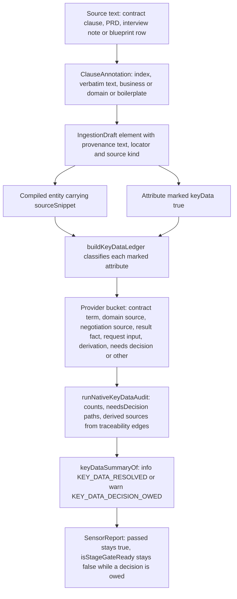
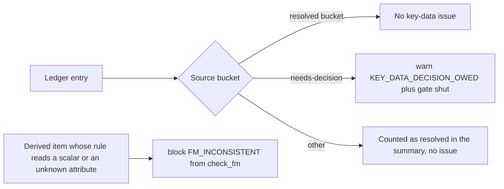

# Key data and provenance

The modeling method's first red line is simple to state and hard to satisfy: **a
number without a provider is not a fact**
(`repo://libs/evidence-agent/src/prompts/modeling.ts#L1-L20`). Amounts, deadlines,
quantities and time differences are not inputs a caller may supply; they are
established by a contract term, a domain object, an upstream evidence attribute, a
recorded result fact, or a derivation over those.

Four mechanisms carry that rule in code: a shared classification vocabulary, a
ledger that inventories every marked item, attribute-level lineage that proves a
formula only reads modeled values, and provenance snippets that say which sentence
an element was read from.

## What counts as a key datum

A key datum is exactly an attribute with `keyData: true`. `buildKeyDataLedger`
skips everything else
(`repo://libs/evidence-model-core/src/keyData/keyDataLedger.ts#L78-L142`), and the
ledger spec pins that exclusion
(`repo://libs/evidence-model-core/src/keyData/keyDataLedger.spec.ts#L148-L160`).

That makes the flag, not the attribute's meaning, the gate. Nothing in
`strictValidate` forces an amount-like attribute to carry it; the discipline lives
in the modeling prompt and in the inspector helper text ("金额、期限、数量、时间差必须
标记为关键数据"). Two consequences a reader should keep in mind:

- A model can be structurally valid, gate-ready and still contain an unmarked
  price. No checker looks at it.
- The sanctioned way to leave the ledger is to withdraw the claim: the inline
  picker's `并非关键数据` button patches `keyData: false` through one undoable
  `UpdateAttributeCommand`
  (`repo://libs/desktop/feature-inspector/src/inspector/KeyDataProvenancePicker.tsx#L88-L116`).

## The classification vocabulary

`KEY_DATA_SOURCE_DEFINITIONS` is the single authority behind the ledger: each entry
carries the label a picker prints and a `resolved` flag, and
`KEY_DATA_SOURCE_KINDS`, `KEY_DATA_SOURCE_LABELS` and `RESOLVED_KEY_DATA_SOURCES`
are all derived from that one declaration, so the resolved set is a filter rather
than a second list that can drift
(`repo://libs/evidence-schema/src/ast/keyData.ts#L8-L71`).

| Kind | Label | `resolved` | How it is established |
| --- | --- | --- | --- |
| `derived` | 派生规则（Derived） | yes | a derivation rule targets this attribute |
| `contract-term` | 合同参数（Contract Term） | yes | a `contract` attribute |
| `domain-source` | 领域对象（Domain Source） | yes | a `thing` participant's attribute |
| `negotiation-source` | 协商来源（Negotiation Source） | yes | an `rfp` or `proposal` attribute |
| `result-fact` | 结果事实（Result Fact） | yes | a `fulfillment_confirmation` or `other_evidence` attribute |
| `request-input` | 请求形成事实（Request Input） | yes | a request attribute the requester records |
| `needs-decision` | 待决（Decision Owed） | no | a request attribute the vocabulary does not recognise |
| `other` | 未归类（Other） | no | any other category, e.g. a role or context attribute |

`classifyKeyDataSource` is a pure function of the entity's `category`/`kind` and the
attribute's `name`/`derivedByRuleRef`, evaluated in this order
(`repo://libs/evidence-schema/src/ast/keyData.ts#L100-L143`):

```text
derivedByRuleRef present              → derived
evidence.contract                     → contract-term
participant.thing                     → domain-source
evidence.rfp | evidence.proposal      → negotiation-source
evidence.fulfillment_confirmation
  | evidence.other_evidence           → result-fact
evidence.fulfillment_request          → request-input if name ∈ REQUEST_FORMATION_FIELDS
                                        else needs-decision
everything else                       → other
```

The request-formation whitelist is deliberately small: `started_at`,
`request_number`, `delivery_address`, `return_address`, `fault_description`,
`asset_code`, `billing_period`, `settlement_period`
(`repo://libs/evidence-schema/src/ast/keyData.ts#L73-L85`). A request attribute
outside it owes a decision until the business names a provider.

Two helpers turn the table into policy: `isKeyDataDecisionOwed` is true only for
`needs-decision`, while `isKeyDataResolved` accepts every kind except
`needs-decision` and `other`
(`repo://libs/evidence-schema/src/ast/keyData.ts#L92-L98`). The vocabulary also
declares the four providers a human may pick in the inspector —
`contract-term`, `result-fact`, `derived`, `request-input`
(`repo://libs/evidence-schema/src/ast/keyData.ts#L145-L157`).

### The classification is syntactic, not semantic

The classifier reads kinds and names, not meanings:

- A contract attribute is `contract-term` even if the business actually computes
  it — unless a `derivedByRuleRef` is present, which wins first.
- A request attribute inside the whitelist is `request-input` even if its value is
  negotiated; one outside it is `needs-decision` even if the interview already
  settled it.
- An attribute on a role or context entity lands in `other`, which is the one
  bucket that is neither resolved nor owed. `keyDataSummaryOf` computes
  `resolvedCount` as total items minus the owed list, so an `other` item is
  reported as resolved and produces no issue at all
  (`repo://libs/evidence-agent/src/sensors/sensorReport.ts#L263-L302`). Marking a
  role attribute `keyData` buys a row in the ledger and no check behind it.

The most visible interaction with the time rules is `expired_at`. A
`fulfillment_request` must model `started_at` and `expired_at`, but only
`started_at` appears in `REQUEST_FORMATION_FIELDS`; the mandated deadline therefore
owes a decision until a derivation supplies it. The golden fixture shows both sides
of that: `request.content-access#expired_at` is the audit's single owed item while
`request.content-payment#expired_at` is `derived` by `rule.payment-deadline`
(`repo://libs/evidence-agent/src/sensors/native/nativeSensors.spec.ts#L58-L100`).

## Two consumers of one ledger

The same `buildKeyDataLedger(document)` output feeds the inspector a modeler edits
and the native audit that grades the model. Because classification is pure over the
document, the badge in the attribute table and the saved report cannot disagree.



The chain from a source sentence to a graded key datum: provenance stays on the
element, the provider is derived from the model, and only the audit decides whether
the item is accepted.

### The inspector: the sheet and the inline picker

`KeyDataLedgerSheet` recomputes the ledger from the live session document and shows
one row per attribute of the selected entity, with editable data type, required
flag, the key-data badge and the rule expression; the header states `N 项台账待决`
or `台账已闭合` before anyone reads a row, and the formula bar commits an expression
through `UpdateRuleCommand`
(`repo://libs/desktop/feature-inspector/src/inspector/KeyDataLedgerSheet.tsx#L36-L90`,
`repo://libs/desktop/feature-inspector/src/inspector/KeyDataLedgerSheet.tsx#L110-L140`).
Escape is handled in the capture phase so closing the wide sheet does not also
clear the selection behind it.

The attribute grid shows the compact version — `关键数据 N 项 · 待决 M 项` — and
expands a row into `KeyDataProvenancePicker`
(`repo://libs/desktop/feature-inspector/src/inspector/AttributeDataGrid.tsx#L76-L100`,
`repo://libs/desktop/feature-inspector/src/inspector/AttributeDataGrid.tsx#L252-L266`).
The picker prints `KEY_DATA_SOURCE_LABELS[source]` from the ledger entry, lists each
derivation provider as `alias → modeled label` (or `alias → 运行时 <valueType>` for a
scalar binding), and offers two actions: bind a derivation rule, or retract the
key-data claim. **Nothing about the source is persisted**: the provider is a
consequence of the modeled facts, so changing it means changing the model or
withdrawing the claim
(`repo://libs/desktop/feature-inspector/src/inspector/KeyDataProvenancePicker.tsx#L36-L52`).

### The native audit and the sensor report

`runNativeKeyDataAudit(model, traceability)` builds the ledger, prints only the
buckets that occur, lists owed items as `entity#attribute` paths with `contextRef`,
`meaning` and `valueType`, and pairs every derived item with the attributes its rule
reads by scanning traceability edges. The report keeps a stable shape
(`checkVersion: 1`, `valid: true`, a fixed note saying `needsDecision` is a decision
list rather than an error) because a saved report is compared with a fresh one
(`repo://libs/evidence-agent/src/sensors/native/nativeKeyDataAudit.ts#L12-L67`).

`keyDataSummaryOf` then folds that report into `totalItems`, `resolvedCount`,
`decisionOwedCount` and an unresolved list capped at `MAX_KEY_DATA` (40), and emits
`info KEY_DATA_RESOLVED` when nothing is owed or one `warn
KEY_DATA_DECISION_OWED` per owed path, with `targetNodeId` set to the path, a
`contextRef` and a remedy suggestion
(`repo://libs/evidence-agent/src/sensors/sensorReport.ts#L255-L302`).

Severity and gate readiness are deliberately different questions:

- `passed` and `blockCount` count `block` findings only, so an owed decision leaves
  the model consistent — `passed: true`, `warnCount` at least 1.
- `isStageGateReady` in `finalizeSensorReport` requires a passed stage gate, **zero**
  owed decisions, zero blocks and a clean API summary
  (`repo://libs/evidence-agent/src/sensors/sensorReport.ts#L313-L360`). One orphan
  amount is therefore enough to keep a model out of API design even though nothing
  blocked it.

The `run_sensors` tool surfaces exactly that pair to the agent — `passed`,
`isStageGateReady`, counts and `decisionOwed: report.keyDataSummary.decisionOwedCount`
(`repo://libs/evidence-agent/src/tools/evidenceTools.ts#L172-L195`), which is why the
workflow prompt names ledger decisions as a warning that must be closed before
handing off.

### Where a decision blocks instead of warning

Owed provider decisions are the only key-data outcome that stays a warning. A
derived key datum whose formula cannot be traced is a static error: the lineage
errors are folded into the FM check's error list
(`repo://libs/evidence-model-core/src/validation/fmCheck.ts#L175-L190`), so they
arrive as `block` `FM_INCONSISTENT` findings from `check_fm`, not as
`audit_key_data` warnings.



The two chains answer different questions: the bucket asks *who provides this
number*, lineage asks *what does the formula read*. A model can pass one and fail
the other.

## Business time is a required key-data timestamp

Every evidence kind declares the business clock it cannot be modeled without:
`rfp`, `proposal` and `fulfillment_request` need `started_at` and `expired_at`; a
`contract` needs `signed_at`; a `fulfillment_confirmation` needs `confirmed_at`;
`other_evidence` needs `created_at`
(`repo://libs/evidence-schema/src/ast/entity.ts#L28-L84`).

Each of those names, wherever it appears, must be declared as a **required
`keyData` `timestamp`**: the strict validator reports
`attribute.time.notKeyTimestamp` when type, requiredness or the key-data flag is
wrong, and `attribute.time.missing` when a kind's mandated attribute is absent
(`repo://libs/evidence-schema/src/validation/strictValidate.ts#L576-L630`). The
JSON schema encodes the same conditional on the attribute name
(`repo://libs/evidence-schema/schemas/entity.schema.json#L60-L100`).

The distinction is substantive, not cosmetic: a request records a window in which a
delivery was asked for, a confirmation records the instant an obligation was
discharged. Recording a confirmation as an interval would let a model avoid saying
when it happened, and time differences between moments are exactly the amounts the
ledger exists to police.

## Lineage: a formula may only read modeled values

`analyzeTraceability` walks every rule expression and records which modeled
attribute each read comes from
(`repo://libs/evidence-model-core/src/validation/traceability.ts#L15-L25`). Its
checks are the second half of the "no hidden formula" rule
(`repo://libs/evidence-model-core/src/validation/traceability.ts#L392-L470`):

| Check | Failure |
| --- | --- |
| a `many` binding must be read through a CEL macro (`all`, `exists`, `exists_one`, `filter`, `map`) | `<rule>: many binding '…' must be accessed through a CEL collection macro` |
| a macro may only iterate a `many` binding | `<rule>: CEL macro '…' iterates binding '…', which must declare cardinality: many` |
| an entity binding must be indexed by a static string | `<rule>: Entity binding '…' must use a static string attribute index for traceability` |
| every read must name a declared attribute | `<rule>: CEL binding '…' reads unknown attribute 'entity#attribute'` |
| the binding's `ref` must be the entity being read | `<rule>: attribute access '…' does not match binding '…'` |
| only one derivation may target an attribute | `entity#attribute: multiple derivation Rules target this attribute` |
| a derivation target must be declared back by `derivedByRuleRef` | `entity#attribute: derivation Rule '…' must be declared by derivedByRuleRef` |
| lineage may not cycle | `attribute lineage cycle: …` |

Two checks exist specifically for key data
(`repo://libs/evidence-model-core/src/validation/traceability.ts#L511-L540`):

- a **key** derived attribute must trace to at least one modeled Entity attribute;
- a key derivation may not use a scalar (`type`-only) binding the expression actually
  reads: `key derivation scalar inputs [...] must be modeled as Entity attributes`.

That is what stops a formula like `amount * 0.13` from hiding a tax rate in an
unmodeled constant. The scalar binding may exist in the rule — it simply shows up as
a runtime provider in the inspector — but if the expression reads it, the model is
refused.

The output is a `TraceabilityDocument` of nodes (`entity#attribute`), edges
(`source → target` through a rule) and constraints (non-derivation rules and the
attributes they read)
(`repo://libs/evidence-model-core/src/validation/traceability.ts#L34-L70`), which is
also what lets `runNativeKeyDataAudit` name each derived item's sources instead of
just its rule.

## Provenance: where a claim came from

Provenance is recorded on the **element**, never on the attribute. `EntityBase`
carries an optional `sourceSnippet`
(`repo://libs/evidence-schema/src/ast/entity.ts#L186-L200`), and a snippet is a
verbatim sentence plus a human-readable locator and the input form it came from —
`contract`, `prd`, `interview`, `blueprint` or `unknown`
(`repo://libs/evidence-schema/src/ast/provenance.ts#L8-L54`). `DraftAttribute` has no
provenance field at all, so a key datum inherits its carrier entity's sentence
(`repo://libs/evidence-schema/src/ingestion/draft.ts#L83-L113`).

The ingestion path keeps that link end to end:

1. A reader (`contractReader`, `textExtractor`, `blueprintParser`) or a person
   filling a review panel produces an `IngestionDraft` whose elements carry
   `provenance` — the ingestion prompt requires the verbatim sentence and a
   `第 N 句` locator for every element
   (`repo://libs/evidence-agent/src/prompts/ingestion.ts#L25-L50`).
2. `compileDraft` copies `provenance` onto the compiled entity as `sourceSnippet`
   (`repo://libs/evidence-model-core/src/ingestion/compileDraft.ts#L490-L505`).
3. `strictValidate` lists `sourceSnippet` among the entity keys it accepts, so a
   traced model loads like any other instead of failing on an unknown key
   (`repo://libs/evidence-schema/src/validation/strictValidate.ts#L47-L64`;
   `repo://libs/evidence-schema/src/ingestion/draft.spec.ts#L61-L120`).

Before any draft exists, `ClauseAnnotation` is the reading: one entry per sentence
with its verbatim text, the bucket it landed in and the reason, where each bucket
declares where its outcome goes — business → evidence, domain → a domain `thing`,
boilerplate → nothing
(`repo://libs/evidence-schema/src/ast/clause.ts#L20-L135`). Nothing enforces that a
draft element came from an annotation; the annotation is the record of the reading,
not its proof.

### There is no interview trace to reconcile

`interview` survives only as an ingestion source kind. The native sensor set states
the consequence plainly: *the model is the only input: there is no interview record
to reconcile, so a verdict describes what the sources say and nothing else*
(`repo://libs/evidence-agent/src/sensors/native/nativeSensors.ts#L52-L62`). A claim
that exists only in a conversation is therefore not evidence here; the reviewer's
substitute is the element-level `sourceSnippet`.

### Provenance is not shipped outward

The offline workbench projection whitelists every field it emits and deliberately
carries no provenance, file paths, material sources or history: a reader who may see
the model is not automatically allowed to see where it came from
(`repo://libs/evidence-visualization/src/projection/workbenchProjection.ts#L9-L19`).
Provenance is an authoring and review artifact, not part of the published contract.
See [The offline review workbench](../contracts/offline-workbench.md).

## What a reviewer can and cannot conclude

The ledger, lineage and snippets together let a reviewer ask:

- Does every marked amount, deadline or quantity have a named provider?
- Does every derived value trace to modeled attributes, with no hidden scalar?
- Is business time recorded in the shape the evidence kind requires?
- Which sentence was the element read from, and where in the source is it?

They do **not** let a reviewer conclude:

- that an unmarked amount is safe, or that an `other`-bucket item has a provider;
- that a `contract-term` classification is the correct business decision;
- that a recorded result fact is true — only that the business recorded it;
- that a derived value matches what production writes; that is the drift audit, see
  below;
- that a scope is complete — that is the scope check, not the ledger.

## Neighbouring consumers of the same ledger

- **Branch comparison.** `diffDomainModels` rebuilds both ledgers and reports each
  key-data item whose source, rule or expression changed, plus
  `hasKeyDataDrift`, `decisionOwedBase` and `decisionOwedTarget`
  (`repo://libs/evidence-model-core/src/diff/modelDiff.ts#L350-L460`). See
<!-- openwiki: broken internal link [../desktop/branches-and-lineage.md] file "../desktop/branches-and-lineage.md" does not exist. Fix the href or restore the target, then delete this comment. -->
  [Branches and lineage](../desktop/branches-and-lineage.md).
- **Production drift.** The drift sensor reads `derivedByRuleRef` directly rather
  than the ledger: a service writing a field the model says is derived produces a
  `block` `DERIVED_VALUE_SUPPLIED` finding, and writing an undeclared field a `warn`
  `UNMODELED_ATTRIBUTE_WRITTEN` finding
  (`repo://libs/evidence-agent/src/sensors/native/driftSensor.ts#L241-L300`). That is
  the one place where evidence about a key datum conflicts with the model itself.

## Tests that protect this contract

- `keyDataLedger.spec.ts` pins the per-kind counts, the separation of owed decisions
  from resolved ones, the derivation providers (including a scalar as
  `{ ref: '', valueType }`), and that unmarked attributes stay out
  (`repo://libs/evidence-model-core/src/keyData/keyDataLedger.spec.ts#L115-L160`).
- `keyData.spec.ts` pins classification precedence and the two helper predicates,
  including that `other` is neither resolved nor owed
  (`repo://libs/evidence-schema/src/ast/keyData.spec.ts#L1-L86`).
- `nativeSensors.spec.ts` pins the whole audit report for the golden fixture:
  `keyDataCount: 14`, counts by bucket, the single owed
  `request.content-access#expired_at`, and the three derived items with their
  sources; the folded run reports `totalItems: 14`, `decisionOwedCount: 1`,
  `resolvedCount: 13`
  (`repo://libs/evidence-agent/src/sensors/native/nativeSensors.spec.ts#L58-L100`,
  `repo://libs/evidence-agent/src/sensors/native/nativeSensors.spec.ts#L175-L192`).
- `sensorReport.spec.ts` pins the severity split: an owed decision keeps
  `passed: true`, produces one warning and leaves `isStageGateReady` false; a
  resolved ledger is info; a missing audit yields an empty summary
  (`repo://libs/evidence-agent/src/sensors/sensorReport.spec.ts#L82-L160`).
- `strictValidate.spec.ts` covers the business-time rules
  (`repo://libs/evidence-schema/src/validation/strictValidate.spec.ts#L240-L270`).
- `AttributeDataGrid.spec.tsx` and `KeyDataLedgerSheet.spec.tsx` pin the surfaces:
  the ledger summary badge, the picker's source label, binding a derivation from an
  owed item, retracting a key-data claim with one undo, and the sheet's header count
  (`repo://libs/desktop/feature-inspector/src/inspector/AttributeDataGrid.spec.tsx#L169-L260`,
  `repo://libs/desktop/feature-inspector/src/inspector/KeyDataLedgerSheet.spec.tsx#L86-L140`).
- `traceability` coverage lives in `fmCheck.spec.ts`; `driftSensor.spec.ts` pins the
  derived-value and unmodeled-field findings.

## Related pages

- [The Fulfillment Modeling DSL (FM v5)](./fm-dsl.md) — where `keyData`, time
  attributes and derivation targets live.
- [The native check and simulation pipeline](../model/checks-and-simulation.md) —
  the passes that consume lineage and the ledger.
- [Sensors, stage gate and the dependency frontier](../agents/sensor-orchestration.md) —
  how owed decisions close the gate.
- [Canvas and inspector](../desktop/canvas-and-inspector.md) — where the sheet and
  the provenance picker appear.
- [The offline review workbench](../contracts/offline-workbench.md) — why provenance
  never reaches the published page.
