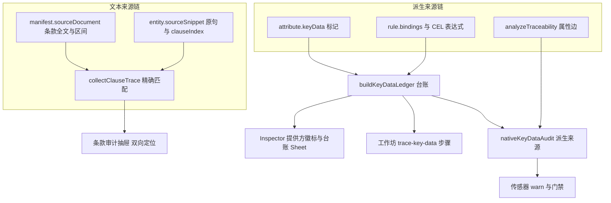

# 关键数据、派生与来源追溯

四条证据链互不替代：`keyData` 标记决定字段是否进入台账；来源分类解释它的提供方；lineage 证明公式读了哪些模型属性；`sourceSnippet` 加条款审计说明对象从哪句文本读出。四条链都只描述模型写了什么，**都不证明实际后端执行正确，也不构成业务批准或合同法律判断**。

图：文本来源链与派生来源链各自成立，只在台账与审计报告处汇合；任一条链都不读运行中的服务。

## 八类来源与分类局限

`buildKeyDataLedger` 只统计 `attribute.keyData === true` 的属性，金额类名称不会自动强制打标：未标价格的字段能通过结构检查，建模纪律依赖人和 prompt。分类词表 `KEY_DATA_SOURCE_DEFINITIONS` 单源声明 `label` 与 `resolved`，`classifyKeyDataSource` 的优先级是：

| 条件 | source |
| --- | --- |
| `derivedByRuleRef` 存在 | `derived` |
| `evidence.contract` | `contract-term` |
| `participant.thing` | `domain-source` |
| `evidence.rfp` / `evidence.proposal` | `negotiation-source` |
| `evidence.fulfillment_confirmation` / `evidence.other_evidence` | `result-fact` |
| `evidence.fulfillment_request` 且字段在请求形成白名单 | `request-input` |
| `fulfillment_request` 的其他字段 | `needs-decision` |
| 其余类别（role、context 等） | `other` |

请求形成白名单是 `started_at`、`request_number`、`delivery_address`、`return_address`、`fault_description`、`asset_code`、`billing_period`、`settlement_period`。`expired_at` 不在其中：履约请求的必填截止时间必须有来源决议，实践中通过派生规则建立（golden 夹具里的 `request.content-payment#expired_at` 就由 `rule.payment-deadline` 派生）。

分类只是 `category`/`kind`/`attribute.name`/`derivedByRuleRef` 的语法推断：不读 `meaning`，不验证数值是否真实，也不判断业务上谁该提供。三个 API 的语义各不相同：`isKeyDataDecisionOwed` 只认 `needs-decision`；`isKeyDataResolved` 排除 `needs-decision` 与 `other`；而 `keyDataSummaryOf` 用 `totalItems - needsDecision.length` 算 `resolvedCount`，于是 `other` 会被汇总算成"已解决"却仍无真实提供方。Inspector 里 `KeyDataProvenancePicker` 的绿色徽标同样只看 `entry.decisionOwed === false`，`other` 因此显示为已解决。不要把汇总计数或绿色徽标当作业务充分性证明。词表里另有四个供人选择的提供方 `KEY_DATA_PROVIDER_CHOICES`（`contract-term`/`result-fact`/`derived`/`request-input`），但界面上没有可持久化的 provider 字段，选择只能落成"绑定派生规则"或"撤回 keyData"。

## 同一台账，多个消费者

`buildKeyDataLedger` 是唯一分类实现，因此下列消费者不会互相漂移：

- **窄属性网格**（`AttributeDataGrid`）：表头 `data-ledger-summary` 直接报"关键数据 N 项 · 待决 M 项"，展开行才显示 `KeyDataProvenancePicker`。
- **提供方徽标**（`KeyDataProvenancePicker`）：打印 `KEY_DATA_SOURCE_LABELS[source]`，把派生规则的 `bindings` 显示成 `alias → 对象标签`（或 `alias → 运行时 type`），并把 `cardinality: many` 标成"（集合）"；待决时给两个动作——"绑定派生规则"和"并非关键数据"。
- **宽台账**（`KeyDataLedgerSheet`）：55vw 侧滑页，逐行列出全部字段（类型、必填、关键数据、派生表达式），表头报"N 项台账待决"或"台账已闭合"，选中行决定 `CelFormulaBar` 编辑哪条规则；选中非派生字段会提示需要先绑定规则。
- **原生审计**（`nativeKeyDataAudit`）与**工作坊进度**（`workshopProgress` 的 `trace-key-data` 步骤）、**模型比较**（`diffDomainModels` 复算两侧台账）：详见下文。

所有编辑都走 `session.mutate` 加 guarded mutator（`updateAttributeMutator`、`updateRuleMutator`、`bindDerivedRuleMutator`、`removeAttributeMutator`），一次提交一个撤销步；旧的 `UpdateAttribute`/`UpdateRule` Command 已不存在，公式栏与网格共享同一会话历史。台账 Sheet 与属性网格都不缓存徽标状态，文档一变就重算，因此不存在"绿色徽标忘了清"的状态。

## 待决如何走到传感器

`nativeKeyDataAudit(model, traceability)` 输出固定形状：`checkVersion: 1`、常量 `valid: true`、`modelId`、`keyDataCount`、只打印非零桶的 `counts`、`needsDecision` 列表（`entity#attribute`、`contextRef`、`meaning`、`valueType`）、`derived` 列表（`path`、`ruleRef`，以及从 lineage 边反查并按字典序去重的 `sources`），外加一条固定 `note`：`needsDecision` 是待决清单而不是错误。报告形状固定是为了让保存的报告能与新跑的报告逐字段比较。

`keyDataSummaryOf` 把待决项变成 `KEY_DATA_DECISION_OWED` 的 **warn**（最多 40 条，`summary.unresolvedItems` 同时截断；计数仍是全量），零待决时给一条 `KEY_DATA_RESOLVED` 的 **info**。因此待决永远不阻塞 `passed`（只看 block 数），但会让 `isStageGateReady` 保持关闭——它要求 `stageGate.passed`、零待决、零 block，以及 API 覆盖无缺口、无破坏性变更。管线分工见[传感器编排](../agents/sensor-orchestration.md)。

## 业务时间属于模型红线

需要业务时刻的凭证种类在词汇表里声明，而不是散落在手写校验中：`EVIDENCE_KIND_DEFINITIONS[kind].requiredTimeAttributes` 规定 `rfp`/`proposal`/`fulfillment_request` 需 `started_at` 与 `expired_at`、`contract` 需 `signed_at`、`fulfillment_confirmation` 需 `confirmed_at`、`other_evidence` 需 `created_at`。`documentSemantics` 在 schema 层报告两类问题：缺失必需时刻是 `attribute.time.missing`；而 `EVIDENCE_TIME_ATTRIBUTE_NAMES` 里认出的五个时间属性（`started_at`/`expired_at`/`signed_at`/`confirmed_at`/`created_at`）若不是 `required` + `keyData` + `timestamp`，报 `attribute.time.notKeyTimestamp`。这些结论进入 FM check，不需要一个巨型手写 `strictValidate` 函数。

业务发生时间与技术写入时间是两回事：`signed_at`/`confirmed_at` 描述业务事实，客户端任意回填的时间戳不会因为通过 schema 就成为合同事实。

## Native CEL scoped AST 的 lineage

`extractRuleAttributeAccesses` 直接编译 cel-js AST，用 `walkCelAst`/`resolveCelReference` 跟踪宏的词法作用域，不走旧手写 parser 或正则。`a.field`、`a['field']`、optional 访问等静态成员可追溯；`many` 绑定必须经 `CEL_COLLECTION_MACROS` 迭代，宏不能把 `one` 绑定当 `many` 用，动态索引不能假装属性确定；嵌套宏变量与 shadowing 按作用域解回模型 binding，字符串内容不产生假读。

`analyzeTraceability` 建立 `entity#attribute` 节点、`source → target` 的 rule 边与 non-derivation 约束，输出确定性排序的 `TraceabilityDocument`（节点按 path，边按 target/source/ruleRef）。它拒绝：未知属性、binding 与访问的 ref 不匹配、重复 derivation 目标、目标与 `derivedByRuleRef` 反向不对齐（两个方向都查）、lineage 环。`ParseError` 留给 CEL 静态诊断，避免重复的语法噪音；其他内部错误不伪装成成功。

关键派生还必须至少读一个 modeled attribute；**实际被读取**的 type-only scalar binding 必须建成模型属性（错误信息会列出变量名）。只声明未使用的 scalar 不会误报，宏局部变量也不算自由 scalar。注意这不是"禁止数字常量"：表达式里写死的税率不会因这条规则自动被识别为隐藏提供方，业务审查仍要判断。

lineage 错误进 FM check 的 `errors`，因此变成 `check_fm`/`FM_INCONSISTENT` 的 block；而提供方待决只是 `audit_key_data` 的 warn。一个问"谁提供这个值"，一个问"公式读了什么"，不可互相替代。

## 精确整数边界

cel-js 的 `int`/`uint` 用 bigint 精确运算。JSON 输入接受安全整数或落在 CEL `int64`/`uint64` 范围内的精确十进制字符串，拒绝不安全 number 与越界值；`celValueToJson` 把安全整数转 number、较宽的合法整数保留 decimal string，绝不 `Number` 静默舍入。内联样例的 oracle、Step CI 与 Hurl literal 复用同一纪律；canonical JSON 与 hash 必须同步，不能把换序列化样式当成格式调整。细节见[检查与 CEL](../model/checks-and-simulation.md)。

## 文本来源：元素级片段与条款审计

来源是**元素级**记录。草稿元素上的 `provenance`（`text`、`locator`、`source` 取 `contract`/`prd`/`interview`/`blueprint`/`unknown`、可选 `clauseIndex` 与 `charStart`/`charEnd`）由 `compileIngestionDraft` 原样复制到 `entity.sourceSnippet`；`EntityBaseSchema` 明确允许 `ProvenanceSnippetSchema`，属性草稿不持独立来源字段。`ProvenanceSnippetSchema` 是 strict 对象：拒绝多余键，且 `charStart`/`charEnd` 必须成对，区间长度必须等于 `text.length`（UTF-16）。

合同导入时 `draftFromContract` 把全文与分句写进 `draft.sourceDocument`，再随编译落到 `manifest.sourceDocument`。`ContractSourceDocumentSchema` 校验句号从 1 连续、区间按源顺序不重叠、每个区间切片与 `text` 完全相等；`clauseTrace.spec` 证明这些区间在编译、源文件树往返与 bundle 往返后仍能对回（含重复句与 CRLF）。回填 `sourceSnippet` 时只在原句中**唯一精确匹配**才链接，并写入 `clauseIndex` 与字符区间；重复文本不按偏移猜。

`collectClauseTrace(model)` 是这一步的反向查询，也是纯创作期索引（源码注释明确写 authoring-only）：

- 有 `manifest.sourceDocument`：以条款为行（`clause-N`、`第 N 句`、类别、区间），对每个 `sourceSnippet` 依次尝试"精确区间命中 → `clauseIndex` 指向且文本相同 → 全文唯一文本匹配"。都不成立就进 `unmatchedEntityIds`，绝不模糊匹配。
- 只有 `sourceSnippet`、没有全文：按 `locator`+`text` 聚合成 `category: 'unknown'` 的片段行，`fullText` 为 `null`，界面明确说"仅保存来源片段，暂无合同全文"。

桌面上这条链是双向的：`clauses` 抽屉（`ClauseTraceDrawer`，rail 标题"条款审计"）按原始顺序渲染全文并把每个条款装饰成可高亮块，选中画布对象时自动滚动并高亮它所属条款；每块列出关联对象按钮，点击即 `focusEntity`；`boilerplate`（纯法务）条款默认折叠，可用"显示纯法务条款"展开，但没有任何一键删除模型的入口；有未定位对象时给 `role="alert"` 提示"来源无法唯一定位，请核对原文。未进行模糊匹配"。反方向由检查器的"依据条款原文"区块提供：它打印 `entity.sourceSnippet.text` 与 `locator`，"查看条款审计"按钮打开同一个抽屉。`EditorScreen.spec` 端到端验证这两个方向。抽屉自己声明其限度：来源材料只供本地审计，条款分类是阅读建议，不是法律判断。

关键边界：`sourceSnippet` 与 `sourceDocument` 都只存在于模型文档里；FM check 的静态错误集来自 `strictValidateDomainModel` 与 `analyzeTraceability`，原生传感器只读模型，没有访谈记录可对账，`interview` 仅是来源 kind。因此"对象与条款对不上"只在创作抽屉里提示，不会进入 block/warn，也不会让门禁关闭。反之，对话里说过但没落成模型的理由不算验证证据。

## 邻接与验证

`diffDomainModels` 复算两侧台账，报告 `source`/`ruleRef`/`expression` 变化、`hasKeyDataDrift` 与两侧待决计数——这是模型比较能力，不代表桌面暴露了 branch API。生产漂移直接读 `derivedByRuleRef`：后端提交派生值报 `DERIVED_VALUE_SUPPLIED` 的 block，未声明字段报 `UNMODELED_ATTRIBUTE_WRITTEN` 的 warn。

`keyDataLedger.spec` 保护八类优先级、counts、待决/派生分列与未标字段排除；`keyData.spec`（schema）保护分类优先级与 `isKeyDataDecisionOwed`/`isKeyDataResolved` 的差异；`fmCheck.spec` 保护 lineage 边与非 derivation 约束、无宏的 many 读取、未知属性；`nativeSensors.spec` 固定审计报告全文，`sensorReport.spec` 保护 warn/info 与 40 条截断；`clauseTrace.spec` 保护区间往返、legacy 片段与模糊匹配拒绝；`ClauseTraceDrawer.spec`、`AttributeDataGrid.spec`、`KeyDataLedgerSheet.spec` 保护双向定位、提供方徽标、单步撤销与 Escape 归属。

审查仍需补问：未标 `keyData` 的金额、落在 `other` 的提供方、分类的语义正确性、真实 HTTP 实现与 scope 闭环，以及条款引用是否仍与法务原件一致。

相关：[语言与 DSL](./fm-dsl.md) · [检查与 CEL](../model/checks-and-simulation.md) · [传感器编排](../agents/sensor-orchestration.md) · [画布与检查器](../desktop/canvas-and-inspector.md) · [工作区与条款审计](../desktop/workspace-surfaces.md) · [资料摄取与补丁审查](../desktop/ingestion-and-patch-review.md)
