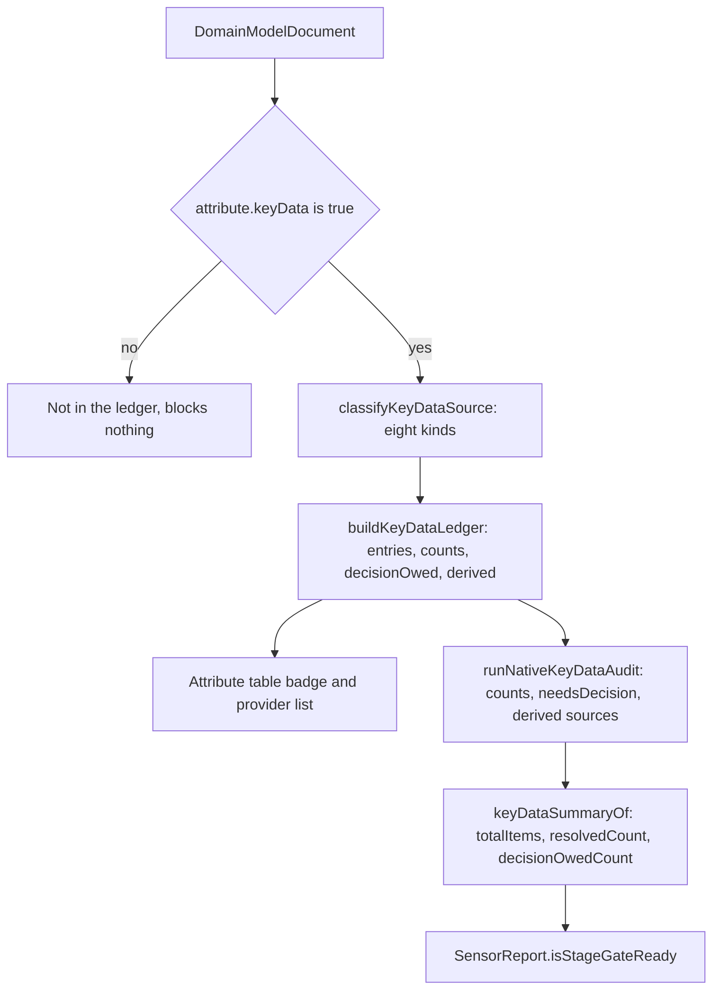

# Key data, business time and provenance

The modeling method's first red line is simple to state and hard to satisfy: **a
number without a provider is not a fact**. Amounts, deadlines, quantities and time
differences are not inputs a caller may supply; they are either established by a
contract term, an upstream evidence attribute, a domain object, a recorded result
fact, or a derivation over those.

Three mechanisms enforce that: a shared classification vocabulary, a ledger that
inventories every marked item, and attribute-level lineage that proves a formula
only reads modeled values. A fourth, provenance, answers a different question: not
"where does this value come from?" but "which sentence put this element here?".

## One declaration, three readers

`KEY_DATA_SOURCE_DEFINITIONS` is the single authority
(`repo://libs/evidence-schema/src/ast/keyData.ts#L25-L58`). Each entry carries the
text a picker prints and a `resolved` flag, and every other constant is derived
from it: `KEY_DATA_SOURCE_KINDS` and `KEY_DATA_SOURCE_LABELS` are vocabulary views,
and `RESOLVED_KEY_DATA_SOURCES` is a *filter over the same declaration*
(`repo://libs/evidence-schema/src/ast/keyData.ts#L62-L72`). That is deliberate — the
resolved set cannot fall out of step with the picker text, because there is no
second list.

| Kind | Label | `resolved` | Established by |
| --- | --- | --- | --- |
| `derived` | 派生规则（Derived） | yes | the attribute carries a `derivedByRuleRef` |
| `contract-term` | 合同参数（Contract Term） | yes | an `evidence.contract` attribute |
| `domain-source` | 领域对象（Domain Source） | yes | a `participant.thing` attribute |
| `negotiation-source` | 协商来源（Negotiation Source） | yes | an `rfp` or `proposal` attribute |
| `result-fact` | 结果事实（Result Fact） | yes | a `fulfillment_confirmation` or `other_evidence` attribute |
| `request-input` | 请求形成事实（Request Input） | yes | a `fulfillment_request` attribute inside `REQUEST_FORMATION_FIELDS` |
| `needs-decision` | 待决（Decision Owed） | no | a `fulfillment_request` attribute outside that list |
| `other` | 未归类（Other） | no | anything else, e.g. a role or context attribute |

The three readers of this declaration are the inspector badge, the ledger and the
native sensor:

- the badge prints `KEY_DATA_SOURCE_LABELS[source]` and colours itself on the
  ledger entry's `decisionOwed` flag
  (`repo://apps/desktop/src/renderer/components/inspector/KeyDataProvenancePicker.tsx#L44-L72`);
- `buildKeyDataLedger` classifies with `classifyKeyDataSource` and sets
  `decisionOwed` through `isKeyDataDecisionOwed`
  (`repo://libs/evidence-model-core/src/keyData/keyDataLedger.ts#L85-L139`);
- `runNativeKeyDataAudit` prints the ledger's own `counts`, `decisionOwed` and
  `derived` lists, adding nothing of its own except the traceability sources
  (`repo://libs/evidence-modeling-orchestrator/src/sensors/native/nativeKeyDataAudit.ts#L20-L66`).



One classification feeds the badge, the audit and the gate verdict; only attributes
marked `keyData` enter at all.

### `resolved` and `owed` are two different questions

`RESOLVED_KEY_DATA_SOURCES` is every kind whose declaration says `resolved: true`,
while `isKeyDataDecisionOwed` is true for `needs-decision` alone
(`repo://libs/evidence-schema/src/ast/keyData.ts#L69-L101`). The two predicates
therefore disagree about `other`: it is not resolved, but it also owes nothing to a
human. The consequences are worth knowing:

- `other` never appears in the ledger's `decisionOwed` list, so an unclassified item
  is silent rather than flagged;
- the sensor summary computes `resolvedCount` arithmetically as
  `totalItems - decisionOwedCount`, so an `other` item is counted among the resolved
  items even though `isKeyDataResolved` returns `false` for it
  (`repo://libs/evidence-modeling-orchestrator/src/sensors/sensorReport.ts#L261-L300`);
- `KEY_DATA_PROVIDER_CHOICES` names the four providers a human may pick —
  `contract-term`, `result-fact`, `derived`, `request-input`
  (`repo://libs/evidence-schema/src/ast/keyData.ts#L149-L155`).

A source is never written by hand. It is a read of the model, so the inspector can
only offer the two actions that change the model: bind a derivation rule, or retract
the key-data claim with `keyData: false`
(`repo://apps/desktop/src/renderer/components/inspector/KeyDataProvenancePicker.tsx#L74-L104`).

## The classifier is a pure precedence rule

`classifyKeyDataSource` takes only the entity's `category`/`kind` and the attribute's
`name`/`derivedByRuleRef`, and always returns the same bucket for the same input
(`repo://libs/evidence-schema/src/ast/keyData.ts#L100-L147`):

```text
derivedByRuleRef present        → derived
evidence.contract               → contract-term
participant.thing               → domain-source
evidence.rfp | proposal         → negotiation-source
evidence.confirmation | other   → result-fact
evidence.fulfillment_request    → request-input if name ∈ REQUEST_FORMATION_FIELDS
                                  else needs-decision
everything else                 → other
```

The request-formation whitelist is deliberately small: `started_at`,
`request_number`, `delivery_address`, `return_address`, `fault_description`,
`asset_code`, `billing_period`, `settlement_period`
(`repo://libs/evidence-schema/src/ast/keyData.ts#L75-L88`). A request attribute
outside it `needs-decision` until the business names a provider.

### The classification is syntactic, not semantic

The classifier reads kinds and names, not meanings. Two consequences follow:

- A contract attribute is `contract-term` even if the business actually computes
  it — unless a `derivedByRuleRef` is present, which wins first.
- A request attribute named inside the whitelist is `request-input` even if its
  value is negotiated; one named outside it is `needs-decision` even if a person
  already decided where it comes from. The vocabulary records where a value *may*
  come from, not what anyone said in a particular session.

A third consequence is sharper: a `derivedByRuleRef` that points at no rule still
classifies as `derived`, because the classifier only asks whether the field is
present. The ledger can therefore call an item resolved while
`strictValidateDomainModel` reports `attribute.derivedByRuleRef.unresolved` for the
same attribute (`repo://libs/evidence-schema/src/validation/strictValidate.ts#L560-L578`).
The ledger is a decision list, not a proof of correctness.

## Stored fields and derived fields

Apart from the stored fields below, everything a reviewer reads on this page is
recomputed from the document on demand. Nothing caches a verdict.

| Stored on the model | Derived on read |
| --- | --- |
| `attribute.keyData` — the claim that this value needs a provider | `source` (the classification), `decisionOwed`, the ledger's `counts` |
| `attribute.derivedByRuleRef` — the attribute's side of the derivation link | traceability `origin`, nodes and edges |
| `rule.target` + `rule.bindings` + `rule.expression` | ledger `ruleRef`, `expression`, `providers`; the badge's provider list |
| `entity.sourceSnippet` — verbatim sentence, locator, input kind | the review panel's 原文 line; stripped from the published workbench |
| — (nothing stored) | `KeyDataSummary`, `isStageGateReady`, the badge label and colour |

The inspector is the clearest example: it rebuilds the whole ledger from
`session.getDocument()` on every document identity change and prints both the badge
and the `关键数据 N 项 · 待决 M 项` counter from that one build, so no second flag can
drift (`repo://apps/desktop/src/renderer/components/inspector/AttributeTableEditor.tsx#L71-L100`).

### `derivedByRuleRef` is stored twice and kept symmetric

The derivation link is the one relationship recorded on both sides: the attribute
carries `derivedByRuleRef`, and the derivation rule carries `target`. Four checks
keep the two halves in agreement, and a model that gets it wrong fails in whichever
direction it broke:

| Side | Check | Finding |
| --- | --- | --- |
| attribute → rule | the ref must resolve to a rule id | `attribute.derivedByRuleRef.unresolved` |
| attribute → rule | that rule must be a `derivation` whose target is exactly this entity and attribute, and whose `contextRef` is the target entity's owner context | `rule.derivation.mismatch`, `rule.derivation.context` |
| rule → attribute | the targeted attribute must point back at this rule | `rule.derivation.mismatch` from the rule side |
| rule → attribute | the lineage walk reports a target nobody declared | `derivation Rule … must be declared by derivedByRuleRef` |

The static half lives in two passes: `rule.derivation.mismatch` is raised from
`validateRules` when a derivation's target attribute does not point back at the rule,
and `validateDerivedAttributes` re-checks the other direction plus the owner context
(`repo://libs/evidence-schema/src/validation/strictValidate.ts#L1770-L1845`). The
lineage walk adds the reverse complaints, including
`derivedByRuleRef '…' has no matching derivation target`
(`repo://libs/evidence-model-core/src/validation/traceability.ts#L486-L556`). That
symmetry is what makes "this number is computed" and "this rule computes something"
the same statement rather than two that happen to coexist.

## The ledger: only the flag brings an item in

`buildKeyDataLedger` inventories only attributes whose `keyData` flag is `true`
(`repo://libs/evidence-model-core/src/keyData/keyDataLedger.ts#L85-L139`).

This is the most important operational detail on this page: **an amount that is not
marked `keyData` never enters the ledger, and therefore never blocks anything.**
Nothing in the static validator forces an amount-like attribute to carry the flag —
the only forced case is the recognised business-time names, below. The discipline
lives in the modeling instructions and the inspector's helper text ("金额、期限、数量
与时间差标记为关键数据"). A model can therefore be structurally valid and gate-ready
while an unmarked price sits in a request. The ledger test asserts the exclusion
explicitly (`repo://libs/evidence-model-core/src/keyData/keyDataLedger.spec.ts#L147-L160`).

Each entry records the entity ref, label, kind and `category.kind` signature, an
optional `contextRef`, the attribute name/label/meaning/value type, the `source`
kind and `decisionOwed`. A derived entry also gets the rule id, its expression, and
**providers** built from the rule's bindings: per alias either a modeled `ref` (with
`cardinality` when the binding declares one) or a runtime `valueType` with an empty
ref (`repo://libs/evidence-model-core/src/keyData/keyDataLedger.ts#L13-L77`). Entries
whose `derivedByRuleRef` resolves to nothing carry no rule id and an empty provider
list — the dangling case again.

`keyDataEntryOf` rebuilds the ledger and finds one entry, which is the documented way
for a caller to ask about a single attribute
(`repo://libs/evidence-model-core/src/keyData/keyDataLedger.ts#L141-L149`).

### From ledger to warning to gate

`keyDataSummaryOf` turns the audit report into `totalItems`, `resolvedCount`,
`decisionOwedCount` and at most 40 unresolved items (`MAX_KEY_DATA`), then emits one
finding per owed item — or a single `KEY_DATA_RESOLVED` info when nothing is owed
(`repo://libs/evidence-modeling-orchestrator/src/sensors/sensorReport.ts#L158-L300`).

An owed decision is a **warning, not a static error**:

- each one becomes a `warn` `KEY_DATA_DECISION_OWED` finding pointing at
  `entity#attribute`, so `warnCount` rises while `blockCount` stays 0 and `passed`
  stays `true` (`repo://libs/evidence-modeling-orchestrator/src/sensors/sensorReport.spec.ts#L123-L150`);
- `isStageGateReady` ANDs `stageGate.passed`, `decisionOwedCount === 0`,
  `blockCount === 0` and a covered API summary, so owed key data alone is enough to
  keep the model out of downstream hand-off
  (`repo://libs/evidence-modeling-orchestrator/src/sensors/sensorReport.ts#L344-L356`);
- the status bar says exactly that: `门禁：等待台账决议` when the report passed but the
  ledger still owes a decision (`repo://apps/desktop/src/renderer/components/BottomStatusBar.tsx#L34-L46`).

The audit's own note says the same in business language: `needsDecision 是待决清单，
不是错误` (`repo://libs/evidence-modeling-orchestrator/src/sensors/native/nativeKeyDataAudit.ts#L60-L66`).
For why gate readiness is rarely observable on a fresh run at all, see
[Sensors, stage gate and the dependency frontier](../agents/sensor-orchestration.md).

## Business time is a required key-data timestamp

Every evidence kind mandates specific time attributes: an `rfp`, `proposal` and
`fulfillment_request` need `started_at` and `expired_at`; a `contract` needs
`signed_at`; a confirmation needs `confirmed_at`; other evidence needs `created_at`
(`repo://libs/evidence-schema/src/ast/entity.ts#L33-L66`). The same file declares the
five recognised names — `started_at`, `expired_at`, `signed_at`, `confirmed_at`,
`created_at` — each with a short label a card may print.

Two static rules follow
(`repo://libs/evidence-schema/src/validation/strictValidate.ts#L577-L630`):

- **any** attribute carrying one of the five recognised names, on any entity, must be
  declared as a required `keyData` `timestamp`, or the model reports
  `attribute.time.notKeyTimestamp`;
- the kind's mandated name must be present, or the model reports
  `attribute.time.missing`.

The distinction is substantive: a period is a claim about a window, a moment is a
claim about an instant. Recording a confirmation as an interval would let a model
avoid saying when the obligation was actually discharged, and time differences
between moments are exactly the amounts the key-data ledger exists to police. The
draft layer carries the same split: `draftEvidenceIsMoment` marks `contract`,
`fulfillment_confirmation` and `other_evidence` as instants and the three spans as
not, with the two lists pinned in tests
(`repo://libs/evidence-schema/src/ingestion/draft.ts#L171-L187`,
`repo://libs/evidence-schema/src/ingestion/draft.spec.ts#L28-L38`).

## Lineage: a formula may only read modeled values

`analyzeTraceability` walks every rule expression and records which modeled
attribute each read comes from. Its checks are the second half of the "no hidden
formula" rule (`repo://libs/evidence-model-core/src/validation/traceability.ts#L1-L30`):

| Check | Failure |
| --- | --- |
| a `many` binding must be read through a CEL macro (`all`, `exists`, `exists_one`, `filter`, `map`) | `many binding … must be accessed through a CEL collection macro` |
| a macro may only iterate a `many` binding | `CEL macro … iterates binding …, which must declare cardinality: many` |
| an entity binding must be indexed by a static string | `Entity binding … must use a static string attribute index for traceability` |
| every read must name a declared attribute | `reads unknown attribute …` |
| the binding's `ref` must be the entity being read | `attribute access … does not match binding …` |
| only one derivation may target an attribute | `multiple derivation Rules target this attribute` |
| a derivation target must be declared back by `derivedByRuleRef` | `derivation Rule … must be declared by derivedByRuleRef` |
| lineage may not cycle | `attribute lineage cycle: …` |

The checks run inside `analyzeTraceability`
(`repo://libs/evidence-model-core/src/validation/traceability.ts#L392-L560`).

Two of them exist specifically for key data
(`repo://libs/evidence-model-core/src/validation/traceability.ts#L513-L540`):

- a **key** derived attribute must trace to at least one modeled Entity attribute;
- a key derivation may not use a scalar (`type`-only) binding that the expression
  actually reads: `key derivation scalar inputs [...] must be modeled as Entity
  attributes`.

That is what prevents a formula like `amount * 0.13` from hiding a tax rate in an
unmodeled constant. The scalar binding may exist in the rule, but if the expression
reads it, the model is refused.

The output is a `TraceabilityDocument` of nodes (`entity#attribute`, with `origin`
`asserted` or `derived`), edges (`source → target` through a rule) and constraints
(non-derivation rules and the attributes they read), sorted deterministically because
it is generated output a review compares across runs
(`repo://libs/evidence-model-core/src/validation/traceability.ts#L34-L60`). The key-data
audit consumes only its edges, to name each derived item's sources.

## Provenance: which sentence put this here

### `sourceSnippet` on the model

An ingested entity can carry the verbatim sentence it was read from, a
human-readable locator (a sentence number, `row 4`, a stage name) and the input kind
(`repo://libs/evidence-schema/src/ast/provenance.ts#L19-L54`). The input kinds are
`contract`, `prd`, `interview`, `blueprint` and `unknown`
(`repo://libs/evidence-schema/src/ast/provenance.ts#L19-L31`).

The field is optional and entity-level only
(`repo://libs/evidence-schema/src/ast/entity.ts#L189-L198`):
`sourceSnippet` is part of the entity key set in `strictValidate.ts` and of no other
key set, so attaching a snippet to an attribute, relationship or rule is an
unknown-field finding
(`repo://libs/evidence-schema/src/validation/strictValidate.ts#L48-L67`). Hand-written
entities may omit it; nothing in the model depends on it.

Ingestion writes it. Every draft element carries an optional
`provenance: ProvenanceSnippet`, and `compileDraft` copies each one onto the compiled
context, role, participant, thing and evidence as `sourceSnippet`
(`repo://libs/evidence-schema/src/ingestion/draft.ts#L25-L90`,
`repo://libs/evidence-model-core/src/ingestion/compileDraft.ts#L331-L350`). The
compiler test pins it — the compiled `rfp` keeps the sentence containing
`商品询价单` (`repo://libs/evidence-model-core/src/ingestion/compileDraft.spec.ts#L73-L81`).
The reading prompt states the rule as a hard constraint: every element's
`provenance.text` must be a verbatim sentence of the input and its `locator` must be
`第 N 句` (`repo://libs/evidence-agent-core/src/prompts/ingestion.ts#L28-L34`).

Where a reviewer actually meets it today: the draft review panel prints
`原文（{locator}）：{text}` beside an evidence before compile
(`repo://apps/desktop/src/renderer/components/ingestion/DraftReviewPanel.tsx#L250-L265`).
The inspector does not render `sourceSnippet`, and the offline workbench deliberately
strips it — "a reader who is allowed to see the model is not automatically allowed to
see where it came from" (`repo://libs/evidence-visualization/src/projection/workbenchProjection.ts#L8-L16`).
Provenance is an authoring and review artefact, not part of the published page.

### Clause annotations: the reading before the model

An agreement is not a model, so it is first split into three readings, declared in
one vocabulary that the extraction prompt, the review panel and the compiler all name
(`repo://libs/evidence-schema/src/ast/clause.ts#L1-L101`):

| Category | Label | Hint | Destination |
| --- | --- | --- | --- |
| `business` | 业务逻辑（Business） | 谁在什么时刻向谁交付什么，决定盈利与成本 | `evidence` |
| `domain` | 领域逻辑（Domain） | 计价、折算、校验等能写成规则的算法 | `domain-thing` |
| `boilerplate` | 纯法务条款（Boilerplate） | 管辖、免责、送达等不由系统承载的条款 | `none` |

The destination is part of the same declaration (`CLAUSE_DESTINATION_OF`), which is
what stops the review panel from inventing a fourth place to put a sentence it does
not understand. A `ClauseAnnotation` records the 1-based `index`, the verbatim `text`,
the `category` and a business-language `reason`; `ClauseReading` adds
`computesValue`, because a sentence can oblige and compute at once.

`annotateContractClauses` applies the method's order: boilerplate first, then a
business action verb, then a computation, and a sentence that matches nothing stays
boilerplate *and* is reported as an issue rather than silently dropped
(`repo://libs/evidence-model-core/src/ingestion/contractAnnotator.ts#L110-L165`).
`draftFromContract` uses that split to send business clauses through the row reader
and computing clauses into Domain components, each carrying the clause as its
provenance (`repo://libs/evidence-model-core/src/ingestion/contractReader.ts#L42-L110`).
`ClauseSplit` prints the per-category counts and lists the filtered boilerplate
(`repo://apps/desktop/src/renderer/components/ingestion/ClauseSplit.tsx#L17-L62`), and
the agent can call the same annotator as the read-only tool
`annotate_contract_clauses` (`repo://libs/evidence-modeling-orchestrator/src/tools/evidenceTools.ts#L254-L270`).
Annotations live in the reading result shown before compile; the persisted provenance
of a compiled model is `sourceSnippet` alone.

### There is no interview trace to reconcile

Provenance is per-element, not per-conversation. The native sensor set documents the
boundary plainly: "the model is the only input: there is no interview record to
reconcile, so a verdict describes what the sources say and nothing else"
(`repo://libs/evidence-modeling-orchestrator/src/sensors/native/nativeSensors.ts#L55-L60`).
The desktop keeps no interview log either — the tool-call activity stream beside the
canvas is the record of where the conversation went
(`repo://apps/desktop/src/renderer/components/agent/AgentPanel.tsx#L18-L24`).

So `interview` remains a valid value of `sourceSnippet.source`, for a snippet read out
of a conversation transcript, but nothing in the schema, the sensor set or the
inspector binds a claim to an interview round, a question id or a user statement.
Provenance checks are therefore of one kind only: does the model declare the object
the snippet sits on. There is no reference-resolution pass over provenance, because
`sourceSnippet` names no model object.

## What a reviewer can and cannot conclude

The ledger and lineage together let a reviewer ask:

- Does every marked amount/deadline/quantity have a named provider?
- Does every derived value trace to modeled attributes, with no hidden scalar?
- Do `derivedByRuleRef` and the derivation target agree?
- Is business time recorded in the shape the evidence kind requires?
- Which sentence was each element read from, and which bucket did the reading put it in?

They do **not** let a reviewer conclude:

- that an unmarked amount is safe — nothing forced the flag;
- that an `other`-classified item is fine — it is unresolved but never listed as owed;
- that a `derived` classification means the rule exists;
- that a `contract-term` classification is the correct business decision;
- that a recorded result fact is true — only that the business recorded it;
- that a scope is complete — that is the scope check, not the ledger.

## Tests that protect this contract

- `keyDataLedger.spec.ts` pins the count per source kind, the separation of owed
  decisions, the derivation providers (including the scalar alias with an empty ref),
  and that non-`keyData` attributes are ignored
  (`repo://libs/evidence-model-core/src/keyData/keyDataLedger.spec.ts#L115-L160`).
- `nativeSensors.spec.ts` pins the whole audit shape for the golden fixture — 14
  items, five non-empty buckets, one owed decision, three derived entries with their
  sources — and folds it into a summary of 14/13/1
  (`repo://libs/evidence-modeling-orchestrator/src/sensors/native/nativeSensors.spec.ts#L66-L190`).
- `sensorReport.spec.ts` pins the warning-not-error semantics: owed key data keeps
  `passed` true and `blockCount` 0 while forcing `isStageGateReady` false
  (`repo://libs/evidence-modeling-orchestrator/src/sensors/sensorReport.spec.ts#L123-L150`).
- `strictValidate.spec.ts` covers the business-time rules (`attribute.time.missing`,
  `attribute.time.notKeyTimestamp`), an unresolvable `derivedByRuleRef`, and both
  directions of derivation mismatch including the owner-context rule
  (`repo://libs/evidence-schema/src/validation/strictValidate.spec.ts#L249-L300`).
- `fmCheck.spec.ts` covers the lineage walk: nodes and edges for the golden fixture,
  a collection binding read without a macro, and a read of an unmodeled attribute
  (`repo://libs/evidence-model-core/src/validation/fmCheck.spec.ts#L191-L250`).
- `contractAnnotator.spec.ts` covers the three-bucket split and the reported
  unplaceable sentences
  (`repo://libs/evidence-model-core/src/ingestion/contractAnnotator.spec.ts#L78-L110`);
  `clause.spec.ts` pins that only three categories exist and that boilerplate goes
  nowhere (`repo://libs/evidence-schema/src/ast/clause.spec.ts#L30-L40`).

## Related pages

- [The Fulfillment Modeling DSL (FM v5)](./fm-dsl.md) — where `keyData`, time
  attributes, derivation targets and `sourceSnippet` live in the document.
- [Sensors, stage gate and the dependency frontier](../agents/sensor-orchestration.md) —
  how owed decisions become warnings and why `isStageGateReady` is usually false on a
  fresh run.
- [The native check and simulation pipeline](../model/checks-and-simulation.md) — the
  passes that consume lineage and the ledger.
- [Canvas and inspector](../desktop/canvas-and-inspector.md) — where the badge, the
  provider list and the attribute table are rendered.
- [Ingestion and patch review](../desktop/ingestion-and-patch-review.md) — how a draft
  keeps its snippet and its clause split before compile.
- [The offline workbench](../contracts/offline-workbench.md) — the projection that
  deliberately drops provenance.
