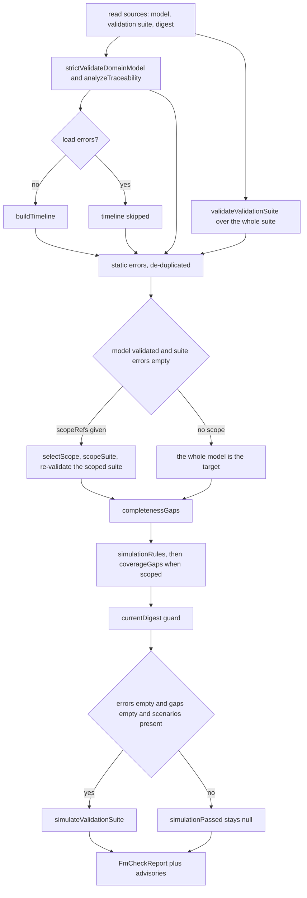
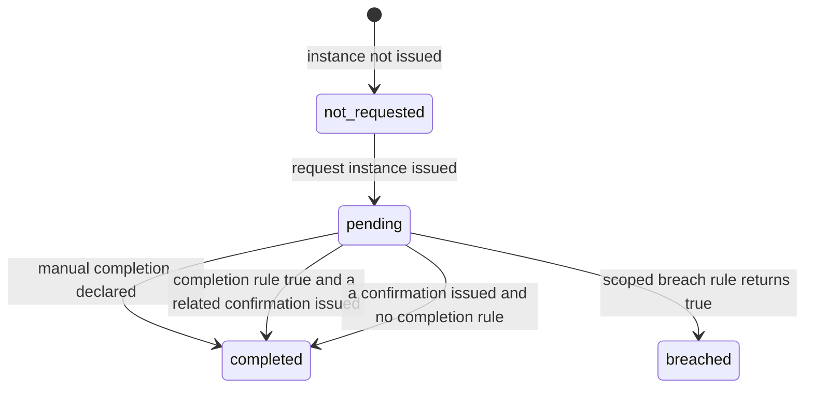

# The native check and simulation pipeline

`evidence-model-core` answers one question with one report: *may this model, or
this scope of it, be trusted?* The answer is deliberately split into three
independent ones, because they fail differently:

| Question | Report field | Blocking? |
| --- | --- | --- |
| does the model close structurally and in its rules | `consistent` | yes |
| does the requested scope carry a whole responsibility | `complete` | only when a scope is asked for |
| do the scenarios assert what the model claims | `simulationPassed` | yes, once a scenario runs |

`buildFmCheckReport` is the single entry point
(`repo://libs/evidence-model-core/src/validation/fmCheck.ts#L172-L305`). Every
surface that judges a model calls it, so a terminal, a status bar and an agent
cannot disagree:

- the CLI `evidence-model check`
  (`repo://libs/evidence-model-core/src/cli.ts#L379-L436`);
- the native sensor run behind the desktop verdict, which reads the sources once
  and hands the same digest, document and suite to every sensor
  (`repo://libs/evidence-modeling-orchestrator/src/sensors/native/modelSources.ts#L105-L132`,
  `repo://libs/evidence-modeling-orchestrator/src/sensors/native/nativeSensors.ts#L55-L80`);
- the desktop review preview, which checks the unsaved document against the
  scenarios on disk and says in its notice that a machine check is not business
  approval (`repo://apps/desktop/src/main/reviewPreview.ts#L50-L112`).

The outcome is not only the report: the same call returns the built timeline, the
simulation report and the selected scoped document, so a caller that needs those
objects does not re-derive them and end up disagreeing with the verdict.

## The pipeline in order

One check, from the source read to the report.

The order is causal, not cosmetic. A source that failed to load stops the
timeline, because a lane built from half a suite would be fiction. Scope
selection is skipped when the model did not validate, because a subset of an
inconsistent model is not a smaller deliverable. Gaps stop simulation, because a
scenario run over a scope that has not closed its responsibility proves nothing.

## Consistency is the union of the static findings

`modelIssues` is the de-duplicated union of three sources:

- problems found while reading the files, rendered as `path: message`;
- `strictValidateDomainModel` issues, rendered as `path: message`;
- `analyzeTraceability` errors.

The report's blocking `errors` are then that set, plus
`validateValidationSuite` over the whole suite, plus `buildTimeline` errors, plus
the scoped suite re-validation when a scope was selected, plus any simulation
error, plus the staleness message
(`repo://libs/evidence-model-core/src/validation/fmCheck.ts#L180-L260`).

This is where the language's structural rules become blocking findings: a
duplicate id, a contract without two roles, a play-role in the wrong direction, a
derivation whose target does not point back, a `many` binding read without a
macro, or an interval that starts after it expires all stop the model here.

`modelValidated` is the narrower flag — only the model-level sources count — and
it gates completeness, simulator applicability and request enumeration. Three
different words therefore mean three different things:

| Field | True when |
| --- | --- |
| `modelValidated` | no source issues, no structural issue, no lineage error |
| `consistent` | no static error at all **and** the digest did not move |
| `valid` | no error at all (including scenario failures) **and** `complete !== false` |

A scenario that asserts the wrong value leaves `consistent: true` and flips
`valid: false`; that split is deliberate — the graph still closes, the claims do
not.

### The digest and the input-changed guard

The report always names its inputs. A caller passes the digest of the bytes it
parsed (`modelDigestOf` over a sorted `path → sha256(bytes)` map, so file order
and checkout location do not matter) and may pass a `currentDigest` callback. The
callback is evaluated at the end of the pipeline; if it differs, the check adds
`Model inputs changed during validation`, sets `inputChanged: true`, and forces
`consistent: false` and `valid: false` — a verdict about bytes that no longer
exist is not a verdict
(`repo://libs/evidence-model-core/src/validation/fmCheck.ts#L255-L261`,
`repo://libs/evidence-model-core/src/adapters/modelRoot.ts#L192-L217`).

The CLI re-reads the tree to compute that callback, so a save landing between the
two reads makes the report stale instead of authoritative. The desktop's
debounced background run skips the second read on purpose
(`detectInputChange: false`); its runs are previews, and a hand-off is decided on
a run that did check
(`repo://libs/evidence-modeling-orchestrator/src/sensors/native/modelSources.ts#L89-L124`).

The digest is also the reason two terminals can compare notes: `fmCheck.spec.ts`
pins the digest and the `timelineSummary` of a scoped fixture, so a change in
hashing or in the summary shape fails a test rather than silently changing the
contract (`repo://libs/evidence-model-core/src/validation/fmCheck.spec.ts#L99-L131`).

## Scope is a delivery unit, not a filter

`selectScope` takes **independent Context ids** and refuses anything else:

- an id that is not a Context, or that has a `parentContextRef`, is rejected with
  "must be an independent Context, not a fulfillment slice";
- duplicates are rejected.

The walk then keeps whole Contexts, their descendants and real dependencies. Two
rules make it trustworthy
(`repo://libs/evidence-model-core/src/validation/scope.ts#L110-L223`):

- a child stage or a single Fulfillment cannot be selected on its own to hide
  another obligation of the same contract;
- a Participant shared by two Contracts does **not** drag the unrelated Contract
  in: only a non-Party source pulls its outbound references. An unresolved
  `role.context` is retained rather than invented.

`scopeSuite` then keeps only the scenarios and instances the scoped model can
execute, following references transitively, and the selected suite is validated
again — a scope whose scenarios reference objects the subset dropped is a
blocking error, not a smaller scenario list
(`repo://libs/evidence-model-core/src/validation/scope.ts#L232-L278`).

### Completeness gaps

A scope claims completeness only when these hold
(`repo://libs/evidence-model-core/src/validation/scope.ts#L402-L472`,
`repo://libs/evidence-model-core/src/validation/scope.ts#L560-L585`):

- every evidence kind has its mandated business-time attributes;
- every attribute declares `valueType` and `required`;
- every `fulfillment_request` is associated with at least one confirmation or
  Evidence Role;
- every `fulfillment_confirmation` is referenced by at least one request;
- every Contract Context that has requests has **both** contract Parties as right
  holder of at least one primary Fulfillment (`pairingGaps`);
- a Contract Context has a primary Fulfillment Request at all.

Completeness issues already reported as model-level consistency errors are not
repeated as gaps. `complete` is `null` when no scope was asked for, and otherwise
true only when there are no gaps and the model is consistent
(`repo://libs/evidence-model-core/src/validation/fmCheck.ts#L263-L265`).

Gaps are computed against the target document whether or not a scope was asked
for, and they block simulation in both cases. A scope-less check can therefore
return `valid: true`, `complete: null`, `simulationPassed: null` on a model whose
Contract Context still owes a confirmation — advice for the modeler, not yet a
refusal (`repo://libs/evidence-model-core/src/validation/fmCheck.spec.ts#L158-L171`).

This separation is the answer to "why not just `consistent`?": consistency is a
statement about the graph, completeness is a statement about delivery. A contract
with one obligation direction can be saved and reviewed while the other is
unclear — but it cannot be handed downstream.

## Scenario requirement and coverage gaps

`simulationRules` keeps the rules the Evidence-instance simulator can execute —
the model has at least one evidence entity, and every binding reference and the
derivation target is an evidence entity or an evidence Role — and reports the
rest as **limitations**, not as passes
(`repo://libs/evidence-model-core/src/validation/scope.ts#L280-L333`).

The requirement is `required` when the target model has an applicable rule **or**
any fulfillment request; otherwise `not-applicable`. A scope-less run reports
`not-checked`, because applicability was never asked about
(`repo://libs/evidence-model-core/src/validation/fmCheck.ts#L208-L215`).

When a scope was selected and scenarios are required, `coverageGaps` adds a gap
for each of (`repo://libs/evidence-model-core/src/validation/fmCheck.ts#L112-L160`):

- no executable scenario at all;
- an applicable rule no scenario evaluates;
- a fulfillment request whose status no scenario asserts.

A rule without a scenario has not been executed; a request without a status
assertion has not been decided. Coverage is only computed for a scope, which is
the one place the report claims delivery.

## Simulation is deterministic

Scenarios run only when `errors` and `gaps` are both empty, at least one scenario
exists, and the model validated
(`repo://libs/evidence-model-core/src/validation/fmCheck.ts#L236-L256`). Inside
`simulateScenario`:

- an activation is built from the scenario's bindings — instances, instance
  lists, or literals typed by their declared `valueType` — and `asOf`/`now` come
  from the scenario clock, never from the machine
  (`repo://libs/evidence-model-core/src/validation/ruleActivation.ts#L78-L135`);
- the rule is evaluated, the CEL result converted to JSON, checked against
  `resultType`, normalised, and compared structurally with `expectedResult`; a
  mismatch is an error naming the rule and both values;
- a derivation writes its result back into the target instance. If the instance
  already asserts a different value, that is an error, not an overwrite
  (`repo://libs/evidence-model-core/src/validation/simulation.ts#L101-L130`);
- after derivations, every required attribute of every issued instance must have
  a value;
- fulfillment statuses are decided per assertion from the issued graph.

A suite that fails static validation executes nothing and reports
`machineValidated: false`, because a run over an invalid suite proves nothing
(`repo://libs/evidence-model-core/src/validation/simulation.ts#L313-L356`). The
report sorts `scenarioResults` by scenario id and carries `schemaVersion: '5.0'`.

### Fulfillment status comes from the issued graph

`fulfillmentStatusOf` is the one reading of a request's state; the end-of-scenario
verdict and every replay frame call it, so a request cannot be "completed" in one
and "pending" in the other for the same graph
(`repo://libs/evidence-model-core/src/validation/fulfillmentState.ts#L96-L195`).

Derived state per frame: breach wins over completion, and a completion rule only
counts when the confirming evidence was actually issued.

A rule result counts for a request only when it is scoped to that request: an
unbound rule result, or one computed over an instance that does not descend from
the request through `basedOn`, is not evidence about it. A request whose instance
is unissued, or whose entity is not a Fulfillment Request, is `not_requested`
even when a manual completion names it.

## Replay frames: which step closed it

The simulation answers "did it close"; `replayValidationSuite` answers "which step
closed it". It replays every requested scenario, or all of them in file order
(`repo://libs/evidence-model-core/src/validation/replay.ts#L279-L453`).

Each replay has an `opening` and one frame per declared step, sorted by
`sequence`. A frame carries everything the sandbox and an agent need to narrate
it (`repo://libs/evidence-model-core/src/validation/replay.ts#L37-L100`):

| Frame field | Meaning |
| --- | --- |
| `sequence`, `actingRoleRef`, `instanceRef`, `entityRef` | which step issued what, and who acted |
| `contextRef`, `evidenceKind` | where the issued evidence sits |
| `at` | business time the issued evidence carries, read from its own required time attribute |
| `basedOn`, `visibleRefs` | the basis, and the instances the acting Role could see |
| `derivations` | each derived value this step introduced, with rule and `entity#attribute` target |
| `checkpoints` | each assertion this step decided, with expected, actual and pass |
| `fulfillmentStates` | status of every request issued so far, in id order |
| `values` | the issued instance after its derivations |

Evaluations settle at the first frame whose inputs are all issued, so intermediate
frames are not empty of verdicts and the last frame does not carry every one of
them. Assertions only the starting graph can decide belong to `opening`, together
with the statuses of the given instances. A scenario that issues the same instance
twice produces an error instead of a frame order, and a suite that does not
validate is not replayed at all — frames that look authoritative but reference
objects the model does not have would be worse than no frames
(`repo://libs/evidence-model-core/src/validation/replay.ts#L286-L312`,
`repo://libs/evidence-model-core/src/validation/replay.ts#L402-L424`).

Nothing in the replay reads a clock: pressing step-forward twice on the same
sources shows the same two frames, which `replay.spec.ts` pins by comparing two
runs byte for byte
(`repo://libs/evidence-model-core/src/validation/replay.spec.ts#L174-L181`).

Two consumers read exactly these frames:

- the desktop simulation sandbox, through the `evidence:simulation:replay` IPC
  channel, whose renderer only moves a cursor over the frames the main process
  computed from saved sources
  (`repo://apps/desktop/src/main/simulationIpc.ts#L86-L100`,
  `repo://apps/desktop/src/renderer/state/useSimulation.ts#L1-L20`);
- the MCP tool `run_scenario_replay`, which reduces each frame to sequence,
  acting role, instance, entity, business time, derivations, checkpoints and
  fulfillment statuses, and returns frames only for the scenario that was named
  (`repo://libs/evidence-mcp/src/types.ts#L146-L190`,
  `repo://apps/desktop/src/main/mcpSimulationService.ts#L33-L53`).

Both go through `replayValidationSuite` on the saved sources, so an agent and a
modeler looking at the same project are looking at the same steps.

## Timeline: order comes from basis, not timestamps

`buildTimeline` groups evidence instances into Context lanes and records three
errors:

- an interval that starts after it expires;
- a `basedOn` cycle;
- a basis evidence formed **after** the instance that depends on it.

Pairs with no basis path between them are not ordered by timestamp. They are
reported in `unresolvedOrder` with the reason "no instance basis path; timestamps
do not imply dependency". Dependencies are only emitted between instances the
suite actually asserts
(`repo://libs/evidence-model-core/src/validation/timeline.ts#L170-L336`).

The timeline is canonicalised (sorted keys, no whitespace, both interval bounds
always printed so an unasserted bound hashes as `null`) and hashed;
`timelineSummary` carries the five counts plus that `sha256`
(`repo://libs/evidence-model-core/src/validation/timeline.ts#L84-L112`,
`repo://libs/evidence-model-core/src/validation/timeline.ts#L355-L362`). The
digest is part of the report contract, not a formatting detail.

One consequence is worth knowing before reading a failing report: the summary
describes an **empty** timeline whenever the check ends with any error, even if
the lane was built. A failing report reports zero counts rather than a partial
timeline a reader might mistake for the whole
(`repo://libs/evidence-model-core/src/validation/fmCheck.ts#L262-L266`).

## Traceability is part of consistency

`analyzeTraceability` turns every CEL read into an attribute-level lineage
document: nodes for key data, derived attributes and every accessed attribute,
edges from source attribute to derivation target with the rule that derives it,
and a constraint row per non-derivation rule. The document is deterministic —
nodes by path, edges by target then source — because a review compares it across
runs.

The walk itself is where the blocking lineage errors come from
(`repo://libs/evidence-model-core/src/validation/traceability.ts#L392-L573`):

- a `many` binding read without a CEL collection macro;
- a read of an attribute the entity does not model, or a read that does not match
  its binding;
- two derivation rules targeting the same attribute, or a derivation with no
  `derivedByRuleRef`;
- a key derived attribute that traces to no modeled attribute, or whose scalar
  inputs are not modeled attributes;
- a derivation cycle;
- a duplicate attribute name.

These errors are part of `modelIssues`, so they block exactly like a structural
problem. The sensor run returns the document beside the report because the key
data audit reads the same lineage; computing it twice would let the two disagree
(`repo://libs/evidence-modeling-orchestrator/src/sensors/native/modelSources.ts#L105-L132`).

## Advisories: advice that never changes the verdict

`FmCheckReport.advisories` is a list of `ModelAdvisory` — `code`, `entityId`,
`message` and a `suggestion` — computed on every check, valid or not. There is
exactly one code today, `ROLE_DOMAIN_NAME_NOT_ANTHROPOMORPHIC`: a domain component
(a `role.domain`, or a `participant.thing` that abstracts one) whose label names
the work instead of the actor — 折扣算法, 价格计算 — is advised to be renamed after
the participant that does the work, keeping the business noun and swapping only
the tail
(`repo://libs/evidence-model-core/src/validation/lintRules.ts#L14-L142`).

An advisory never enters `errors` or `gaps`, so it never changes `consistent`,
`complete` or `valid`. A model can be perfectly consistent and still carry advice
a business reviewer should read, and a broken model carries the same advice
(`repo://libs/evidence-model-core/src/validation/fmCheck.ts#L70-L79`).

How it reaches a person:

- the sensor report converts each advisory into a `warn` finding whose code is the
  advisory code and whose `targetNodeId` is the advised entity, so the desktop
  status bar, the diagnostics drawer and the canvas rank it as a warning **on its
  object** without blocking
  (`repo://libs/evidence-modeling-orchestrator/src/sensors/sensorReport.ts#L195-L248`,
  `repo://apps/desktop/src/renderer/state/diagnosticIndex.ts#L15-L52`);
- the CLI prints advisories under a separate, explicitly non-blocking heading;
- the check report keeps them out of `errors`, so any consumer that ranks
  severities itself can decide.

## The report contract

Fields a consumer may rely on, contract version `5`
(`repo://libs/evidence-model-core/src/validation/fmCheck.ts#L46-L79`):

| Field | Meaning |
| --- | --- |
| `checkVersion` | `5`; downstream refuses anything else |
| `valid` | no errors **and** `complete !== false` |
| `consistent` | no static errors and inputs unchanged |
| `complete` | `null` without a scope, otherwise gaps-free and consistent |
| `scopeRefs` / `contextRefs` | what was asked for and which Contexts the scope resolved to |
| `gaps` | completeness and coverage warnings |
| `humanConfirmation` | literal `not-asserted-by-machine` |
| `modelDigest` | `sha256:…` of the sources the report describes |
| `inputChanged` | the sources moved during the check |
| `modelValidated` | source, structural and lineage checks passed |
| `scenarioRequirement` | `required` / `not-applicable` / `not-checked` |
| `scenarioCount`, `executedScenarioCount`, `simulationPassed` | execution facts |
| `simulationLimitations` | rules the simulator cannot execute |
| `scenarioResults` | per-scenario evaluations and statuses |
| `timelineSummary` | five counts plus the canonical `sha256` |
| `errors` | blocking messages |
| `advisories` | non-blocking modelling advice |

The `humanConfirmation` literal is the honest part: the machine never claims a
person approved anything.

### What a downstream consumer does with it

`readyScope` is the library's stricter gate. It refuses unless the report is
version 5, `consistent`, `complete === true`, `valid`, has no errors and no gaps,
`inputChanged === false`, and simulation passed or was not applicable; then it
rebuilds the delivered scope from `selectScope`, compares the resolved
`contextRefs` with the report's, re-derives `scenarioRequirement`, and requires
every applicable scenario to have executed
(`repo://libs/evidence-model-core/src/validation/scope.ts#L624-L690`). Its error
message states the boundary: "consistency is not delivery readiness or human
confirmation".

The in-repo hand-off gate checks the same report fields but a slightly different
set: version 5, `consistent`, `complete`, `valid`, `inputChanged === false`, no
errors, no gaps, and `scopeRefs` covering every requested scope — it does not
look at `simulationPassed`
(`repo://libs/evidence-modeling-orchestrator/src/sensors/native/nativeStageGate.ts#L36-L110`).
A consumer that needs executed scenarios must require them explicitly, which is
what `readyScope` does.

## Command-line face

`evidence-model check <model> [--scope <context>]... [--json]` runs exactly the
same `buildFmCheckReport`, prints consistency, completeness, executed/total
scenario counts and the digest, then errors, gaps and advisories, and exits `1`
when the report is not valid (`repo://libs/evidence-model-core/src/cli.ts#L327-L436`).

`check` reads a `.evidence/fm` directory; a bundle is refused with a hint to
`unpack` first, so a report always names files a reader can open.

The derived commands share the same guard:

| Command | Refuses when |
| --- | --- |
| `compile` | the check report is not valid (any blocking error) |
| `lineage` | the check report is not valid |
| `timeline` | the timeline reports an ordering error |
| `simulate` | nothing — it always writes the report, but exits `1` when `simulationPassed` is false |
| `role-play` | the scenario cannot be built or does not simulate cleanly, or `--force` is missing for an existing directory |

## What a passing report does not prove

The report is evidence, and the boundary is worth stating exactly:

- it is **not** human confirmation — `humanConfirmation` is the literal
  `not-asserted-by-machine`, and the review hub, not the check, owns approval;
- it is **not** release authorization — `valid: true` without a scope says
  nothing about delivery, and handing a scope downstream needs `complete: true`
  plus the gates above;
- it says nothing about rules the simulator cannot execute; those are listed in
  `simulationLimitations` and are neither proven nor refuted;
- without a scope it does not claim scenario coverage: no scenario may evaluate a
  given rule and no request may have an asserted status, and the report still
  says `not-checked`;
- it says nothing about production: whether a deployed service honours the model
  is a drift audit over exported traces, not a check of the sources;
- it says nothing about key-data decisions, which the key data ledger owns — a
  consistent model can still owe a provider decision.

## Failure behaviour

| Situation | Result |
| --- | --- |
| structural or lineage error | `consistent: false`, `valid: false`, error listed |
| source changed mid-check | `inputChanged: true`, `consistent: false`, error added |
| scope is a child or duplicated Context | `ScopeSelectionError` message becomes a blocking error |
| scope has missing responsibility | gap, `complete: false` |
| no scenarios for a required scope | gap, simulation not run |
| scenario expectation mismatch | error naming rule and both values, `consistent: true`, `valid: false` |
| derived value contradicts an asserted value | error, value not overwritten |
| invalid validation suite | no scenario executes, `machineValidated: false` |
| interval start after expire, basis cycle, future basis | timeline error |
| unordered pair | `unresolvedOrder`, not a guess |
| any error at all | `timelineSummary` reports empty collections |
| advisory only | nothing changes; the advice is listed |

## Tests that protect this contract

- `fmCheck.spec.ts` pins consistency-only reports, the non-blocking advisory, the
  scoped report's digest and timeline summary, staleness on source change, refusal
  of a non-independent scope, the Contract Context gap, digest order-independence
  and lineage errors
  (`repo://libs/evidence-model-core/src/validation/fmCheck.spec.ts#L48-L253`).
- `lintRules.spec.ts` pins which names draw advice, the rename suggestion, and
  that parties and plain things stay silent
  (`repo://libs/evidence-model-core/src/validation/lintRules.spec.ts#L44-L102`).
- `replay.spec.ts` pins file-order replay, one frame per step, per-step settling,
  pending→completed and pending→breached transitions, business time read from the
  evidence, unknown scenario ids, refusal of an invalid suite and determinism
  (`repo://libs/evidence-model-core/src/validation/replay.spec.ts#L22-L181`).
- `scope.spec.ts` pins whole-context selection, dependency retention, child and
  duplicate refusal, suite narrowing, simulator applicability, completeness gaps
  and the "party never holds a request" gap
  (`repo://libs/evidence-model-core/src/validation/scope.spec.ts#L46-L160`).
- `simulation.spec.ts` pins golden-fixture execution, derivation write-back,
  "no scenario executes on an invalid suite", scenario selection, unknown ids and
  named expectation failures
  (`repo://libs/evidence-model-core/src/validation/simulation.spec.ts#L21-L160`).
- `timeline.spec.ts` pins basis ordering, interval, future-basis and cycle errors,
  the summary counts and canonical digests
  (`repo://libs/evidence-model-core/src/validation/timeline.spec.ts#L21-L129`).
- `validationSuite.spec.ts` pins source reading, filename/id mismatch, duplicate
  ids, suite validation and typed-value checks
  (`repo://libs/evidence-model-core/src/validation/validationSuite.spec.ts#L19-L200`).
- `sensorReport.spec.ts` pins that a clean report produces no findings and that an
  advisory becomes one warning pointing at the advised object
  (`repo://libs/evidence-modeling-orchestrator/src/sensors/sensorReport.spec.ts#L55-L80`).

## Related pages

- [Sensors, severity folding and the stage gate](../agents/sensor-orchestration.md) —
  how this report is folded into one verdict and how the gate reads a saved one.
- [The Fulfillment Modeling DSL (FM v5)](../language/fm-dsl.md) — the structural
  rules that produce the blocking errors.
- [Key data, business time and provenance](../language/key-data-and-provenance.md) —
  lineage and the ledger built from the same traceability document.
- [Source tree and bundle adapters](source-formats.md) — how the sources this
  report digests are read.
- [Commands, guards and the model session](commands-and-session.md) — the edits
  that these checks judge.
- [API contract projection](../contracts/api-projection.md) — a downstream
  consumer that needs a passed scope.
- [MCP bridge and tool surface](../agents/mcp-integration.md) — the agent-facing
  `run_scenario_replay` tool that returns these frames.
