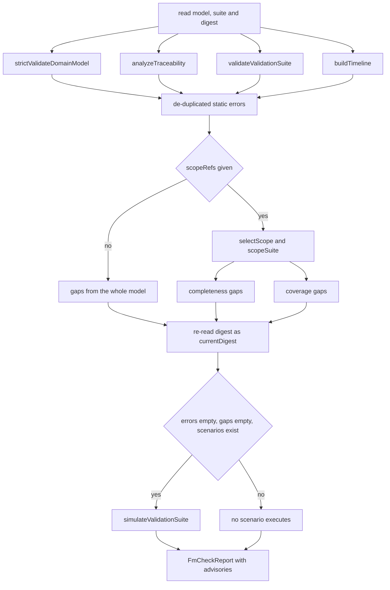
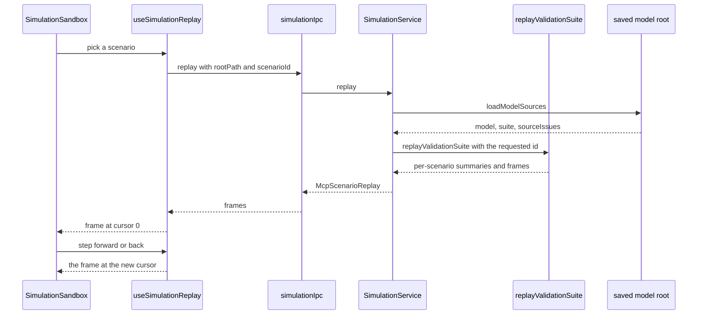
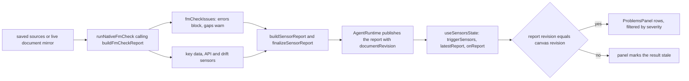

# Checks, simulation and replay

`evidence-model-core` answers one question with one report: *may this model, or
this scope of it, be trusted?* The answer is deliberately split into three
independent ones, because they fail differently and are fixed by different
people:

| Question | Where it lands in the report | Blocking? |
| --- | --- | --- |
| Is the document well-formed? | `errors` from source loading, `strictValidateDomainModel` and the suite's shape checks | yes |
| Is it internally consistent? | `consistent`, plus the rest of `errors`: FM rules, lineage, suite cross-checks against the model, timeline | yes |
| Does it survive a scenario? | `simulationPassed` and `scenarioResults`; the replay shows the same run step by step | yes, once required |
| Is the requested scope complete? | `complete` and `gaps` | only when a scope is asked for |
| Is it good style? | `advisories` | never |

Keeping them apart is what lets a modeler save a half-finished contract without
being told it is "invalid", and lets a consumer refuse the same model without
arguing about style. Only the first three can move a blocking verdict; a scope gap
never blocks a save, and naming advice never blocks anything.

`buildFmCheckReport` is the single entry point; the CLI, the desktop sensors and
the agent tools all call it, so a terminal and a window cannot disagree
(`repo://libs/evidence-model-core/src/validation/fmCheck.ts#L172-L305`).

## The check pipeline in order

The order is causal, not cosmetic: source load problems stop the timeline, an
invalid model stops completeness (`modelValidated` gates it), and a gap stops
simulation. A scenario run on an inconsistent model would prove nothing.

## Consistency

Static errors are the union of
(`repo://libs/evidence-model-core/src/validation/fmCheck.ts#L180-L208`):

- problems found while reading the sources;
- `strictValidateDomainModel` issues, rendered as `path: message`;
- `analyzeTraceability` errors;
- validation-suite errors (shape problems plus the cross-checks against the
  model in `validateValidationSuite`);
- timeline errors.

They are de-duplicated and become `errors`. `consistent` is true only when that
static list is empty **and** the digest did not move during the check
(`repo://libs/evidence-model-core/src/validation/fmCheck.ts#L237-L262`). The
`inputChanged` case also appends `Model inputs changed during validation`, so a
stale conclusion is never a silent one.

This is where the language's structural rules become blocking findings: a
duplicate id, a contract without two roles, a play-role in the wrong direction, a
derivation whose target does not point back, a `many` binding read without a
macro, or an interval that starts after it expires all stop the model here.

### Lineage is part of consistency, not a report to read later

`analyzeTraceability` walks every CEL expression and resolves each read to a
modeled attribute, so a derivation can be explained by the values it consumed
(`repo://libs/evidence-model-core/src/validation/traceability.ts#L386-L430`).
The walk produces the checks that make lineage meaningful: an attribute read the
entity does not declare, an access that does not match its rule binding, two
derivations targeting one attribute, a `derivedByRuleRef` with no matching
target (and the reverse), a key derived attribute that traces to nothing or
depends on scalar inputs, and a derivation cycle. Those errors join the static
list, which is why a lineage mistake fails consistency rather than waiting for
the `lineage` command.

### Lint rules advise, they never block

`auditDomainComponentNaming` reports domain components whose label states the
work instead of the actor (`折扣算法`, `价格计算`) and suggests a rename such as
`折扣计算器`. The advisory carries a code
(`ROLE_DOMAIN_NAME_NOT_ANTHROPOMORPHIC`), the entity id, a message and the
suggestion (`repo://libs/evidence-model-core/src/validation/lintRules.ts#L1-L19`,
`repo://libs/evidence-model-core/src/validation/lintRules.ts#L117-L141`).

Advisories travel in their own report field and are computed for the model as
submitted, never for the scoped projection. A consistent model can therefore
still carry advice, and a test pins exactly that: advice appears while
`consistent` stays true
(`repo://libs/evidence-model-core/src/validation/fmCheck.spec.ts#L73-L97`).

## Scope is a delivery unit, not a filter

`selectScope` takes **independent Context ids** and refuses anything else:

- an id that is not a Context, or that has a `parentContextRef`, is rejected with
  "must be an independent Context, not a fulfillment slice";
- duplicates are rejected.

The walk then keeps whole Contexts, their descendants and real dependencies. Two
rules make it trustworthy
(`repo://libs/evidence-model-core/src/validation/scope.ts#L110-L216`):

- a child stage or a single Fulfillment cannot be selected on its own to hide
  another obligation of the same contract;
- a Participant shared by two Contracts does **not** drag the unrelated Contract
  in: only a non-Party source pulls its outbound references. An unresolved
  `role.context` is retained rather than invented.

`scopeSuite` then keeps only the scenarios and instances the scoped model can
execute, following `basedOn` chains transitively
(`repo://libs/evidence-model-core/src/validation/scope.ts#L225-L278`).

### Completeness gaps

A scope claims completeness only when these hold
(`repo://libs/evidence-model-core/src/validation/scope.ts#L402-L473`,
`repo://libs/evidence-model-core/src/validation/scope.ts#L560-L585`):

- every evidence kind has its mandated business-time attributes;
- every attribute declares `valueType` and `required`;
- every `fulfillment_request` is associated with at least one confirmation or
  Evidence Role;
- every `fulfillment_confirmation` is referenced by at least one request;
- every Contract Context that has requests has **both** contract Parties as right
  holder of at least one primary Fulfillment (`pairingGaps`);
- a Contract Context has a primary Fulfillment Request at all.

Completeness issues already reported as consistency errors are not repeated as
gaps. `complete` is `null` when no scope was asked for, and otherwise true only
when there are no gaps and the model is consistent
(`repo://libs/evidence-model-core/src/validation/fmCheck.ts#L263-L274`).

Gaps are computed even without `--scope` — they describe the whole model — but
they stay non-blocking there, which is why `valid` can be true with a non-empty
`gaps` list. This separation is the answer to "why not just `consistent`?":
consistency is a statement about the graph, completeness is a statement about
delivery. A contract with one obligation direction can be saved and reviewed
while the other is unclear — but it cannot be handed downstream.

## Scenario requirement and coverage gaps

`simulationRules` keeps the rules the Evidence-instance simulator can execute
(those whose bindings and target are Evidence or Evidence Role entities) and
reports the rest as **limitations**, not as passes
(`repo://libs/evidence-model-core/src/validation/scope.ts#L286-L333`).

The requirement is `required` when the scoped model has any applicable rule **or**
any fulfillment request; otherwise `not-applicable`. Without a scope the field is
reported as `not-checked`
(`repo://libs/evidence-model-core/src/validation/fmCheck.ts#L225-L227`).

When a scope was selected and scenarios are required, `coverageGaps` adds a gap for
each of (`repo://libs/evidence-model-core/src/validation/fmCheck.ts#L120-L158`):

- no executable scenario at all;
- an applicable rule no scenario evaluates;
- a fulfillment request whose status no scenario asserts.

A rule without a scenario has not been executed; a request without a status
assertion has not been decided.

## Simulation is deterministic

Scenarios run only when `errors` and `gaps` are both empty and at least one
scenario exists (`repo://libs/evidence-model-core/src/validation/fmCheck.ts#L241-L255`).

Inside `simulateScenario`:

- values are converted from JSON to the CEL type their declared `valueType`
  implies, and `asOf`/`now` are bound from the scenario clock, never from the
  machine (`repo://libs/evidence-model-core/src/validation/ruleActivation.ts#L28-L134`);
- each evaluation binds instances or literals, evaluates the rule, validates the
  result against the rule's `resultType`, normalises it and compares it
  structurally with `expectedResult`
  (`repo://libs/evidence-model-core/src/validation/simulation.ts#L140-L214`);
- a derivation writes its result back into the target instance. If the instance
  already asserts a different value, that is an error, not an overwrite
  (`repo://libs/evidence-model-core/src/validation/simulation.ts#L101-L133`);
- after derivations, every required attribute of every issued instance must have a
  value;
- fulfillment status comes from the issued graph, so a breach or a completion is
  only counted when its inputs were actually issued
  (`repo://libs/evidence-model-core/src/validation/fulfillmentState.ts#L88-L195`).

The status function is the shared one, used by the simulator and the replay
alike — a request cannot be "completed" in one and "pending" in the other for the
same graph (`repo://libs/evidence-model-core/src/validation/fulfillmentState.ts#L88-L95`):

1. an unissued instance, or one whose entity is not a request, is
   `not_requested`;
2. a scenario-level manual completion decision returns `completed`;
3. a `breach` rule whose scoped result is truthy returns `breached`;
4. completion rules count only with at least one related issued confirmation; a
   rule that is true returns `completed`, otherwise `pending`;
5. with no completion rule declared, a related issued confirmation alone makes it
   `completed`.

A suite that fails static validation executes nothing and reports `machineValidated:
false`, because a run over an invalid suite proves nothing
(`repo://libs/evidence-model-core/src/validation/simulation.ts#L313-L357`).

## Replay: the same run, one step at a time

The simulation answers "did it close"; the replay answers "which step closed it".
Nothing in the replay reads a clock either: every frame is the state after one
declared step, so pressing step-forward twice on the same sources always shows the
same two frames (`repo://libs/evidence-model-core/src/validation/replay.ts#L20-L28`).

`replayValidationSuite` returns one `ScenarioReplay` per scenario, or only the
requested ids; an unknown id fails the report instead of yielding an empty pass
(`repo://libs/evidence-model-core/src/validation/replay.ts#L427-L453`). Each
replay carries:

| Field | Meaning |
| --- | --- |
| `givenInstanceRefs` | instances already in force before the first frame |
| `opening` | assertions that only the starting graph could decide |
| `steps[]` | one frame per declared step, in `sequence` order |
| `checkpointCount` | assertions decided inside the frames; the opening's own assertions stay under `opening` |
| `passed` / `errors` | whether the run and its evaluations held |

Each frame records what the acting Role issued, the business time that evidence
carries, its `basedOn` refs, the instances the Role could see, the derivations and
checkpoints that became answerable at that step, and the fulfillment state of
every request issued so far.

Three behaviours are worth knowing before trusting a frame:

- an evaluation is settled at the *first* step where all its required instances
  are issued, not at the end, so intermediate frames carry verdicts
  (`repo://libs/evidence-model-core/src/validation/replay.ts#L159-L264`);
- a derivation only fills an attribute that is not already asserted. A
  contradiction therefore surfaces as a simulation error (and a failing
  `simulationPassed`), while the replay keeps the asserted value and shows the
  computed one in the frame — so the replay of a contradicted suite can pass
  while the simulation of the same suite fails
  (`repo://libs/evidence-model-core/src/validation/replay.ts#L218-L222`);
- a scenario that issues the same instance twice is refused, because the replay
  order would otherwise be undefined, and a suite that does not validate replays
  no steps at all.

Replay is the presentation layer for the same data the desktop sandbox shows,
which is why `replayableScenarioIds` exists: it lists what a caller may ask for in
file order.

## Timeline: order comes from basis, not timestamps

`buildTimeline` groups instances into Context lanes and records three errors
(`repo://libs/evidence-model-core/src/validation/timeline.ts#L170-L341`):

- an interval that starts after it expires;
- a `basedOn` cycle;
- a basis evidence formed **after** the instance that depends on it.

Pairs with no basis path between them are not ordered by timestamp. Within one
Context lane they are reported in `unresolvedOrder` with the reason "no instance
basis path; timestamps do not imply dependency"; pairs in different Contexts are
simply not compared.

The timeline is canonicalised (sorted keys, no whitespace, missing interval bounds
printed as `null`) and hashed, and `timelineSummary` carries the five counts plus
that `sha256`. The digest is part of the report contract, not a formatting detail
(`repo://libs/evidence-model-core/src/validation/timeline.ts#L77-L114`,
`repo://libs/evidence-model-core/src/validation/timeline.ts#L355-L362`). When a
check never got as far as building a timeline, the summary is computed over empty
collections rather than omitted, so the field's shape never varies.

## The report contract

Fields a consumer may rely on
(`repo://libs/evidence-model-core/src/validation/fmCheck.ts#L46-L90`):

| Field | Meaning |
| --- | --- |
| `checkVersion` | `5`; downstream refuses anything else |
| `valid` | no errors **and** `complete !== false` |
| `consistent` | no static errors and inputs unchanged |
| `complete` | `null` without a scope, otherwise gaps-free and consistent |
| `scopeRefs` / `contextRefs` | what was asked for and what the scope resolved to |
| `gaps` | completeness and coverage warnings |
| `advisories` | non-blocking naming advice |
| `humanConfirmation` | literal `not-asserted-by-machine` |
| `modelDigest` | `sha256:…` of the sources the report describes |
| `inputChanged` | the sources moved during the check |
| `modelValidated` | structural + lineage checks passed |
| `scenarioRequirement` | `required` / `not-applicable` / `not-checked` |
| `scenarioCount`, `executedScenarioCount`, `simulationPassed` | execution facts |
| `simulationLimitations` | rules the simulator cannot execute |
| `scenarioResults` | per-scenario evaluations and statuses |
| `timelineSummary` | counts and digest |
| `errors` | blocking messages |

The `humanConfirmation` literal is the honest part: the machine never claims a
person approved anything.

### Downstream readiness

`readyScope` is the stricter gate a consumer uses. It rebuilds the delivered scope
from the report and refuses unless version 5, `consistent`, `complete`, `valid`, no
errors, no gaps, `inputChanged === false`, simulation passed or not applicable, and
the report's `scopeRefs`, `contextRefs` and `scenarioRequirement` still match the
current source. When scenarios are required, every applicable scenario must have
executed (`repo://libs/evidence-model-core/src/validation/scope.ts#L624-L690`).

Its error message states the boundary: "consistency is not delivery readiness or
human confirmation".

## The desktop sandbox hub and the drift radar

The desktop exposes two of these reads through one panel,
`SimulationSandbox`, with two tabs: scenario replay and production drift. They
share a panel because they are two questions about the same model — does it still
hold, does production still match it — and a modeler who just watched a step fail
is the person most likely to open a trace.

Frames are computed in the main process; the renderer only decides which one is
on screen.

### Why the answer comes from disk, not the canvas

`registerSimulationIpc` answers on three channels — `evidence:simulation:replay`,
`evidence:simulation:drift` and `evidence:simulation:trace-dialog` — and both
services read the **saved** sources: `createSimulationService` loads the model
root per call, and `runNativeDriftAudit` reads it for that call rather than taking
a session document
(`repo://apps/desktop/src/main/simulationIpc.ts#L12-L18`,
`repo://apps/desktop/src/main/mcpSimulationService.ts#L16-L21`,
`repo://libs/evidence-agent/src/sensors/native/nativeDriftAudit.ts#L6-L30`).

That is not an implementation shortcut, it is the point of the verdict. A replay
shown next to an unsaved canvas revision would describe a model no service is
running, and an audit of a production trace has to be against what was deployed —
otherwise "production matches the model" could be made true by typing. The
renderer has no filesystem access either, so the trace file is read and parsed in
the main process; a file that is not JSON fails with the message from the parser
instead of producing an empty, passing audit
(`repo://apps/desktop/src/main/simulationIpc.ts#L28-L38`).

The gate's own report is the deliberate exception: the sensors may be handed the
mirrored live document, and the report then carries `documentRevision`. The
problems panel compares that revision with the canvas and marks the rows stale as
soon as they diverge, so a live result is always labelled with the revision it
describes (`repo://apps/desktop/src/main/agentRuntime.ts#L111-L131`,
`repo://apps/desktop/src/renderer/screens/EditorScreen.tsx#L229-L236`).

### Playback is a cursor, not a timer

`useSimulationReplay` keeps `{ replay, scenarioId, cursor, loading, error }` and
nothing else: `stepForward`/`stepBack` move an index into `frames`, `reset` returns
to the first frame, and `atEnd` disables the control rather than looping. A reply
that arrives after the panel closed—or after another scenario was requested—is
dropped by a request counter, so a late answer cannot reopen a frame
(`repo://apps/desktop/src/renderer/state/useSimulation.ts#L10-L127`).

The panel is deliberately thin over that state: it lists scenario summaries with
step and checkpoint counts, shows the current frame's derivations, fulfillment
states and checkpoints, and offers "focus on canvas" so a frame's entity becomes
the selected object. An unknown or empty scenario list is reported as *nothing to
replay yet*, not as a pass: the service turns an empty replay into a failure with
a message, because a replay that played nothing is not a conclusion
(`repo://apps/desktop/src/main/mcpSimulationService.ts#L103-L134`).

The same service is what agents read: the MCP bridge maps
`run_scenario_replay` and `audit_production_drift` onto
`SimulationService.replay`/`auditDrift` using the active project root, so a window
and an agent see the same frames and the same findings
(`repo://apps/desktop/src/main/mcpRequestHandler.ts#L111-L121`).

### Drift is a question, not a defect list

`auditProductionDrift` compares one exported trace with the model and classifies
each disagreement
(`repo://libs/evidence-agent/src/sensors/native/driftSensor.ts#L20-L34`,
`repo://libs/evidence-agent/src/sensors/native/driftSensor.ts#L99-L102`):

| Kind | Severity | Question it raises |
| --- | --- | --- |
| `UNMODELED_EVIDENCE_COMMITTED` | block | a business fact no contract covers |
| `DERIVED_VALUE_SUPPLIED` | block | the service decided a value the model derives |
| `UNMODELED_ATTRIBUTE_WRITTEN` | warn | a field that will never reach lineage or a contract |
| `CROSS_CONTEXT_WRITE` | warn | a context writing into someone else's responsibility |
| `BREACH_WITHOUT_FOLLOW_UP` | warn | a breach with no compensation evidence in the trace |

Only the two blocking kinds make `passed` false; warnings still need a decision
but the audit is not withheld. Every finding carries the commit it came from, the
model's expectation and a `remediation`, so the reader knows which side to move.
A breach finding is raised both when the model declares no breach/compensation
pair at all and when it declares one that the trace shows no follow-up for
(`repo://libs/evidence-agent/src/sensors/native/driftSensor.ts#L286-L356`).

Source read problems are merged into the audit's `errors`, because an audit that
could not see the whole model must not read like a clean comparison. The radar
surfaces exactly this shape: span and commit counts, blocking-versus-warning
status, and one card per finding with its remedy
(`repo://libs/evidence-agent/src/sensors/native/nativeDriftAudit.ts#L19-L30`).

## From report to problems panel

The check does not paint the UI directly; it becomes a `SensorReport`, which is
what both the status bar and the problems panel read.

The mapping from report fields to rows is fixed
(`repo://libs/evidence-agent/src/sensors/sensorReport.ts#L197-L245`):

| Report field | Row |
| --- | --- |
| `errors[]` | `block`, code `FM_INCONSISTENT` |
| `gaps[]` | `warn`, code `FM_SCOPE_GAP` |
| `inputChanged` | `warn`, code `FM_INPUT_CHANGED` |
| `executedScenarioCount === 0` | `info`, code `FM_NO_SCENARIO` |
| `advisories[]` | `warn`, one code per advisory, targeted at the entity |
| drift findings | `block`/`warn`, one row per finding, remedy as the suggestion |

Rows are deduplicated by a stable `issueId` (`source:code:message`) when the
report is finalized, and the panel filters by severity without owning the rule, so
"block" always means the same thing in the gate, the console, the CLI and the
sandbox (`repo://libs/evidence-agent/src/sensors/sensorReport.ts#L319-L333`,
`repo://apps/desktop/src/renderer/components/console/problemFilters.ts#L1-L19`).

## Command-line face

`evidence-model check <model> [--scope <context>]... [--json]` runs exactly the
same `buildFmCheckReport`, printing consistency, scope completeness, scenario
counts, the digest, then blocking errors, scope gaps and non-blocking advice, and
exits `1` when the report is not valid
(`repo://libs/evidence-model-io/src/cli.ts#L330-L427`).

`check` reads a `.evidence/fm` directory; a bundle is refused with a hint to
`unpack` first, so a report always names files a reader can open.

Each derived command refuses on its own condition rather than a shared gate:

| Command | Refuses when |
| --- | --- |
| `compile` | the model's check report is not valid |
| `lineage` | the model's check report is not valid |
| `timeline` | the timeline reports an ordering error |
| `simulate` | the simulation report says `simulationPassed: false` |
| `role-play` | the scenario cannot be built, or `--force` is missing for an existing directory |

## Failure behaviour

| Situation | Result |
| --- | --- |
| structural error | `consistent: false`, `valid: false`, error listed |
| source changed mid-check | `inputChanged: true`, `consistent: false`, error added |
| scope is a child/duplicated Context | `ScopeSelectionError` message becomes a blocking error |
| scope has missing responsibility | gap, `complete: false` |
| no scenarios for a required scope | gap, simulation not run |
| scenario expectation mismatch | error naming rule and both values |
| derived value contradicts an asserted value | simulation error, value not overwritten |
| invalid validation suite | no scenario executes, `machineValidated: false` |
| interval start after expire / basis cycle / future basis | timeline error |
| unordered pair | `unresolvedOrder`, not a guess |
| replay of an unknown scenario id | report fails with the id, no frames |
| sandbox or radar cannot read the model root | `passed: false` with the read error, never a silent pass |
| trace file is not JSON | IPC rejects with the parse message, no audit is produced |

## Tests that protect this contract

- `fmCheck.spec.ts` pins consistency-only reports, advisories that do not move the
  verdict, the scope report against the pinned digest and timeline summary,
  staleness on source change, refusal of a non-independent scope, the Contract
  Context gap, and lineage errors
  (`repo://libs/evidence-model-core/src/validation/fmCheck.spec.ts#L49-L170`,
  `repo://libs/evidence-model-core/src/validation/fmCheck.spec.ts#L193-L253`).
- `lintRules.spec.ts` pins the naming advice: silent for actor-shaped names,
  suggested for work-shaped ones, silent for parties
  (`repo://libs/evidence-model-core/src/validation/lintRules.spec.ts#L45-L102`).
- `scope.spec.ts` pins whole-context selection, dependency retention, child and
  duplicate refusal, suite narrowing, simulator applicability, completeness gaps
  and the "party never holds a request" gap
  (`repo://libs/evidence-model-core/src/validation/scope.spec.ts#L47-L158`).
- `simulation.spec.ts` pins golden-fixture execution, derivation write-back, "no
  scenario executes on an invalid suite", scenario selection, unknown ids and
  named expectation failures
  (`repo://libs/evidence-model-core/src/validation/simulation.spec.ts#L22-L160`).
- `replay.spec.ts` pins one frame per declared step in sequence order, assertions
  decided at the step that made them answerable, pending-to-completed transitions,
  a breach decided on the frame that already satisfies it, refusal of an invalid
  suite, unknown ids and byte-identical repeat runs
  (`repo://libs/evidence-model-core/src/validation/replay.spec.ts#L23-L176`).
- `timeline.spec.ts` pins basis ordering, interval, future-basis and cycle errors,
  the summary counts and canonical digests
  (`repo://libs/evidence-model-core/src/validation/timeline.spec.ts#L23-L129`).
- `validationSuite.spec.ts` pins source reading, filename/id mismatch, duplicate
  ids, suite validation and typed-value checks
  (`repo://libs/evidence-model-core/src/validation/validationSuite.spec.ts#L45-L211`).
- `driftSensor.spec.ts` pins each drift kind and its severity, including
  "production commits exactly what the model declares"
  (`repo://libs/evidence-agent/src/sensors/native/driftSensor.spec.ts#L72-L260`).
- On the desktop, `mcpSimulationService.spec.ts` pins summaries without frames,
  requested frames, the unknown-scenario failure and an unreadable model root
  (`repo://apps/desktop/src/main/mcpSimulationService.spec.ts#L73-L134`);
  `simulationIpc.spec.ts` pins channel forwarding, trace parsing, cancelled
  pickers and handler disposal
  (`repo://apps/desktop/src/main/simulationIpc.spec.ts#L77-L151`);
  `SimulationSandbox.spec.tsx` pins frame-by-frame playback, the scenario actually
  requested, canvas focus, drift rendering and the kept audit when the picker is
  cancelled (`repo://apps/desktop/src/renderer/components/simulation/SimulationSandbox.spec.tsx#L66-L226`).

## Related pages

- [Sensors, stage gate and the dependency frontier](../agents/sensor-orchestration.md) —
  how this report is folded into one verdict.
- [Workspace surfaces](../desktop/workspace-surfaces.md) — where the sandbox, the
  problems panel and the console live.
- [Commands and session](../model/commands-and-session.md) — the editable model a
  check is run against.
- [Verification strategy](../testing/verification-strategy.md) — the golden
  fixtures and pinned digests this page relies on.
- [The Fulfillment Modeling DSL (FM v5)](../language/fm-dsl.md) — the structural
  rules that produce the blocking errors.
- [Key data, business time and provenance](../language/key-data-and-provenance.md) —
  lineage and the ledger.
