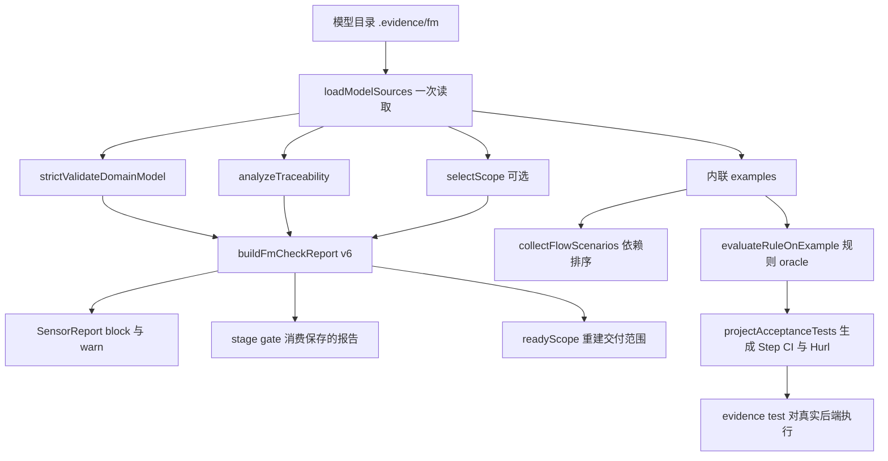

# 静态检查、CEL 与样例求值

历史页名为兼容导航保留，但系统里已经没有 timeline/replay 执行器，也没有那种"跑完整场景、给出通过或失败"的内存模拟器。留下来的是一条**静态 FM v6 + native CEL + 编译期 examples oracle + 标准 HTTP 验收**的链路；内存里只剩逐点的规则沙箱，不产出验收结论。本页解释每一段各证明什么。

## 四种结论不能互相替代

同一份模型会得到四种不同性质的结论。把它们混读，是这一层最常见的错误。

| 结论 | 谁计算 | 证明了什么 | 不能证明什么 |
| --- | --- | --- | --- |
| 静态一致性 | `strictValidateDomainModel` + `analyzeTraceability` | 结构合法、引用闭合、规则的每次读取都落到真实属性、血缘无环 | 责任是否完整、代码是否照做 |
| scope 完整性 | `selectScope` + `completenessGaps` | 该交付范围内的责任闭环、违约声明结构成立 | 业务批准、机器代签 |
| 示例求值 | `evaluateRuleOnExample`、`projectAcceptanceTests` | 规则在给定 typed 输入与显式 `asOf` 下算出什么 | 后端真的执行了这条规则 |
| 真实 HTTP 验收 | `evidence test` / `export-tests` + Step CI、Hurl | 独立后端进程的状态码、字段与 schema | 业务正当性、合同最终效力 |

一次静态检查的数据流：报告分叉给传感器、门禁与交付范围，只有最右侧一支接触真实后端。

## FM check v6 只证明静态事实

`buildFmCheckReport` 同步聚合三类静态问题：`sourceIssues`（读取 `.evidence/fm` 时的 `path: message`）、`strictValidateDomainModel` 的 path/message、`analyzeTraceability` 的错误。去重后形成 `staticErrors` 与 `modelValidated`。只有用户显式给出 `scopeRefs` 且模型已通过静态检查时才 `selectScope`；`ScopeSelectionError` 的消息进入 errors，其他异常原样抛出——检查器不吞内部故障。

摘要与时间戳是报告契约的一部分：

- `digestOf` 对 `compactCanonicalJson` 加一个结尾换行做 sha256，因此同一模型的对象键序不同仍得同一摘要；
- 目录摘要由 `modelDigestOf` 按 `path` + 字节计算，文件顺序变化不改变它；
- `currentDigest` 回调与输入 digest 比较，不一致时追加 `Model inputs changed during validation`，`inputChanged=true`、`consistent=false`。

判定只有三条：`consistent` = 无静态错误且未变化；`complete` = 无 scope 时为 `null`，有 scope 时为 `gaps` 为空且 `consistent`；`valid` = 无 errors 且 `complete !== false`。所以**无 scope 的运行即使有 gaps 也可以 valid**——那是"一致性通过、完整性没问"的意思，不能读成交付就绪。

报告字段 `checkVersion=6`，携带 `scopeRefs`/`contextRefs`/`gaps`/`errors`、`modelDigest`/`modelValidated`/`inputChanged`、`humanConfirmation: not-asserted-by-machine`，以及 `testExampleCount`（**target 范围内声明了 `test` 的样例数，不是执行数**）。`simulationPassed`、`scenarioResults`、`timelineSummary` 不再出现，`fmCheck.spec.ts` 直接断言这些属性不存在。

## 静态红线：AST、语义与血缘

schema 层负责结构，`analyzeTraceability` 负责语义。它把每条规则表达式编译成 native CEL AST，再沿词法作用域检查：

- `many` 绑定必须经 CEL 集合宏（`exists`、`all`、`map`、`filter`…）访问，直接取字段报 `must be accessed through a CEL collection macro`；
- 绑定必须是 `entity` 级引用，用 `[]`/`[?]` 索引时必须是静态字符串，否则"无法追溯"；
- 每次读取都必须命中该 Entity 声明的属性，否则 `reads unknown attribute 'entity#attribute'`；
- 访问所属 Entity 必须与绑定声明的 `ref` 一致；
- 同一属性不能被两条派生规则同时作为 `target`；
- `derivedByRuleRef` 与派生规则必须互相对应；
- `keyData` 派生属性必须至少追溯到一个建模属性，且其 scalar `type` 输入不得参与——关键数字不能来自凭空常量；
- 血缘边成环即报错，并打印闭环路径。

语法错误不算血缘错误：`compileCelExpression` 抛 `ParseError` 时 `extractRuleAttributeAccesses` 返回空结果，把语法诊断留给静态检查，避免一次笔误制造两处噪声。

要记住的边界：CEL 环境以 `unlistedVariablesAreDyn: true` 创建，**表达式能 parse 不等于模型绑定正确**——绑定正确性由上面的血缘规则判定；**表达式能求值也不等于后端执行了它**。

## Scope 是交付单位

`selectScope` 只接受独立 Context，拒绝非 Context、`parentContextRef` 非空的子切片与重复 ID。选中后按"整个 Context 子树 + 真实出站依赖"扩张：实体、规则、关系一起索引，`*Ref`/`*Refs`/`ref`/`basedOn` 都算引用，但 `examples` 被显式跳过——内联样例里的 `basedOn` 与 `contextRef` 是测试引用，不是模型的职责边。

两条刻意的克制：只有非 `participant.party` 的来源才拉出站关系，所以两个合同共享一个参与方不会把无关合同整包拖进来；未知的 Context Role 实现被保留而不是猜造。输出模型的 `entryContextRefs` 被覆盖为请求的 scope 列表。

`completenessIssues` 只在"被要求完整"时才失败，覆盖：属性必须有 `valueType` 与 `required`；每类证据必须带上 `REQUIRED_EVIDENCE_TIME_ATTRIBUTES` 规定的业务时间属性；每个 Fulfillment Request 必须有同 Context 的 Confirmation 或 Evidence Role 通过 `references` 关系或完成/违约规则绑定关掉；每个 Confirmation 必须被某个 Request 引用。`pairingGaps` 再要求合同双方都作为 primary 履约的权利人。

`completenessGaps` 是它们的并集：`completenessIssues`（先滤掉已经是静态错误的条目，同一缺陷不重复成 gap）再加三类——Contract Context 必须已有 primary Fulfillment Request、`pairingGaps`（合同双方都得是某个 primary Fulfillment Request 的权利人）、`breachFlowGaps`。它是"gaps 报出、不抛出"的：一条已识别的责任方向可以先存盘评审，另一边还没想清。

`readyScope` 是下游真正的读法：要求报告 `checkVersion === 6`、`consistent`/`complete`/`valid` 全为 `true`、`errors` 与 `gaps` 为空、`inputChanged === false`，然后**从当前源码重建同一 scope**，比对重建出的 Context 集合与报告里的 `contextRefs`，不一致即 `FM checked scope dependencies do not match current source`。它消费的是"门禁证明过的范围身份"，不是一句 `valid: true`；错误信息本身就在提醒：一致性既不是交付就绪，也不是人工确认。旧 replay/count 字段它一个都不看。

## Breach flow：结构声明，不是法律结论

违约路径写在关系上：`flowKind` 取值 `primary` | `breach_compensation` | `escalation`，**缺省在读取时视为 primary，且从不写回默认值**。schema 拒绝未知取值；`setRelationshipFlowMutator` 只允许 `references` 关系声明 flow，改回 `primary` 会删除字段而不是写入。

`breachFlowGaps` 只认显式声明，绝不由标签推断语义（把实体改名成"超时赔偿"不会产生任何 gap）：

- 任何非 primary 的 flow 边都必须是 `references` 且 target 是 `evidence.fulfillment_request`，否则 `breach flow must reference the breached Fulfillment Request`；
- `breach_compensation` 的 source 必须是**新的** Fulfillment Request，否则 `compensation source must be a new Fulfillment Request`；补偿链成环报 `compensation chain must be cyclic`；
- `escalation` 的 source 必须是 `other_evidence`、带 `responsibleRoleRef`、并写明移交终点（`notes` 非空），否则 `escalation requires an Evidence record, responsible role and notes naming the hand-off endpoint`。

这些 gap 通过 `completenessGaps` 进入 `complete`，因此表现为 warn 级 `FM_SCOPE_GAP` 并让门禁关闭；它们**不是**静态错误——结构合法但方向写错的 breach 声明只产生 gap，不会让 `consistent` 变 false（未知的 `flowKind` 取值则由 schema 直接判为静态错误）。检查器只证明结构：注释明确写着不推断法律含义、不裁决最终效力。

画布上的标记也来自同一份声明而非推测：布局边携带 `flowKind`，`FulfillmentEdge` 据此着色（补偿橙色、升级紫色）、改虚线样式，并在边中点挂一枚 `RELATIONSHIP_FLOW_LABELS` 文字标签，`data-flow-kind` 暴露给测试；标记在无 hover 时依然可见。`flowKind` 缺失即"正常履约"，没有装饰。

### lint advisory 与 verdict 无关

`auditDomainComponentNaming` 只产出一条 `ROLE_DOMAIN_NAME_NOT_ANTHROPOMORPHIC` 建议：领域组件（`role.domain`，或带 `domainRole` 的 `participant.thing`）如果名字描述的是"做的事"（`折扣算法`、`价格计算`），就建议改成能承担动作的名字（`折扣计算器`）。替换逻辑保留业务名词、只换实现后缀。

它是 `advisories`，与 `errors` 分开存放，**永不改变 `consistent`/`complete`/`valid`**；传感器把它折成 warn 并定位到 `entityId`，CLI 打印在"建模建议（不阻断）"下。advisories 始终针对提交的整个模型计算，即使这次只检查了一个 scope。

## 原生 CEL 是解析与求值的权威

`celEvaluator` 直接使用 `@marcbachmann/cel-js` 的 `Environment({ unlistedVariablesAreDyn: true })` 与 `environment.parse`，`CompiledCel` 暴露 native `ParseResult`/AST 和可重复 `evaluate`。没有自制解释器，也没有把 AST 转译回 JS 的第二条路径：

- native 错误保留原始 `range`/`cause`（`ParseError` 的 range 被测到字符级），求值错误是 `EvaluationError`；
- `Timestamp` 输入按声明类型转 `Date`，但只转换 RFC 3339 文本，原 activation 不被改写；
- `identifiers()` 用带作用域的 AST walker 收集自由标识符，排除 CEL 内建常量/namespace 与宏局部变量（`cel.bind`、`exists(x, …)` 的 `x` 不算），并保持源码顺序——血缘检查就靠它判断"关键派生有没有读外部标量"。

**精确整数纪律**是这条链的核心契约。`int`/`uint` 在 CEL 里是 `bigint`/`UnsignedInt`，不走 double 中间态。跨到 JSON 时由 `celValueToJson` 归一化：

| CEL 值 | JSON 表示 |
| --- | --- |
| `Date` | 秒级 `...Z` UTC 字符串 |
| `Duration` | 原生字符串，保留纳秒精度（如 `0.001000001s`） |
| `UnsignedInt` | 展开后按整数规则处理 |
| safe 范围内 `bigint` | `number` |
| 更宽的 `bigint` | **精确十进制字符串** |
| `bytes` | base64 字符串 |
| `Map` 与嵌套容器 | 递归归一化，不泄漏 native 类 |

输入侧由 `validateTypedValue` 守住同一条线：`int`/`uint` 接受 safe 的 JS 整数或落在 int64/uint64 范围内的精确十进制字符串，拒绝 unsafe number（`9007199254740992` 这种整数也不行）、越界、`01`、`1.5`；`timestamp` 必须是带显式偏移的 RFC 3339；`duration` 交给 CEL 解析；`money` 必须是 `{minorUnits 整数, currency 非空}`。这样"大于 JS 安全范围"不再是拒绝理由，而"用 double 静默舍入"变成不可能。

这条纪律之所以算报告契约，是因为精确十进制字符串可以一路保留到 OpenAPI schema 与测试字面量；一旦中途变 number，舍入就会在验收里制造伪绿。

## 内联 examples oracle

`evaluateRuleOnExample(model, rule, { bindings, asOf })` 是编译期预期生成器：无 Node I/O、不读环境时钟、不加载任何 scenario 文件。

- `asOf` 必须是 RFC 3339，否则失败；
- 传入未知 alias、缺少 `one`/`many` 形态的绑定、无法解析 entity 或类型不符，全部失败，消息带 `rule.id` 前缀；
- `now`/`asOf` 这类 `type: timestamp` 的仅类型别名由显式 `asOf` 注入，用户传了不同值直接拒绝——时钟只有一个来源；
- entity 绑定按模型属性声明的 `valueType` 逐个转换（未声明类型按 `dynamic`），`many` 必须给列表；
- 每个值先 `structuredClone`，所以在 spec 里能断言输入对象原样不变；
- 求值后 `celValueToJson` → 按 `rule.resultType` 校验 → JSON 往返，剔除 `undefined`、`bigint`、非有限数等不可表示值；失败保留 rule ID 与 `cause`。

它不知道后端会怎样，只回答"按模型算出来是多少"。同一份 oracle 服务三个消费者：验收投影器、Scenario Studio 的本地核对、以及 what-if 沙箱。

`simulateWhatIf` 是最容易被误读成"模拟器"的一段，实际仍是内存里的规则沙箱：进入函数先 `structuredClone` 输入，避免与编辑器后续改动混版；假设只能改非派生输入字段，覆盖未知或派生字段即报错；假设时钟不得早于依赖事实；派生值一律从原始事实重算，**已声明的派生值先删掉再算**，绝不把自己的预期答案当输入；判定规则必须返回 boolean；AI 只负责抽取假设与解释，`native CEL` 才是裁决者。它不写模型，也不代表后端执行。

## Flow 场景聚合：能不能执行取决于依赖图

`collectFlowScenarios(model, fmCheckReport?)` 把内联 `examples[].test.flow` 聚合成"已声明事实"的故事，不执行规则、不做 I/O、不跑测试：

- 步的引用是 `entityId#exampleLabel`；依赖先按规范引用精确匹配，再退回 `value.id`/`value.ref` 别名，别名必须在同一 flow 内无歧义；
- 排序是拓扑序：依赖先出，同层按 `asOf` 的真实时刻（不是字符串）再按规范引用文本；`sequence` 从 1 开始；
- `stepHash` 只覆盖本地业务事实（entity、kind、actingRoleRef、asOf、basedOn、values、derivedAssertions），不含 `sequence` 与展示元数据，所以插入一步只会让 `traceDigest` 变、不会让其他步的指纹失效；`traceDigest` 是排序后 `stepHash` 拼接的 sha256；
- 断言只是从 `test.expect` 抄来，不求值；负向样例（`bad-input`）照样留在故事里；
- 传入 FM 报告时按 `entityId`、所属 `contextRef`、`entityId.attribute` 三个 subject 前缀匹配 gap，排序去重后挂到步上；gap 不进入指纹，换一份报告不会改哈希。没有报告就没有 gap。

图不合法时它**拒绝执行**，而不是把图摊平成一个看起来合理的顺序——静默重排等于凭空发明因果。所有失败都是 `FlowScenarioError`，带 `code`、`flowId`、`exampleRefs` 与可选的 `dependencyRef`：

| 错误码 | 触发条件 |
| --- | --- |
| `DUPLICATE_EXAMPLE_REF` | 同一 `entityId#label` 出现两次，引用会指向两个步 |
| `UNKNOWN_DEPENDENCY` | `basedOn` 既不是规范引用也匹配不到任何别名 |
| `AMBIGUOUS_DEPENDENCY` | 别名在同一 flow 内匹配到多个步，无法判断读的是哪一个事实 |
| `CROSS_FLOW_DEPENDENCY` | 依赖落在另一个 flow，场景隔离被打破 |
| `CYCLIC_DEPENDENCY` | 拓扑排序排不完，报出的是真正的环成员（不是被环阻塞的下游步），并打印闭环路径；自依赖同样命中 |

因此 `evidence story` 与桌面的业务流投影/导出、Scenario Studio 的场景发布（`replaceScenarioExamples` 在写入前先跑一遍聚合）都会在同一处失败：错误消息进 stderr 或 IPC 错误，用户看到的是 `code: flow 'x': …`，而不是一份悄悄少一步的故事。what-if 由调用方先取到 flow，并自己再守一道：依赖必须早于消费它的步，否则报 `Dependency 'x' must precede …`。真正的 HTTP 执行走另一条路：`projectAcceptanceTests` 从同一批 `test` 元数据生成可运行脚本，并自带更严的校验（必须恰好一条已建模 POST 路由、角色可调用、状态码已声明、不能依赖被拒绝的操作、依赖时钟不能晚于本步、路径参数必须有 `exampleRef`+`jsonpath` 捕获源）。

## 从报告到传感器与 stage gate

`runNativeFmCheck` 在 `loadModelSources` 的一次读取上运行：模型、`sourceIssues`、目录摘要、`rereadDigest` 都描述同一批字节，`inputChanged` 才可信。同一次读取里只算一遍 `analyzeTraceability`，血缘文档与报告一起返回，关键数据台账复用同一份血缘，两个结论不会互相矛盾。

传感器侧把报告折成 `SensorIssue`：`errors` → block `FM_INCONSISTENT`，`gaps` → warn `FM_SCOPE_GAP`，`inputChanged` → warn `FM_INPUT_CHANGED`，`advisories` → warn（保留自身 code、定位 `entityId`）。severity 与状态栏语义见[传感器、门禁与生产漂移](../agents/sensor-orchestration.md)。

stage gate 消费的是**保存下来的** v6 报告，而不是实时模型：`filterFmCheckErrors` 逐条判定 `checkVersion === 6`、`consistent`、`complete`、`valid`、`inputChanged === false`、无 `errors`、无 `gaps`，并检查每个被请求的 scope 都出现在 `scopeRefs` 中；空 scope 列表直接拒绝——"下游不消费无边界模型"。每个条件单独判定，拒绝原因累积返回，审查者一次看全。`sensorsEngine.checkStageGate` 还会以 `apiMode: 'release'` 重跑一次，把保存报告的 `modelDigest` 与新一轮摘要比对，不一致就追加"FM 检查与当前模型摘要不一致，请重新检查"。

## CLI 与桌面当前入口

`evidence check [model] --scope <context> --json` 共享同一份报告，`--scope` 可重复；`loadModel` 接受模型树或 `*.evidence.json` bundle，`--json` 直接打印报告对象，退出码只由 `valid` 决定，文本模式明写 `PASSED: static model checks (not HTTP acceptance)`。`evidence-model` 兼容工作流里的 `check` 有自身目录约束（bundle 要求先 unpack），不要把旧 bin 的限制泛化到统一 `check`；`compile`/`lineage` 都先 `ensureCheckable`，静态检查不过就不产出派生物。

旧 `timeline`/`simulate`/`role-play` 命令与 MCP 侧的 scenario replay 方法已明确移除，不会返回空成功；`legacyRemoval.spec.ts` 与 MCP 的 `UNSUPPORTED_METHOD` 分支守着这条线。桌面只把"描述当前 live revision（含 undo/redo）"的报告当数：`EditorScreen` 在报告 `documentRevision` 不等于当前 revision、或处于 loading/error 时把诊断标成过期，ProblemsPanel 据此显示"结果已过期"。实时静态检查不修改模型，也不代替保存或业务批准。

## 验证与故障边界

`fmCheck.spec.ts` 钉住 v6 字段、`complete: null`、摘要变化、非独立 Context 拒绝、gap 与 advisory；`scope.spec.ts` 守住 `referencesOf` 忽略样例、scope 边界、`readyScope` 拒绝 v5 报告；`breachFlow.spec.ts` 覆盖补偿/升级/成环，以及违约标记经单次 session mutation 可撤销；`flowAggregator.spec.ts` 覆盖排序、别名、五个错误码、负向样例保留、gap 匹配与宽/深图；`celEvaluator.spec.ts`/`transientSandbox.spec.ts` 覆盖 native 功能、宏作用域、精确整数与时钟注入；`acceptance.e2e.spec.ts` 用独立后端进程证明生成的 Step CI 会因错误派生值或后端接受调用方派生字段而变红。

遇错按层定位：语法/引用/血缘 → 修模型；scope gaps（含 breach flow）→ 补责任闭环；oracle 绑定或期望冲突 → 修 `examples` 或规则；flow 错误码 → 修 `basedOn`/flow 归属；HTTP 失败 → 修实际实现；源在检查期间变了 → 重跑；工具或传感器不可用 → 显式报 `SENSOR_UNAVAILABLE`，绝不编造一个成功结论。

相关：[语言与 CEL 规则](../language/fm-dsl.md) · [关键数据与血缘](../language/key-data-and-provenance.md) · [API 验收投影](../contracts/api-projection.md) · [CLI 与命令治理](../workflows/cli-governance.md) · [命令与会话](commands-and-session.md) · [验证策略](../testing/verification-strategy.md)
