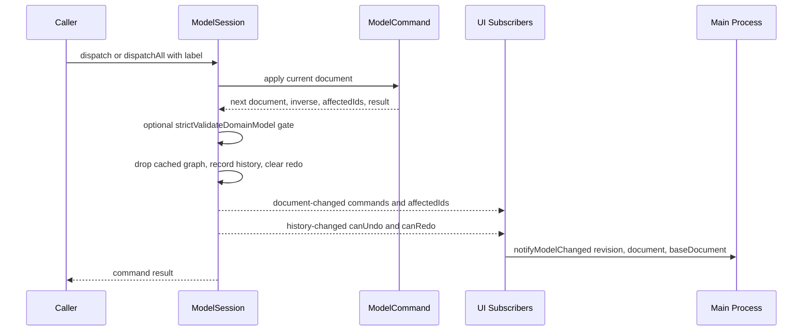
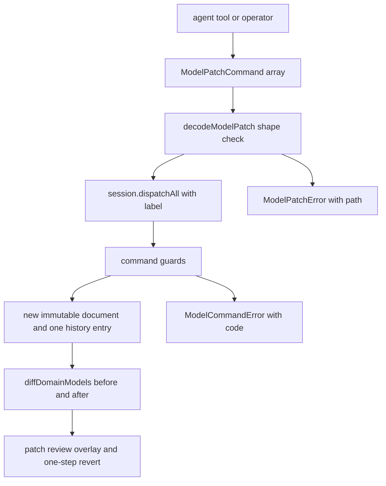

# Commands and the model session

A model document is a plain, immutable JSON tree. Everything that edits it at
runtime — a keystroke in the inspector, an undo, a cell edit in the ledger, an
agent patch, an external MCP call — goes through one object:
`ModelSession`, created by `createModelSession`
(`repo://libs/evidence-model-core/src/session/createModelSession.ts`). The session
owns the current document, the derived graph, the selection, the undo/redo stacks
and the subscriber list. There is no setter and no second write path; `dispatch`,
`dispatchAll` and `replaceDocument` are the whole mutation surface.

That single funnel is what lets the app promise three things at once:

- every edit is a deterministic transition with a recorded inverse;
- every edit passes the same guards (and, optionally, the same static gate);
- every edit is one undo step, whether a human or an agent made it.

## The session contract

`createModelSession(options)` takes the starting document plus two optional knobs
(`repo://libs/evidence-model-core/src/session/createModelSession.ts#L28-L60`):

| Option | Default | Meaning |
| --- | --- | --- |
| `document` | required | the document the editor opens with |
| `historyLimit` | `100`, clamped to at least `1` | how many undo steps stay in memory |
| `validateOnDispatch` | `false` | run `strictValidateDomainModel` on the *next* document and refuse the transition if it is invalid |

The returned `ModelSession` splits cleanly into reads, transitions, history,
selection and subscription:

| Surface | Behaviour |
| --- | --- |
| `getDocument()` | the current immutable document |
| `getGraph()` | `createDomainGraph(document)`, memoised until the document changes |
| `validate()` | `strictValidateDomainModel(document)` computed fresh on each call, never cached |
| `dispatch(command)` | applies one command, records one history entry, returns the command's result |
| `dispatchAll(commands, label?)` | applies a batch as one transaction and one history entry |
| `undo()` / `redo()` | apply the stored inverse / original; return `false` on an empty stack |
| `canUndo()` / `canRedo()` | history state without mutating it |
| `select(nodeId)` / `selectAttribute(nodeId, name)` / `clearSelection()` | selection lives here, not in the renderer |
| `getSelection()` | `{ nodeId, attributeName }`, both `null` when nothing is selected |
| `replaceDocument(next, { resetHistory })` | wholesale replacement for reloads and branch checkouts |
| `subscribe(listener)` | registers a listener and returns its unsubscribe function |

Three event shapes are the only thing a UI may depend on
(`repo://libs/evidence-model-core/src/session/createModelSession.ts#L20-L27`):

| Event | Payload | Emitted when |
| --- | --- | --- |
| `document-changed` | `commands: readonly string[]`, `affectedIds: readonly string[]` | after every successful dispatch, batch, undo, redo and `replaceDocument` |
| `history-changed` | `canUndo`, `canRedo` | immediately after `document-changed` for every transition |
| `selection-changed` | `selection` | on `select`/`selectAttribute`/`clearSelection`, and when a change deletes the selected node |

`affectedIds` is what the renderer is expected to refresh; `commands` is a list of
command *types* (`['update-entity', 'update-entity']` for a batch), or a prefixed
label (`undo:agent:<rationale>`) for history transitions, which is how a UI can
tell an undo apart from a forward edit without diffing documents.

The order is load-bearing: the document and history are updated *before* listeners
run, and `document-changed` arrives before `history-changed`. A subscriber that
publishes to the main process therefore always sees a fully committed edit.

## The command contract

A command has a `type` and an `apply(document)` method, and `apply` never mutates
its argument. It returns a `ModelCommandOutcome`: the next document, the inverse
command, the affected ids and an arbitrary result
(`repo://libs/evidence-model-core/src/commands/types.ts#L48-L67`). The history
entry stores exactly that forward/inverse pair plus a label, so undo needs no
snapshot replay.

Rejections are typed. `ModelCommandError` carries a `code` from a closed set plus
optional `details` strings
(`repo://libs/evidence-model-core/src/commands/types.ts#L3-L46`): `id.invalid`,
`id.duplicate`, `entity.notFound`, `entity.immutableField`, `entity.referenced`,
`attribute.notFound`, `attribute.duplicate`, `attribute.time.missing`,
`context.notFound`, `context.notDomain`, `context.notContract`,
`context.responsibility`, `context.rootNotAllowed`, `context.rootMissing`,
`role.notParty`, `role.notBound`, `participant.contextRef`,
`relationship.notFound`, `relationship.endpoint`, `relationship.self`,
`rule.notFound`, `rule.duplicate`, `rule.referenced`, `rule.context`,
`derivation.alreadyBound`, `sequence.mismatch`.

The code — not the message — is the contract: the MCP bridge copies it into a
diagnostic's `code`, so a client can react to `derivation.alreadyBound` without
parsing prose.

Guards in `commands/guards.ts` are the first line of defense and run before any
document is produced: id grammar and cross-collection uniqueness, reference
resolution, the single root Contract of a Contract Context, Party-Role and
root-Contract binding, and the category rules that mirror the language
(`repo://libs/evidence-model-core/src/commands/guards.ts`). A few invariants are
enforced by refusal rather than repair:

- saved identity is immutable — an entity refuses changes to `id`, `type` and
  `category`, a rule keeps `id`, `type`, `kind`, `contextRef` and `target` fixed,
  and an attribute cannot be renamed while a derivation still writes it;
- deleting is reference-aware: `DeleteEntityCommand` enumerates every place an id
  can be cited and either refuses with `entity.referenced`, removes only the
  removable references under `cascade`, or replaces the whole document (with a
  `ReplaceDocumentCommand` as its inverse) when it cascades;
- removing a derived attribute either deletes its rule first or fails with
  `rule.referenced`, so a rule never outlives the attribute it targets.

## The command set is a closed, JSON-shaped list

The canonical enumeration of the command set is the `ModelPatchCommand` union in
`commands/patches.ts` — seventeen members, each a plain-JSON description of a real
command class (`repo://libs/evidence-model-core/src/commands/patches.ts#L55-L155`).
Grouping them by what they own is more useful than reading them one file at a time:

| Family | Patch types | What the command guarantees |
| --- | --- | --- |
| Entity lifecycle | `create-entity`, `create-contract`, `update-entity`, `delete-entity`, `replace-context-roots` | context/category rules at insert; `create-contract` also links the new Contract as the Context root; delete is reference-aware |
| Attributes | `add-attribute`, `remove-attribute`, `update-attribute` | unique snake_case name, no rename while a rule writes it, cascade or `rule.referenced` on removal |
| Relationships | `create-relationship`, `delete-relationship` | endpoints resolve, no self edge, the `plays_role` direction matrix holds |
| Rules | `create-rule`, `update-rule`, `delete-rule` | boolean result for decision rules, writable derivation target, no orphaned derivation on delete |
| Composite edits | `bind-derived-rule`, `create-fulfillment-pair`, `pair-fulfillment`, `bind-breach-rule` | several writes in one command, hence one undo step; the pair also requires its business times |

Composite commands are where the modeling red lines are cheapest to honour:
`CreateFulfillmentPairCommand` writes the request, the confirmation, the
confirmation→request reference, the optional request→contract reference and the
completion rule, and refuses a pair whose moments do not already model
`started_at`/`expired_at`/`confirmed_at`
(`repo://libs/evidence-model-core/src/commands/fulfillmentCommands.spec.ts#L124-L165`).
`CommandSequence` is what turns any of these into a batch: it applies commands in
order and builds its inverse by reversing the individual inverses, so undo restores
the exact previous document in one step
(`repo://libs/evidence-model-core/src/commands/sequence.ts#L10-L55`).

### Operators are named batches, not a privileged path

`introduceFulfillmentPair`, `addBreachCompensation` and
`roleifyAndInvertDependency` are pure functions of a document snapshot that return
an `OperatorPatch` — a `ModelPatchCommand[]` plus the `createdIds` it created
(`repo://libs/evidence-model-core/src/commands/operators.ts#L9-L30`). The agent
tools build the patch, then submit those same commands through
`apply_model_patch`; they hit the same guards and land in the same undo history
(`repo://libs/evidence-agent/src/tools/evidenceTools.ts#L378-L410`).

Their value is assembly discipline, not authority: business time, the root-contract
reference, the pairing reference and the completion rule are filled in rather than
left for the caller to remember.

## The patch path: decode, apply, explain

The wire form is deliberately weaker than the command form. `decodeModelPatch`
checks *shape only* — that the payload is an array of objects, that `type` is
present and known, and that required fields exist — and throws
`ModelPatchError` with `patch.notArray`, `patch.notObject`, `patch.missingField`
or `patch.unknownType`, carrying a path such as `commands[1].entity` for the first
bad entry (`repo://libs/evidence-model-core/src/commands/patches.ts#L160-L280`).
Identity, references and red lines stay with the guards and the static validator,
so a decoded patch is treated exactly like a direct edit.

Both entry points into the live session use it. The MCP bridge
(`useMcpBridge`) decodes the patch, calls `dispatchAll(decoded, 'mcp-patch')`, then
returns `appliedCommands`, the next `revision`, `undoable` and any *post-hoc*
diagnostics from `session.validate()`
(`repo://apps/desktop/src/renderer/state/useMcpBridge.ts#L285-L330`). The agent
bridge does the same with the label `agent:<rationale>`, answers the pending tool
call, and passes both the before and after snapshots to the patch review
(`repo://apps/desktop/src/renderer/state/useAgentPatchBridge.ts#L34-L60`).

Notice what is *not* on this path: the session is created without
`validateOnDispatch` in the desktop, and no production caller enables it. Invalid
transitions are allowed to land and are reported afterwards — as a diagnostic on
the patch result, or as issues from `session.validate()` that the editor renders
from the live document. The gate exists on the session, but the desktop's safety
net is the post-hoc verdict, not a refusal.

One adjacent path deliberately bypasses the session. Ingestion compiles a reviewed
draft into a *whole document* and writes it as a new project, so there is no prior
document to undo into and no history to record
(`repo://apps/desktop/src/main/ingestionIpc.ts#L153-L205`). The compiler is the
lenient side by design — it drops a gap rather than guessing and reports what it
dropped — and `strictValidateDomainModel` stays the judge of what may be saved
(`repo://libs/evidence-model-core/src/ingestion/compileDraft.ts#L94-L108`). Ingested
projects therefore start where a command stream would have ended up, under the same
validator and the same session contract from the next edit onwards.

### Diff is the read side of an applied change

`diffDomainModels(base, target)` compares two snapshots object by object and
returns added/removed/modified entities, relationships and rules plus the key-data
items whose provider decision changed; Contexts are reported separately because a
new boundary is not a new business object
(`repo://libs/evidence-model-core/src/diff/modelDiff.ts#L424-L476`).

The diff is never a write path. It exists so a change that already happened can be
explained: the patch review turns it into the list of added/modified/removed ids
and a canvas overlay, and offers one-step revert only while the patched document is
still the newest edit — `session.getDocument() === pending.after` — because undoing
on top of later work would discard something the modeler did not ask to lose
(`repo://apps/desktop/src/renderer/state/usePatchReview.ts#L76-L114`). The same
function feeds the CLI's model-change report and the API diff, so "what changed"
has one definition.

## History, undo and redo

- A history entry is `{ label, forward, inverse }`; `dispatch` labels it with the
  command type, `dispatchAll` with the caller's label (default `sequence`).
- `undo` applies the stored inverse and pushes the entry onto the redo stack; `redo`
  re-applies the forward command and pushes it back onto undo. Both emit
  `document-changed` (`undo:<label>` / `redo:<label>`) and `history-changed`.
- A new dispatch clears the redo stack. The undo stack is capped at
  `historyLimit` by dropping the oldest entries; an empty stack makes `undo`/`redo`
  return `false` instead of throwing.
- A command failing midway through `dispatchAll` throws before `applyDocument` and
  `record` run, so nothing is committed and no history entry exists.
- `replaceDocument` records a `ReplaceDocumentCommand` pair so the replacement is
  itself undoable; with `{ resetHistory: true }` both stacks are cleared, which is
  the reload/branch-checkout case
  (`repo://libs/evidence-model-core/src/session/createModelSession.ts#L202-L280`).
- The validation gate applies to forward dispatches only. Undo, redo and
  `replaceDocument` write the document without re-running
  `strictValidateDomainModel`, so an undo can land a document that the gate would
  have refused going forward. That is intentional — undo must restore what was
  there — but it means "the gate is on" does not imply "every reachable document is
  valid".

## Selection and subscribers

Selection is session state so that the canvas, the ledger, the inspector and the
MCP tools read one selection. `applyDocument` checks whether the selected node id
still exists after every change and clears the selection (emitting
`selection-changed`) when it does not, which is what stops the inspector from
editing a deleted object
(`repo://libs/evidence-model-core/src/session/createModelSession.ts#L120-L132`).
Only the node id is checked, so removing just the selected *attribute* leaves the
attribute selection in place until the node or an explicit call changes it.

Listeners are stored in a `Set` and invoked synchronously in registration order;
`subscribe` returns the function that removes the listener, and an unsubscribed
listener is never called again. Because emission happens after the document and
history are committed, a listener that throws propagates to the caller of
`dispatch` with the edit already applied and the remaining listeners skipped — a
subscriber is a notification hook, not a transaction participant.

The renderer relies on exactly this: `useEditorSession` subscribes in a
`useLayoutEffect` (before paint, so an incoming patch cannot race the first
render), bumps a version counter on *every* event to re-render, and marks the
document dirty only on `document-changed`
(`repo://apps/desktop/src/renderer/state/useEditorSession.ts#L88-L140`).

## Publishing a revision to main and the agent

The main process and the agent never read the renderer's document directly; the
renderer publishes it. `useLiveModelBridge` subscribes to the session, ignores
everything except `document-changed`, and on each one sends
`notifyModelChanged({ rootPath, revision, document, baseDocument })` with its own
monotonic counter (`repo://apps/desktop/src/renderer/state/useLiveModelBridge.ts#L1-L45`).

Three properties make that feed trustworthy:

- **It publishes on every transition, including undo and redo**, because those emit
  `document-changed`; selection changes do not publish at all
  (`repo://apps/desktop/src/renderer/state/useLiveModelBridge.spec.tsx#L9-L43`).
- **It publishes synchronously inside the dispatch**, before the agent patch is
  acknowledged, so the next tool call sees the edit it just made.
- **`baseDocument` never moves.** It is the document the editor opened with, and
  `agentRuntime.notifyModelChanged` additionally keeps the first baseline it saw
  for that runtime (`live?.baseDocument ?? input.baseDocument`), so a save or a
  reload cannot silently become the new baseline
  (`repo://apps/desktop/src/main/agentRuntime.ts#L225-L235`).

Main treats the feed as a versioned stream: a payload whose `revision` is not
greater than the stored one is dropped, the payload is cloned before it is kept,
and each accepted revision schedules the debounced background sensor run
(`repo://apps/desktop/src/main/agentRuntime.ts#L225-L240`). The same
`{ revision, document, baseDocument }` envelope is what the delivery preview uses,
so "the revision the panel describes" and "the document the export writes" are the
same one (`repo://apps/desktop/src/shared/delivery.ts#L12-L20`).

The MCP surface has a parallel, per-document revision: `EditorScreen` increments a
ref on every document change and passes it into `useMcpBridge`, where
`get_app_state` returns it as `documentRevision` for drift detection and
`apply_model_patch` answers with `revision + 1`
(`repo://apps/desktop/src/renderer/screens/EditorScreen.tsx#L264-L282`,
`repo://apps/desktop/src/renderer/state/useMcpBridge.ts#L56-L70`). A publish failure
does not lose the edit — `useLiveModelBridge` keeps the error for the latest send
only, and the editor marks diagnostics stale while it is non-null.

## The graph is a derived read model

`createDomainGraph(document)` builds `Map` indexes once per document
(`repo://libs/evidence-model-core/src/model/graph.ts#L95-L240`). The session
memoises it and drops the cache on every document assignment, so
`getGraph()` returns the same object until something changes and a new one after.

It offers O(1) lookups plus the walks the UI needs — `outgoing`, `incoming`,
`relatedIds`, `entitiesInContext`, `childContexts`, cycle-safe `contextPath`,
`rootContractOf`, `rulesInContext`, `rulesReferencing`, `derivationRule` — and a
lazily built, cached `fulfillmentPairs()`. A pair collects the confirmations that
reference the request, the `other_evidence` proofs that reference the request or
its confirmations, the root Contract of the request's Context, and the
completion/breach rules bound to the request. The canvas group, the inspector
section and the simulation all read that one definition, so "what completes this
request" cannot mean three different things.

## Purity: model-core has no Node built-ins

Session, commands, diff and graph are browser code — the renderer imports them, and
the MCP/agent paths exercise them inside the app. `purity.spec.ts` enforces that by
bundling the package's entry with Vite and failing on any resolution of `node:` or
a builtin module
(`repo://libs/evidence-model-core/src/purity.spec.ts#L1-L35`). Practically: no
`fs`, no `path`, no `node:*` in `libs/evidence-model-core`. File reading belongs to
the main process, which hands the session a document.

## Failure behaviour

| Situation | Result |
| --- | --- |
| id taken by another entity, relationship or rule | `id.duplicate` |
| Contract without exactly two distinct Party Roles | `role.notParty` |
| responsible role not bound by the root Contract | `role.notBound` |
| evidence placed in the wrong Context kind | `context.responsibility` |
| moment missing required business time | `attribute.time.missing` |
| entity still referenced, no cascade | `entity.referenced` with the reference list |
| derived attribute removed without cascade | `rule.referenced` naming the rule |
| rename of a derived attribute | `rule.referenced`, with the ids of the rules that write it |
| patch missing `type` or a required field | `patch.missingField` at `commands[n].field` |
| patch with unknown type | `patch.unknownType` |
| command fails inside `dispatchAll` | nothing committed, no history entry |
| `validateOnDispatch` rejects | `ModelSessionValidationError` with the issue list, document unchanged |
| `undo`/`redo` on an empty stack | returns `false` |
| a session listener throws | the edit is already committed; later listeners are skipped, the error reaches the dispatcher |
| `notifyModelChanged` fails | the edit stays; the bridge records the error for the latest send |

## Tests that protect this contract

- `createModelSession.spec.ts` pins dispatch, graph reuse, event order and payloads,
  unsubscribe, command results, undo/redo, redo clearing, the history cap, empty
  stacks, `dispatchAll` as one step, no commit on midway failure, the gate off and
  on, selection clearing, `replaceDocument`, and the fulfillment pair as one undo
  step (`repo://libs/evidence-model-core/src/session/createModelSession.spec.ts`).
- `patches.spec.ts` asserts every declared type decodes, a decoded patch stays
  undoable, malformed payloads report a path and an index, and the guards still
  reject illegal edits after decoding
  (`repo://libs/evidence-model-core/src/commands/patches.spec.ts#L21-L157`).
- `entityCommands.spec.ts`, `ruleCommands.spec.ts` and `fulfillmentCommands.spec.ts`
  pin the guards, the `ModelCommandError` code for each refusal, and that each
  `inverse` restores the previous document.
- `modelDiff.spec.ts` pins added/removed/modified classification, Contexts split
  from business objects, and key-data drift reporting.
- `useLiveModelBridge.spec.tsx` pins publish-on-transition, silence on selection,
  the stable baseline and unsubscription; `usePatchReview.spec.tsx` pins the
  added/modified/removed lists and that revert only fires while the patch is newest.
- `purity.spec.ts` pins that the package still bundles without Node built-ins.

## Related pages

- [The Fulfillment Modeling DSL (FM v5)](../language/fm-dsl.md) — the rules these
  guards encode.
- [The native check and simulation pipeline](./checks-and-simulation.md) — the
  static gate and the sensor run each published revision triggers.
- [Renderer state and the editor shell](../desktop/renderer-state.md) — how
  `useEditorSession`, the MCP bridge and the patch review are wired together.
- [Ingestion and patch review](../desktop/ingestion-and-patch-review.md) — the
  draft compiler and the review bar.
- [The Pi agent harness and its tools](../agents/pi-harness.md) — how agent patches
  reach `dispatchAll`.
- [Model source formats](./source-formats.md) — the document that enters and leaves
  a session.
