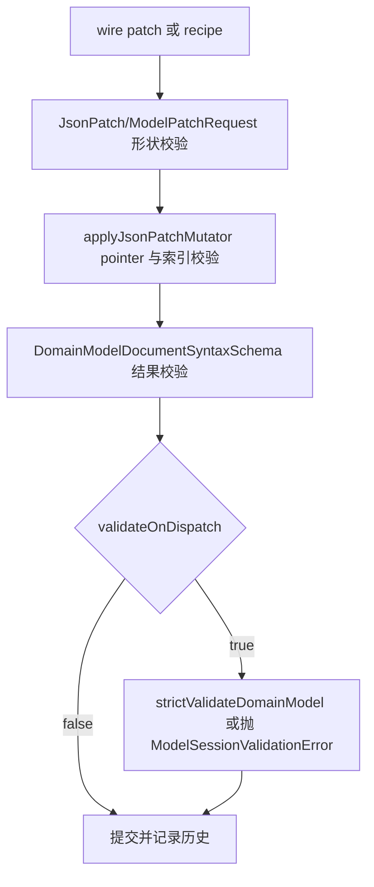
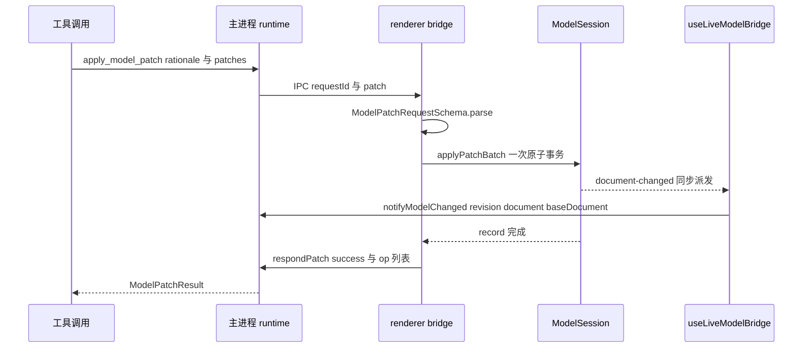

# 受控模型变更、会话与历史

`createModelSession` 以 **Immer draft recipe + forward/inverse patches** 管理编辑；跨进程与工具边界只传 RFC 6902 操作和 RFC 6901 字符串 pointer，不泄漏 Immer 内部 array paths。桌面、Pi 与 MCP 最终都调用同一个 `session.applyPatchBatch`，因此一条 undo 覆盖人类编辑与外部 Agent 编辑。

## 会话所有权与提交

session 持有 current document、惰性 memo 的 `DomainGraph`（`graph ??= createDomainGraph(document)`）、selection、undo/redo 两个栈和 listener `Set`。读侧 API 为 `getDocument/getGraph/getSelection/validate/canUndo/canRedo`；写侧只有 `mutate(recipe,label)`、`applyPatchBatch`、`replaceDocument`；另有 `undo/redo`、`select/selectAttribute/clearSelection` 与 `subscribe`。

`mutate` 在 `produceWithPatches` 里隔离运行 draft，并用 `snapshotRecipeResult` 把 recipe 返回值从已撤销的 proxy 上摘下来（嵌套结果同样快照）。单次 `record` 的顺序固定：

1. `patches.length === 0` 直接返回，文档、缓存 graph、redo 栈和事件都不动；
2. 可选的静态 gate（见下节）；
3. `extractAffectedIds` 比较前后对象身份（并把关系的两端也算进来），数组移位不会把被挪动的对象误报为改动；
4. 追加历史并按 `historyLimit` 截断，清空 redo；
5. `updateDocument` 换文档、失效 graph、必要时清 selection；
6. 同步发 `document-changed`，再发 `history-changed`。

`historyLimit` 默认 100，有限值取 `Math.max(1, Math.floor(v))`，非有限值回 100。历史条目只存 `label/patches/inversePatches/affectedIds`；`undo/redo` 重放已存的 patch 而不是重跑 recipe，空栈返回 `false`，新编辑清空 redo。`replaceDocument` 默认作为可撤销替换走 `record`（label `replace-document`），`{ resetHistory: true }` 则清空两个栈、直接换文档并只发事件，供 reload 使用，且不受静态 gate 约束；`undo/redo` 同样不重新验证，它们恢复的是历史事实。

## 渐进建模与两层校验

`validateOnDispatch` 默认 `false`。开启时对每个候选文档执行 `strictValidateDomainModel`，失败抛 `ModelSessionValidationError`（带 `issues` 文案），文档、历史与 redo 均不提交。桌面 `useEditorSession` 只传 `document` 建会话，允许静态尚不完整的渐进模型。

这里有两层必须区分：

- **wire 层**：`ModelPatchRequestSchema` / `JsonPatchSchema` 校验操作形状与 pointer 安全，`applyJsonPatchMutator` 校验 own member、数组索引、move 语义，并在末端用 `DomainModelDocumentSyntaxSchema` 校验结果；
- **领域层**：`mutations/` 下的 guarded mutator 才实施业务红线，且只有在代码显式调用它们时才执行。

因此任意合法的 wire patch 都**不**等于经过所有领域 guard。`applyPatchBatch` 只是一批标准 RFC 6902 操作，领域红线不会因为它"是 patch"而自动生效；残留的静态缺陷由默认关闭的 gate、`session.validate()` 与 sensors 在事后报告，不能把 patch 成功当成模型绿灯。

上图是两条独立的校验线：wire 层始终执行，领域 guard 只在显式调用 mutator 时发生。

## Guarded domain mutators

`mutations/` 下的函数接受 draft 并**原地**修改 draft，不能把普通共享源对象当可变容器传进去。`guards.ts` 核实 ID 语法（`isDomainId`）与跨集合唯一性、Context 种类、合同 Context 唯一根 Contract、证据时刻的 Context 归属、责任角色的 party 类型与合同绑定，以及分类边界（如 `participant.party` 不得带 `contextRef`、`participant.thing` 必须属于 Domain Context）。拒绝时抛 `ModelMutationError`，携带稳定 `code`（`MutationErrorCode` 联合，如 `id.invalid`、`entity.immutableField`、`entity.referenced`、`attribute.time.missing`、`relationship.self`、`context.rootMissing`、`role.notBound`、`derivation.alreadyBound`）和 `details` 列表，供工具与 UI 做机器可读诊断，而不是解析中文消息。

关键不变量：

- 实体首次保存后 `id/type/category` 不可改；rule 的 `id/type/kind/contextRef/target` 不可改，布尔类规则必须 `resultType === 'bool'`。
- 被规则写入的属性不能改名（`rule.referenced`），也不能在保留悬空 `derivedByRuleRef` 的情况下删除；删除派生属性必须 `cascade` 并连带删除写它的规则。
- 删实体先枚举所有入引用：不 `cascade` 一律 `entity.referenced`；`cascade` 只移除"可移除"的引用（关系、`rootRefs`、引用它的规则），仍然拒绝 `contextRef/parentContextRef/responsibleRoleRef/roleRefs` 这类责任引用，并顺手清掉指向被删规则的 `derivedByRuleRef`。
- 关系拒绝 self（`relationship.self`），`plays_role` 按 source/target 签名矩阵（participant→role、时刻证据→role.evidence、context→role.context）校验方向，禁止 Contract 直连 Contract，只允许 `references` 与 `plays_role`。

复合 mutator 一次写成完整业务结构，而不是让调用方拼半个模型：`createContractMutator` 同时写 Contract 并把它设为 Context 的 root；`bindDerivedRuleMutator` 同时创建 derivation rule 与属性上的 `derivedByRuleRef`；`createFulfillmentPairMutator` 要求合同 Context、唯一根 Contract、两个由根合同绑定的 party 责任角色，并强制 `request` 有 `started_at/expired_at`、`confirmation` 有 `confirmed_at` 且都是 required keyData timestamp。调用方在同一个 `session.mutate` 里组合多个 mutator 就是一批，中途抛错则整批不提交。

## 四领域算子与共享注册表

`libs/evidence-model-core/src/mutations/operators.ts` 暴露四个领域算子，全部是 guarded recipes 并返回 `OperatorResult { createdIds }`：

| 算子 | 写入的形状 |
| --- | --- |
| `introduceFulfillmentPairMutator` | 履约请求 + 确认 + 引用根合同的 references + 完成规则，可选额外证明对象 |
| `addBreachCompensationMutator` | 绑定 breach 规则（`now > request.expired_at` 且窗口内无确认）+ 由违约触发的补偿履约对 |
| `roleifyAndInvertDependencyMutator` | 能力角色 socket + 独立支撑合同 Context/Contract/双方角色 + 支撑履约对 + `references`/`plays_role` |
| `isolateDomainCalculatorMutator` | 领域 Context（或复用已有 Domain Context）+ calculator 型 thing + 宿主属性 + 绑定它的 derivation rule |

`createModelPatch(document, recipe)` 在本地对快照执行 recipe，只返回 `{ result, patches: toJsonPatches(patches) }`——算子没有任何特权写通道，写仍然必须交给宿主的 `applyModelPatch`。

`libs/evidence-tools/src/index.ts` 是**唯一**的算子注册表：`createModelTools(ports)` 生成 `apply_model_patch` 与四个算子工具，文件本身不 import Pi、MCP、Node 或 renderer。共享语义有三条：

- `MODEL_WRITE_ANNOTATIONS` 固定为 `{ readOnlyHint: false, destructiveHint: true, idempotentHint: false, openWorldHint: false }`——变更是破坏性且非幂等的，任何适配器都不得把它降级成只读或可重试的读；
- `define()` 在 `run` 前先 `parameters.parse(input)`，非法输入在触达任何 host port 之前就被 Zod 拒绝，in-process 调用者也一样；
- `ModelToolPorts` 只含 `loadDocument` 与 `applyModelPatch`，注释即契约：**宿主持有授权、静态 guard、原子应用与 undo**。`runOperator` 用 `createModelPatch` 在本地快照上跑算子，算子拒绝时返回 `isError` 文案且不调用 `applyModelPatch`；成功则把整批 patch 一次性提交，被宿主拒绝同样转成 `isError`。

Pi 与 MCP 各自只是适配层：`libs/evidence-agent/src/tools/evidenceTools.ts` 的 `createEvidenceToolsExtension(handlers)` 调用 `createModelTools(handlers)` 并按 `MODEL_TOOL_NAMES` 逐个注册；主进程通过 `agentIpcHandlers` 的 `requestPatch` 生成 `requestId`、带超时地把补丁发给 renderer。`libs/evidence-mcp/src/server/toolset.ts` 直接展开 `createModelTools({ loadDocument, applyModelPatch })` 并原样透传注解。两者不各自实现算子或写路径。

上图显示发布先于补丁确认：`document-changed` 在 `applyPatchBatch` 内部同步发出，`notifyModelChanged` 因此早于 `respondPatch`，下一个工具调用读到的是同一份模型。

## RFC6902 边界与安全

`JsonPatchItemSchema` 用 discriminated union 区分 add/remove/replace/move/copy/test，对象 `.strict()`，`value` 必须是有限、无环的 JSON 值。pointer 允许空串（root）或以 `/` 开头，转义仅接受 `~0`/`~1`（`~(?:[^01]|$)` 直接拒绝），解码后的段拒绝 `__proto__/constructor/prototype`，在 IPC 边界挡住原型穿透。`ModelPatchRequestSchema` 额外要求非空 `rationale` 与至少一条 op；内部 `JsonPatchSchema` 允许空数组。

`applyJsonPatchMutator` 先 `structuredClone(JsonPatchSchema.parse(patches))`，既不冻结调用方的 value，也不把它别名进文档。逐 op 校验：

- `assertLocation` 只接受 own JSON member，数组下标必须是规范非负安全整数且不越界（挡住 `4294967296` 被 int32 折成 0，也挡住 `01`、`-1`），`-` 只在 add 的末位合法；
- `move`/`copy` 先验证 `from`，move 拒绝移入自身子孙、同 path 视为 no-op，先 remove 再按新的数组长度验证 destination，符合 RFC 语义；
- 每步交给 `fast-json-patch` 执行，最后用 `DomainModelDocumentSyntaxSchema.parse` 验证结果；
- root 的 add/replace/copy/move 可能替换整个文档，即使先前已写过 draft，也会把 `next` reconcile 回同一个 draft（删多余 key、`Object.assign`），避免 Immer "先修改再返回替代对象" 的冲突。

`test` 适合先验证 `/entities/N/id` 之类定位，从而拒绝过期快照。所有 op 处于同一个 produce recipe 内，中间任何 test/path/syntax 失败都让整批不提交，文档、graph 缓存、历史与 redo 保持原样。`applyModelPatches` 是只读预览，返回副本；`toJsonPatches` 负责把 Immer 路径转义成 RFC 6901 pointer。

## 选择、事件与异常

换文档后若 selected entity 消失就清空 selection；若只是 selected attribute 消失则只清 `attributeName` 并保留 node。`select(nodeId)` 会把 `attributeName` 归零。这些 `selection-changed` 可能早于 `document-changed` 发出，UI 因此不会去编辑不存在的字段。graph memo 只在文档变动后失效，selection 不会构造另一张图。

事件有三种：`document-changed`（`commands` 字段名保留，但内容现在是事务 label）、`history-changed`、`selection-changed`。文档与栈提交后按 `Set` 顺序同步通知，doc event 先于 history，undo/redo 的 label 为 `undo:`/`redo:` 前缀。listener 不是事务参与者：它抛错可能让调用方看到异常，但编辑已提交、后续 listener 未收到通知，不能解释成回滚。

## 桌面、Agent、MCP 与读取模型

- `useEditorSession` 每个编辑窗口持一个 `ModelSession`，在 `useLayoutEffect` 里订阅（在 paint 与 incoming agent patch 之前完成），`document-changed` 标脏；保存与 watcher reload 走 `projects.save` / `projects.open`，内容相同的 reload 不重置历史。
- `libs/desktop/feature-agent/src/state/useAgentPatchBridge.ts`：renderer 是唯一持有 `ModelSession` 的地方，因此主进程请求它应用补丁。收到 IPC 后先 `ModelPatchRequestSchema.parse`，再一次 `session.applyPatchBatch(parsed.patches)`，label 为 `agent:` 加 rationale；成功回 `appliedCommands`，失败回错误文案；只有 `after !== before` 才把 before/after 交给 review。
- `apps/desktop/src/renderer/state/useMcpBridge.ts` 的 `apply_model_patch` 同样再 parse 再一次 `session.applyPatchBatch`（label 为 `mcp:` 加 rationale），返回 `appliedCommands/revision/undoable/diagnostics`；只有真变更才 `revision + 1`，`diagnostics` 用 `session.validate()` 做事后（post-hoc）报告，失败时把 `code` 也带回。
- `useLiveModelBridge` 在 mount 与每个 `document-changed` 发布 `{ rootPath, revision, document, baseDocument }`：undo/redo 也发，selection 不发；同步 `emit` 让发布早于 patch ack。主进程 `notifyModelChanged` 只接受 revision 大于已存值的负载，保留第一次收到的 `baseDocument`（编辑打开时的基线），用 `structuredClone` 镜像并调度去抖的后台 sensors；保存不会让基线自动前进，报告按 revision 判 stale。

`diffDomainModels` 是只读说明：分别给出 Contexts、业务实体、关系、规则与 key-data 变化（含 provider 决策变化），不是写入口。`usePatchReview`（`libs/desktop/feature-agent/src/state/usePatchReview.ts`）只用它生成 added/removed/modified id 列表与画布 overlay，并在 `session.getDocument() === patched` 时才 `session.undo()`；后续编辑后只关闭评审、不提供回退，accept 不写模型。`DomainGraph` 的 indexed lookup / `contextPath` / `rules` / `fulfillmentPairs` 是派生 read model，canvas 与 Inspector 共用。

## 测试与纯度

- `session/createModelSession.spec.ts` 保护：immutable 更新与 graph 失效、嵌套结果快照、一段 recipe 内多次写为一次 undo、no-op 不发事件不清 redo、recipe 抛错全回滚、`historyLimit` 截断、级联删除的 `affectedIds` 不误报被移位对象、`validateOnDispatch` 原子拒绝、selection 清理与 `replaceDocument` 语义。
- `session/jsonPatches.spec.ts` 覆盖六 op 单批可逆、数组演化下标、按值复制且不冻结调用方、转义 pointer、root 替换与精确恢复、test-only/空批 no-op、八类失败批次原子回滚、非法索引（`01`/`-1`/`+1`/`1.0`/`4294967296`/`-`）、move 目标越界、继承属性被拒，以及 `createModelPatch` 导出的 patch 能在远端 session 复现并可 undo。
- `mutations/*.spec.ts` 与 `operators.spec.ts` 保护各 family 红线与"一次事务"；`libs/evidence-tools/src/index.spec.ts` 保护单一注册表、注解一致、非法输入不触达 port、算子只提交一批 patch 且被拒时不谎报成功；`purity.spec.ts` 用 Vite 打包 browser bundle 并禁止任何 Node builtin，这既保证 core 可被 renderer 与 Node 工具共用，也解释了文件读写为何只留在 `model-io`/main。

相关：[renderer](../desktop/renderer-state.md) · [补丁审查](../desktop/ingestion-and-patch-review.md) · [语言](../language/fm-dsl.md) · [MCP 集成](../agents/mcp-integration.md) · [Pi harness](../agents/pi-harness.md) · [源格式](./source-formats.md)
