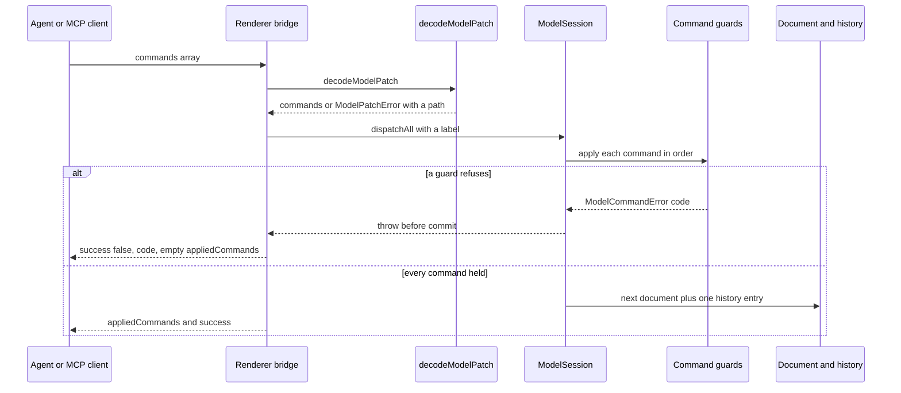

# Commands, guards and the model session

Every change to a model — a keystroke in the inspector, a drag that creates a
relationship, an agent's patch, a compiled draft — is expressed as a command in
`libs/evidence-model-core/src/commands/` and applied by the same `ModelSession`.
There is no second write path. That is what lets the app promise four things at
once:

- every edit is a deterministic transition with a recorded inverse;
- every edit passes the same guards, whether a human or an agent made it;
- every edit is one undo step, and one change event for the canvas;
- every edit can be described, compared and reviewed as plain JSON.

## The command contract

A command is an object with a `type` and an `apply(document)` method. It never
mutates its input; it returns the next document, the inverse command, the affected
ids and a result
(`repo://libs/evidence-model-core/src/commands/types.ts#L48-L67`).

Rejections are typed. `ModelCommandError` carries a stable `code` from a closed
set — `id.invalid`, `id.duplicate`, `entity.notFound`, `entity.immutableField`,
`entity.referenced`, `attribute.duplicate`, `attribute.time.missing`,
`context.notContract`, `context.rootMissing`, `role.notParty`, `role.notBound`,
`relationship.endpoint`, `rule.context`, `rule.referenced`,
`derivation.alreadyBound`, and others
(`repo://libs/evidence-model-core/src/commands/types.ts#L3-L46`).

The code matters beyond the message: the renderer and MCP bridge surface it as a
diagnostic code, so a UI can react to `derivation.alreadyBound` without parsing
prose (`repo://apps/desktop/src/renderer/state/useMcpBridge.ts#L296-L344`).

### The families

| Family | Commands (file) | What it adds on top of the contract |
| --- | --- | --- |
| Entity and Context | `CreateEntityCommand`, `CreateContractCommand`, `UpdateEntityCommand`, `DeleteEntityCommand`, `ReplaceContextRootsCommand` (`entityCommands.ts`) | category rules on insert, immutability on update, reference-aware delete |
| Attribute | `AddAttributeCommand`, `RemoveAttributeCommand`, `UpdateAttributeCommand` (`attributeCommands.ts`) | name uniqueness, shape checks, derivation-aware rename and removal |
| Relationship | `CreateRelationshipCommand`, `DeleteRelationshipCommand` (`relationshipCommands.ts`) | endpoint direction matrix, no self edges |
| Rule | `CreateRuleCommand`, `UpdateRuleCommand`, `DeleteRuleCommand` (`ruleCommands.ts`), `BindDerivedRuleCommand` (`derivationCommands.ts`) | rule/context agreement, derivation symmetry |
| Fulfillment | `CreateFulfillmentPairCommand` (`fulfillmentCommands.ts`), `PairFulfillmentCommand`, `BindBreachRuleCommand` (`fulfillmentPairCommands.ts`) | root Contract, responsibility and business time checked before anything is written |

## Guards: defined by what they refuse

`guards.ts` is the first line of defense, before any document change. Every refusal
goes through one `fail(code, message, details)` helper, so a caller can always branch
on the code and show the `details` list
(`repo://libs/evidence-model-core/src/commands/guards.ts#L18-L24`).

| Guard | Refuses when |
| --- | --- |
| `assertId` | the id does not match the FM identifier grammar (`id.invalid`) |
| `assertUniqueId` | the id is already used by *any* entity, relationship or rule — one shared id namespace (`id.duplicate`) |
| `requireEntity` / `requireContext` / `requireContractContext` | the reference does not resolve, is not a Context, or is not a Contract Context (`entity.notFound`, `context.notFound`, `context.notContract`) |
| `requireRootContract` | a Contract Context does not list exactly one root Contract (`context.rootMissing`); this is the responsibility anchor everything else hangs from |
| `requirePartyRole` | the target is not a Party Role (`role.notParty`) |
| `requireRoleBoundByContract` | the responsible role is not in the root Contract's `roleRefs`, or does not belong to that Context (`role.notBound`) |
| `requireAttribute` | the entity has no attribute with that name (`attribute.notFound`) |
| `assertEntityInsertable` | the object breaks a category rule: a `participant.party` declaring a `contextRef` (`participant.contextRef`), a Thing outside a Domain Context (`context.notDomain` / `participant.contextRef`), an evidence kind outside the Context kind its phase implies (`context.responsibility`), a Contract without exactly two distinct Party Roles (`role.notParty`), or another evidence moment without a Party Role `responsibleRoleRef` (`context.responsibility`) |

`assertMandatoryTime` is the guard that makes business time non-optional: it
refuses a request without `started_at` and `expired_at`, or a confirmation without
`confirmed_at`, and it also refuses an attribute that is present but not a
required `keyData` timestamp (`attribute.time.missing`)
(`repo://libs/evidence-model-core/src/commands/derivationCommands.ts#L85-L112`).

Two more guard clusters live beside their commands rather than in `guards.ts`,
because they need the shape of the object being added:

- `assertRuleInsertable` refuses a rule whose `contextRef` is not a Context, a
  boolean rule that does not return `bool`, a `target` on a non-derivation rule, a
  derivation without a target or outside the target entity's Context, a target
  attribute that already has a `derivedByRuleRef` (`derivation.alreadyBound`), and a
  binding that points at an unknown id
  (`repo://libs/evidence-model-core/src/commands/ruleCommands.ts#L34-L100`).
- `assertEndpoints` refuses self relationships (`relationship.self`), a direct
  Contract → Contract edge, and unsupported kinds; `assertPlaysRole` only allows
  `party` → `role.party`/`role.third_party`, `thing` → `role.domain`, a moment
  evidence → `role.evidence`, and a Context → `role.context`
  (`repo://libs/evidence-model-core/src/commands/relationshipCommands.ts#L31-L103`).

### Why refusing here keeps an invalid model unsavable

The guards run before a next document exists, so the sanctioned path cannot build
the states the static FM check would reject: a Contract Context with no single
root, a Contract with one party, an evidence moment in the wrong phase Context, or
a fulfillment pair whose business time was never modeled. A modeler therefore
learns the red line at the edit that crossed it, not hours later from a validator
report on a tree that can no longer be repaired in one place.

What guards deliberately do **not** enforce is whole-document completeness. One
object is saved at a time, so an intermediate document may still be transiently
incomplete; that judgement belongs to `strictValidateDomainModel` and the session
gate described below.

## What cannot be changed after saving

Several commands enforce immutability rather than allowing a rename-and-repair:

- `UpdateEntityCommand` refuses changes to `id`, `type` or `category` —
  `entity.immutableField`
  (`repo://libs/evidence-model-core/src/commands/entityCommands.ts#L120-L160`);
- `UpdateRuleCommand` keeps `id`, `type`, `kind`, `contextRef` and `target`
  immutable (`rule.context`), because changing them would silently repoint the
  attribute that reads the rule
  (`repo://libs/evidence-model-core/src/commands/ruleCommands.ts#L124-L180`);
- `UpdateAttributeCommand` refuses a rename while a rule still writes the
  attribute (`rule.referenced`), because other rules read attribute names inside
  expression text that cannot be rewritten reliably
  (`repo://libs/evidence-model-core/src/commands/attributeCommands.ts#L167-L230`).

The trade-off is deliberate: the model keeps stable identity even if a modeler must
delete and recreate an object.

## Composition: one business edit, several primitives

A single command often needs several writes that must not be half-applied. The
codebase composes them rather than asking callers to sequence them:

| Command | Writes |
| --- | --- |
| `CreateContractCommand` | the Contract entity **and** its Context `rootRefs` (and refuses a Context that already declares roots) |
| `BindDerivedRuleCommand` | the derivation rule **and** the attribute's `derivedByRuleRef` |
| `CreateFulfillmentPairCommand` | request, confirmation, confirmation→request reference, optional request→Contract reference, completion rule |
| `PairFulfillmentCommand` | confirmation→request reference (or reuses the existing one) and completion rule |
| `BindBreachRuleCommand` | a `breach` rule whose bindings include the request |

Examples:
`repo://libs/evidence-model-core/src/commands/entityCommands.ts#L82-L118`,
`repo://libs/evidence-model-core/src/commands/derivationCommands.ts#L20-L78`,
`repo://libs/evidence-model-core/src/commands/fulfillmentCommands.ts#L65-L172`,
`repo://libs/evidence-model-core/src/commands/fulfillmentPairCommands.ts#L110-L190`.

`CommandSequence` applies them in order, collects the individual inverses and
returns them reversed, so undo of a composite edit restores the exact previous
document in one history step
(`repo://libs/evidence-model-core/src/commands/sequence.ts#L8-L53`).
`ReplaceDocumentCommand` is the escape hatch for operations that rewrite the tree
at once — cascade deletes and reloads — and its inverse is the previous document
(`repo://libs/evidence-model-core/src/commands/sequence.ts#L63-L78`).

### Deletion is reference-aware

`entityReferences` walks every place an id can be cited — relationship endpoints,
`contextRef`, `parentContextRef`, `responsibleRoleRef`, `roleRefs`, `rootRefs`, rule
context, rule target and rule bindings — and marks each reference `removable` or
not (`repo://libs/evidence-model-core/src/commands/entityCommands.ts#L186-L283`).

- Without `cascade`, any reference blocks with `entity.referenced` and the list of
  descriptions.
- With `cascade: true`, removable references (relationships, `rootRefs`, rule
  bindings) are deleted; a remaining responsibility reference (`contextRef`,
  `parentContextRef`, `responsibleRoleRef`, `roleRefs`) still blocks.
- A cascading delete replaces the whole document and records a
  `ReplaceDocumentCommand` as the inverse; a clean delete records a
  `CreateEntityCommand` at the original index
  (`repo://libs/evidence-model-core/src/commands/entityCommands.ts#L285-L350`).

Removing a derived attribute either cascades into its rule or is refused with
`rule.referenced`; the cascade deletes the rule first, so the attribute never
outlives the rule that points at it
(`repo://libs/evidence-model-core/src/commands/attributeCommands.ts#L104-L160`).
`DeleteRuleCommand` mirrors that: it refuses `rule.referenced` while an attribute
is still derived by it, and its cascade clears the `derivedByRuleRef` pointer
(`repo://libs/evidence-model-core/src/commands/ruleCommands.ts#L202-L278`).

## Patches are the wire form

Agents and MCP clients cannot send class instances, so every edit also has a
plain-JSON description. `ModelPatchCommand` declares seventeen command types
(entity, attribute, relationship, rule, derivation and fulfillment commands), and
`decodeModelPatchCommand` maps each to a real command
(`repo://libs/evidence-model-core/src/commands/patches.ts#L55-L155`).

`decodeModelPatch` is the single entry point for agent and MCP patches. Both
renderer bridges call it and hand the result to `dispatchAll` — the agent bridge
with the label `agent:<rationale>`, the MCP bridge with `mcp-patch`
(`repo://apps/desktop/src/renderer/state/useAgentPatchBridge.ts#L30-L68`,
`repo://apps/desktop/src/renderer/state/useMcpBridge.ts#L296-L344`). The read-only
API-diff tool uses the same decoder to fold a *proposed* command list over a copy of
the current document, so a dry run and a real patch cannot disagree about what a
command means (`repo://libs/evidence-modeling-orchestrator/src/tools/evidenceTools.ts#L118-L140`).

Decoding checks **shape only**: that the payload is an array of objects, that
`type` is present and known, and that required fields exist. Identity, references
and red lines stay with the command guards and `strictValidateDomainModel`, so a
decoded patch is treated exactly like a direct edit
(`repo://libs/evidence-model-core/src/commands/patches.ts#L156-L280`).

Decode failures are `ModelPatchError` with `patch.notArray`, `patch.notObject`,
`patch.missingField` or `patch.unknownType`, plus the failing path
(`commands[3].entity`); a batch reports the index of the first bad command
(`repo://libs/evidence-model-core/src/commands/patches.ts#L97-L155`).

### A refused batch writes nothing

Commands are pure and `dispatchAll` builds the whole next document inside
`CommandSequence.apply` before the session assigns it, so a refusal at command *n*
leaves the live document and the undo history untouched — there is no partial
apply to clean up. Both bridges rely on that: they catch the error and answer with
`success: false`, the error's `code`, and an empty `appliedCommands` list
(`repo://libs/evidence-model-core/src/commands/sequence.ts#L17-L52`,
`repo://libs/evidence-model-core/src/session/createModelSession.ts#L177-L201`,
`repo://apps/desktop/src/renderer/state/useMcpBridge.ts#L315-L344`).

One patch travels through decoding, a single transaction, and one history entry —
or it fails before anything reaches the document.

## The session

`createModelSession` wraps a document with selection, history and subscribers, and
is the only owner of the live document
(`repo://libs/evidence-model-core/src/session/createModelSession.ts#L94-L176`). The
desktop hook `useEditorSession` owns one session per editor window, marks the
editor dirty on any `document-changed`, and re-renders from the session after every
event (`repo://apps/desktop/src/renderer/state/useEditorSession.ts#L100-L119`).

### Dispatch

`dispatch` applies one command, optionally gates the next document on static
validation, swaps the document, records the history entry, and emits two events:
`document-changed` (command types + affected ids) and `history-changed`
(`repo://libs/evidence-model-core/src/session/createModelSession.ts#L159-L176`).
It returns the command's own result; `dispatchAll` returns the array of results.

`validateOnDispatch` is **off by default**, and no production caller turns it on:
the desktop editor creates its session with the document alone, and the MCP bridge
validates *after* applying, returning the issues as diagnostics
(`repo://apps/desktop/src/renderer/state/useEditorSession.ts#L89-L91`,
`repo://apps/desktop/src/renderer/state/useMcpBridge.ts#L305-L315`). Progressive
modeling needs that ordering — an intermediate document is often structurally
incomplete (a Contract before its roles, a request before its confirmation). The
gate stays available for callers that must not commit an invalid tree; when it is
on, an invalid next document throws `ModelSessionValidationError` (carrying the
issue list) and nothing is committed
(`repo://libs/evidence-model-core/src/session/createModelSession.ts#L32-L54`,
`repo://libs/evidence-model-core/src/session/createModelSession.ts#L133-L141`).

### Transactions and history

`dispatchAll` wraps commands in one `CommandSequence` and records **one** history
entry under the caller's label (`agent:<rationale>`, `mcp-patch`, or `sequence`).
An entry is `{ label, forward, inverse }`
(`repo://libs/evidence-model-core/src/session/createModelSession.ts#L177-L201`).

- History is capped at 100 entries by default (`historyLimit`, clamped to at least
  1); older entries drop off.
- A new dispatch clears the redo stack.
- `undo` applies the recorded inverse and pushes the entry onto redo; `redo`
  re-applies the original. Both emit `document-changed` with a prefixed label
  (`undo:update-entity`) so the activity stream can tell a revert from an edit.
- An empty stack makes `undo`/`redo` return `false`, not throw.
- `replaceDocument` either records an undoable replacement (its inverse is the
  previous document) or resets history when `{resetHistory: true}` is passed
  (`repo://libs/evidence-model-core/src/session/createModelSession.ts#L202-L278`).

### Selection and the derived graph

Selection is part of the session, not the renderer: `select`, `selectAttribute` and
`clearSelection` emit `selection-changed`. When a change removes the selected
object, selection clears itself and emits, so the inspector cannot keep editing a
deleted node (`repo://libs/evidence-model-core/src/session/createModelSession.ts#L120-L132`).

`session.getGraph()` returns a `createDomainGraph(document)` read model built once
per document and memoised until the document changes: `Map` indexes for O(1)
lookups, context walks, rules by Context/reference, `derivationRule(entity,
attribute)`, and lazily derived `fulfillmentPairs()` — for each request the
confirmations that reference it, the `other_evidence` proofs, the root Contract, and
the completion/breach rules bound to it
(`repo://libs/evidence-model-core/src/model/graph.ts#L93-L195`).

## Save is not undo

Undo and redo move the in-memory document and the two stacks; they never touch the
disk. Saving is a separate, explicit step owned by the desktop shell:

1. the renderer hands `session.getDocument()` to the main process
   (`window.evidenceAPI.projects.save`)
   (`repo://apps/desktop/src/renderer/state/useEditorSession.ts#L140-L154`);
2. the main process writes either the `.evidence/fm` tree via
   `writeModelDirectory` or the single `*.evidence.json` bundle
   (`repo://apps/desktop/src/main/projectStore.ts#L341-L375`);
3. the adapter leaves unchanged files byte-identical, writes new or edited files
   through a temp file and an atomic rename, and removes source files whose object
   no longer exists — the layout itself is described on the
   [source formats page](source-formats.md)
   (`repo://libs/evidence-model-core/src/adapters/diskAdapter.ts#L139-L174`).

Consequences a modeler can observe:

- Saving creates no history entry, so `undo` after a save changes the document and
  makes the editor dirty again; nothing on disk moves back.
- A failed save sets `saveError` and returns without clearing `dirty`, because the
  document in memory was never the file.
- An external write (Git checkout, script, another editor) is detected by the main
  process watcher and surfaced as a change notification rather than a silent merge
  (`repo://apps/desktop/src/main/projectIpc.ts#L48-L66`). Reloading calls
  `replaceDocument(document, { resetHistory: true })`, deliberately discarding the
  old history: the inverse commands describe edits to a document that is no longer
  the baseline (`repo://apps/desktop/src/renderer/state/useEditorSession.ts#L156-L170`).

## The model diff

`diffDomainModels(base, target)` is the one structural comparison of two documents
(`repo://libs/evidence-model-core/src/diff/modelDiff.ts#L424-L476`). It walks the
union of ids across entities, relationships and rules, sorts them by id, and emits
one row per object with a `changeType` of `added`, `removed`, `modified` or
`unchanged`, the list of differing top-level `fields`, and the `base`/`target`
payloads so a panel can render either side.

Per-kind field lists decide what "changed" means: entity fields (category, kind,
label, aliases, notes, context refs, role refs, roots), relationship fields
(endpoints, cardinality, kind, label), rule fields (kind, context, bindings,
expression, resultType, target), and attribute fields (label, meaning, valueType,
required, keyData, derivation pointer, notes)
(`repo://libs/evidence-model-core/src/diff/modelDiff.ts#L108-L152`). Values are
compared through a token that keeps `undefined` distinct from `null`, so an omitted
optional field is not reported as equal to an explicit one
(`repo://libs/evidence-model-core/src/diff/modelDiff.ts#L154-L175`).

Beyond the flat object list, three things make the diff useful for review:

- **Attribute rows.** Every entity diff carries `attributeDiffs` sorted by name,
  each with its own `changeType` and changed `fields`, so "the meaning of
  `requested_minor_units` changed" is a row, not a rewritten entity
  (`repo://libs/evidence-model-core/src/diff/modelDiff.ts#L178-L240`).
- **Contexts are separate.** A Context is a container on the canvas, so it is
  reported under `contexts` rather than `entities`; adding a nested boundary is
  still counted in the summary but is not presented as a new business object
  (`repo://libs/evidence-model-core/src/diff/modelDiff.ts#L424-L470`).
- **Key-data drift.** Both sides go through `buildKeyDataLedger`; every key data
  item whose provider `source`, `expression` or rule reference differs — or that
  exists on only one side — becomes a `KeyDataDiff` with base/target source and
  decision-owed flags. The summary carries `hasKeyDataDrift` plus
  `decisionOwedBase`/`decisionOwedTarget`, so a branch that quietly drops a provider
  decision cannot look like a clean diff
  (`repo://libs/evidence-model-core/src/diff/modelDiff.ts#L350-L410`).

That single definition is reused everywhere a change must be explained:

- the patch review bar diffs the before/after snapshots, turns added, removed and
  modified ids into canvas overlay rings, and only offers revert while the patched
  document is still the one on screen
  (`repo://apps/desktop/src/renderer/state/usePatchReview.ts#L41-L113`);
- the workbench diff projects the same changes onto workbench nodes
  (`repo://libs/evidence-visualization/src/projection/workbenchDiff.ts#L45-L60`);
- the API diff attaches it as `modelChanges` next to the route-level changes
  (`repo://libs/evidence-api/src/diff/apiDiff.ts#L347-L356`).

## Macro operators

The named batch builders (`introduceFulfillmentPair`, `addBreachCompensation`,
`roleifyAndInvertDependency`) hand back ordinary command arrays and are documented
on [Macro operators](operators.md).

## Failure behaviour

| Situation | Result |
| --- | --- |
| id taken by another collection | `id.duplicate` |
| Contract without exactly two Party Roles | `role.notParty` at insert |
| responsible role not bound by the root Contract | `role.notBound` |
| evidence placed in the wrong Context kind | `context.responsibility` |
| moment missing required business time | `attribute.time.missing` |
| duplicate attribute name, or rename onto an existing name | `attribute.duplicate` |
| entity still referenced, no cascade | `entity.referenced` with the reference list |
| derived attribute removed without cascade | `rule.referenced` naming the rule |
| rename of a derived attribute | refusal; identity stays stable |
| request already has a completion or breach rule | `rule.duplicate` naming the rule |
| patch object missing `type` | `patch.missingField` at `commands[n].type` |
| patch with unknown type | `patch.unknownType` |
| command fails inside `dispatchAll` | nothing committed, no history entry |
| `validateOnDispatch` rejects | `ModelSessionValidationError`, document unchanged |
| save fails in the main process | `saveError` shown, `dirty` not cleared |

## Tests that protect this contract

- `createModelSession.spec.ts` pins dispatch, graph reuse, events, unsubscribe,
  command results, undo/redo, redo clearing, the history cap, empty stacks, one-step
  `dispatchAll`, no commit on midway failure, the validation gate off/on, selection
  clearing, `replaceDocument` (with and without `resetHistory`), and the
  fulfillment pair as one undo step
  (`repo://libs/evidence-model-core/src/session/createModelSession.spec.ts#L18-L430`).
- `patches.spec.ts` asserts every declared command type decodes, a decoded patch is
  undoable, malformed payloads report a path and an index, and guards still reject
  illegal edits after decoding
  (`repo://libs/evidence-model-core/src/commands/patches.spec.ts#L21-L157`).
- `modelDiff.spec.ts` pins the no-change case, Context separation, a removed object
  keeping its base payload, per-attribute rows, a rule whose expression changed, a
  provider decision resolved by a derivation, a key data item modeled on only one
  side, and the summary counts
  (`repo://libs/evidence-model-core/src/diff/modelDiff.spec.ts#L22-L240`).
- `useMcpBridge.spec.tsx` and `useAgentPatchBridge.spec.tsx` pin the two patch
  entry points: an applied patch is undoable, a rejected patch reports the guard's
  code or message with an empty `appliedCommands` list, a malformed payload never
  touches the document, and only an accepted patch hands both snapshots to the
  review.

## Related pages

- [The Fulfillment Modeling DSL (FM v5)](../language/fm-dsl.md) — the rules these
  guards and the diff enforce.
- [The native check and simulation pipeline](checks-and-simulation.md) — the static
  gate and what happens after a save.
- [Source tree and bundle adapters](source-formats.md) — the file layout that save
  writes.
- [Canvas layout, viewport and inspector](../desktop/canvas-and-inspector.md) — the
  graph read model and the UI that dispatches these commands.
- [Ingestion and patch review](../desktop/ingestion-and-patch-review.md) — how a
  reviewed patch reaches the session.
- [The Pi agent harness and its tools](../agents/pi-harness.md) — how agent patches
  reach `dispatchAll`.
