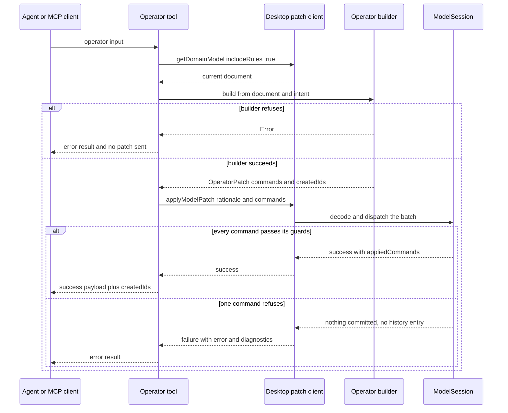
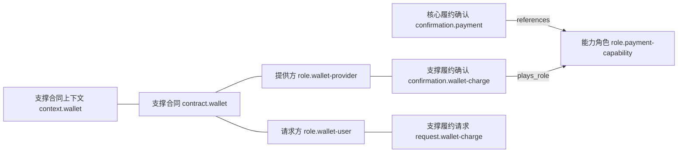

# Modeling operators and generated command batches

A modeler session produces the same shapes over and over: a request paired with the
confirmation that closes it, a missed deadline plus the pair that compensates it, a
third-party capability hidden behind a role, a calculation moved out of the
agreement. Written by hand each of those is a dozen command descriptions, and each
hand-written version is an opportunity to drop one mandatory attribute or to write
half a pair.

Four macro operators in `libs/evidence-model-core/src/commands/operators.ts` assemble
those shapes. They are named, reusable command batches — not a second write path.
Every operator returns an `OperatorPatch`, whose commands are exactly the
descriptions an agent would otherwise send through `apply_model_patch`, so "the
model session validates and records it like any other edit"
(`repo://libs/evidence-model-core/src/commands/operators.ts#L14-L27`).

```ts
export interface OperatorPatch {
  commands: readonly ModelPatchCommand[];
  /** Objects the operator creates, in the order the commands create them. */
  createdIds: readonly string[];
}
```

| Operator | MCP tool | Pi extension tool | Intent it answers |
| --- | --- | --- | --- |
| `introduceFulfillmentPair` | `introduce_fulfillment_pair` | same | one request (interval) plus the confirmation (moment) that closes it, plus an optional proof |
| `addBreachCompensation` | `add_breach_compensation` | same | a missed deadline and the compensating pair it triggers |
| `roleifyAndInvertDependency` | `roleify_and_invert_dependency` | same | a capability that moves behind its own contract |
| `isolateDomainCalculator` | — | `isolate_domain_calculator` | a computed value moved into a Domain Context, with the derivation that reads it |

The MCP server exposes only the three fulfillment operators; the Pi extension also
registers `isolate_domain_calculator`, which is why the in-app agent can move a
calculation into a Domain Context in one call while an external MCP client has to
compose that batch itself
(`repo://libs/evidence-mcp/src/server/toolset.ts#L261-L372`,
`repo://libs/evidence-modeling-orchestrator/src/tools/evidenceTools.ts#L415-L534`).

`OPERATOR_PROMPT` states the rule the catalogue encodes: an intent expressible with
an operator must not be dissolved into atomic commands, and all operators enter the
same patch channel, so they are not a shortcut around the checks
(`repo://libs/evidence-agent-core/src/prompts/operators.ts#L12-L48`). The same
section lists two *readings* — `annotate_contract_clauses` and
`read_service_blueprint` — which return drafts and write nothing.

## The shared `runOperator` path

Both tool surfaces wrap the builders in one helper with the same three properties:

1. **Build against the current document.** The MCP toolset reads
   `getDomainModel({ includeRules: true })` and passes `model.document` to the
   builder, so an operator naming a root Contract or a breached request resolves it
   against the live tree rather than a guess
   (`repo://libs/evidence-mcp/src/server/toolset.ts#L96-L124`). The Pi extension does
   the same with `handlers.loadDocument()`
   (`repo://libs/evidence-modeling-orchestrator/src/tools/evidenceTools.ts#L383-L412`);
   in the desktop that handler reads the bundle file or the model directory on each
   call, because the main process owns no live document
   (`repo://apps/desktop/src/main/agentRuntime.ts#L128-L136`).
2. **Refuse as a readable error, never as a partial write.** A builder that throws
   is caught, and the tool answers with the message (`算子未执行：…` in both
   surfaces) and sends no patch at all. The test set asserts both halves: the model
   read happens first, and `applyModelPatch` is never called on a refusal
   (`repo://libs/evidence-mcp/src/server/toolset.spec.ts#L239-L258`,
   `repo://libs/evidence-modeling-orchestrator/src/tools/evidenceTools.spec.ts#L431-L455`).
3. **Commit through the ordinary patch channel.** A built patch goes to
   `applyModelPatch({ rationale, commands })` — the same call a hand-written batch
   uses, so the commands are decoded and dispatched by the `ModelSession` the UI
   uses, giving one undo step and the ordinary static check. A rejected patch comes
   back as an error result carrying `error` and `diagnostics`, never as a silent
   success (`repo://libs/evidence-mcp/src/server/toolset.spec.ts#L324-L357`).



One operator call, showing the build-then-commit split and where refusal can happen.

The two surfaces differ only in the shape of the answer, not in semantics:

| Behaviour | MCP toolset | Pi extension |
| --- | --- | --- |
| builder refusal | `{ text: "算子未执行：…", isError: true }` | `isError` result with the same prefix |
| success | the patch result JSON plus `createdIds` | `已写入：<ids>。` plus `createdIds` in details |
| rejected patch | the full result JSON with `diagnostics`, `isError` | `补丁被拒绝：<error>` |
| rationale | `新增履约项：<request> / <confirmation>`, `违约补偿：<condition>`, `反转依赖：<socket> 交由 <contract> 履约`, `抽出领域计算：<calculator>` | identical |

The rationale is not decoration: it is what the modeler reads in the desktop
activity stream when deciding whether to undo the batch.

The tool input schemas mirror the intent shapes field by field but only check shape:
ids are non-empty strings, and the handler casts the parsed input to the core intent
type (`input as unknown as Parameters<typeof introduceFulfillmentPair>[1]` in the MCP
toolset). Whether a reference exists, is the right kind, or is legal in the target
Context therefore stays with the builders and command guards — a schema-valid call can
still come back refused (`repo://libs/evidence-mcp/src/server/toolset.ts#L261-L289`).

## `introduceFulfillmentPair`

One intent produces at most three commands
(`repo://libs/evidence-model-core/src/commands/operators.ts#L172-L229`):

| Order | Command | What it creates |
| --- | --- | --- |
| 1 (only with `proof`) | `create-entity` | `other_evidence` proof, `responsibleRoleRef` defaulting to the confirmation's role, carrying `created_at` |
| 2 | `create-fulfillment-pair` | request, confirmation, the confirmation → request reference, the request → root Contract reference, the completion rule |
| 3 (only with `proof`) | `create-relationship` | confirmation → proof, `references`, 1..1, `确认引用履约证明` |

`createdIds` is `[proof?, request.id, confirmation.id]`. It deliberately does not
list the ids the commands assign by default — the completion rule
(`rule.<request>-completed`), the pair reference
(`relation.<request>-confirmed-by`) and the request → Contract reference
(`relation.<request>-references-contract`), the last of which the operator names
explicitly through `contractReferenceId`.

Two things make the batch more than a convenience wrapper.

**Business time is filled in, not left to the caller.** The command guard
`assertMandatoryTime` refuses a request without `started_at` and `expired_at`, or a
confirmation without `confirmed_at`, and refuses an attribute that is present but
not a required `keyData` timestamp
(`repo://libs/evidence-model-core/src/commands/derivationCommands.ts#L85-L112`). The
operator therefore emits `发起时间`, `履约截止时间` and `确认时间` itself. The optional
`window` (`7 个工作日`) does not create a derived value; it only sharpens the meaning
text, so `expired_at` means "发起时间加 7 个工作日" instead of "由合同条款确定"
(`repo://libs/evidence-model-core/src/commands/operators.ts#L29-L75`). The spec pins
the attribute names per side rather than trusting the promise
(`repo://libs/evidence-model-core/src/commands/operators.spec.ts#L101-L113`).

**The root Contract is resolved, then enforced.** `rootContractOf` looks up the
context and refuses an unknown or non-Context id outright (`未知的上下文 …`), then
returns the single `evidence.contract` among its `rootRefs` — or `undefined` when
there are zero or several. In that case the operator omits `contractReferenceId`
instead of inventing a root, and the model is still refused by the command's own
`requireRootContract` guard (`context.rootMissing`), which demands exactly one root
Contract (`repo://libs/evidence-model-core/src/commands/operators.ts#L117-L140`,
`repo://libs/evidence-model-core/src/commands/guards.ts#L74-L93`). Omitting the
reference is thus a way to avoid a wrong edge, not a way around the root contract.

The pair command itself is where the fulfillment red lines live
(`repo://libs/evidence-model-core/src/commands/fulfillmentCommands.ts#L61-L168`):

- the Context must be a Contract Context with exactly one root Contract;
- both `responsibleRoleRef`s must be Party Roles bound by that Contract and living
  in that Context (`role.notBound`);
- request and confirmation must have distinct ids (`id.duplicate`);
- the mandated time attributes must already be modeled;
- a `references` edge with 1..1 cardinality on both ends is written confirmation →
  request, and a `completion` rule is added whose default expression requires a
  confirmation formed inside the request window:
  `confirmations.exists(c, c.confirmed_at >= request.started_at && c.confirmed_at <= request.expired_at)`.

So "a request without a confirmation is not evidence" is not a style rule the agent
has to remember; the single operator call is the smallest unit that can be written.

## `addBreachCompensation`

The intent names the breached request, the confirmation that would have closed it,
and the compensation pair. The batch is exactly
`bind-breach-rule` followed by the `introduceFulfillmentPair` commands, in that order
(`repo://libs/evidence-model-core/src/commands/operators.ts#L264-L321`):

| Order | Command | What it creates |
| --- | --- | --- |
| 1 | `bind-breach-rule` | `kind: 'breach'` rule `rule.<requestRef>-breached`, its `description` set to the intent's condition, binding the request, the confirmations alias and `now` |
| 2..n | the pair commands | proof (optional), request, confirmation, references, completion rule |

Three semantics are worth stating explicitly, because each one is a modelling
decision rather than an implementation choice.

- **A breach is a rule, not an undo.** The generated expression is
  `now > request.expired_at && !confirmations.exists(c, c.confirmed_at <= request.expired_at)`,
  and `BindBreachRuleCommand` refuses to give the rule a target or to invent the
  follow-up evidence, so "what happens after the breach" stays an explicit decision
  (`repo://libs/evidence-model-core/src/commands/fulfillmentPairCommands.ts#L183-L263`).
  The spec asserts the command list is `['bind-breach-rule', 'create-fulfillment-pair']`
  — nothing removes or rewrites the original pair.
- **Compensation is a new pair in the same contract.** The operator reads
  `contextRef` from the breached request and reuses the pair builder, so the
  compensating request, confirmation and proof live in the breached request's
  Contract Context, with the same root-contract reference and their own completion
  rule. Refunds, penalties, re-delivery and re-issuance are all new fulfillment
  items, not retries of the original.
- **Only the request reference is checked by the builder.** An id that is not an
  `evidence.fulfillment_request` is refused with `'<id>' 不是履约请求，无法声明违约补偿。`
  The confirmation reference reaches the model as a rule binding, so an unresolvable
  id is caught later by `assertRuleInsertable` (`binding '<alias>' references
  unknown id`) rather than by the builder
  (`repo://libs/evidence-model-core/src/commands/ruleCommands.ts#L34-L100`). A request
  that already declares a breach rule is refused with `rule.duplicate` naming it.

`createdIds` starts with the rule id, then the compensation ids, so the agent learns
that `rule.request.payment-breached` now exists before it sees the new pair.

## `roleifyAndInvertDependency`

This operator reverses one dependency: the capability the core contract needs becomes
a *role* the core contract references, and a separate Contract Context supplies a
confirmation that plays that role. The stated reason is substitutability — otherwise
the core contract has to name every provider that can ever settle it, "which is how a
subscription model ends up depending on one payment vendor"
(`repo://libs/evidence-model-core/src/commands/operators.ts#L337-L348`).



The two-context shape one call produces: the core contract sees only a role, the
supporting contract owns the parties that actually perform.

| Order | Command | What it creates |
| --- | --- | --- |
| 1 | `create-entity` | socket `role` with `kind: 'evidence'` in the *target confirmation's* context, noted as a capability slot with no responsible party and no instance |
| 2 | `create-entity` | supporting `context` with `kind: 'contract'` and no roots |
| 3, 4 | `create-entity` | `provider` and `consumer` Party Roles inside the supporting context |
| 5 | `create-contract` | supporting Contract with `roleRefs: [provider, consumer]` and a required `signed_at`, defaulting to `当事双方签订该协议的业务时间` or the intent's `signedAtMeaning` |
| 6 | `create-fulfillment-pair` | consumer asks (window optional), provider confirms, request references the supporting Contract |
| 7 | `create-relationship` | core confirmation → socket, `references`, 1..1, `确认引用履约能力角色` |
| 8 | `create-relationship` | supporting confirmation → socket, `plays_role`, `外部履约确认扮演能力角色` |

`CreateContractCommand` is what keeps this legal in one batch: it creates the
Contract *and* binds it as the single root of its context, so the supporting context
the operator just created with no roots is never left without one, and a context that
already declares roots is refused
(`repo://libs/evidence-model-core/src/commands/entityCommands.ts#L76-L114`). The
result validates clean — the spec runs `strictValidateDomainModel` on the output
(`repo://libs/evidence-model-core/src/commands/operators.spec.ts#L339-L356`).

`createdIds` order is socket, context, provider, consumer, contract, request,
confirmation — the order the commands create them, which is also the order a
reader needs to understand the batch.

### The target must be a confirmation, and an interval is named as such

The builder accepts exactly one kind: `evidence` + `fulfillment_confirmation`. Two
distinct refusals exist
(`repo://libs/evidence-model-core/src/commands/operators.ts#L355-L377`):

| Target | Message |
| --- | --- |
| another evidence kind (a request, an `rfp`, a `proposal`) | `'<id>' 是时段凭证（<kind>），只表示尚未落定的履约窗口，不能扮演能力角色；请先为它补上对应的履约确认，再抽象该确认。` |
| not evidence at all, or unknown | `'<id>' 不是履约确认，无法抽象为能力角色。` |

The first message is the change that matters to a modeler: an interval is no longer
answered with the generic complaint, it is told *what it is* — a window nobody has
settled yet — and told the repair (add the confirmation, then abstract that). The
branch is taken by any evidence whose kind is not `fulfillment_confirmation`, and the
message interpolates the kind it actually found, so the reader sees which
non-confirmation the reference resolved to. The refusal mirrors an invariant enforced
twice below it: `plays_role` allows only a moment evidence → `role.evidence`
(`relationship.endpoint`), and the static validator reports
`relationship.playsRole.momentOnly` for a request or proposal playing a role
(`repo://libs/evidence-model-core/src/commands/relationshipCommands.ts#L33-L56`,
`repo://libs/evidence-schema/src/validation/strictValidate.ts#L1425-L1450`). Without
the builder check the agent would get an opaque endpoint error deep in the batch
instead of a modelling instruction.

### What the core contract is spared

The core Contract is never edited: its `roleRefs` stay the parties it already had,
and the provider Role lives in the supporting context. The spec asserts exactly that
pair of facts — `contract.procurement` still has `roleRefs: ['role.buyer', 'role.seller']`
while `role.wallet-provider` exists elsewhere — so the inversion cannot quietly
enrol a third party into the core agreement
(`repo://libs/evidence-model-core/src/commands/operators.spec.ts#L312-L337`).

## `isolateDomainCalculator`

The last operator moves a calculation out of the agreement into a Domain Context and
wires the derivation that reads it, "so the model cannot be left with a component
nobody computes with or a derivation pointing at a missing input"
(`repo://libs/evidence-model-core/src/commands/operators.ts#L516-L525`).

The batch, in order (`repo://libs/evidence-model-core/src/commands/operators.ts#L526-L636`):

| Command | Condition |
| --- | --- |
| `create-entity` — `context` / `domain` with `rootRefs: [calculator.id]` | only when the Domain Context does not exist yet |
| `create-entity` — `participant` / `thing`, `contextRef` = the Domain Context, `domainRole` = `calculator` (default) or `checker`, `notes` = the intent's meaning | always |
| `add-attribute` — the computed attribute on the host entity | only when the host does not already carry that attribute name |
| `bind-derived-rule` — rule `kind: 'derivation'` with bindings `calculator` (or `rule.alias`) and `host` (or `hostAlias`) plus any extra `bindings` | always |

`createdIds` is `[context?, calculator, host.attribute?, rule.id]` — the composite
`request.payment.service_fee` form appears for an attribute the batch adds, which is
the id a follow-up patch must use.

The builder's five refusals are all about *not overwriting an existing decision*:

| Refusal | Message |
| --- | --- |
| host id unknown | `未知的宿主对象 '<id>'，无法为它抽出领域计算。` |
| host is a Context | `上下文 '<id>' 不能承载计算属性。` |
| host already carries that attribute name with a `derivedByRuleRef` | `'<host>.<attribute>' 已有派生规则，先用 update-attribute 解除再抽出计算。` |
| the id exists but is not a Domain Context | `'<id>' 不是领域上下文，计算不能放在那里。` |
| the calculator id is taken | `'<id>' 已被占用，领域组件需要新的标识。` |

The third refusal is the one that protects derivation symmetry: an attribute has at
most one writer, and the operator refuses to become a second one. `bind-derived-rule`
implements the symmetry itself — it creates the rule *and* sets
`attribute.derivedByRuleRef` in one command with one inverse, refusing when the
attribute is already bound (`derivation.alreadyBound`) or the host has no Context
(`rule.context`) (`repo://libs/evidence-model-core/src/commands/derivationCommands.ts#L22-L72`).
That is why the spec can assert both sides of the link after one call: the attribute
names `rule.service-fee` and the rule's `target` names
`{ entityRef: 'request.payment', attribute: 'service_fee' }`
(`repo://libs/evidence-model-core/src/commands/operators.spec.ts#L442-L456`).

The Domain Context root is deliberately the calculator, not the contract: the
component is what that context is *about*, the same way a Contract is what a Contract
Context is about. See
[the FM DSL domain-component roles](../language/fm-dsl.md) for the `calculator` and
`checker` vocabulary this fills in.

Programmatic callers have one extension point the tool schema does not expose:
`DomainCalculatorIntent.bindings` and `hostAlias` let an expression read additional
aliases, while the Pi tool only forwards `rule.alias` and `hostAlias`
(`repo://libs/evidence-model-core/src/commands/operators.ts#L487-L515`,
`repo://libs/evidence-modeling-orchestrator/src/tools/evidenceTools.ts#L534-L660`).

## Invariants: which guard holds which line

No operator re-implements a check it can delegate. What the operators add is
*completeness*: the guards would accept a model with a request and no confirmation,
or a component nobody reads; the batches make those states unreachable in one call.

| Invariant | Enforced by | Operator that relies on it |
| --- | --- | --- |
| a Contract Context has exactly one root Contract, and every moment's responsible role is bound by it | `requireRootContract`, `requireRoleBoundByContract` | pair, breach (through the pair), dependency inversion |
| request is an interval with `started_at` and `expired_at`; confirmation is a moment with `confirmed_at`; all required `keyData` timestamps | `assertMandatoryTime` | pair, breach |
| a completion rule decides exactly one request, and a request has at most one completion and one breach rule | `rule.duplicate` in `CreateRuleCommand` / `PairFulfillmentCommand` / `BindBreachRuleCommand` | pair, breach |
| a supporting proof can never close a request | `PairFulfillmentCommand` requires the result side to be a `fulfillment_confirmation` in the same Context | pair, breach, dependency inversion |
| a Contract has exactly two distinct Party Roles | `assertEvidenceInsertable` (`role.notParty`) | dependency inversion |
| only a moment evidence plays an `evidence` role | `assertPlaysRole` and `relationship.playsRole.momentOnly` | dependency inversion |
| an attribute has one derivation, and rule target and attribute pointer name each other | `BindDerivedRuleCommand`, `assertRuleInsertable` | domain calculator |
| a Domain Thing belongs to a Domain Context | `assertEntityInsertable` (`context.notDomain`) | domain calculator |
| a batch either commits whole or not at all, as one undo step | `dispatchAll` in `ModelSession` | all four |

The last row is why `createdIds` can be trusted as a description of what now exists:
if any command in the batch fails, nothing is committed and no history entry is
recorded. `createdIds` is the builder's claim about the batch, not evidence that it
committed — the success payload pairs it with the session's `appliedCommands`. See
[Commands, guards and the model session](commands-and-session.md) for the dispatch
and undo mechanics.

## Choosing between the operator and a patch

The prompt's decision table is the short version
(`repo://libs/evidence-agent-core/src/prompts/operators.ts#L18-L30`):

- a request and the confirmation that closes it → `introduce_fulfillment_pair`;
- a missed deadline and what it triggers → `add_breach_compensation`;
- a capability that may change vendor or channel → `roleify_and_invert_dependency`;
- a price ladder, discount, tier, validity window or eligibility check →
  `isolate_domain_calculator`;
- everything else — attributes, rules, participants, subject matters, relationships
  → `apply_model_patch`.

The prompt also names the mistakes the operators exist to prevent, several of which
are only avoidable *because* the pair is one call: substituting "confirmation timed
out, closed automatically" for a compensation path (the close itself is a
fulfillment item), or packing two fulfillments into one request/confirmation pair to
save a call (`repo://libs/evidence-agent-core/src/prompts/operators.ts#L40-L46`).
Where each operator sits in the seven workshop steps is covered in
[the modeling method](../agents/modeling-method.md).

## Tests that protect the operators

- `operators.spec.ts` decodes each returned patch with `decodeModelPatch` and
  dispatches it into a real `createModelSession`, so it tests the guards rather than
  the builder's intentions. It pins the pair's created ids, the mandatory time
  attribute names, the proof entity plus its link, the unknown-context refusal, the
  omitted contract reference, the breach rule's kind and expression, the
  compensation pair, the dependency inversion's created-id order and clean static
  validation, the interval refusal, and the calculator's created ids, symmetry,
  context reuse, attribute insertion, already-derived refusal and non-Domain-Context
  refusal
  (`repo://libs/evidence-model-core/src/commands/operators.spec.ts#L17-L545`).
- `toolset.spec.ts` pins the MCP transport side: the model is read before a
  reference is resolved, an operator batch reaches `applyModelPatch` as a single
  `create-fulfillment-pair`, a refusal leaves `applyModelPatch` uncalled, and the
  three operators are the only writers besides `apply_model_patch`
  (`repo://libs/evidence-mcp/src/server/toolset.spec.ts#L191-L388`).
- `evidenceTools.spec.ts` pins the Pi side: one pair intent becomes one patch, the
  refusal path returns the interval message with no patch, a rejected patch becomes
  an error result, and the calculator tool emits `create-entity`, `create-entity`,
  `add-attribute`, `bind-derived-rule` in that order
  (`repo://libs/evidence-modeling-orchestrator/src/tools/evidenceTools.spec.ts#L381-L620`).

## Related pages

- [Commands, guards and the model session](commands-and-session.md) — the command
  families, guard codes and `dispatchAll` transaction these batches rely on.
- [The Fulfillment Modeling DSL (FM v5)](../language/fm-dsl.md) — the red lines the
  guards encode, including the domain-component roles the calculator fills in.
- [External agents over MCP](../agents/mcp-integration.md) — tool annotations, the
  instruction block, and the desktop request routing behind the three MCP operators.
- [The Pi agent harness](../agents/pi-harness.md) — the in-app tool set, including
  `isolate_domain_calculator`, and how it routes patches to the renderer session.
- [The modeling method](../agents/modeling-method.md) — the seven workshop steps and
  the prompt sections that tell the agent which operator to reach for.
