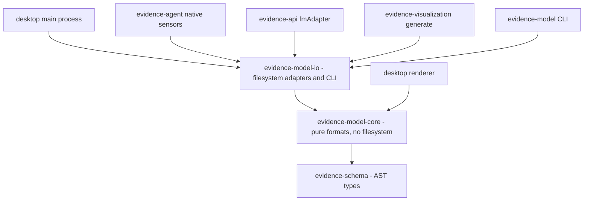

# Model source formats and disk adapters

Evidence keeps one `DomainModelDocument` in two interchangeable on-disk forms:

- a **tree** at `.evidence/fm/` — one JSON file per object, Git-friendly, the form
  checks, sensors and the desktop all read;
- a **bundle** at `*.evidence.json` — one file with a manifest and three arrays,
  the form that can be mailed or dragged into the app.

The document is the same; only the adapter differs. `loadValidationSuite` takes
either a `readonly ModelSourceFile[]` or a `DomainModelBundle` and builds the same
suite (`repo://libs/evidence-model-core/src/validation/validationSuite.ts#L812-L820`),
and the bundle type is literally the document plus a discriminator, a schema
version and two optional extras
(`repo://libs/evidence-model-core/src/adapters/modelBundle.ts#L46-L68`). A caller
never has to convert before checking.

## The layer boundary: pure formats versus node adapters

The two adapter files that define the formats live in
`libs/evidence-model-core/src/adapters/`, and they never touch the filesystem:
`modelSourceFiles.ts` owns file naming, tree serialization and tree parsing,
`modelBundle.ts` owns the bundle envelope, bundle parsing/serialization, packing
from source files and projection back to source files. The filesystem half lives
in `libs/evidence-model-io/src/adapters/`: `diskAdapter.ts` (tree read/write),
`modelRoot.ts` (check readers, directory walkers, digest),
`modelFileAdapter.ts` (bundle on disk) and `cli.ts`.



Each arrow points from a package to the package it imports: only process-side code
reaches the `node:fs` adapters.

The split is enforced, not conventional. `purity.spec.ts` bundles the model-core
entry point with Vite and a resolver that throws on any `node:` or Node builtin
import, so a `node:fs` leak into core fails the suite
(`repo://libs/evidence-model-core/src/purity.spec.ts#L1-L35`). Model-core's own
specs still want real trees, so they carry a test-only mirror reader whose header
states that the production reader lives in model-io and that keeping it out is the
point of the split
(`repo://libs/evidence-model-core/tests/support/modelRoot.ts#L1-L14`).

Model-io declares itself `platform:node`, `layer:io` and ships the CLI binary
(`repo://libs/evidence-model-io/package.json#L12-L41`); its README says it is
consumed by the desktop main process, the sensors and the CLI only
(`repo://libs/evidence-model-io/README.md#L1-L8`). Grep the import sites and that
is what you find: the desktop main process
(`repo://apps/desktop/src/main/projectStore.ts#L9-L15`), the native sensors
(`repo://libs/evidence-agent/src/sensors/native/modelSources.ts#L14-L18`), the API
projection (`repo://libs/evidence-api/src/adapter/fmAdapter.ts#L20-L27`) and the
review-page generator (`repo://libs/evidence-visualization/src/generate/collectWorkbench.ts#L20-L25`).
The renderer imports model-core only.

One documentation trap: the model-core README still groups `packModelDirectory`,
`unpackModelBundle` and `writeModelBundle` with the core adapters in its prose. The
code is in model-io; resolve the import, not the sentence.

## The tree layout

```text
.evidence/fm/
  model.json                         # manifest
  entities/
    evidence-contract--product-procurement.json
    context-contract--product-procurement.json
    role-party--buyer.json
  relationships/
    relation--confirmation-payment-references-request-payment.json
  rules/
    rule--request-payment-completed.json
  validation/                        # read by checks, never rewritten here
    instances/*.json
    scenarios/*.json
  README.md                          # optional prose, carried into a bundle
  generated/                         # derived output, ignored by readers
```

The file name is a function of the object: `category-kind--slug` for entities,
`relation--slug` for relationships, `rule--slug` for rules, where the slug is the
id tail after the first dot with dots turned into dashes
(`repo://libs/evidence-model-core/src/adapters/modelSourceFiles.ts#L99-L118`).
`modelSourcePaths` sorts by desired path and then by id and appends `-2`, `-3`… when
two ids slug to the same name, so the mapping is deterministic and collision-free
(`repo://libs/evidence-model-core/src/adapters/modelSourceFiles.ts#L119-L156`).

`MODEL_SOURCE_TREES` is `entities`, `relationships`, `rules`;
`MODEL_NON_SOURCE_TREES` is `generated` and `validation`
(`repo://libs/evidence-model-core/src/adapters/modelSourceFiles.ts#L8-L20`). Only
the three source trees plus `model.json` are ever rewritten by the tree writer.

## Serialization rules

`stringifyModelJson` writes two-space JSON with a trailing newline and deep-sorts
object keys only when `sortKeys` is requested
(`repo://libs/evidence-model-core/src/adapters/modelSourceFiles.ts#L158-L185`).
`serializeDomainModel` orders files manifest first, then entities, relationships and
rules, each group sorted by path, so a caller can write them deterministically
(`repo://libs/evidence-model-core/src/adapters/modelSourceFiles.ts#L183-L218`).

A bundle sorts differently on purpose: `serializeModelBundle` sorts entities,
relationships and rules **by id** by default (`sortItems: true`) because one file
is diffed as a whole, so stable order matters more than authoring order
(`repo://libs/evidence-model-core/src/adapters/modelBundle.ts#L416-L447`).

## Parsing reports, never throws

`parseModelSourceFiles` accumulates issues instead of failing:

- invalid JSON, a non-object document, an unsupported `type` and a duplicate id
  each become an issue on that path;
- a missing `model.json` becomes an issue at `model.json`;
- an entity-less model becomes `model.empty` — a **code**, not just a message, so a
  caller can accept a freshly created blank project while refusing a broken tree
  (`repo://libs/evidence-model-core/src/adapters/modelSourceFiles.ts#L226-L340`).

Passing `validate: true` appends the static FM checks to the same issue list.
Parsing never throws on malformed input; the caller decides what is fatal. Paths
are normalized to POSIX separators, and anything that is not a `.json` file under
the three source trees (or a part under `generated/`, `validation/`, a dot
directory or `__pycache__`) is skipped before parsing
(`repo://libs/evidence-model-core/src/adapters/modelSourceFiles.ts#L50-L88`).

## The bundle envelope

A bundle is a document plus an envelope
(`repo://libs/evidence-model-core/src/adapters/modelBundle.ts#L32-L90`):

```jsonc
{
  "type": "fm_bundle",
  "schemaVersion": "5.0",
  "manifest": { /* model.json */ },
  "entities": [],
  "relationships": [],
  "rules": [],
  "validation": { "instances": [], "scenarios": [] },  // optional
  "readme": "…"                                        // optional
}
```

`parseModelBundleText` follows the same "report, do not throw" rule: wrong bundle
`type`, a *present* `schemaVersion` other than `5.0` (an absent one is tolerated so
older bundles stay readable), a missing manifest, a wrong item `type`, duplicate
ids, malformed validation entries and a non-string `readme` each become issues; an
entity-less bundle gets `model.empty`
(`repo://libs/evidence-model-core/src/adapters/modelBundle.ts#L266-L381`).

Extras survive: `validation` and `readme` are written back exactly when the
in-memory document carries them, which is what makes an edit-then-save round trip
lossless — the desktop hands the parser's own document back on save
(`repo://libs/evidence-model-core/src/adapters/modelBundle.ts#L416-L447`).

## Writing a tree without churn

`writeModelDirectory` serializes the document, then for each file:

- reads the current bytes; if identical, records `unchanged` and writes nothing;
- otherwise writes through a temporary `<path>.tmp-<uuid>` file and an atomic
  rename;
- finally removes `.json` files under the three source trees that the document no
  longer names.

It returns `written`, `unchanged` and `removed`
(`repo://libs/evidence-model-io/src/adapters/diskAdapter.ts#L98-L172`). Because the
stale scan only walks `MODEL_SOURCE_TREES`, a `validation/` or `generated/` file is
never deleted by a model save.

Two invariants follow, both tested:

1. A second identical save touches nothing, so opening and saving a model produces
   no Git churn (`repo://libs/evidence-model-io/src/adapters/diskAdapter.spec.ts#L86-L100`).
2. Renaming or deleting an object removes its old file only
   (`repo://libs/evidence-model-io/src/adapters/diskAdapter.spec.ts#L122-L147`).

## Writing a bundle

`writeModelBundle` serializes the document and writes only when the resulting text
differs from the file's current content, atomically, returning
`{ written, bytes }` (`repo://libs/evidence-model-io/src/adapters/modelFileAdapter.ts#L213-L230`).
Two consequences worth knowing: an idle bundle save produces no churn, but when it
does write, the canonical serialization replaces whatever formatting the file had —
bundles are compared as bytes, unlike unpacking (below).

## Packing a tree into a bundle

`packModelDirectory(directory)` walks the directory it is given and carries only
`*.json` files plus a root `README.md`, skipping the root `generated/` tree, any
path part starting with `.` and `__pycache__`
(`repo://libs/evidence-model-io/src/adapters/modelFileAdapter.ts#L34-L119`). Its
JSDoc describes the argument as `<root>/.evidence/fm`; the implementation walks the
argument itself, and the CLI and specs pass the `.evidence/fm` path. It then hands
the files to `packModelSourceFiles`, which parses them with the tree rules and
adds:

- `validation/instances/**` and `validation/scenarios/**`, in file order, as
  `validation.instances` / `validation.scenarios`;
- the root `README.md` as `readme`.

A malformed validation file is reported, not dropped, because packing must never
silently lose the scenarios an author wrote
(`repo://libs/evidence-model-core/src/adapters/modelBundle.ts#L449-L540`).

Reading a root is the other direction: `readModelRoot` is
`readModelRootFiles` followed by the same pure packer, returning the bundle plus
the files it read (`repo://libs/evidence-model-io/src/adapters/modelRoot.ts#L221-L227`).

## Unpacking a bundle onto a tree

`unpackModelBundle` writes `modelBundleSourceFiles(document)` back out with one
important difference: for `.json` files it compares **canonical JSON** (keys deep
sorted), not bytes, so a hand-formatted tree whose objects already match is left
untouched; non-JSON files such as `README.md` are compared as bytes
(`repo://libs/evidence-model-io/src/adapters/modelFileAdapter.ts#L150-L163`,
`repo://libs/evidence-model-io/src/adapters/modelFileAdapter.ts#L243-L275`).

Unpacking is a migration step, not a destructive reset:

- files the bundle does not name are left alone — a tree that still holds
  `generated/` keeps it, and unpack never deletes stale object files the way
  `writeModelDirectory` does;
- validation file names are **not** round-trip stable: the bundle holds arrays, so
  unpack re-derives each name from the object id, writing
  `validation/instances/<id with every dot replaced by a double dash>.json`
  (`repo://libs/evidence-model-core/src/adapters/modelBundle.ts#L534-L546`,
  `repo://libs/evidence-model-io/src/adapters/modelFileAdapter.spec.ts#L28-L70`).

## Three readers for a model root

| Reader | Reads | Owner and use |
| --- | --- | --- |
| `readModelDirectory` | `model.json` + the three source trees | `diskAdapter.ts`; the tree writer's read/rewrite scope |
| `readModelRootFiles` | `model.json` + three trees + `validation/` | `modelRoot.ts`; checks and sensors |
| `readModelRootBytes` | every file except `generated/`, `__pycache__` and dot paths | `modelRoot.ts`; the digest |

`readModelDirectory` tolerates a missing `model.json` by filtering it out, so the
parser reports `model.json is required` rather than the reader throwing `ENOENT`
(`repo://libs/evidence-model-io/src/adapters/diskAdapter.ts#L71-L89`).

`readModelRootFiles` puts the manifest first, then walks `MODEL_CHECK_TREES`
(entities, relationships, rules, `validation`), reading `.json` files only, and
treats a missing root as an empty set
(`repo://libs/evidence-model-io/src/adapters/modelRoot.ts#L20-L128`).

`readModelRootBytes` walks the whole root rather than named trees, and sorts by
path. Its doc comment states why: the digest covers whatever is on disk rather than
only the sources, because a hand-edited `README.md` or a stray file is input too,
and a check that silently ignored it could be invalidated without noticing
(`repo://libs/evidence-model-io/src/adapters/modelRoot.ts#L140-L192`).

## The digest and the desktop fingerprint

### `modelDigestOf`

`modelDigestOf` hashes each file with sha256, builds a `path → hash` map, sorts the
entries by path, `JSON.stringify`s that map and hashes it again, returning the
result prefixed with `sha256:`
(`repo://libs/evidence-model-io/src/adapters/modelRoot.ts#L194-L213`).

Properties:

- independent of where the tree lives;
- independent of `generated/` output, because the reader that feeds it ignores that
  tree;
- sensitive to a path rename even when content is unchanged;
- comparable between a packed and an unpacked copy **of the model sources** — but
  only if both sides carry the same `validation/` and `README.md` files, and only
  if no extra file was added beside them.

That last point bites in one ordinary workflow: `pack` defaults its output to
`<model dir>/<model id>.evidence.json`
(`repo://libs/evidence-model-io/src/cli.ts#L173-L186`), i.e. inside `.evidence/fm`,
and `readModelRootBytes` covers every file there — so packing in place adds a file
that joins the digest, while the desktop's three-tree reader never sees it.

The digest is part of the check report and the API projection contract: the CLI
prints it as `模型摘要: sha256:…`
(`repo://libs/evidence-model-io/src/cli.ts#L330-L345`), `buildFmCheckReport` carries
it on the report (`repo://libs/evidence-model-core/src/validation/fmCheck.ts#L280-L300`),
and a change to canonical serialization is a change to the contract, not a
formatting detail.

### `projectStore.fingerprint`

The desktop store has its own, cheaper identity: sha1 over the manifest plus the
three source trees, in sorted path order, each fed as `path`, NUL, `content`, NUL;
for a bundle project, sha1 over the file's text; `null` when the source is missing
or empty (`repo://apps/desktop/src/main/projectStore.ts#L377-L404`).

It is *not* the digest: different algorithm, and it does not cover `validation/`,
`README.md` or stray files. It is also currently exercised only by
`projectStore.spec.ts`, which asserts it changes when a file is edited and returns
`null` for a missing root
(`repo://apps/desktop/src/main/projectStore.spec.ts#L186-L204`). External-edit
detection in the shipped app is the watcher, not a fingerprint poll.

### Detecting external edits

Two independent mechanisms:

- **The watcher.** `watchModelDirectory` opens non-recursive watchers on `.`,
  `entities`, `relationships` and `rules` (non-recursive keeps Windows working) and
  debounces a burst of events into one callback;
  `watchModelBundle` watches the *parent directory* and filters on the file name so
  an editor that saves through a rename does not detach it
  (`repo://apps/desktop/src/main/modelWatcher.ts#L1-L30`,
  `repo://apps/desktop/src/main/modelWatcher.ts#L100-L150`). The main process
  forwards a `changed` event to the renderer
  (`repo://apps/desktop/src/main/projectIpc.ts#L43-L58`), which raises a banner
  offering reload or dismiss. `validation/` is not watched.
- **The digest, inside a check.** `buildFmCheckReport` takes an optional
  `currentDigest` callback; if the value differs from the digest of the inputs it
  already validated, the report gains the error
  `Model inputs changed during validation` and `consistent` becomes false
  (`repo://libs/evidence-model-core/src/validation/fmCheck.ts#L234-L262`). The CLI
  supplies it by re-reading the root after the first read
  (`repo://libs/evidence-model-io/src/cli.ts#L406-L430`); the sensor layer does the
  same through `rereadDigest`
  (`repo://libs/evidence-agent/src/sensors/native/modelSources.ts#L25-L37`,
  `repo://libs/evidence-agent/src/sensors/native/modelSources.ts#L60-L70`). The
  review-page generator brackets its own work with
  `workbenchFingerprint` and throws `预览期间磁盘输入变化，请重新预览` rather than
  emitting a page about a model that moved
  (`repo://apps/desktop/src/main/reviewPreview.ts#L37-L41`,
  `repo://apps/desktop/src/main/reviewPreview.ts#L118-L119`,
  `repo://libs/evidence-visualization/src/generate/collectWorkbench.ts#L150-L195`).

### Refusing silent overwrites

The writers do refuse some overwrites and only some:

- `create` refuses an existing target: a bundle path that already exists, or a
  directory that already holds `.evidence/fm/model.json`, fails with the path the
  user should open instead
  (`repo://apps/desktop/src/main/projectStore.ts#L207-L262`,
  `repo://apps/desktop/src/main/projectStore.spec.ts#L401-L471`).
- An idle save is a no-op: files whose bytes already match the document are
  reported as `unchanged`, and a bundle is not rewritten when its text matches. That
  is churn protection, not conflict protection — the comparison is against the
  renderer's document, not against a baseline fingerprint.
- A save therefore overwrites: `projects.save` hands the renderer's document
  straight to the store (`repo://apps/desktop/src/main/projectIpc.ts#L174-L178`),
  `writeModelDirectory` rewrites every source file whose bytes differ from that
  document, and the stale scan deletes `.json` files under the three source trees
  that the document does not name — including files an external agent just added.
  There is no lock, no merge and no fingerprint comparison. An object edited both
  on disk and in the app is last-write-wins.
- What does survive a save is everything outside the writer's scope: `validation/`,
  `README.md` and `generated/` are never written or deleted by a model save.
- The watcher banner is the only warning before that overwrite, and it is advisory —
  nothing blocks the save; reloading replaces the session document with the disk
  state (`repo://apps/desktop/src/renderer/state/useEditorSession.ts#L109-L113`,
  `repo://apps/desktop/src/renderer/state/useEditorSession.ts#L141-L170`).
- `role-play` refuses an existing output directory unless `--force` is given, and
  only then removes it recursively (`repo://libs/evidence-model-io/src/cli.ts#L624-L686`).

## CLI verbs

The model-io entry point is a library function plus a directly-invoked script:
`runEvidenceModelCommand(argv)` returns the exit code, and the module sets
`process.exitCode` only when it was executed as `argv[1]` (realpath compared to
`import.meta.url`), which is how the specs drive it without spawning a process
(`repo://libs/evidence-model-io/src/cli.ts#L687-L739`).

```bash
evidence-model pack <model-dir> [--out <file>] [--sort-keys]
evidence-model unpack <file> [--out <dir>] [--sort-keys]
evidence-model inspect <file|dir> [--json]
evidence-model check <model-dir> [--scope <context-id>]... [--json]
evidence-model compile <model-dir> --out <file> [--compact] [--sort-keys]
evidence-model lineage <model-dir> --out <file>
evidence-model timeline <model-dir> --out <file>
evidence-model simulate <model-dir> --out <file> [--scenario <id>]...
evidence-model role-play <model-dir> <scenario-id> --out <dir> [--force]
```

Defaults: `pack` writes `<model dir>/<model id>.evidence.json` (dots in the id
become dashes; `model.evidence.json` when the manifest has no id), `unpack` restores
into `./.evidence/fm`, and `--out <path>`/`-o`, `--out=<path>` are both accepted
(`repo://libs/evidence-model-io/src/cli.ts#L87-L172`).

Only `pack`, `unpack` and `inspect` are wrapped by root scripts (`pnpm model:pack`,
`pnpm model:unpack`, `pnpm model:inspect`, each running
`node libs/evidence-model-io/dist/cli.js`); the other verbs need the built binary or
the exported function (`repo://package.json#L15-L17`).

Two mismatches between the usage text and the parser are worth knowing:

- `simulate` advertises `--scenario <id>`, but `parseArguments` implements no such
  flag — it falls through to the positional list and `runSimulate` narrows only by
  `--scope`, so a "filtered" simulation actually runs the whole suite
  (`repo://libs/evidence-model-io/src/cli.ts#L59`,
  `repo://libs/evidence-model-io/src/cli.ts#L87-L172`,
  `repo://libs/evidence-model-io/src/cli.ts#L600-L622`).
- `check`, `compile`, `lineage`, `timeline`, `simulate` and `role-play` read a
  directory; a `*.evidence.json` argument is refused with a hint to unpack first, so
  a report always names files a reader can open
  (`repo://libs/evidence-model-io/src/cli.ts#L396-L406`,
  `repo://libs/evidence-model-io/src/cli.ts#L456-L464`).

### Printed output and exit codes

Every command writes to stdout, failures to stderr, and returns `0` for success,
`1` for a finding or refusal, `2` for a usage error.

| Verb | Output | Exit |
| --- | --- | --- |
| `pack` | `已写入`/`已是最新 <abs path> (<bytes> 字节)`, then `对象: N 实体 / N 关系 / N 规则` plus ` / N 实例 / N 场景` when the bundle carries validation; on issues also `打包时发现的问题（已按原样写入，未修正）：` and one `• <path>: <message>` per issue | `0` clean, `1` issues written as-is, `2` no target |
| `unpack` | `已还原到 <dir>：写入 N 个文件，保持不变 M 个。`; on issues `单文件中的问题（已写出，未修正）：` and the issue bullets | `0` clean, `1` issues, `2` no target or not a bundle path |
| `inspect` | `单文件`/`目录 <abs path>`, `模型: <name> (<id> v<version>)`, `对象: …`, then `问题:` with bullets or `未发现问题。`; `--json` prints a summary object (`kind`, `path`, `modelId`, `modelName`, `modelVersion`, counts, `issues`) | `0` no issues, `1` issues, `2` no target |
| `check` | text mode prints `一致性: 通过/未通过` (+ ` · 范围完整性: …` when scopes were given), `场景: 执行 N / M` (+ ` · 全部通过/存在失败`), `模型摘要: sha256:…`, then `阻塞问题:`, `范围缺口（警告）:` and `建模建议（不阻断）:` blocks; `--json` prints the whole report | `0` `report.valid`, `1` otherwise, `2` no target or a bundle |
| `compile`, `lineage` | `已写入 <abs path>` | `0`, `1` when `ensureCheckable` rejects the model (`模型未通过一致性检查，已中止：` plus bullet errors), `2` missing target or `--out` |
| `timeline` | `已写入 <abs path>` | `1` with `时间线存在问题，已中止：` when the timeline reports errors |
| `simulate` | `已写入 <abs path>` | `0` when `simulationPassed`, `1` otherwise, `2` missing target or `--out` |
| `role-play` | `已生成角色扮演包 <dir>（场景 <id>，N 个文件）` | `1` with `输出目录已存在：…；使用 --force 才会替换。` or a `RolePlayPackError` message, `2` missing scenario id or `--out` |
| — | usage text on stdout; `未知命令 <name>。` plus usage on stderr | `0` for `--help`, `2` for no command or an unknown one |

`--json` and `--compact` only change formatting: `--compact` writes single-line
JSON for the `--out` verbs, otherwise `stringifyModelJson` writes two-space JSON
with optional key sorting (`repo://libs/evidence-model-io/src/cli.ts#L498-L511`).
The CLI is tested as behaviour, not prose: default bundle naming, explicit
`--out` plus unpack, `2` for usage errors, `2` for unpacking a non-bundle,
`check` printing `一致性: 通过` and `模型摘要: sha256:`, `check` refusing a bundle,
`inspect` printing without writing, the derived verbs aborting on a failed check,
and `role-play` refusing then accepting with `--force`
(`repo://libs/evidence-model-io/src/cli.spec.ts#L26-L116`,
`repo://libs/evidence-model-io/src/cliDerived.spec.ts#L28-L155`).

## Failure behaviour

| Situation | Result |
| --- | --- |
| malformed JSON in a source file | issue on that path; other files still parse |
| missing `model.json` (tree) | issue at `model.json`; the document keeps an empty manifest |
| unsupported document `type` | issue; the object is skipped |
| duplicate id across files | issue naming both paths; the second object is skipped |
| entity-less model | `model.empty` code (a blank start is allowed by the desktop) |
| wrong bundle `type` | issue; parsing continues with what it could read |
| `schemaVersion` other than `5.0` | issue; absent `schemaVersion` is tolerated |
| malformed validation entry while packing | issue; the file is not silently dropped |
| bundle missing or empty | one issue (`does not exist or is empty`), empty document returned |
| existing file bytes/objects equal | `unchanged`, no write |
| stale source file after rename/delete (tree save) | `removed`, from the three trees only |
| external edit to a modeled file, then an in-app save | overwritten: the save writes the document, not the disk state |
| external file added under the three source trees, then an in-app save | removed by the stale scan |
| `validation/`, `README.md` or `generated/` edited externally | untouched by a save |
| file the bundle does not name (unpack) | left untouched, never deleted |
| hand-formatted tree (unpack) | untouched when canonical JSON matches |
| inputs change during a check | error `Model inputs changed during validation`, report not consistent |
| `create` onto an existing model | refused with the path to open instead |

## Tests that protect this contract

- `modelSourceFiles.spec.ts` pins file naming, collision suffixes, two-space JSON
  with a newline, optional key sorting, manifest-first order, round-trip parsing,
  non-throwing malformed input, `model.empty` coding, duplicate ids and ignored
  non-source trees (`repo://libs/evidence-model-core/src/adapters/modelSourceFiles.spec.ts#L27-L210`).
- `modelBundle.spec.ts` pins suffix recognition, envelope shape, id sorting, extras
  preservation, projection back to the tree layout, validation/readme packing and
  malformed-validation reporting
  (`repo://libs/evidence-model-core/src/adapters/modelBundle.spec.ts#L23-L254`).
- `diskAdapter.spec.ts` pins the initial write, read-back equivalence, idempotent
  second write, only-changed-file rewrite, removal of deleted objects, other trees
  left alone and no leftover `.tmp-` files
  (`repo://libs/evidence-model-io/src/adapters/diskAdapter.spec.ts#L43-L160`).
- `modelFileAdapter.spec.ts` pins the pack/write/unpack round trip, canonical-JSON
  non-rewrites, byte-identical bundle non-writes and the missing-bundle report
  (`repo://libs/evidence-model-io/src/adapters/modelFileAdapter.spec.ts#L22-L119`).
- `cli.spec.ts` and `cliDerived.spec.ts` pin the verbs, printed strings and exit
  codes listed above.
- `purity.spec.ts` keeps `node:fs` out of model-core
  (`repo://libs/evidence-model-core/src/purity.spec.ts#L1-L35`).

## Related pages

- [System map and dependency direction](../architecture/overview.md) — where the
  two packages sit in the ring ladder.
- [Commands, guards and the model session](./commands-and-session.md) — the
  document these files hold.
- [The native check and simulation pipeline](./checks-and-simulation.md) — what the
  digest protects and who consumes the report.
- [Desktop app shell and IPC surface](../desktop/app-shell.md) — how a project root
  picks tree or bundle, and how the watcher reaches the renderer.
