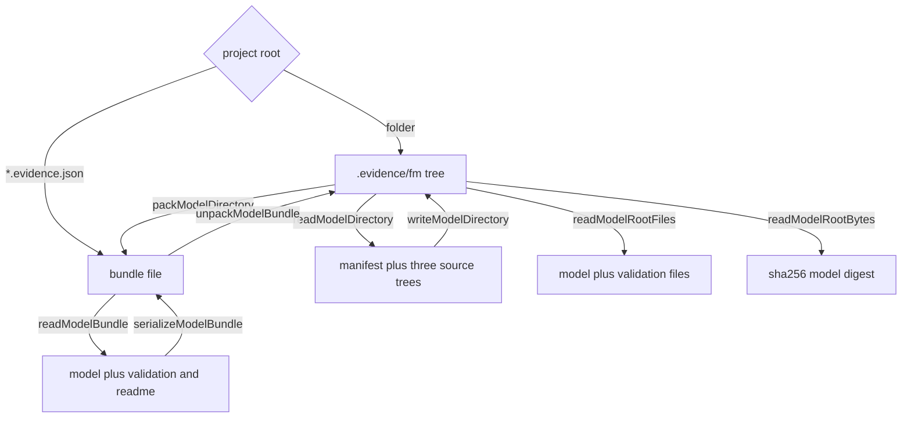

# Source tree and bundle adapters

Evidence stores one `DomainModelDocument` in two interchangeable forms:

- a **tree** at `.evidence/fm/` — one JSON file per object, Git-friendly, the form
  the checks and sensors read;
- a **bundle** at `*.evidence.json` — one file with an envelope: the manifest and
  the same three object arrays, the form that can be mailed, used as a review diff
  baseline, or dragged onto the desktop app.

The same core document is behind both; only the adapter differs. Consumers that
can take either form switch once, on the path, and never convert:
`loadValidationSuite` accepts a file list or a bundle, and `loadFm` parses a
bundle with `parseModelBundleText` and a directory with `readModelRoot` before
deriving the same index
(`repo://libs/evidence-model-core/README.md#L14-L17`,
`repo://libs/evidence-model-core/src/validation/validationSuite.ts#L812-L820`,
`repo://libs/evidence-api/src/adapter/fmAdapter.ts#L210-L230`).



The two storage forms, and which adapter entry point reads or writes each one.

## The tree layout

```text
.evidence/fm/
  model.json                         # manifest
  entities/
    evidence-contract--product-procurement.json
    context-contract--product-procurement.json
    role-party--buyer.json
  relationships/
    relation--confirmation-payment-references-request-payment.json
  rules/
    rule--request-payment-completed.json
  validation/                        # check inputs: read, never rewritten here
    instances/*.json
    scenarios/*.json
  README.md                          # optional prose
  generated/                         # derived output, ignored by readers
```

The three trees are the only ones the tree adapter rewrites. `generated/` and
`validation/` are other owners' data: `MODEL_SOURCE_TREES` names the three source
trees and `MODEL_NON_SOURCE_TREES` names their two siblings explicitly, so a save
cannot reach them by accident
(`repo://libs/evidence-model-core/src/adapters/modelSourceFiles.ts#L10-L20`).

`libs/evidence-schema/tests/fixtures/product-procurement/` is a real instance of
this layout — `model.json` plus the three trees, no `validation/`, no README —
kept as a frozen snapshot so schema tests do not move with the API fixture. It is
loaded by its own small reader rather than by the adapter, which makes it a useful
reminder that the layout is a convention any reader can implement
(`repo://libs/evidence-schema/tests/support/fixtures.ts#L55-L78`).

## File names are a function of object identity

`modelSourcePaths` maps each object id to a relative path:

- entity → `entities/<category>-<kind>--<slug>.json`;
- relationship → `relationships/relation--<slug>.json`;
- rule → `rules/rule--<slug>.json`.

The slug is the id without its first dot-separated segment, with `_` folded to `-`
and every other unsafe character replaced, so `role.buyer` becomes
`entities/role-party--buyer.json` and `contract.product-procurement` becomes
`entities/evidence-contract--product-procurement.json`
(`repo://libs/evidence-model-core/src/adapters/modelSourceFiles.ts#L96-L117`).

Desired pairs are sorted by path and then by id, and when two ids slug to the same
file the later one gains `-2`, `-3`… before `.json`. The mapping is therefore
deterministic and collision-free: neither the input order nor the filesystem
decides a file name
(`repo://libs/evidence-model-core/src/adapters/modelSourceFiles.ts#L119-L152`).

## Serialization rules

`stringifyModelJson` writes two-space JSON with a trailing newline, and sorts keys
deeply only when `sortKeys` is requested
(`repo://libs/evidence-model-core/src/adapters/modelSourceFiles.ts#L165-L179`).

`serializeDomainModel` orders files manifest first, then entities, relationships
and rules, each sorted by path. The order is stable so a caller can write them
deterministically (`repo://libs/evidence-model-core/src/adapters/modelSourceFiles.ts#L183-L214`).

## Parsing never throws

`parseModelSourceFiles` accumulates issues instead of failing:

- invalid JSON, a non-object document, an unsupported `type` and a duplicate id
  each become an issue on that path;
- a missing `model.json` becomes an issue at `model.json`, and the document keeps
  the empty manifest (`id: 'untitled'`) instead of losing the parse;
- an entity-less model becomes the finding coded `model.empty`.

Only `.json` files at least two segments deep under one of the three source trees
are treated as model sources. Anything below `generated/` or `validation/`, below
a dot directory, or inside `__pycache__` is skipped by the parser even when it is
valid JSON, so the tree's non-source siblings can hold objects the schema does not
know (`repo://libs/evidence-model-core/src/adapters/modelSourceFiles.ts#L61-L85`).

Passing `validate: true` appends the static FM checks to the same issue list and
keeps their codes. Parsing never throws on malformed input; the caller decides
what is fatal (`repo://libs/evidence-model-core/src/adapters/modelSourceFiles.ts#L239-L332`).

### The empty-model finding

An entity-less model is reported as `{ path: 'entities', code: 'model.empty' }`
rather than as an error, because "no objects yet" and "broken tree" are different
states. `EMPTY_MODEL_ISSUE_CODE` exists so readers can filter on the code instead
of matching the message
(`repo://libs/evidence-model-core/src/adapters/modelSourceFiles.ts#L30-L42`).

The desktop relies on exactly that. A freshly created blank project holds a
manifest and nothing else, so opening it yields one finding — `model.empty` — and
`isBlankStart` accepts the source only when *every* issue carries that code;
`isReadableSource` then accepts either a document with entities or a blank start.
A tree with one `model.empty` and any other finding is refused with the joined
issue list, which is how a partially broken project stops being mistaken for a new
one (`repo://apps/desktop/src/main/projectStore.ts#L106-L131`,
`repo://apps/desktop/src/main/templates/starterModels.ts#L1037-L1044`).

## Writing a tree without churn

`writeModelDirectory` serializes the document, then for each file:

- reads the current bytes; if identical, records `unchanged` and writes nothing;
- otherwise writes through a temporary file and an atomic rename;
- finally re-reads the three source trees and removes `.json` files the document
  no longer names, so a renamed or deleted object leaves no orphan behind
  (`repo://libs/evidence-model-core/src/adapters/diskAdapter.ts#L139-L173`).

Stale-file removal only ever scans `MODEL_SOURCE_TREES`, so `validation/` and
`generated/` are never deleted by a model save — a fact pinned by a test that puts
`validation/suite.json` in the root, deletes a party, saves, and expects the file
untouched (`repo://libs/evidence-model-core/src/adapters/diskAdapter.spec.ts#L142-L164`).

Two invariants follow, both tested:

1. A second identical save touches nothing, so opening and saving a model does not
   produce Git churn.
2. Renaming or deleting an object removes its old file, but a `validation/` or
   `generated/` file is never deleted by a model save.

## The bundle envelope

A bundle is a document plus envelope keys
(`repo://libs/evidence-model-core/src/adapters/modelBundle.ts#L23-L90`):

```jsonc
{
  "type": "fm_bundle",
  "schemaVersion": "5.0",
  "manifest": { /* model.json */ },
  "entities": [],
  "relationships": [],
  "rules": [],
  "validation": { "instances": [], "scenarios": [] },  // optional
  "readme": "…"                                        // optional
}
```

`isModelBundlePath` is the whole suffix rule: a normalized path whose lowercase
ends with `.evidence.json`. Nothing else is a bundle, which is why `model.json`
and a stray `evidence.json` never match
(`repo://libs/evidence-model-core/src/adapters/modelBundle.ts#L97-L99`).

`schemaVersion` is optional on read but must be `5.0` when present. A missing
`schemaVersion` is tolerated so older bundles remain readable; a different one is
a reported issue while the rest still parses.

`serializeModelBundle` sorts entities, relationships and rules **by id by
default**, because a single file is diffed as a whole and a stable order matters
more than authoring order. `sortKeys` remains the opt-in for key ordering
(`repo://libs/evidence-model-core/src/adapters/modelBundle.ts#L416-L452`).

Extras survive: `validation` and `readme` are written back exactly when the
in-memory document carries them. That is what makes an edit-then-save round trip
in the canvas lossless — the renderer's document already holds the extras it
parsed, and a command dispatched on it keeps them
(`repo://libs/evidence-model-core/src/adapters/modelBundle.ts#L405-L414`,
`repo://libs/evidence-model-core/src/adapters/modelBundle.spec.ts#L165-L190`).

`parseModelBundleText` follows the same "report, do not throw" rule. Issues are
addressed by their place in the envelope — `type`, `schemaVersion`, `manifest`,
`entities`, `entities[2]`, `readme` — so a finding points at the offending entry
rather than at the file as a whole; an entity-less bundle gets the same
`model.empty` code, and `validate: true` runs the static checks on the model part
only, so bundle extras never leak into a validator that does not know them
(`repo://libs/evidence-model-core/src/adapters/modelBundle.ts#L266-L405`).

## Packing and unpacking

`packModelSourceFiles` parses the given files with the tree rules, then adds:

- every `validation/instances/**` and `validation/scenarios/**` JSON object;
- the root `README.md` as `readme`.

A bundle gains a `validation` key as soon as any such path is present, even when
the arrays end up empty. A malformed validation file cannot be carried, but the
loss is reported as an issue on that path — packing never loses an author's
scenarios *silently*
(`repo://libs/evidence-model-core/src/adapters/modelBundle.ts#L456-L531`).

`packModelDirectory` supplies those files by walking the filesystem with a
deliberately narrow rule: only `.json` files plus a root `README.md` are carried,
the top-level `generated/` tree is skipped outright, and any path with a
dot-prefixed segment or `__pycache__` is skipped. A pack therefore describes the
model, not the checkout
(`repo://libs/evidence-model-core/src/adapters/modelFileAdapter.ts#L34-L111`).

`unpackModelBundle` projects a bundle back onto tree files — manifest first, then
the three model trees, then `validation/instances` and `validation/scenarios`,
then `README.md`. Validation file names are re-derived from the object id
(`evidence-instance.a` → `evidence-instance--a.json`, or `unnamed-<n>.json` when
there is no id), and a README gains a trailing newline if it lacked one
(`repo://libs/evidence-model-core/src/adapters/modelBundle.ts#L533-L577`).

Writing is where unpacking differs from a copy:

- `.json` files are compared as **canonical JSON**, not bytes, so a hand-formatted
  tree whose objects already match keeps its formatting;
- `README.md` is compared byte for byte;
- files the bundle does not name are left alone, because unpacking is a migration
  step, not a destructive reset;
- anything not already correct goes through the same temporary-file-and-rename
  write, and `written` / `unchanged` are reported separately
  (`repo://libs/evidence-model-core/src/adapters/modelFileAdapter.ts#L243-L275`).

`writeModelBundle` is the single-file mirror of the tree writer: serialize, compare
bytes, and skip the write entirely when the file already holds exactly that text
(`repo://libs/evidence-model-core/src/adapters/modelFileAdapter.ts#L213-L235`).

## A bundle is also a project root

A `*.evidence.json` path is not a file *inside* a project — it is the project
root. `modelSource.ts` states the rule once so no caller concatenates paths
(`repo://apps/desktop/src/main/modelSource.ts#L8-L26`):

| Function | Tree project | Bundle project |
| --- | --- | --- |
| `isBundleProject` | false | true for a `*.evidence.json` path |
| `projectDirectoryOf` | the project root | the bundle's parent directory |
| `modelSourceOf` | `<root>/.evidence/fm` | the bundle file |

The consequence is layout, not just plumbing: a bundle project still keeps its
`.evidence/` neighbours **beside** the file — review pages, API designs and
generated outputs land next to the bundle, never inside it.

`createProjectStore` is the desktop's only writer, and it switches on that
distinction:

- `open` reads a bundle when `isModelBundleFile` finds a real file at the path
  (suffix plus `stat().isFile()`), and otherwise requires
  `.evidence/fm/model.json`, failing with a message that names both forms;
- `save` calls `writeModelBundle` for a bundle path and `writeModelDirectory` for
  a folder, and reports the bundle file itself as written or unchanged;
- `create` refuses an existing target in either form rather than overwriting, and
  appends `.evidence.json` when the chosen file name lacks the suffix;
- `fingerprint` hashes the bundle's text with SHA-1, or every model source file's
  path and content, so the renderer can tell its own save from an external write
  (`repo://apps/desktop/src/main/projectStore.ts#L77-L131`,
  `repo://apps/desktop/src/main/projectStore.ts#L205-L265`,
  `repo://apps/desktop/src/main/projectStore.ts#L280-L403`).

## Reading a root for checks

There are three readers with different scopes:

| Reader | Reads | Use |
| --- | --- | --- |
| `readModelDirectory` | `model.json` + three trees | the disk adapter's rewrite scope |
| `readModelRootFiles` | `model.json` + three trees + `validation/` | checks and sensors |
| `readModelRootBytes` | every file except `generated/`, caches and dot paths | the digest |

`readModelDirectory` stops at the three trees because that is all the writer owns.
`readModelRootFiles` adds `validation/` and reads a missing root as an empty set
rather than throwing, so a caller can report "this directory is not a model"
(`repo://libs/evidence-model-core/src/adapters/diskAdapter.ts#L73-L110`,
`repo://libs/evidence-model-core/src/adapters/modelRoot.ts#L99-L131`).

`readModelRootBytes` walks everything else. Its doc comment states why: a
hand-edited `README.md` or a stray file is input too, and a check that ignored it
could be invalidated without noticing
(`repo://libs/evidence-model-core/src/adapters/modelRoot.ts#L170-L191`).

## The digest contract

`modelDigestOf` hashes each file, builds a `path → sha256` map, sorts the paths,
serializes that map, and hashes it again with a `sha256:` prefix
(`repo://libs/evidence-model-core/src/adapters/modelRoot.ts#L196-L214`).

Properties, as the code actually behaves:

- independent of file order in the input list — the map is sorted before hashing;
- independent of where the tree lives, because only relative paths enter it;
- independent of `generated/` output and of caches, which the byte reader skips;
- sensitive to a path rename even when content is unchanged;
- **not** comparable between the two storage forms. A bundle is hashed as one file
  whose path is the bundle's basename and whose bytes are the envelope text, so a
  bundle and the tree it was packed from always produce different digests
  (`repo://libs/evidence-api/src/adapter/fmAdapter.ts#L210-L252`).

A pack/unpack round trip is not digest-preserving either, for two concrete
reasons: unpacking re-derives validation file names from object ids, and the pack
only carries `.json` files plus the root `README.md`, so any other file under the
root disappears from the digest of a freshly unpacked copy. The digests agree only
when both sides came out of the serializer — the model part always does, and the
validation files do once they are named from their ids.

The digest is part of the check report: `buildFmCheckReport` always returns one,
and a caller that re-reads the sources can compare it — `currentDigest` — to mark
an old verdict stale instead of trusting it
(`repo://libs/evidence-model-core/src/validation/fmCheck.ts#L168-L178`). It is
also part of the API projection contract, so a change to canonical serialization
is a change to the contract, not a formatting detail, and pinned digest values in
specs are refreshed deliberately
(`repo://ENVIRONMENT.md#L54-L57`).

## CLI verbs

```bash
npx evidence-model pack .evidence/fm --out procurement.evidence.json [--sort-keys]
npx evidence-model unpack procurement.evidence.json --out .evidence/fm [--sort-keys]
npx evidence-model inspect procurement.evidence.json [--json]
```

`pack` writes into the model directory when `--out` is omitted, naming the file
after the model id with dots turned into dashes and falling back to
`model.evidence.json`. That default puts the bundle *inside* the tree, where
`readModelRootBytes` will count it on the next check — pass `--out` outside the
root when digests are compared across packs. `unpack` defaults to
`./.evidence/fm`, and refuses a target that does not end in `.evidence.json`.
`inspect` reads either form and prints counts, extras and file-level issues
without writing; both `pack` and `unpack` exit non-zero when they reported issues,
having written the result unfixed
(`repo://libs/evidence-model-core/src/cli.ts#L176-L320`).

`check`, `compile`, `lineage`, `timeline`, `simulate` and `role-play` are
different: they read a directory and refuse a bundle with a message telling the
caller to unpack first, so a report always names files a reader can open
(`repo://libs/evidence-model-core/src/cli.ts#L379-L470`). See
[The native check and simulation pipeline](./checks-and-simulation.md).

## Failure behaviour

| Situation | Result |
| --- | --- |
| malformed JSON in a source file | issue on that path; other files still parse |
| missing `model.json` | issue at `model.json`; document keeps the `untitled` manifest |
| unsupported document `type` | issue; the object is skipped |
| duplicate id across files | issue naming the earlier path; the second object is skipped |
| entity-less model | `model.empty` code; the desktop opens it as a blank start |
| entity-less model plus any other finding | open fails and the findings are shown |
| wrong bundle `type` / `schemaVersion` | reported issue; parsing continues |
| malformed validation entry in a bundle | issue at `validation/instances/[i]`; entry skipped |
| malformed validation file while packing | issue on that path; the file cannot be carried |
| existing file bytes equal | `unchanged`, no write |
| stale source file after rename/delete | `removed` from the three trees only |
| hand-formatted tree unpack | object untouched when canonical JSON matches |
| file the bundle does not name | left alone |
| bundle missing/empty | reported issue, empty document returned |

## Tests that protect this contract

- `modelSourceFiles.spec.ts` pins file naming, collision suffixes, two-space JSON
  with newline, optional key sorting, manifest-first order, round-trip parsing,
  non-throwing malformed input, `model.empty` coding, duplicate ids, ignored
  non-source trees and inline validation
  (`repo://libs/evidence-model-core/src/adapters/modelSourceFiles.spec.ts#L27-L211`).
- `diskAdapter.spec.ts` pins the initial write, read-back equivalence, idempotent
  second write, only-changed-file rewrite, deletion of stale object files, leaving
  `validation/` alone, and key sorting
  (`repo://libs/evidence-model-core/src/adapters/diskAdapter.spec.ts#L43-L198`).
- `modelBundle.spec.ts` pins suffix recognition, envelope shape, id sorting, extras
  preservation through parse/serialize and through a command, projection back to
  the tree, validation/readme packing, malformed validation reporting, a full
  pack/unpack round trip, canonical-JSON non-rewrites, byte-identical bundle
  non-writes and a missing bundle
  (`repo://libs/evidence-model-core/src/adapters/modelBundle.spec.ts#L31-L367`).
- `projectStore.spec.ts` pins the blank start: create a blank project, open it, get
  an empty document plus a `model.empty` issue and a successful result
  (`repo://apps/desktop/src/main/projectStore.spec.ts#L471-L489`), and
  `modelSource.spec.ts` pins `isBundleProject`, `modelSourceOf` and
  `projectDirectoryOf` for both forms
  (`repo://apps/desktop/src/main/modelSource.spec.ts#L12-L26`).
- `fmCheck.spec.ts` pins digest order-independence and content sensitivity
  (`repo://libs/evidence-model-core/src/validation/fmCheck.spec.ts#L173-L187`).

## Related pages

- [System map and dependency direction](../architecture/overview.md) — where the
  adapters sit.
- [Commands, guards and the model session](./commands-and-session.md) — the
  document these files hold.
- [Desktop app shell and IPC surface](../desktop/app-shell.md) — how a project root
  picks tree or bundle, and the watcher that follows either.
- [The native check and simulation pipeline](./checks-and-simulation.md) — the
  digest consumer.
- [The FM DSL and its static contract](../language/fm-dsl.md) — what the objects
  in these files mean.
- [The offline workbench contract](../contracts/offline-workbench.md) — what a
  bundle or tree is turned into for a reviewer.
