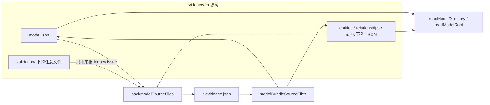
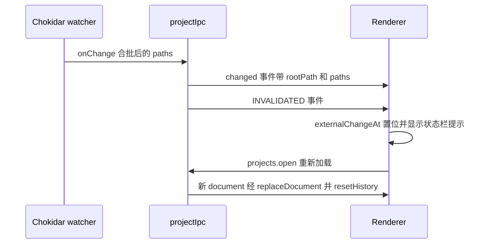

# 模型源格式、Bundle 与文件边界

同一份 `DomainModelDocument` 有两种等价载体：Git 友好的 `.evidence/fm/` 源树，和便携的 `*.evidence.json` 单文件 Bundle。格式语义（命名、序列化、解析、互相投影）全部由 browser-safe 的 `@evidence-poc/evidence-model-core/adapters` 决定，`node:fs` 只出现在 `@evidence-poc/evidence-model-io/adapters`。包装进 Bundle 或还原成树不改变模型语义：实体内联 `examples` 原样往返，根 `README.md` 进 `readme` 字段；唯一被**拒绝**的旧格式是 retired 的 `validation`（scenarios/instances）——它既不被兼容读取，也不会被静默丢弃。

```ts
MODEL_MANIFEST_PATH = 'model.json'
MODEL_SOURCE_TREES = ['entities', 'relationships', 'rules']
MODEL_NON_SOURCE_TREES = ['generated']
MODEL_BUNDLE_EXTENSION = '.evidence.json'
DEFAULT_MODEL_BUNDLE_FILE = 'model.evidence.json'
MODEL_README_PATH = 'README.md'
EMPTY_MODEL_ISSUE_CODE = 'model.empty'
// model-io 侧
MODEL_DIRECTORY = '.evidence/fm'
MODEL_GENERATED_TREE = 'generated'
MODEL_CHECK_TREES = [...MODEL_SOURCE_TREES, 'validation']
```

选哪种读取器由**文件名后缀**决定，而不是内容形状：`isModelBundlePath` 只做大小写不敏感的 `.evidence.json` 后缀判断（`isModelBundleShape` 才检查 `type`/`manifest`/三数组）。桌面据此把项目根归一化成"一个文件"或"`<root>/.evidence/fm` 一棵树"，watcher、摘要和所有读取器都以该路径为界。



树与 Bundle 的往返：树只经由 `packModelSourceFiles` 变成 bundle，bundle 只经由 `modelBundleSourceFiles` 投影回树。

## 哪些路径是源，哪些只是邻居

- **源**：根 `model.json`，以及 `entities/`、`relationships/`、`rules/` 下形如 `*.json` 的文件（可嵌套子目录）。打包时再加根 `README.md`。
- **明确跳过**：`generated/`（`MODEL_NON_SOURCE_TREES` / `MODEL_GENERATED_TREE`）、`__pycache__`、任何以 `.` 开头的路径段。它们既不被解析，也不被写出，`writeModelDirectory` 也从不删除。
- **根下其他目录**（自建的 `cache/`、`dist/` 等）不属于这三棵树，因此**不是模型输入**：`isManagedJsonPath` 只认三棵树，解析器会把它们完全忽略。但要记住摘要的边界不同——`readModelRootBytes` 只排除 `generated/`、`__pycache__` 和点路径，所以这类目录里的文件增删会改变 digest，却不会改变文档。
- **retired 的 `validation/`**：读取器会把它读进来（包括非 JSON 文件）**只为了拒绝**，产出 `code: 'model.legacy-validation'` 的 issue 并提示改用 `entity.examples[].test`；它不会进入 document，也不会被打进新 Bundle。

## 格式代码不碰磁盘

`evidence-model-core` 的 `modelSourceFiles`（命名、`stringifyModelJson`、`serializeDomainModel`、`parseModelSourceFiles`）与 `modelBundle`（`parseModelBundleText`、`serializeModelBundle`、`packModelSourceFiles`、`modelBundleSourceFiles`）是纯函数，renderer 可以直接用；`purity.spec.ts` 用 vite browser 构建跑一遍，任何 `node:`/内建模块导入都会让测试失败。model-core 自己的 spec 走 `tests/support/modelRoot.ts` 这个**仅测试**的镜像 reader，而不是反向依赖 model-io。

`evidence-model-io/adapters` 是唯一的 Node 侧实现，按职责分为三块：

| 模块 | 负责 |
| --- | --- |
| `diskAdapter` | `readModelDirectory`（manifest + 三树，容忍缺失 manifest 让 parser 报错）、`writeModelDirectory` |
| `modelRoot` | `readModelRootFiles`（三树 + `validation`）、`readModelRoot`（= files + pack）、`readModelRootBytes`（非 ignored 常规文件含 README/散落文件）、`modelDigestOf` |
| `modelFileAdapter` | `MODEL_DIRECTORY`、`packModelDirectory`、`readModelBundle`、`writeModelBundle`、`unpackModelBundle`、`isModelBundleFile` |

可以 import model-io 的是进程侧入口：desktop main、agent 的 native sensors、`evidence-api`、`evidence-acceptance` 与 CLI；renderer 只 import model-core。

## 命名、序列化与非抛出解析

树文件名是对象身份的确定性函数：实体 `entities/<category>-<kind>--<slug>.json`，关系 `relationships/relation--<slug>.json`，规则 `rules/rule--<slug>.json`。slug 取 ID 第一个点之后的部分（无点则整段），`_` 变 `-`，其余非 `[a-z0-9-]` 字符各自变成 `-`；同一路径被多个对象命中时按 path、id 排序后依次加 `-2`、`-3`，因此不会丢对象，且输入顺序不影响结果。

`stringifyModelJson` 统一两空格缩进加末尾换行，`sortKeys` 只在显式要求时深排序；`serializeDomainModel` 把 manifest 放在最前，之后按 entities/relationships/rules 分组、组内按路径排序。Bundle 序列化同样稳定：`type: fm_bundle`、`schemaVersion: 5.0`、三数组默认按 `id` 排序（`sortItems: false` 可关），可选 `readme`，永不输出 `validation`。

`parseModelSourceFiles` 对任何畸形输入都**不抛异常**，只给 `path` + `message` 的 issue：坏 JSON、非对象、不支持的 `type`、重复 `id`（报第二条并提出前一条位置）、缺 `model.json`。空模型单独用 `EMPTY_MODEL_ISSUE_CODE` 标记，调用方据此区分"刚创建的空白起点"和其他致命问题；`validate: true` 时追加 `strictValidateDomainModel` 的 findings。

`parseModelBundleText` 要求根是对象、`type` 必须匹配；`schemaVersion` 出现时必须是 `5.0`，缺失仍可读。未知顶层字段（其中 `validation` 给 legacy 文案）、数组元素类型不符、跨三数组的重复 `id`、非字符串 `readme` 都会产出 issue，而**可读部分照样保留**。序列化侧的态度更硬：`serializeModelBundle` / `modelBundleSourceFiles` 遇到带 `validation` 的文档直接抛错，避免"打包成功但丢掉测试"。

## 保存与打包：原子、幂等、拒绝而不修

`writeModelDirectory` 逐文件按**字节**比较：相同记 `unchanged` 不触碰（无 git churn），不同的经 `<path>.tmp-<uuid>` + rename 原子替换，最后删除三棵树里 document 已不再命名的 `*.json`，返回 `written / unchanged / removed`。它只拥有 `model.json` 与三棵树，`README`、`generated/`、`validation/` 一律不动。

`writeModelBundle` 用序列化文本与现有内容比较，只有不同才原子替换，返回 `{ written, bytes }`。注意这与解包路径不同：**Bundle 保存会把作者的排版规范化为 canonical 序列化**，而解包不会。

`packModelDirectory(root)` 直接读传入目录（不会自动再拼 `.evidence/fm`）：收根级 `*.json`、三棵树里的 JSON、`validation/` 下任意文件（只用于报错）和根 `README.md`，跳过 `generated/`、点路径、`__pycache__`。`packModelSourceFiles` 复用树 parser，并把 README 内容放进 `bundle.readme`。

## 解包与"语义不变"

`unpackModelBundle` 按 `modelBundleSourceFiles` 投影写出：`.json` 文件比 canonical JSON（键排序后比较），其他文件比字节，所以手工排版但对象等价的树**一个字节都不重写**。Bundle 没有命名的文件留在原地——解包是一次迁移，不是破坏性 reset。

失败语义是"全有或全无"：Bundle 读不出可用的 document 时（例如旧 envelope 带 `validation`），`unpackModelBundle` 直接返回 issues 和空的 `written/unchanged`，一个文件都不写，输出目录保持原样。同理 `pack` 在有任何 issue 时以 1 退出**且不写 Bundle**，所以 retired 的 `validation/` 只能被清理，绝不会被打包成空套件。

## 摘要、读取期间变化与指纹

`modelDigestOf` 先把每个文件算 `sha256(bytes)`，构造 `path → hash` 映射并按 path 排序，再对这段 JSON 取 `sha256` 并加 `sha256:` 前缀。它位置无关（树搬到哪都一样）、路径敏感（改名即变），且不含 generated 输出。摘要**与载体相关**：Bundle 的摘要覆盖的是那一个文件的字节，解包后源树的摘要覆盖"多路径映射"，两者不可能相等，不要拿去互相比较；同理把 Bundle 写进被读的模型目录会让该目录的摘要变化，即使它不会被解析成模型对象。

读取期间变化的检测有三处同一模式：

- `evidence-model` 的 `check`：读一次 `readModelRootBytes` 得到 digest，再读一次得到 `currentDigest`，交给 `buildFmCheckReport`；
- agent native sensors：`loadModelSources` 一次读出 bundle、`sourceIssues` 和 digest，`rereadDigest()` 再读一次（`detectInputChange: false` 只给桌面去抖跑法用）；
- `evidence-api` 的 `loadFm`：解析前后各取一次字节快照，不同则返回 `index: null` 和 `SOURCE_CHANGED` 诊断。

只要 `currentDigest` 与 `digest` 不一致，`fmCheck` 就把 `inputChanged` 置真、追加 `Model inputs changed during validation` 并令 `consistent`/`valid` 为假——宁可报"输入变了"，也不给出一个基于混合读数的结论。注意 check 的文档读取**不含** `README.md`，但摘要含：改 README 会让 digest 变而文档不变，这是有意的（散落文件也是输入）。

桌面侧还有另一个指纹：`projectStore.fingerprint` 是 sha1，目录项目按 manifest + 三树文件的 `path`、NUL、`content`、NUL 依次喂入，Bundle 项目直接哈希文件文本，读不到则返回 `null`。它不是 artifact 摘要、不覆盖 `validation/` 或 `README.md`，renderer 也不轮询它（外部变更靠文件监听通知）。

## 桌面：文件监听与外部变更

`modelSourceOf` 把项目根折叠成单一来源：Bundle 项目就是该文件本身，目录项目是 `<root>/.evidence/fm`。`watchModelSource` 用 Chokidar v4 从**最近的已存在祖先**开始监听（这样首次保存才出现的 `.evidence/fm` 也能覆盖），`ignoreInitial: true`、`followSymlinks: false`、`atomic: true`、`awaitWriteFinish` 稳定阈值 150ms、变更默认去抖 200ms 后按路径排序合批。

相关性规则很窄：目录项目只认根 `model.json` 和三棵树下扩展名为 `.json` 的文件（含嵌套子目录与整棵根被删除/重建），Bundle 项目只认目标文件本身（包括临时文件 + rename 的原子保存）。`validation/`、`generated/`、`README.md` 与旁路文件的改动都不会触发通知。



通知只提示不自动改画布：用户必须点"重新加载"（显式重新 `open` 并 `resetHistory`）或"忽略"（只清标记）。

同一层的其它边界：`create` 在两种形态下都拒绝已存在的目标（已存在的 `*.evidence.json`，或已有 `.evidence/fm/model.json` 的目录），并回显应打开哪个路径；`open` 只有在"有实体"或"全部 issue 都是 `model.empty` 的空白起点"时才成功，否则把 issues 拼成错误返回；`save` 没有任何 baseline compare、锁或 merge——renderer 手里的 document 最后写入获胜，三树里被外部新增的 JSON 可能被 stale 清理删掉。

## CLI 落点

`evidence pack|unpack|compile|inspect|lineage <target>` 由 `apps/cli/src/commands/model.ts` 转发到 model-io 的 `runModelCommand`（CLI 不重复实现第二条解析路径）；顶层 `evidence check` 则走 `apps/cli/src/commands/check.ts` → `loadModel`，目录与 Bundle 都接受，只输出静态报告。只有 `evidence-model` 那个 `check` verb 会做双读摘要，并拒绝 Bundle 路径（提示先 unpack）。

`evidence-model` 这个 bin 是弃用 shim：它用 cac 注册六个 verb（`pack`/`unpack`/`inspect`/`check`/`compile`/`lineage`）并调用同一份 `runModelCommand`，帮助文本逐条提示 `Use evidence <command> instead`。旧的 `timeline`/`simulate`/`role-play` 已删除，不会假装成功。

操作语义：

- `pack` 默认把 Bundle 写成 `<modelDir>/<manifest.id 的点换成横线>.evidence.json`（无 id 时 `model.evidence.json`）；建议用 `-o` 放到源树外，避免 Bundle 本身进入下一次摘要。
- `unpack` 默认还原到 `./.evidence/fm`；目标必须是 `.evidence.json` 后缀，否则退出码 2。
- `compile` / `lineage` 必须给 `--out`，并先用 `buildFmCheckReport` 确认模型 checkable。
- `inspect` 接受文件或目录，`--json` 输出 `kind/path/modelId/.../issues` 摘要。
- 退出码统一：0 成功、1 findings 或拒绝、2 用法错误；有 issue 时命令报告 issue 而不悄悄修（pack/unpack 更进一步：不落盘）。
- 根脚本 `model:pack` / `model:unpack` / `model:inspect` 已指向 `apps/cli/dist/cli.js`。

## 验证入口

- `modelSourceFiles.spec.ts`：命名与碰撞确定性、两空格加换行的序列化、非抛出 issue、`model.empty` code、忽略非源树与非 JSON。
- `modelBundle.spec.ts`：envelope 与 `sortItems`、readme/examples 往返、`parseModelBundleText` 的 schema/type/duplicate/未知字段、legacy `validation` 的拒绝与抛错。
- `diskAdapter.spec.ts` / `modelFileAdapter.spec.ts`：幂等写出、临时文件清理、只删被移除对象、canonical 解包不重排手工格式、Bundle 缺失报 issue 而非抛错。
- `legacyRemoval.spec.ts`：retired `validation/` 挡住 `readModelRoot`、`packModelDirectory` 与 `pack` 命令，旧 envelope 解包不创建也不覆盖输出。
- `projectStore.spec.ts` / `modelWatcher.spec.ts` / `modelSource.spec.ts`：两种形态的打开/保存/指纹，初始静默、嵌套源、树重建、Bundle 原子替换、`close` 取消 pending。

相关：[桌面外壳](../desktop/app-shell.md) · [模型命令与会话](./commands-and-session.md) · [CLI 治理](../workflows/cli-governance.md) · [架构总览](../architecture/overview.md)
