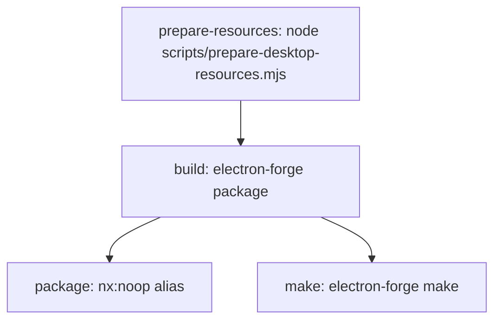

# Build, lint and packaging

Evidence ships from one pnpm workspace and one Nx target graph. There is no
interpreter to pin, no second lockfile and no per-package build script:
`pnpm install` is the whole setup, and CI runs the same targets a developer runs
(`repo://ENVIRONMENT.md#L1-L8`). This page covers the operational half of that
claim — which settings change how modules resolve, which lint rules carry the
architecture, and what `nx build desktop` actually produces.

## The real package layout

`pnpm-workspace.yaml` selects three globs, not two: `apps/*`, `libs/*` and
`libs/desktop/*`. The third exists because `libs/*` matches direct children only,
so the four desktop libraries living one level deeper need their own entry
(`repo://pnpm-workspace.yaml#L1-L4`).

`docs/workspace-layout.md` still describes an older shape: it lists
`evidence-agent-core` and `evidence-modeling-orchestrator` in `libs/` and a
`scope:evidence` tag. Neither package nor tag exists. `libs/evidence-agent`
replaced the pair, and the manifests carry the scopes `shared`, `model`, `api`,
`visualization`, `agent`, `mcp` and `desktop`. The manifests are the source of
truth; [the system map](../architecture/overview.md) carries the per-project
dependency table.

What matters for the linter is the vocabulary, and it is only tags:

| Tag family | Values in use | What it constrains |
| --- | --- | --- |
| `type:*` | `app` (`desktop`), `lib` (everything else) | an app composes libraries; a library never imports an app |
| `layer:*` | `schema`, `domain`, `io`, `ui`, `projection`, `orchestration`, `feature`, `testing`, `app` | the ring direction: a ring may only point downward |
| `platform:*` | `universal` (schema, model-core, canvas-interaction), `node` (model-io, api, visualization, agent, mcp, desktop), `browser` (ui-kit, feature-canvas, feature-inspector, testing) | the runtime boundary between process and renderer |
| `surface:browser-safe` | `evidence-api`, `evidence-agent` | the only `platform:node` packages a browser project may reach |
| `scope:*` | `shared`, `model`, `api`, `visualization`, `agent`, `mcp`, `desktop` | the wrong edges two libraries in the same ring could otherwise share |

## pnpm settings and their consequences

Workspace settings live in `pnpm-workspace.yaml`, not `.npmrc` — a pnpm setting
in the wrong file is silently ignored
(`repo://docs/workspace-layout.md#L32-L52`). The pinned package manager is
`pnpm@12.16.1` in the root manifest, and the lockfile is the install contract
(`repo://package.json#L19-L20`).

| Setting | Value | Consequence |
| --- | --- | --- |
| `nodeLinker` | `hoisted` | Electron Forge resolves the app's runtime tree with `flora-colossus`, which does not follow pnpm symlinks (`repo://pnpm-workspace.yaml#L5-L9`) |
| `blockExoticSubdeps` | `false` | `electron-winstaller` reaches `@electron/node-gyp` through a git URL, which pnpm refuses by default (`repo://pnpm-workspace.yaml#L11-L12`) |
| `allowBuilds` | `electron`, `electron-winstaller`, `nx`, `@swc/core`, `protobufjs`, `@google/genai` | pnpm blocks lifecycle scripts unless approved; Electron downloads its binary, nx and swc fetch platform artifacts, the packagers build installer helpers (`repo://pnpm-workspace.yaml#L14-L23`) |
| `minimumReleaseAgeExclude` | eight `@earendil-works/pi-*@1.5.2` entries | pnpm 12 refuses packages inside a quarantine window; the Pi SDK is exempted **by exact version**, so a later release has to be reviewed again (`repo://pnpm-workspace.yaml#L25-L36`) |

The hoisted linker has the widest blast radius. It makes the Forge packaging step
work, and it also makes an undeclared import resolve locally, so the installer is
no longer the guard that catches a missing dependency: `@nx/dependency-checks`
in each project's `eslint.config.mjs` is, plus the `workspace:*` protocol for
internal dependencies (`repo://docs/workspace-layout.md#L17-L30`,
`repo://docs/workspace-layout.md#L49-L50`,
`repo://libs/evidence-api/eslint.config.mjs#L6-L20`).

CI installs with `pnpm install --frozen-lockfile` on Node 22, so a manifest edit
without a matching `pnpm-lock.yaml` update fails before any target runs
(`repo://.github/workflows/ci.yml#L26-L33`).

## The Nx graph

Nothing declares `lint`, `test` or `build` per library. Four plugins infer them
from the config files present in each project
(`repo://nx.json#L17-L58`):

| Plugin | Infers | From |
| --- | --- | --- |
| `@nx/js/typescript` | `typecheck`, `build` (via `tsconfig.lib.json`), plus `build-deps`/`watch-deps` | each library's `tsconfig.json` |
| `@nx/eslint/plugin` | `lint` | each project's `eslint.config.mjs` |
| `@nx/vite/plugin` | `build`, `serve`, `dev`, `preview`, `typecheck` | each `vite.config.*` |
| `@nx/vitest` | `test`, and per-file `test-ci--*` targets | each `vitest.config.*` |

Two `nx.json` defaults do real work:

- `targetDefaults.test.dependsOn: ["^build"]` — a test waits for the libraries it
  imports to be built, which also means a library whose Vitest config omits the
  source condition still tests against a fresh `dist`
  (`repo://nx.json#L60-L65`).
- `namedInputs.sharedGlobals: ["{workspaceRoot}/tools/eslint/**/*"]` — the shared
  lint rule files are inputs to every project, so editing
  `tools/eslint/browser-platform.mjs` invalidates cached `lint` results instead of
  leaving stale "success" entries (`repo://nx.json#L4-L16`). The `production`
  input drops specs, eslint configs, `tsconfig.spec.json`, test setup and
  `src/test/**`, so a test-only change does not invalidate a production build.

`apps/desktop` is the exception: Electron Forge owns its steps, so its
`project.json` declares `prepare-resources`, `build`, `package`, `make`, `start`
and `typecheck` by hand, and only `lint` and `test` are inferred. Do not
re-declare an inferred target anywhere else — a second definition silently wins
and loses the per-file `test-ci--*` targets
(`repo://docs/workspace-layout.md#L118-L124`).

## Three guards against a layering mistake

The rings are not something the compiler would catch: TypeScript resolves every
path, so an import from `layer:schema` into a projection type-checks happily.
Three separate mechanisms, each blind to what the others see, stand in for that.

### Guard 1 — the `@evidence-poc/source` condition

Workspace packages are consumed from `src`, never from a `dist` that has to be
built first. Four pieces agree:

1. **Exports.** Every library lists
   `"@evidence-poc/source": "./src/index.ts"` before `types` and `import` in each
   export entry, so a resolver that understands the condition reads TypeScript
   and everything else reads the built output
   (`repo://libs/evidence-model-core/package.json#L9-L25`).
2. **The type checker.** `tsconfig.base.json` sets
   `customConditions: ["@evidence-poc/source"]`, so `tsc` reads sources and no
   `paths` table has to be maintained (`repo://tsconfig.base.json#L2-L20`).
3. **Bundlers and runners.** The desktop's three Vite configs and its Vitest
   config repeat the condition in `resolve.conditions`, as do most library test
   configs; a consumer that omits it falls back to `dist`.
4. **Project references.** The root `tsconfig.json` references all twelve
   projects so `tsc --build` stays incremental, and each `tsconfig.lib.json`
   references only the libraries it imports
   (`repo://tsconfig.json#L5-L42`).

The desktop configs show the per-target differences:

| Config | Conditions | Note |
| --- | --- | --- |
| `vite.main.config.mjs` | `@evidence-poc/source`, `module`, `development\|production` | `node` is added by Forge itself; Node builtins stay external (`repo://apps/desktop/vite.main.config.mjs#L9-L20`) |
| `vite.preload.config.mjs` | `@evidence-poc/source`, `node`, `module`, `development\|production` | the bridge only imports types today, but resolves like main so a runtime import keeps working (`repo://apps/desktop/vite.preload.config.mjs#L10-L18`) |
| `vite.renderer.config.mjs` | `@evidence-poc/source`, `module`, `browser`, `development\|production` | plus `preserveSymlinks: false` so linked workspace packages stay source rather than pre-bundled deps (`repo://apps/desktop/vite.renderer.config.mjs#L13-L25`) |
| `vitest.config.mts` (desktop) | browser list, and a separate `ssr.resolve.conditions` of source/`node`/`import` | one jsdom project for renderer, shared and main specs (`repo://apps/desktop/vitest.config.mts#L14-L25`) |

Library test configs are not uniform: `evidence-api`, `evidence-visualization`,
`evidence-model-io`, `evidence-canvas-interaction` and `desktop-ui-kit` repeat the
condition, while `evidence-model-core`, `evidence-schema`, `evidence-agent` and
`evidence-mcp` do not and rely on `^build` having produced `dist` first
(`repo://libs/evidence-api/vitest.config.mts#L6-L12`,
`repo://libs/evidence-model-core/vitest.config.mts#L1-L18`). Adding the condition
to a config is always safe; omitting it in a *bundled* consumer (Vite, Forge) is
the mistake that fails later.

The failure mode does not look like a resolution problem: the resolver silently
falls back to `dist`, so the symptom is a missing module in a library nobody
built (`repo://AGENTS.md#L8-L16`). The second entry per package follows the same
rule — `./browser` on `evidence-agent`, `./delivery` on `evidence-api`, `./cli`
on the three `bin`-carrying libraries, `./testing` on `evidence-model-core` — so a
renderer file can import a pure contract without dragging a Node module into the
browser bundle.

### Guard 2 — tags and `@nx/enforce-module-boundaries`

`eslint.config.mjs` turns the tags into errors in four constraint families
(`repo://eslint.config.mjs#L18-L36`):

- **Kind.** `type:app` may depend on `type:lib` only; `type:lib` may depend on
  `type:lib` only. This is what stops a library from importing the Electron main
  process after the hoisted linker made undeclared imports resolvable.
- **Ring** (`repo://eslint.config.mjs#L38-L112`). `layer:schema` depends on
  nothing; `layer:domain` on schema and domain; `layer:io` on domain and schema;
  `layer:ui` on ui and schema; `layer:projection` on projection, domain, io,
  schema; `layer:orchestration` on orchestration and everything below;
  `layer:feature` on feature, ui, orchestration, projection, domain, schema,
  testing; `layer:testing` on domain, ui, schema; `layer:app` on anything.
- **Platform** (`repo://eslint.config.mjs#L113-L144`). `platform:universal` may
  depend only on universal; `platform:node` on node, universal and browser;
  `platform:browser` on browser, universal and any `surface:browser-safe`
  project, with three imports banned outright: `electron`,
  `@modelcontextprotocol/sdk` and `@earendil-works/pi-coding-agent`.
- **Scope** (`repo://eslint.config.mjs#L146-L194`). No evidence package may depend
  on `scope:desktop` or `layer:testing`; `scope:api` may not depend on
  `scope:visualization`; `scope:agent` may not depend on `scope:mcp` or
  `scope:visualization`.

Command-line names come from `nx.name` in the manifest, not from the package
name: `@evidence-poc/evidence-model-io` is `evidence-model-io`, and
`@evidence-poc/desktop-feature-canvas` is `desktop-feature-canvas`.

### Guard 3 — the browser-platform ESLint rule

The tag rules check workspace projects and declared externals; Node builtins are
neither. `node:fs` is not a project-graph node, so a renderer import of it passed
every tag rule. `tools/eslint/browser-platform.mjs` closes that gap:

- it bans `node:*`, `fs`, `path`, `child_process`, `os` and `stream` in any
  TypeScript file of the project, with a message that says to ask the process
  over IPC (`repo://tools/eslint/browser-platform.mjs#L19-L33`);
- it bans the package **root** of the two Node packages that publish a
  browser-safe entry, because a project-level rule cannot see a subpath — the
  renderer must import `evidence-api/delivery` or `evidence-agent/browser`
  instead (`repo://tools/eslint/browser-platform.mjs#L14-L17`,
  `repo://tools/eslint/browser-platform.mjs#L34-L41`).

The rule is opt-in per project: the four `platform:browser` libraries import it
into their own `eslint.config.mjs` (`repo://libs/desktop/feature-canvas/eslint.config.mjs#L1-L10`).
A new browser project therefore needs two things, not one — the tag, and the
import. Tagging without importing the rule leaves builtins unguarded.

A second, test-time check covers the universal side:
`libs/evidence-model-core/src/purity.spec.ts` bundles `evidence-model-core` with
Vite and a resolver plugin that throws on any Node builtin, so universal code
cannot quietly stop being universal
(`repo://libs/evidence-model-core/src/purity.spec.ts#L6-L34`).

### Proving the guards: the boundary drill

A lint rule that passes is not evidence — it passes just as well when its tag was
renamed or its constraint deleted. `pnpm boundaries:drill`
(`node tools/workspace-rules/boundary-drill.mjs`) writes one import that a rule
must refuse, runs that project's `lint` target uncached, and fails if lint
succeeds or fails for the wrong reason (`repo://tools/workspace-rules/boundary-drill.mjs#L1-L14`).

| Case | Probe | Message fragment required |
| --- | --- | --- |
| domain reaching a projection | `evidence-canvas-interaction` re-exports `@evidence-poc/evidence-api/delivery` | `A project tagged with "layer:domain" can only depend on libs` |
| browser reaching a Node-only projection | `desktop-feature-canvas` re-exports `@evidence-poc/evidence-visualization` | `A project tagged with "platform:browser" can only depend on libs tagged` |
| browser importing a builtin | `desktop-ui-kit` imports `node:fs` | `'node:fs' import is restricted from being used by a pattern` |
| one business context reading another | `evidence-agent` re-exports `@evidence-poc/evidence-mcp` | `A project tagged with "scope:agent" can not depend on libs` |

Each probe is written to a `__boundary-drill.ts` file inside the project, linted
with `pnpm nx lint <project> --skip-nx-cache`, and removed in a `finally` block so
the tree is left as found; any unproven case makes the script exit non-zero
(`repo://tools/workspace-rules/boundary-drill.mjs#L17-L45`,
`repo://tools/workspace-rules/boundary-drill.mjs#L84-L109`). It is the first thing
CI runs after install, precisely because it is the only check that notices a
deleted constraint (`repo://.github/workflows/ci.yml#L35-L38`).

## Desktop targets and packaging

The three real steps plus one alias, all declared in
`apps/desktop/project.json` (`repo://apps/desktop/project.json#L8-L56`):

- **`prepare-resources`** copies the review-page assets out of
  `libs/evidence-visualization/assets`. It caches on
  `libs/evidence-visualization/assets/**/*` and the script itself, and writes
  `apps/desktop/resources`. It deletes the destination first, so a removed asset
  cannot linger, and copies exactly four files —
  `workbench.html`, `workbench.css`, `workbench.js`, `business-graph.js` — which
  keeps the browser test harnesses out of the installer
  (`repo://scripts/prepare-desktop-resources.mjs#L22-L41`).
- **`build`** runs `electron-forge package` in `apps/desktop`, producing the
  unpacked app under `out/` with the Vite bundles in `.vite/`. Its only target
  dependency is `prepare-resources`; it does **not** wait for library builds,
  because everything it imports resolves from `src`
  (`repo://apps/desktop/project.json#L24-L37`).
- **`make`** depends on `build` and runs `electron-forge make`, emitting
  installers under `out/make`.
- **`package`** is an `nx:noop` alias that depends on `build`, kept so the
  documented `nx package desktop` workflow still resolves
  (`repo://apps/desktop/project.json#L38-L45`).
- **`start`** runs `electron-forge start` (what `pnpm desktop` calls) and
  **`typecheck`** runs `tsc -p tsconfig.app.json` then `tsc -p tsconfig.spec.json`
  after `^build`, so both compiler passes run against the same resolved sources
  (`repo://apps/desktop/project.json#L57-L74`).

Forge itself (`repo://apps/desktop/forge.config.mjs#L24-L71`):

- `asar: true` for the app code, with `extraResource: [resources/assets]` so the
  page compiler can read the four files with `node:fs` from
  `process.resourcesPath` — the only thing that must live outside `app.asar`;
- a `VitePlugin` with build entries for `src/main/main.ts` and
  `src/preload/index.ts` and one renderer, `main_window`;
- `osxSign`/`osxNotarize` only when `APPLE_ID` is set, so a local build needs no
  Apple credentials;
- makers for Squirrel (Windows), ZIP (macOS), RPM and DEB (Linux).

Two Vite details are load-bearing rather than stylistic:

- `vite.main.config.mjs` sets `rolldownOptions.platform: 'node'`. Forge's Vite
  plugin emits CJS without `build.ssr: true`, so Vite 8 would default to the
  browser platform and turn `import.meta.url` into `undefined`, breaking
  `createRequire` in the main bundle
  (`repo://apps/desktop/vite.main.config.mjs#L17-L24`).
- `vite.preload.config.mjs` pins `output.entryFileNames: 'preload.js'`, because
  Forge names the bundle after the entry file and `src/preload/index.ts` would
  otherwise emit `index.js` while the window code loads `preload.js`
  (`repo://apps/desktop/vite.preload.config.mjs#L5-L22`).

The app ships no interpreter, no virtualenv and no skill tree; the four page
assets are the only payload that must sit beside the archive
(`repo://ENVIRONMENT.md#L70-L76`).

## Root scripts

The root manifest holds dev tooling and thin wrappers only
(`repo://package.json#L5-L18`):

| Script | Runs | Note |
| --- | --- | --- |
| `pnpm build` | `nx run-many --target=build --all` | inferred per library, Forge for the app |
| `pnpm test` | `nx run-many --target=test --all` | every Vitest project |
| `pnpm lint` | `nx run-many --target=lint --all` | includes the boundary and dependency rules |
| `pnpm boundaries:drill` | `node tools/workspace-rules/boundary-drill.mjs` | proves the guards still refuse |
| `pnpm graph` | `nx graph` | the dependency graph |
| `pnpm desktop` | `nx start desktop` | the only runnable app |
| `pnpm desktop:package` | `nx package desktop` | alias for the Forge `build` |
| `pnpm desktop:make` | `nx make desktop` | installers |
| `pnpm test:desktop` | `nx test desktop` | jsdom project only |
| `pnpm model:pack` / `unpack` / `inspect` | `node libs/evidence-model-io/dist/cli.js …` | **requires a build first** |

There is no `typecheck` root script; CI and `ENVIRONMENT.md` call
`nx run-many --target=typecheck --all` / `-t test typecheck lint` directly.

The `model:*` scripts are the clearest operational trap in the set. The modeling
CLI now lives in `libs/evidence-model-io` — a `platform:node` disk adapter with
`bin.evidence-model` pointing at `dist/cli.js` and a `./cli` export entry
(`repo://libs/evidence-model-io/package.json#L10-L27`) — and the root scripts
invoke the compiled file directly, so `pnpm model:pack` fails until
`nx build evidence-model-io` has emitted `dist/cli.js`. The CLI is the same code
path the desktop uses: it re-exports the report builders (`buildFmCheckReport`,
`derivedTimeline`, `buildRolePlayPack`) from `evidence-model-core` and adds the
directory and bundle adapters from `evidence-model-io`
(`repo://libs/evidence-model-io/src/cli.ts#L1-L20`).

## CI and release

`.github/workflows/ci.yml` runs on pushes and pull requests to `main` with
concurrency cancellation, on Node 22, against the frozen lockfile
(`repo://.github/workflows/ci.yml#L1-L55`):

1. `pnpm boundaries:drill`
2. lint — `nx affected --target=lint --base=<pr base sha> --head=<pr head sha>` on
   pull requests, `nx run-many --target=lint --all` on `main` pushes
3. `nx run-many --target=typecheck --all`
4. `nx run-many --target=test --all`
5. `nx build desktop`

Step 5 is the packaging smoke test: `prepare-resources` plus
`electron-forge package` means a broken Vite config, a missing asset or a
mis-resolved workspace package fails CI without producing installers.

`.github/workflows/release-desktop.yml` runs on `v*.*.*` tags or manual dispatch,
builds a four-way matrix (macOS arm64, macOS x64, Windows x64, Linux x64),
installs the Linux packaging dependencies (`rpm`, `fakeroot`, `dpkg`), runs
`pnpm nx run desktop:make -- --arch=<arch>`, collects `.zip`, `.exe`, `.nupkg`,
`RELEASES`, `.deb` and `.rpm` from `apps/desktop/out/make`, and publishes a
GitHub Release with generated notes. Apple secrets are optional; without them the
macOS artifacts are unsigned (`repo://.github/workflows/release-desktop.yml#L1-L126`).

## Common failure modes

| Symptom | Likely cause |
| --- | --- |
| "cannot find module @evidence-poc/…" | a Vite/Vitest config omitted `@evidence-poc/source`, resolved `dist`, and the library was never built |
| `pnpm model:pack` cannot find `dist/cli.js` | `evidence-model-io` was not built — the root script runs the compiled CLI |
| the drill fails after a refactor | a tag was renamed or a constraint removed; the probe import is now accepted |
| tests fail only in a library whose config omits the condition | the dependency's `dist` is stale — `^build` is the mechanism that is supposed to cover it |
| `import.meta.url` is undefined in main | `rolldownOptions.platform` is no longer `'node'` in `vite.main.config.mjs` |
| the packaged app cannot read page assets | `prepare-resources` did not run, or `extraResource` was removed from the Forge config |
| a renderer file imports `node:fs` and lint passes | the project has `platform:browser` but does not import `tools/eslint/browser-platform.mjs` |
| an undeclared dependency resolves locally | the hoisted linker — `@nx/dependency-checks` in the project's eslint config is the guard |
| CI cannot install | `pnpm-lock.yaml` is stale relative to a manifest, and CI installs with `--frozen-lockfile` |

## Related pages

- [Quickstart](../quickstart.md) — clone to running app.
- [System map and dependency direction](../architecture/overview.md) — the package
  map and why the rings point the way they do.
- [The desktop app shell](../desktop/app-shell.md) — what the packaged main and
  preload bundles actually do.
- [The offline review workbench](../contracts/offline-workbench.md) — what the four
  packaged assets produce.
- [Verification strategy and fixtures](../testing/verification-strategy.md) — what
  steps 3 and 4 of CI run.
