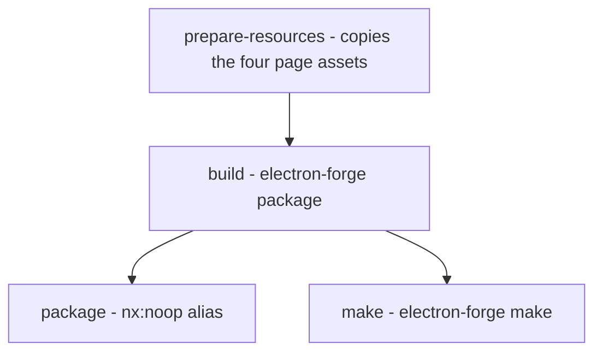
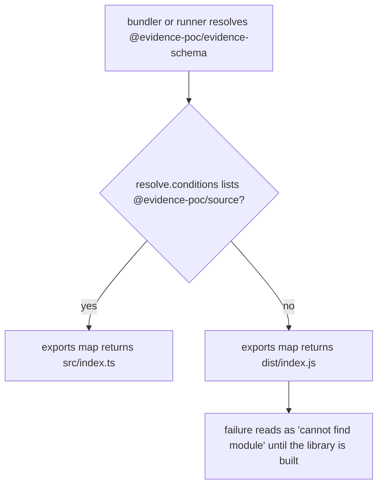

# Workspace, build, packaging and release

The repository is one pnpm workspace driven by Nx. There is no second runtime, no
interpreter to install and no per-package build script to remember: the target
graph decides what runs, and CI runs the same targets a developer does
(`repo://ENVIRONMENT.md#L1-L10`).

Two directories carry code — `apps/` for the runnable Electron app, `libs/` for
the eight libraries — and the package manager settings live in
`pnpm-workspace.yaml`, not `.npmrc` (`repo://docs/workspace-layout.md#L1-L15`).

## pnpm settings and why `pnpm install` is enough

Every key in `pnpm-workspace.yaml` exists for a reason, and each changes behavior
in a way a newcomer can trip over (`repo://pnpm-workspace.yaml#L1-L35`):

| Setting | Value | Consequence |
| --- | --- | --- |
| `packages` | `apps/*`, `libs/*` | only those two trees are workspace members |
| `nodeLinker` | `hoisted` | Electron Forge walks the app's runtime tree with `flora-colossus`, which does not follow the symlinks pnpm creates by default; Forge's docs therefore require a hoisted linker, which is why a plain `pnpm install` is already the right install for packaging. The side effect is that an undeclared import can still resolve locally, so the dependency lint rule — not the installer — is the guard |
| `blockExoticSubdeps` | `false` | `electron-winstaller` reaches `@electron/node-gyp` through a git URL, and pnpm refuses transitive exotic dependencies by default |
| `allowBuilds` | electron, nx, `@swc/core`, protobufjs, `@google/genai`, electron-winstaller | pnpm blocks lifecycle scripts unless the package is approved; Electron downloads its own binary, nx and swc fetch platform artifacts, and the packagers build helpers for the installers they produce. Without these approvals the install "succeeds" without those artifacts |
| `minimumReleaseAgeExclude` | `@earendil-works/pi-*@1.5.2` | pnpm 12 refuses packages inside a release-age quarantine window; the Pi SDK is the modeling runtime and is exempted **by exact version**, so a newer release must be reviewed again |

`pnpm-workspace.yaml` is the only place these settings live: `.npmrc` is ignored
by pnpm 10+, so a setting written there silently does nothing
(`repo://docs/workspace-layout.md#L31-L49`). `node_modules/.cache` holds the Nx,
Vite and desktop-resource caches, so deleting `node_modules` means rerunning
`pnpm install` before anything else works.

## The target graph: declared versus inferred

`nx.json` configures four plugins (`repo://nx.json#L17-L62`):

- `@nx/js/typescript` infers `typecheck` and `build` for each library, building
  through `tsconfig.lib.json`;
- `@nx/eslint/plugin` infers `lint` from each project's `eslint.config.mjs`;
- `@nx/vite/plugin` infers `build`/`serve`/`dev`/`preview` where a plain Vite
  config exists;
- `@nx/vitest` infers `test` plus the per-file `test-ci--*` targets from each
  `vitest.config.mts`.

Two `nx.json` defaults shape ordering and caching:

- `targetDefaults.test.dependsOn: ["^build"]` makes a test wait for the libraries
  it depends on to build. That is the safety net for the library Vitest configs
  that do **not** repeat the source condition (`evidence-model-core`,
  `evidence-schema` and others resolve a sibling through its built `dist` entry),
  and it is why a test run can be slower than the test bodies suggest
  (`repo://nx.json#L63-L67`, `repo://libs/evidence-model-core/vitest.config.mts#L1-L18`).
- The `production` named input excludes specs, ESLint configs, `tsconfig.spec.json`
  and `src/test/**`, so a test-only change does not invalidate a build cache
  (`repo://nx.json#L4-L16`).

`apps/desktop` is the exception: Electron Forge owns its steps, so `project.json`
declares `prepare-resources`, `build`, `package`, `make`, `start` and `typecheck`
explicitly (`repo://apps/desktop/project.json#L1-L76`). `lint` and `test` are
still inferred for it from `eslint.config.mjs` and `vitest.config.mts`, and the
docs warn against re-declaring an inferred target: a second definition silently
wins and loses the per-file `test-ci--*` targets
(`repo://docs/workspace-layout.md#L111-L119`).

The ordering difference inside the desktop graph is deliberate: `build` has no
`dependsOn` on library builds, because the bundler resolves workspace packages
from `src`. `typecheck` does depend on `^build`, because `tsc` consumes the
libraries' emitted `dist/*.d.ts` through project references.



The desktop targets in execution order; only `start` sits outside the chain.

Each step is cached and declares its outputs: `prepare-resources` writes
`{projectRoot}/resources`, `build` writes `.vite` and `out`, `make` writes
`out/make` (`repo://apps/desktop/project.json#L8-L64`). `start` is the one
uncached target — it runs `electron-forge start` and needs a display.

## The source-condition chain

Workspace packages are consumed from `src`, not from `dist`, and this is the
single most fragile convention in the repo because a missing condition fails like
a missing module.

The chain has four links:

1. **Package exports.** Every `libs/*/package.json` lists
   `"@evidence-poc/source": "./src/index.ts"` before `types`, `import` and
   `default`, so the condition wins whenever it is requested
   (`repo://libs/evidence-model-core/package.json#L9-L32`).
2. **TypeScript.** `tsconfig.base.json` sets
   `customConditions: ["@evidence-poc/source"]`, so the type checker reads `src`
   without a `paths` table (`repo://tsconfig.base.json#L1-L21`).
3. **Bundlers and runners.** Each Vite/Vitest config repeats the condition in
   `resolve.conditions`, then adds the platform condition for the process it
   builds for.
4. **Project references.** The root `tsconfig.json` references every library,
   each library's `tsconfig.lib.json` references only what it imports, and
   `apps/desktop/tsconfig.app.json` references all eight libraries' `.lib`
   configs.

Who asks for what (`repo://apps/desktop/vite.main.config.mjs#L14-L20`,
`repo://apps/desktop/vite.preload.config.mjs#L8-L18`,
`repo://apps/desktop/vite.renderer.config.mjs#L10-L22`,
`repo://apps/desktop/vitest.config.mts#L14-L24`):

| Consumer | Conditions it declares |
| --- | --- |
| `vite.main.config.mjs` | `@evidence-poc/source`, `module`, `development\|production` — no `node`, because Forge adds it for the main target |
| `vite.preload.config.mjs` | `@evidence-poc/source`, `node`, `module`, `development\|production` — declared explicitly so a future runtime import keeps working |
| `vite.renderer.config.mjs` | `@evidence-poc/source`, `module`, `browser`, `development\|production`, plus `preserveSymlinks: false` to override Forge's default so linked workspace packages stay source instead of optimized dependencies |
| `apps/desktop/vitest.config.mts` | `browser` in `resolve.conditions` for the jsdom renderer specs, and `node`/`import` in `ssr.resolve.conditions` so main-process specs resolve Node entries |
| `libs/evidence-api`, `libs/evidence-visualization` | `@evidence-poc/source`, `node`, `import` (`default` too in `evidence-api`), repeated in `ssr.resolve` |
| `libs/evidence-model-core`, `evidence-schema`, … | no condition at all — these specs consume dependencies through `dist`, which is why their `test` target waits on `^build` |



Resolution with the condition requested versus omitted.

That failure mode — a fallback to `dist` that surfaces as an unbuilt or missing
package rather than a missing condition — is why a new bundler, runner or script
loader config is part of the convention and not an implementation detail
(`repo://docs/workspace-layout.md#L54-L88`). The renderer additionally lists
`browser` and imports the `/browser` entry of libraries that also ship disk or MCP
adapters, which is why `evidence-model-core` exports three subpaths (`.`,
`./browser`, `./cli`).

## Names, tags and boundaries

Project names are short (`desktop`, `evidence-mcp`) even when the package is
scoped; `nx.name` in the manifest is what sets the command-line name.

Tags drive `@nx/enforce-module-boundaries`
(`repo://eslint.config.mjs#L18-L38`):

- `type:app` may depend only on `type:lib`, never on another app;
- `type:lib` may depend only on `type:lib`;
- `scope:*` records ownership for a future finer rule.

The comment in the ESLint config explains why the rule exists at all: a
workspace-wide wildcard used to accept any edge, so a library could import the
Electron main process — a risk the hoisted linker makes easy to miss.

## Desktop packaging

`prepare-resources` runs `node scripts/prepare-desktop-resources.mjs`, which copies
exactly four files — `workbench.html`, `workbench.css`, `workbench.js`,
`business-graph.js` — from `libs/evidence-visualization/assets` into
`apps/desktop/resources/assets`. It clears the destination first so a removed
asset cannot linger, keeps the browser test harnesses under `tests/` out, logs to
stderr and prints the output directory on stdout
(`repo://scripts/prepare-desktop-resources.mjs#L20-L46`). The generated tree is
gitignored and excluded from lint, so nothing in it is hand-edited
(`repo://apps/desktop/eslint.config.mjs#L1-L17`).

Forge then packages with (`repo://apps/desktop/forge.config.mjs#L21-L70`):

- `asar: true` for the app code, under product name `Evidence Modeling` with app
  bundle id `dev.evidence.modeling`;
- `extraResource: [resources/assets]` so the review-page compiler can read the
  four files with `node:fs` from `process.resourcesPath`;
- Vite plugin entries for `src/main/main.ts`, `src/preload/index.ts` and the
  `main_window` renderer;
- code signing and notarization only when `APPLE_ID` is present, so a local build
  needs no Apple credentials;
- makers for Squirrel (Windows), ZIP (macOS only), RPM and DEB (Linux).

At runtime `resolveReviewAssetsDirectory` looks in exactly one place when packaged
(`<process.resourcesPath>/assets`) and in two when developing
(`apps/desktop/resources/assets` after the copy, then
`libs/evidence-visualization/assets`). It never searches up the tree, and it
returns `undefined` rather than compiling an empty page
(`repo://apps/desktop/src/main/installAssets.ts#L20-L68`).

The app ships no interpreter and no skill tree; the assets are the only thing that
must live outside `app.asar`.

### Why main/preload need `platform: 'node'`

`vite.main.config.mjs` sets `rolldownOptions.platform: 'node'` with an explicit
comment: Forge's Vite plugin emits CJS without `build.ssr`, so Vite 8 would
otherwise default to the browser platform and turn `import.meta.url` into
`undefined`, breaking `createRequire` in the main bundle. Preload pins the output
file name to `preload.js` because Forge names bundles after their entry file, and
the window code loads that name (`repo://apps/desktop/vite.main.config.mjs#L1-L28`,
`repo://apps/desktop/vite.preload.config.mjs#L1-L24`).

The renderer config also pins `outDir: .vite/renderer/main_window` with
`emptyOutDir` and a strict port 4200 dev server, so the dev URL Forge opens cannot
drift (`repo://apps/desktop/vite.renderer.config.mjs#L22-L29`).

## The library commands

Three libraries ship a `bin`, all pointing at their built `dist/cli.js`
(`repo://libs/evidence-model-core/package.json#L9-L11`,
`repo://libs/evidence-api/package.json#L10-L12`,
`repo://libs/evidence-visualization/package.json#L10-L12`):

| Command | Verbs |
| --- | --- |
| `evidence-model` | `pack`, `unpack`, `inspect`, `check`, `compile`, `lineage`, `timeline`, `simulate`, `role-play` |
| `evidence-api` | `inspect`, `check`, `project`, `deliver`, `diff` |
| `evidence-workbench` | `generate` |

Because the binaries are `dist` entry points — and the packages are `private`, so
nothing is published — a command works only after that library has been built.
The root scripts hide this for the model CLI by calling the built file directly:
`pnpm model:pack`, `pnpm model:unpack` and `pnpm model:inspect` all run
`node libs/evidence-model-core/dist/cli.js <verb>`
(`repo://package.json#L5-L17`). The commands are the same code the desktop app
runs in-process, so a terminal and the window cannot disagree.

## CI

`.github/workflows/ci.yml` runs on pushes and pull requests to `main` with
concurrency cancellation, on Node 22 and a pnpm store cache
(`repo://.github/workflows/ci.yml#L1-L45`):

1. `pnpm install --frozen-lockfile`
2. `pnpm nx run-many --target=lint --all`
3. `pnpm nx run-many --target=typecheck --all`
4. `pnpm nx run-many --target=test --all`
5. `pnpm nx build desktop`

Step 5 is the packaging smoke test: it runs `prepare-resources` and
`electron-forge package`, so a broken Vite config, a missing asset or a
source-condition regression fails CI without producing installers.

## Release

`.github/workflows/release-desktop.yml` runs on `v*.*.*` tags or manual dispatch
(`repo://.github/workflows/release-desktop.yml#L1-L126`):

- the build job matrix is macOS arm64, macOS x64, Windows x64 and Linux x64 on
  `macos-latest` / `windows-latest` / `ubuntu-latest`, with `fail-fast: false` so
  one platform does not cancel the others;
- Linux installs `rpm`, `fakeroot` and `dpkg` before packaging, because the RPM
  and DEB makers need them;
- each job installs with `--frozen-lockfile` and runs
  `pnpm nx run desktop:make -- --arch=<arch>`, which also runs `build` and
  `prepare-resources`;
- the make step receives `APPLE_ID`, `APPLE_APP_SPECIFIC_PASSWORD` and
  `APPLE_TEAM_ID` from secrets. They are optional: without them
  `forge.config.mjs` omits `osxSign`/`osxNotarize` and the macOS artifacts are
  unsigned;
- artifacts are collected from `apps/desktop/out/make` by extension — `.zip`,
  `.exe`, `.nupkg`, `RELEASES`, `.deb`, `.rpm` — and uploaded per platform with
  `if-no-files-found: error`.

The `publish-release` job runs only after every matrix job succeeds, needs
`contents: write`, downloads all `desktop-artifacts-*` uploads into one flat
directory, and creates or updates the GitHub Release with
`softprops/action-gh-release`. The tag comes from `github.ref` on a tag push, or
from the `tag_name` dispatch input (default `draft-release`); the release is
published with `draft: false`, `prerelease: false` and generated release notes.

## Nightly OpenWiki refresh

`.github/workflows/openwiki-update.yml` keeps the generated wiki current
(`repo://.github/workflows/openwiki-update.yml#L1-L98`). It runs on a `0 16 * * *`
schedule (midnight in UTC+8) and on manual dispatch, with `contents: write` and
`pull-requests: write`.

The steps matter more than the cron:

- the checkout uses `fetch-depth: 0`, because `openwiki code --update` diffs
  `HEAD` against the commit it last documented and a shallow clone hides it;
- OpenWiki is installed globally at a pinned `openwiki@0.9.0`, together with
  `mermaid` and `jsdom` for high-fidelity diagram validation;
- the run is `openwiki code --update --print` with
  `OPENWIKI_PROVIDER: openai-compatible` pointing at
  `https://api.deepseek.com`, `OPENWIKI_MODEL_ID: deepseek-flash`, an output-token
  cap of 32768, the LangSmith connector key from secrets and
  `LANGCHAIN_TRACING_V2: "false"`;
- `continue-on-error: true` lets the PR step still run when the update fails, and
  a final `exit 1` re-raises the failure so the run is not silently green;
- `openwiki/.run.json` is deleted so transient run state is never committed;
- `peter-evans/create-pull-request` opens or updates branch `openwiki/update` with
  commit and title `docs: update OpenWiki`, staging `openwiki`, `AGENTS.md`, this
  workflow file and `CLAUDE.md` when that file exists;
- the PR body records the OpenWiki outcome and states that a `failure` result
  still leaves the pages completed before the failure for review.

## Commands worth knowing

```bash
pnpm install                          # from the lockfile; the hoisted linker is already configured
pnpm install --frozen-lockfile        # what CI runs
pnpm desktop                          # nx start desktop
pnpm build                            # nx run-many --target=build --all
pnpm test                             # nx run-many --target=test --all
pnpm lint                             # nx run-many --target=lint --all
pnpm desktop:package                  # nx package desktop — an alias for build
pnpm desktop:make                     # nx make desktop — installers in apps/desktop/out/make
pnpm model:pack .evidence/fm --out procurement.evidence.json
nx graph                              # dependency graph
nx affected --target=test --base=main # only what a branch touched
```

Root scripts are thin wrappers around `nx run-many`; there is no `dev` script
because `desktop` is the only runnable app
(`repo://docs/workspace-layout.md#L101-L110`).

## Common failure modes

| Symptom | Likely cause |
| --- | --- |
| "cannot find module @evidence-poc/..." | the consumer's Vite/Vitest config omits `@evidence-poc/source`, so it resolved `dist` and the library was not built |
| a library's tests cannot import a sibling | no condition in that `vitest.config.mts` and the sibling's build did not run — `test` depends on `^build` for exactly this |
| tests pass locally but the packaged app cannot read page assets | `prepare-resources` did not run, or `extraResource` was removed from `forge.config.mjs` |
| `import.meta.url` is undefined in main | `rolldownOptions.platform` is not `node` |
| the preload bundle is emitted as `index.js`, so the window loads nothing | the `entryFileNames: 'preload.js'` pin was dropped |
| `createRequire`/Electron install fails on a fresh checkout | lifecycle scripts were not approved in `allowBuilds` |
| a type-only import fails in a new app | `customConditions` is missing from the tsconfig that compiles it |
| `pnpm model:pack` reports a missing module | `dist/cli.js` was never built — run `pnpm build` |
| `nx make desktop` fails on Linux | `rpm`, `fakeroot` or `dpkg` is missing |
| a library imports Electron | module-boundary tags are wrong or the lint target was skipped |
| CI cannot install | `pnpm-lock.yaml` is stale relative to a manifest |
| macOS release artifacts are unsigned | `APPLE_ID`/`APPLE_APP_SPECIFIC_PASSWORD`/`APPLE_TEAM_ID` were not provided |

## Related pages

- [Quickstart](../quickstart.md) — the shortest path from clone to running app.
- [System map and dependency direction](../architecture/overview.md) — why the
  packages are ordered this way.
- [Desktop app shell](../desktop/app-shell.md) — the three processes these bundles
  produce and the preload contract between them.
- [The offline review workbench](../contracts/offline-workbench.md) — what the
  four packaged assets produce.
- [Verification strategy and fixtures](../testing/verification-strategy.md) — what
  the CI test step actually runs.
