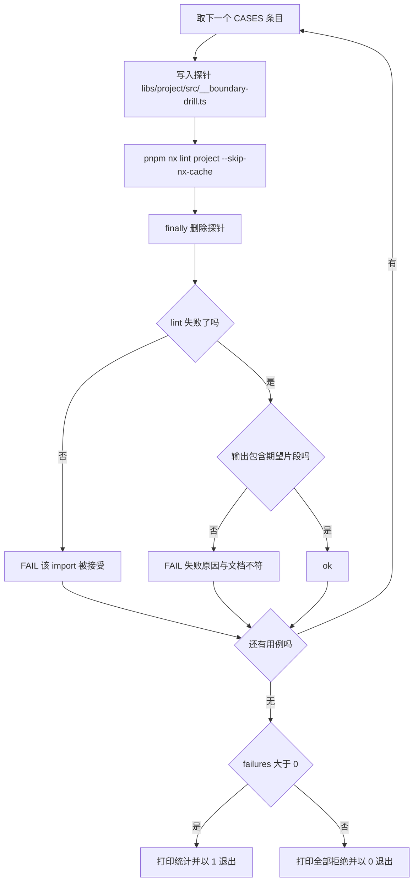

# 构建、打包与仓库维护

整个仓库只有一套工具链：Node.js 22 与 pnpm，一个 lockfile、一个 Nx 图，没有第二种需要 pin 的运行时，也没有 Go/Docker 依赖。但 **`pnpm install` 不是全部 setup**：API 兼容性比较及其测试所用的固定原生 `oasdiff` 要另外跑 `pnpm api:setup`。CI 的顺序也反映这一点（见下文「CI 与发布」）。

## Workspace 与依赖声明

`pnpm-workspace.yaml` 用三个 glob 覆盖全部包：`apps/*`、`libs/*`、`libs/desktop/*`（最后一条是必需的——`libs/*` 只匹配直接子目录，而桌面库都嵌了一层）。当前是两个 app：`desktop`（Electron Forge，`type:app`/`layer:app`/`platform:node`/`scope:desktop`）与 `cli`（统一 `evidence` 命令，`type:app`/`layer:app`/`platform:node`/`scope:cli`），其余 18 个都是库。`docs/workspace-layout.md` 与 manifest 一致，不再有 "只有 desktop" 或已合并包的陈述；命令行的短项目名来自 `package.json`/`project.json` 的 `nx.name`，不是包 scope 名。

设置只写在 `pnpm-workspace.yaml`，每条都有具体理由：

| 设置 | 值 | 原因 |
| --- | --- | --- |
| `nodeLinker` | `hoisted` | Electron Forge 用 `flora-colossus` 遍历运行时依赖树，不跟随 pnpm 默认的符号链接 |
| `blockExoticSubdeps` | `false` | `electron-winstaller` 通过 git URL 引入 `@electron/node-gyp` |
| `allowBuilds` | electron、nx、`@swc/core`、`protobufjs`、`@google/genai`、`electron-winstaller` | 这些包的生命周期脚本被 pnpm 默认拦截 |
| `minimumReleaseAgeExclude` | `@earendil-works/pi-*@1.5.2` 精确版本 | Pi SDK 是建模运行时；新版本需重新评审，因此按版本而不按 scope 豁免 |

hoisted linker 的副作用是：**未声明的 import 在本地也能解析**。所以声明纪律由 `@nx/dependency-checks` 在 JSON manifest 上双向检查（多声明的依赖也会失败），运行期依赖写在使用它的项目 manifest 里并用 `workspace:*`，根 `package.json` 只放 dev tooling 与 `packageManager`。installer 不是这道守卫，lint 才是。

## 库从 src 解析：`@evidence-poc/source`

每个库的 `exports` 把入口写两遍：先 `@evidence-poc/source` 指向 `./src/index.ts`，再 `types`/`import` 指向 `dist`。`tsconfig.base.json` 的 `customConditions: ["@evidence-poc/source"]` 让类型检查直接读源码，无需 `paths` 表；每个 Vite/Vitest 配置再在 `resolve.conditions` 里重复同一条件。**漏掉这个条件的消费者会静默退回 `dist`**，症状是"缺模块"而不是"缺条件"。

desktop 的三种环境各自声明条件：`vite.main.config.mjs` 走 `@evidence-poc/source` + `module` + 环境条件；`vite.preload.config.mjs` 额外带 `node`；`vitest.config.mts` 的渲染进程用 `browser`，SSR 侧用 `node`/`import`。两个已知坑写在各配置里：main 必须设 `build.rolldownOptions.platform = 'node'`，否则 Forge 的 Vite 插件在未开 `build.ssr` 的情况下按 browser 平台产出 CJS，把 `import.meta.url` 变成 `undefined` 而让 `createRequire` 失败；preload 必须把 `output.entryFileNames` 固定为 `preload.js`，因为 Forge 以入口文件名命名 bundle，`src/preload/index.ts` 会产出 `index.js`。

因为一切从 `src` 解析，`nx build desktop` **不等待库的 build**；`^production` 只出现在 inputs 里，作用是依赖变化时让缓存失效，而不是排序依赖。

## desktop 的检查责任在自身 target

根 `tsconfig.json` 是一个 `files: []` 的 solution 文件，references 只列出 `apps/cli` 与 18 个库——**它不引用 `apps/desktop`**。因此 solution 级的 `tsc --build` 完全不覆盖桌面应用；桌面只通过自己的项目配置被检查：

- `typecheck` target：`tsc -p tsconfig.app.json` 与 `tsc -p tsconfig.spec.json` 两条命令串行执行，`dependsOn: ["^build"]`，因此可达的库必须先产出声明文件。
- `build` target：`electron-forge package`，由 Vite 完成真实打包；CI 的 "Verify desktop build" 就是 `nx build desktop`。

改动 desktop 的类型或 tsconfig 时，要跑 `nx typecheck desktop`（或 `nx run-many -t typecheck`，它会覆盖到该 target），不能以为根 `tsconfig.json` 已经检查过它。

## Nx 目标：推断的与手写的

`nx.json` 的插件从项目配置推断目标：`@nx/js/typescript` 给 `typecheck` 与基于 `tsconfig.lib.json` 的 `build`（并生成 `build-deps`/`watch-deps`），`@nx/eslint/plugin` 给 `lint`，`@nx/vite/plugin` 给 `build`/`serve`/`dev`/`preview`/`serve-static`/`typecheck`，`@nx/vitest` 给 `test` 以及每个文件一个的 `test-ci--*`。`targetDefaults.test.dependsOn` 为 `["^build"]`。

namedInputs 有两个关键点：`sharedGlobals` 包含 `{workspaceRoot}/tools/eslint/**/*`，共享 lint 规则一改，缓存的 lint 结果即失效；`production` 排除 spec/test 快照、`eslint.config.mjs`、`tsconfig.spec.json`、`src/test-setup.*` 与 `src/test/**`，测试专属改动不会作废生产构建缓存。

`apps/cli` 手写 `build`（`tsc -b apps/cli/tsconfig.app.json`，`dependsOn: ["^build"]`，输出 `{projectRoot}/dist`）与 `test`（`dependsOn: ["build"]`，`cache: false`），因为 CLI 测试要跑真实的 `dist/cli.js`。

`apps/desktop` 手写五个目标，其余（`lint`、`test`、`test-ci--*`）继续由插件推断——重声明推断目标会让第二份定义静默胜出并丢掉 per-file 测试目标。Forge 拥有的步骤：

| target | 执行 | 依赖与产物 |
| --- | --- | --- |
| `build` | `electron-forge package`（cwd `apps/desktop`） | 缓存；inputs `production`/`^production`；outputs `.vite` 与 `out`；不依赖库 build |
| `package` | `nx:noop` | `dependsOn: ["build"]`，保留文档里的 `nx package desktop` 工作流 |
| `make` | `electron-forge make` | `dependsOn: ["build"]`；outputs `out/make` |
| `start` | `electron-forge start` | 不缓存，开发入口 |
| `typecheck` | 两遍 `tsc -p` | `dependsOn: ["^build"]`，串行 |

`apps/desktop/package.json` 另外把推断出的 `test` 标为 `cache: false`。

## Forge 打包

`apps/desktop/forge.config.mjs` 的实际情况：

- `packagerConfig`：`name: 'Evidence Modeling'`、`appBundleId: 'dev.evidence.modeling'`、`asar: true`；只有在 `APPLE_ID` 存在时才加入 `osxSign` 与 `osxNotarize`（配 `APPLE_APP_SPECIFIC_PASSWORD`、`APPLE_TEAM_ID`），所以没有凭据时本地与 CI 都能打包，只是 macOS 产物未签名。
- `plugins`：`VitePlugin` 声明两个 build 入口（`src/main/main.ts` → `vite.main.config.mjs`，`src/preload/index.ts` → `vite.preload.config.mjs`）与一个 renderer（`main_window` → `vite.renderer.config.mjs`）。
- `makers`：Windows 用 `MakerSquirrel`，`MakerZIP` 只对 darwin，Linux 用 `MakerRpm` 与 `MakerDeb`。

**没有资源准备步骤**：`project.json` 里不存在 `prepare-resources` 之类的 target，仓库里也没有 `scripts/` 资源复制脚本，`packagerConfig` 没有 `extraResource`/`installAssets`，因此不存在把 `workbench.*`、`business-graph.js` 或提示词/资产树拷进 `apps/desktop/resources` 的流程。打包物只由 Vite 产出的 main/preload/renderer bundle 加 Electron 运行时构成，`asar` 内的文件就是这些产物；也没有 skill tree 或虚拟环境被随包分发。排查"打包后界面空白"时应先看 Vite 入口与 `main` 字段，而不是去找资源拷贝。

## 三层边界守卫

**1. `@nx/enforce-module-boundaries`（tag 驱动）。** 标签分五类：`type`、`layer`、`platform`、`surface`、`scope`，规则只认这些标签，所以改标签就是改架构。

- `type:app` 只能依赖 `type:lib`，`type:lib` 只能依赖 `type:lib`。这一条在 hoisted linker 让未声明 import 也能解析之后，成为"库不许 import Electron 主进程"的实际拦截者。
- `layer` 环：`schema` 不依赖任何库；`domain` 只能 `schema`/`domain`；`io` 只能 `domain`/`schema`；`ui` 只能 `ui`/`schema`；`projection` 可到 `domain`/`io`/`schema`；`orchestration` 可到 `projection`/`domain`/`io`/`schema`；`contract` 可到 `schema`/`domain`/`projection`/`orchestration`；`feature` 可到 `contract`/`ui`/`orchestration`/`projection`/`domain`/`schema`/`testing`；`testing` 只读 `domain`/`contract`/`ui`/`schema`；`layer:app` 可依赖一切，但没人能依赖它。
- `platform`：`universal` 只能 `universal`；`node` 可到 `node`/`universal`/`browser`；`browser` 可到 `browser`/`universal` 以及 `surface:browser-safe`，同时 `bannedExternalImports` 禁止 `electron`、`@modelcontextprotocol/sdk`、`@earendil-works/pi-coding-agent`。
- `scope` 记录业务归属并禁止反向边：`scope:shared`/`scope:model`/`scope:api`/`scope:mcp` 不得去 `scope:desktop` 与 `layer:testing`；`scope:agent` 不得去 `scope:desktop`/`scope:mcp`；`scope:acceptance` 不得去 `scope:desktop`/`scope:agent`/`scope:mcp`。`surface:browser-safe` 是"给浏览器用的子入口"标记，不是允许浏览器读 Node 包 root 的许可。

**2. `tools/eslint/browser-platform.mjs`（opt-in 的 builtin 禁令）。** tag 规则看不见 Node 内建模块（`node:fs` 不是图里的外部节点），这条规则补这个洞：禁 `node:*` 与 `fs`/`path`/`child_process`/`os`/`stream`，并禁止 `@evidence-poc/evidence-api`、`@evidence-poc/evidence-acceptance`、`@evidence-poc/evidence-agent` 的**包 root**（要求走 `…/delivery`、`…/projection`、`…/browser` 这类纯表面）。规则不自动生效：目前 8 个 `platform:browser` 项目（`desktop-testing`、`desktop-ui-kit`、`desktop-feature-{canvas,inspector,story,delivery,drift,agent}`）各自在 `eslint.config.mjs` 里导入它。给新库打上 `platform:browser` 却不导入这条规则，等于只剩 tag 一层保护。

**3. purity bundle 测试。** `libs/evidence-model-core/src/purity.spec.ts` 用 Vite 打包本包并在 resolver 里对任何 Node builtin 抛错，覆盖"某个 universal 库没有 lint 规则在旁"的情况。

## `pnpm boundaries:drill`：七个必须失败的用例

lint 通过不是证据——标签被改名、约束被删、受保护的项目被移动时，lint 一样会通过。`tools/workspace-rules/boundary-drill.mjs` 因此反过来验证"规则仍然拒绝"：每个用例把一条本该被拒的 import 写进项目源码，跑一次不读缓存的 lint，并要求失败输出里出现指定片段。

| 用例 | 所属项目 | 必须出现的片段 |
| --- | --- | --- |
| API projection 反向依赖 acceptance 运行时 | `evidence-api` | `Circular dependency between "evidence-api" and "evidence-acceptance"` |
| 浏览器 feature 直接 import acceptance 运行时 root | `desktop-feature-story` | `'@evidence-poc/evidence-acceptance' import is restricted` |
| 共享工具库触到 SDK 编排适配器 | `evidence-tools` | `Circular dependency between "evidence-tools" and "evidence-agent"` |
| domain 库依赖 projection | `evidence-canvas-interaction` | `A project tagged with "layer:domain" can only depend on libs` |
| 浏览器库依赖 Node-only 库 | `desktop-feature-canvas` | `A project tagged with "platform:browser" can only depend on libs tagged` |
| 浏览器库 import Node 内建模块 | `desktop-ui-kit` | `'node:fs' import is restricted from being used by a pattern` |
| 一个业务上下文读另一个 | `evidence-agent` | `A project tagged with "scope:agent" can not depend on libs` |

机制上，每个用例把探针写到 `libs/<project>/src/__boundary-drill.ts`，用 `pnpm nx lint <project> --skip-nx-cache` 跑 lint（缓存会让上一条探针的结果冒充下一条），在 `finally` 里删除探针，保证工作树恢复原状；lint 通过算失败，输出缺少期望片段也算失败（"lint 失败但不是因为文档里的原因"）。全部跑完若仍有失败，打印 "N of 7 cases no longer fail as documented" 并以非零码退出。

*图：drill 对每个用例执行"写探针 → 无缓存 lint → 删除探针 → 校验消息片段"的循环。*

因为 drill 会临时改源码，**生成 wiki 期间不要跑它**；它在 CI 里排在所有 lint 之前，是有意为之：顺序上先证明规则存在，再看合法代码是否通过。

## 新增库要一次改到位

新增 workspace 包不是只加目录，四处必须同时更新，否则 drill 或 lint 会在某个角落静默放行：

1. `nx.tags` 写全 `type`/`layer`/`platform`/`scope`（React 库再加 `platform:browser`），它直接决定上面那张依赖表；
2. `package.json` 的 `exports` 双写，先 `@evidence-poc/source` 再 `types`/`import`，并让消费者配置重复该条件；
3. 每个使用方 manifest 里的 `workspace:*` 声明（`@nx/dependency-checks` 双向检查）；
4. `pnpm exec nx sync` / `nx sync:check` 让 Nx 的 TypeScript 同步生成器维护项目引用，不要手写第二份依赖图；React 库还要从既有 Feature 配置抄 `browser-platform.mjs` 与 source 条件，别用生成器的通用 Vite 默认值。

## 固定 oasdiff：setup 与解析

`pnpm api:setup` 运行 `tools/oasdiff/setup.mjs`，它做的是（版本固定为 `1.38.0`）：

1. 按 `process.platform-process.arch` 选择官方 tar.gz 与**固定的 sha256**，六个平台（darwin arm64/x64 共用一个包、linux x64/arm64、win32 x64/arm64）各有条目；
2. 从 GitHub release 下载（120 秒超时），校验 sha256，失败即抛错；
3. 用 `tar -xzf` 只取 `oasdiff`（Windows 为 `oasdiff.exe`）与 `LICENSE`，`chmod 0o755`；
4. 执行 `--version` 核对输出严格等于 `oasdiff version 1.38.0`；
5. 删除旧目录后 `rename` 临时目录，保证缓存路径要么是完整可用的二进制，要么不存在；`finally` 清理临时目录。

缓存位置是 `node_modules/.cache/evidence/oasdiff/<version>/<platform>`；已存在且版本匹配时直接复用，不再下载。CI 中若设置了 `GITHUB_PATH`，脚本会把该目录追加进去。**没有 postinstall 隐式下载**，所以删掉 `node_modules` 后必须重跑 `pnpm install` 与 `pnpm api:setup`。

运行时解析也不在 setup 里：runner 先接受显式二进制或 `EVIDENCE_OASDIFF_BIN`，否则以**已安装包的位置**上溯到上述缓存目录，最后才回落到 `PATH` 上的 `oasdiff`——与调用者的 cwd 无关。比较阶段从不下载，缺工具或版本不符时带着完整 stdout/stderr 失败闭合；不能改用自制比较器来掩盖 setup 失败。

## 根命令与 CLI 入口

根 `package.json` 的脚本都是薄包装，真正决定跑什么的是 Nx 目标图：

| 脚本 | 内容 |
| --- | --- |
| `pnpm build` / `test` / `lint` | `nx run-many --target=... --all` |
| `pnpm graph` | `nx graph` |
| `pnpm boundaries:drill` | `node tools/workspace-rules/boundary-drill.mjs` |
| `pnpm desktop` / `desktop:package` / `desktop:make` / `test:desktop` | `nx start` / `package` / `make` / `test` desktop |
| `pnpm evidence`、`model:pack/unpack/inspect`、`api:export`、`api:diff` | 都是 `node apps/cli/dist/cli.js ...` |

也就是说 CLI 相关脚本**要求先构建 CLI**（`pnpm exec nx build cli`），它们不经过源码条件。没有根 `typecheck` 脚本，需要时直接 `npx nx run-many -t typecheck`（或 `nx run-many --target=typecheck --all`）。

库层面保留的旧 bin 是弃用适配器而非第二个入口：`evidence-model`（`libs/evidence-model-io`）在 stderr 打印 `[DEPRECATED]` 后转调共享的 `runEvidenceModelCommand`；`evidence-api` 这个旧二进制现在由 `evidence-acceptance` 拥有（它包含 diff 与验收导出）。这些库只导出 `commands`/`cli` 表面，从不反向 import app。

## CI 与发布

`.github/workflows/ci.yml` 在 push 到 `main` 与 PR 时运行于 `ubuntu-latest`、Node 22，验证顺序是固定的：

1. `pnpm install --frozen-lockfile`；
2. `pnpm api:setup`（必须在任何需要比较的测试之前）；
3. `pnpm boundaries:drill`；
4. PR 上 `nx affected --target=lint --base=<base sha> --head=<head sha>`，push 上 `nx run-many --target=lint --all`；
5. `nx run-many --target=typecheck --all`；
6. `nx run-many --target=test --all`；
7. `nx build cli` 后跑 `pnpm evidence --help` 与 `--version`；
8. `nx build desktop`（即 `electron-forge package`）作为桌面打包 smoke。

`.github/workflows/release-desktop.yml` 由 `v*.*.*` tag 或手动触发，矩阵为 macOS arm64、macOS x64、Windows x64、Linux x64；Linux 先装 `rpm fakeroot dpkg`，然后 `pnpm nx run desktop:make -- --arch=<arch>`，从 `apps/desktop/out/make` 收集 `*.zip`、`*.exe`、`*.nupkg`、`RELEASES`、`*.deb`、`*.rpm` 作为 artifact，最后统一发布 GitHub Release。Apple secrets 是可选的：缺失时 macOS 产物只是未签名。

## OpenWiki 维护流程

`.github/workflows/openwiki-update.yml` 每日 UTC 16:00（北京时间 00:00）与手动触发。它 checkout 全历史（`fetch-depth: 0`），否则 `openwiki code --update` 找不到上次文档化的提交；OpenWiki 通过 `npm install --global openwiki@0.9.0 mermaid@11.16.0 jsdom@29.1.1` 独立安装，**不是 pnpm 依赖**，仓库里也没有"改完源码就本地自动跑"的 hook。模型经 `openai-compatible` provider 走 DeepSeek 端点（`OPENWIKI_MODEL_ID=deepseek-flash`，输出上限 32768 token）。

生成步骤标为 `continue-on-error`，后续步骤在 `!cancelled()` 时继续：删除瞬态 `openwiki/.run.json`，然后用 `create-pull-request` 只提交 `openwiki/`、`AGENTS.md`、该 workflow 文件以及存在时的 `CLAUDE.md` 到 `openwiki/update` 分支。最后一步在生成结果为 failure 时 `exit 1`——**故意在保存已完成页面之后才传播失败**，让 PR 里已完成的页面成为下一次的基线。因此更新 PR 正文里的 `OpenWiki result: failure` 表示"部分完成"，不是"全部页面都复核过"。

操作纪律：不要手改生成文件（claims/index/log/provenance 归 OpenWiki 所有）；判定运行是否完整要看工作流的输出与 PR 说明，而不是只看页面是否变多；`openwiki/.last-update.json` 的 `status` 若为 `interrupted`，说明还有未复核的债务。

## 常见排错

- `Cannot find module @evidence-poc/...`：先查该配置是否漏了 `@evidence-poc/source` 条件，再查是否真的需要 build；漏条件时它会退回 `dist`。
- CLI 脚本报 `dist/cli.js` 不存在：先 `nx build cli`（`test` 之前的 CLI 测试也依赖这一步）。
- API diff 报缺 `oasdiff` 或版本不符：跑 `pnpm api:setup`，或显式设 `EVIDENCE_OASDIFF_BIN` 指向匹配版本。
- main 进程里 `import.meta.url` 为 `undefined` / `createRequire` 失败：确认 `vite.main.config.mjs` 仍设 `rolldownOptions.platform: 'node'`。
- 打包后界面空白或找不到 `preload.js`：检查 Forge 的 Vite 入口与 `output.entryFileNames`，不要找资源拷贝步骤——那类 target 已被删除。
- hoisted linker 下漏声明的依赖装完也能跑：靠 `nx lint` 的 `@nx/dependency-checks`，不要靠 installer。
- 边界规则"看起来生效"：跑 `pnpm boundaries:drill`；新浏览器库没导入 `browser-platform.mjs` 时，tag 仍在但 builtin 不被拦。
- OpenWiki 只更新了一部分：看 PR 正文的错误摘要与 `.last-update.json` 的 `status`，不要重置账本。

相关：[架构总览](../architecture/overview.md) · [桌面应用外壳](../desktop/app-shell.md) · [验证策略](../testing/verification-strategy.md) · [CLI 治理](../workflows/cli-governance.md) · [HTTP 验收](../workflows/http-acceptance.md)
