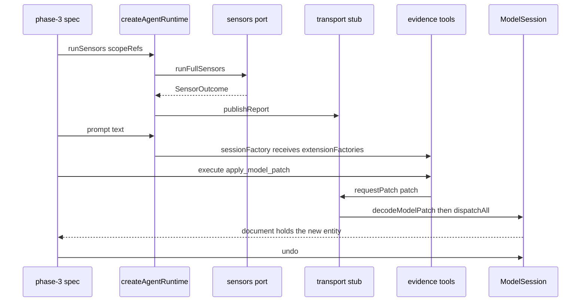

# Verification strategy and fixtures

Evidence has no manual test suite and no golden-screenshot process. Its confidence
comes from five habits:

1. tests live next to the code they describe (`src/**/*.spec.ts`) or in a package's
   `tests/` directory when they cross package boundaries;
2. external systems (Pi, Electron, the filesystem, dialogs) enter through injected
   ports, and main-process specs `vi.mock('electron', …)` rather than boot a window;
3. a small number of golden fixtures carry the expensive invariants, and every
   suite reads them from one place instead of keeping a copy;
4. digests and report shapes are pinned, so a semantic change cannot pass as a
   formatting change;
5. the generated review page is separately exercised by `node:test` VM harnesses
   and headless-Chrome scripts that sit deliberately outside Vitest.

## The project set

The root `vitest.config.mts` is a discovery file, not a project: it collects every
workspace `vite.config.*` and `vitest.config.*` and excludes only the root ones
(`repo://vitest.config.mts#L1-L12`). Each package then owns one named project.

| Project (`test.name`) | Package | Environment | Notable configuration |
| --- | --- | --- | --- |
| `evidence-schema` | `libs/evidence-schema` | `node` | default include |
| `evidence-model-core` | `libs/evidence-model-core` | `node` | default include |
| `evidence-api` | `libs/evidence-api` | `node` | declares `resolve.conditions` |
| `evidence-agent-core` | `libs/evidence-agent-core` | `node` | default include |
| `evidence-modeling-orchestrator` | `libs/evidence-modeling-orchestrator` | `node` | default include |
| `@evidence-poc/evidence-mcp` | `libs/evidence-mcp` | `node` | project name is the package name |
| `@evidence-poc/evidence-canvas-interaction` | `libs/evidence-canvas-interaction` | `node` | `resolve.conditions: ['@evidence-poc/source']` only |
| `evidence-visualization` | `libs/evidence-visualization` | `node` | excludes `tests/node/**` and `tests/browser/**` |
| `@evidence-poc/desktop` | `apps/desktop` | `jsdom` | React plugin, setup file, spec-only include |

Every library project uses the same collection glob,
`{src,tests}/**/*.{test,spec}.{js,mjs,cjs,ts,mts,cts,jsx,tsx}`, `globals: true`,
`watch: false` and v8 coverage into `./test-output/vitest/coverage`
(`repo://libs/evidence-model-core/vitest.config.mts#L1-L18`).

`apps/desktop` is one jsdom project on purpose: React tests need a DOM, and the
store tests only use Node APIs that stay available inside jsdom
(`repo://apps/desktop/vitest.config.mts#L1-L44`). It collects only specs — not
`*.test.*` — from `src/renderer`, `src/shared`, `src/main` and `tests`, inlines
`@evidence-poc/*` dependencies, and loads `src/renderer/test-setup.ts`
(`repo://apps/desktop/vitest.config.mts#L27-L38`). That setup file is what makes
jsdom usable for this codebase: it registers `@testing-library/jest-dom`, calls
Testing Library's `cleanup` after each test, and stubs `ResizeObserver` and the
pointer-capture methods the canvas measures itself with, because jsdom ships
neither (`repo://apps/desktop/src/renderer/test-setup.ts#L1-L39`).

### Resolution conditions decide source or build

Workspace packages resolve from `src` through the `@evidence-poc/source` export
condition; a bundler or test runner that omits it in `resolve.conditions` silently
falls back to `dist`, which `ENVIRONMENT.md` calls out explicitly
(`repo://ENVIRONMENT.md#L60-L76`). The configs are not uniform:

- `apps/desktop` lists `['@evidence-poc/source', 'module', 'browser',
  'development|production']` with `['@evidence-poc/source', 'node', 'import']` for
  SSR resolution — the renderer build needs browser conditions, the main-process
  specs need Node ones (`repo://apps/desktop/vitest.config.mts#L14-L21`);
- `libs/evidence-api` lists `['@evidence-poc/source', 'node', 'import', 'default']`
  (`repo://libs/evidence-api/vitest.config.mts#L5-L14`);
- `libs/evidence-canvas-interaction` lists only `['@evidence-poc/source']`
  (`repo://libs/evidence-canvas-interaction/vitest.config.mts#L5-L7`);
- the other library configs declare no conditions at all, so their workspace
  imports resolve to `dist` — which works because the Nx `test` target depends on
  `^build`.

Nx infers the targets from these configs through `@nx/vitest`
(`testTargetName: 'test'`, `ciTargetName: 'test-ci'`, `testMode: 'watch'`), and
`targetDefaults` makes every `test` depend on `^build`, so a consumer always tests
against a built dependency graph (`repo://nx.json#L53-L66`). The `production` named
input drops spec files, `tsconfig.spec.json` and `src/test-setup.*`, so test sources
never invalidate a build (`repo://nx.json#L4-L17`).

## Injection is the default, not a special case

Every expensive dependency is a constructor or option injection point:

| Port | Where | What the test substitutes |
| --- | --- | --- |
| `PiSdkPort` | `libs/evidence-agent-core/src/session/evidenceAgentSession.ts` | the whole Pi SDK — no credentials, model or terminal (`repo://libs/evidence-agent-core/src/session/evidenceAgentSession.ts#L11-L29`); the session options carry `sdk`, `instructions` and `extensionFactories` as well (`repo://libs/evidence-agent-core/src/session/evidenceAgentSession.ts#L31-L72`) |
| `sessionFactory`, `sensors`, `transport` | `apps/desktop/src/main/agentRuntime.ts` | the conversation, the sensor engine and the patch round trip; defaults are `createEvidenceAgentSession` and `createSensorsEngine` (`repo://apps/desktop/src/main/agentRuntime.ts#L33-L58`) |
| `createEngine` | `apps/desktop/src/main/mcpSensorService.ts` | the sensor engine behind the MCP tool surface (`repo://apps/desktop/src/main/mcpSensorService.ts#L13-L20`) |
| `showBaselineDialog`, `preview`, `showSaveDialog`, `generate`, `readDocument`, `resolveAssets` | `apps/desktop/src/main/reviewIpc.ts` | dialogs, page generation, the project read and the install layout, so the review IPC contract is testable without disk or Electron (`repo://apps/desktop/src/main/reviewIpc.ts#L33-L49`) |
| `recentProjectsFile` | `createProjectStore({ … })` | where recents are written, so the end-to-end suite can open a temporary copy |
| `vi.mock('electron', …)` | main-process specs | `ipcMain.handle`, `BrowserWindow.fromWebContents`, `dialog` and `app`, captured into a channel map (`repo://apps/desktop/src/main/reviewIpc.spec.ts#L1-L60`) |

The pattern is not just for speed. A test that boots a real model would assert on
the model's behavior; these tests assert on *our* contract — what arguments we
pass, what we do with the result, and what we refuse.

## Fixtures are single-sourced

`ENVIRONMENT.md` states the rule: fixtures live in the libraries that own them,
and suites in other packages read them by relative path rather than keeping a
copy, so there is one place to refresh a fixture
(`repo://ENVIRONMENT.md#L46-L58`). Three fixture families are on disk, plus one
in-memory model for renderer tests.

### 1. Golden check models (`libs/evidence-model-core/tests/fixtures/`)

| Fixture | Why it exists |
| --- | --- |
| `models/valid-traceable-subscription/` | six instances, three scenarios, two derivation chains and one key-data decision still owed; every report contract is pinned against it |
| `invalid-missing-confirmation/` | consistent but **incomplete**: a request with no confirmation and a Contract Party holding no request |

The directory README carries the three rules that keep it honest: mirror a real
`.evidence/fm/` tree, never hand-edit a fixture to make a test pass (clone and
mutate the clone), and re-pin any asserted digest deliberately
(`repo://libs/evidence-model-core/tests/fixtures/README.md#L1-L22`).

### 2. The schema snapshot (`libs/evidence-schema/tests/fixtures/product-procurement/`)

A verbatim snapshot of the FM source at
`libs/evidence-api/tests/fixtures/full-lifecycle/fm`, copied (not referenced) so
schema and model-core tests stay stable when the API fixture evolves; its
`validation/` scenarios are excluded because these packages cover the model source
only (`repo://libs/evidence-schema/tests/fixtures/README.md#L1-L17`).

This is the tree the desktop suites drive: both `tests/integration.spec.ts` and
`tests/phase-3-loop.spec.ts` resolve it by relative path, and the integration suite
copies it into a temporary `.evidence/fm` before writing anything
(`repo://apps/desktop/tests/integration.spec.ts#L19-L38`).

### 3. API fixtures (`libs/evidence-api/tests/fixtures/`)

`full-lifecycle/` carries an FM model source, `api.json` and an `openapi.json`
snapshot for the same procurement chain; `subscription-api.json` is a minimal design
and `source.md` a synthetic business source. The README is explicit that the
amounts, identities, roles and routes belong to the fixture and are not project
facts or business defaults, and that counterexamples are built on temporary copies
(`repo://libs/evidence-api/tests/fixtures/README.md#L1-L11`).

The API suite does not hand-write a check report. `checkReportFor` reads the model
root and bytes, then calls `buildFmCheckReport` with the real validation suite and
`modelDigestOf`, so the API stage is tested against the report the FM stage would
actually emit; `fullLifecycleIndex` then loads the design against that report and
caches it (`repo://libs/evidence-api/tests/support/fixtures.ts#L17-L62`).

### 4. The renderer fixture (`createDesktopFixture`)

Renderer and several main-process specs build their model in memory instead of
reading a tree: a compact two-context procurement document with roles,
participants, a contract, a request and a confirmation
(`repo://apps/desktop/src/renderer/test-support/modelFixture.ts#L9-L60`). It exists
so a component test can render a real `DomainModelDocument` without touching disk.

## The desktop integration suite

`apps/desktop/tests/integration.spec.ts` is the one suite that crosses package
boundaries on purpose. It reads the schema snapshot, then:

- parses it with no issues and validates it statically;
- lays out every object with no omitted Context shell, one group per Context, and
  one fulfillment group per request, then marquee-selects that group;
- highlights the neighbours of a hovered request (`dimmed`, node, edge and context
  sets);
- opens a **copy** through the real project store, saves twice, asserts the second
  save writes and removes nothing, and re-parses to an equal document;
- dispatches 50 edits and 50 undos, asserting the document returns exactly to the
  original and stays valid;
- edits the tree, writes it, writes again and asserts zero changed files and the
  new label after a re-parse
  (`repo://apps/desktop/tests/integration.spec.ts#L40-L207`).

That suite protects the composition, not the units: parse → session → layout →
selection → disk → parse again.

## The phase-3 agent patch loop

`apps/desktop/tests/phase-3-loop.spec.ts` builds the **real** `createAgentRuntime`
and injects the three ports around it: a fake `EvidenceAgentSession`, a sensor stub
that returns a report with one key-data advisory, and a transport whose
`requestPatch` decodes the patch and dispatches it into a **real** `ModelSession`
created from the fixture (`repo://apps/desktop/tests/phase-3-loop.spec.ts#L100-L150`).



What this buys is end-to-end coverage of the loop without a model or a window: the
explicit `runSensors` call publishes its report to the transport once; the session
factory is captured so the test can reach the registered tools; the assertion pins
the whole ordered tool-name list (`run_sensors`, `apply_model_patch`,
`get_canvas_selection` … `isolate_domain_calculator`) rather than one lookup; the
patch that the tool hands to the transport lands in the same `ModelSession`, so a
single `session.undo()` restores the exact previous document; and `run_sensors`
executed as a tool publishes a second report
(`repo://apps/desktop/tests/phase-3-loop.spec.ts#L151-L205`).

The second test in the file keeps the "no interpreter" claim honest: it builds the
sensor engine directly and runs a full pass on the schema fixture, asserting
`unavailableSensors` is empty, the block count is zero, the embedded FM check is
valid and key data was collected — so the checks really are in-process
(`repo://apps/desktop/tests/phase-3-loop.spec.ts#L196-L210`).

## The phase-4 review-authoring loop

`apps/desktop/tests/phase-4-review-loop.spec.ts` is the same style applied to the
renderer: the real `EditorScreen` is rendered against `installDesktopApi`, with
`previewReview` replaced by a stub that returns a projection, HTML and one warning.
It then drives the whole authoring round trip
(`repo://apps/desktop/tests/phase-4-review-loop.spec.ts#L15-L116`):

- `Alt+R` opens the 审查中心 dialog; a draft already typed into the interview box
  survives the dialog;
- choosing 交由 Agent 修复 closes the dialog and **appends** the review findings to
  the interview text instead of sending them — the call log still has zero prompts;
- `Ctrl+Enter` sends exactly one prompt;
- a patch pushed through `agentMock.requestPatch` surfaces the AI patch review bar,
  and 导出差异审查 stays disabled while the patch is pending;
- after 保留 and 保存, export is enabled, the click reaches
  `exportDiffReview(['/models/procurement'])`, and one undo disables the button
  again because the saved snapshot is gone.

What it proves is the invariant behind the review hub: export is only offered for
saved state, and the repair prompt is human-approved text, not a second channel.

## Renderer tests never boot Electron

`installDesktopApi` defines a scripted `window.evidenceAPI` on the jsdom global,
returns it together with a `calls` log, and exposes `agentMock`/`mcpMock`
controllers that stream events, reports and patch requests the way the main process
would (`repo://apps/desktop/src/renderer/test-support/desktopApi.ts#L148-L172`,
`repo://apps/desktop/src/renderer/test-support/desktopApi.ts#L483-L492`). Every
async method resolves a typed result or records its arguments; `onEvent`,
`onReport`, `onApplyPatch`, `onStatus`, `onRequest` and `onCaptureMode` return
unsubscribers backed by `Set`s. A component spec therefore asserts both the UI and
the IPC payloads through one object, and `useReviewExport.spec.tsx`,
`EditorScreen.spec.tsx` and `phase-4-review-loop.spec.ts` share it.

## The generated review page, tested in a browser

The page that `evidence-workbench` writes is a single HTML file with one inline
script, so Vitest cannot judge it. `libs/evidence-visualization` keeps two harness
directories and excludes both from the Vitest project, with a comment explaining
that they are `node:test` harnesses that would otherwise be collected and fail to
load (`repo://libs/evidence-visualization/vitest.config.mts#L15-L18`).

- `tests/node/*.test.mjs` load the shipped assets (`assets/business-graph.js` and
  friends) into a `node:vm` context and assert the page's graph logic as the browser
  would run it (`repo://libs/evidence-visualization/tests/node/business-graph.test.mjs#L1-L20`).
- `tests/browser/review-browser.mjs` takes the generated HTML path as `argv[2]`,
  launches headless Chrome (`CHROME_BIN`, defaulting to the macOS Chrome path),
  attaches over the DevTools protocol and asserts that the page reached
  `body.dataset.ready`, renders the graph, never parses a label as markup (a
  `` label stays text), carries no provenance or build tokens
  (`modelDigest`, `sourceRefs`, `cytoscape`, …), makes **zero** external requests,
  leaves the file byte-identical, and does not overflow a 390×844 viewport
  (`repo://libs/evidence-visualization/tests/browser/review-browser.mjs#L10-L40`,
  `repo://libs/evidence-visualization/tests/browser/review-browser.mjs#L1640-L1784`).
- `tests/browser/diff-review-browser.mjs` generates a real diff page from the
  golden subscription fixture with an added, a removed and a relabelled party, then
  blocks `http://*` and `https://*` and asserts the `added`/`removed` markers, the
  computed stroke colours, that the removed object keeps its baseline `x`, that a
  `PRIVATE_DO_NOT_EXPORT` note never reached the file, that clicking the removed
  object still shows its details, and that no external request was attempted
  (`repo://libs/evidence-visualization/tests/browser/diff-review-browser.mjs#L44-L194`).

These harnesses need a built `dist` and a local Chrome, so they are manual checks:
nothing in `ci.yml` runs them.

## Digests are contract, not snapshots

Two values are pinned for the `context.content-subscription` scope of the golden
subscription fixture:

- `modelDigest: sha256:7b002eff…` — a digest over the sorted `path → sha256(bytes)`
  map of the sources, independent of where the tree lives
  (`repo://libs/evidence-model-core/src/adapters/modelRoot.ts#L191-L215`);
- `timelineSummary.sha256: sha256:361a464e…`, together with lane/type/instance/
  dependency/unresolved counts
  (`repo://libs/evidence-model-core/src/validation/fmCheck.spec.ts#L102-L134`).

The same timeline sha is asserted again in `timeline.spec.ts`, next to
`digestOf`'s own contract test: the digest is SHA-256 over canonical JSON (sorted
keys, no spaces) plus a trailing newline, computed identically in Node and a browser
(`repo://libs/evidence-model-core/src/validation/timeline.spec.ts#L105-L140`).
The comment at both assertions states the rule — these values are report contract,
so they must not drift.

`ENVIRONMENT.md` extends it to process: a change to canonical serialization is a
change to the contract, so refresh the pinned values deliberately and say why in the
commit message (`repo://ENVIRONMENT.md#L54-L58`). This is why a passing suite is
meaningful: an innocent-looking refactor of key order or newline handling fails
loudly.

## What is deliberately not exercised through the real thing

| Real dependency | Test substitute | Why |
| --- | --- | --- |
| Pi model, credentials, terminal | `PiSdkPort` fake, `sessionFactory` | tests must run offline and deterministically |
| Electron windows and IPC | `vi.mock('electron', …)`, `installDesktopApi` | IPC handler logic is not window lifecycle |
| model process / interpreter | none exists; sensors run in-process | the old interpreter is gone |
| filesystem and dialogs for review export | injected `generate`, `readDocument`, `resolveAssets`, `showSaveDialog` | asserts the IPC contract, not the page renderer |
| real sockets | in-memory transports and listener sets | only the bridge spec opens a real Unix socket |
| the generated page | VM sandboxes and headless Chrome, run by hand | the page is a build artifact of an inline-script HTML file |

The MCP bridge spec is the exception that proves the rule. It creates a real socket,
asserts the endpoint is `0o600`, round-trips a request, returns `isRunning: false`
with an `APP_NOT_RUNNING` code when nothing listens, propagates handler error codes,
and proves the endpoint is reusable after a close
(`repo://libs/evidence-mcp/src/bridge/bridge.spec.ts#L77-L175`). A timeout test with
fake timers covers the app that stops answering
(`repo://libs/evidence-mcp/src/bridge/bridge.spec.ts#L217-L240`).

## What CI gates

`.github/workflows/ci.yml` runs on every push and pull request to `main` with Node 22
and `pnpm install --frozen-lockfile`, then four steps in order: workspace lint,
workspace typecheck, workspace tests, and `nx build desktop`
(`repo://.github/workflows/ci.yml#L1-L45`). A change lands only if all four pass.
Two consequences are worth knowing when reading a green check:

- the desktop build runs inside the gate, so a broken resource copy or a renderer
  import that only works in dev fails before a release is cut;
- the `node:test` VM harnesses and the headless-Chrome scripts are not part of it, so
  a change to the workspace page assets can pass CI and still break a manual browser
  check.

## Failure modes a reviewer should expect from the suite

| Change | What fails first |
| --- | --- |
| canonical JSON key order or trailing newline | pinned `modelDigest` / `timelineSummary.sha256` |
| scope selection includes an unrelated Contract | `scope.spec.ts` whole-context tests |
| a guard allows a red-line edit | command specs and `strictValidate` specs |
| layout stops omitting empty Contexts, or groups drift | desktop integration layout test |
| save rewrites unchanged files | desktop integration idempotency test |
| the review prompt is sent without human approval | phase-4 loop call log |
| export stays enabled after an undo | phase-4 loop export button state |
| the agent tools change name or order | phase-3 loop tool-name assertion |
| the prompt starts naming a skill or a shell | `prompts.spec.ts` relic check over `SKILL.md`, `.agents`, `references/`, `npx `, `$` |
| a Vitest config loses the source condition | workspace imports silently fall back to `dist` instead of `src` |
| an asset leaks a build token into the page | `review-browser.mjs` token scan |

## Commands

```bash
pnpm test                                         # nx run-many --target=test --all
npx vitest run --project evidence-model-core      # one library
npx vitest run --project @evidence-poc/desktop    # the app
pnpm nx run-many --target=typecheck --all         # tsc --build across refs
pnpm nx run-many --target=lint --all              # includes module boundaries
node libs/evidence-visualization/tests/node/business-graph.test.mjs   # VM harness
```

## Related pages

- [Workspace, build and packaging](../operations/build-and-package.md) — how these
  targets are inferred and what CI runs.
- [The native check and simulation pipeline](../model/checks-and-simulation.md) —
  what the golden fixture pins.
- [API contract projection](../contracts/api-projection.md) — the full-lifecycle
  fixture and its OpenAPI snapshot.
- [The offline workbench contract](../contracts/offline-workbench.md) — the page
  contract the browser harnesses enforce.
- [The review hub](../desktop/review-hub.md) — the surface the phase-4 loop drives.
- [The Pi agent harness and its tools](../agents/pi-harness.md) — the injected SDK
  port and the tools the phase-3 loop names.
