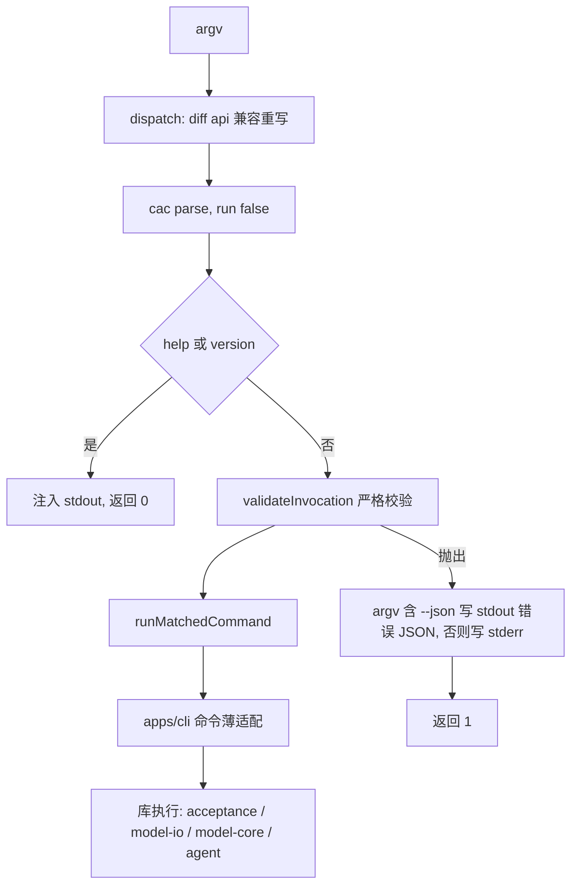

# 统一 CLI 与治理门禁

`apps/cli` 是唯一面向人的可执行入口（cac 应用），执行逻辑全部在库里：验收执行、契约 diff 与 `renderDeliverables` 来自 `@evidence-poc/evidence-acceptance`；`pack/unpack/compile/inspect/lineage` 来自 `@evidence-poc/evidence-model-io`；解析与静态检查来自 `@evidence-poc/evidence-model-core`；业务故事投影来自 `@evidence-poc/evidence-agent`。依赖方向是 app → 库，库的命令层不反向 import app，因此同一套语义既能被统一 CLI 复用，也能被旧 library bin 作为适配器调用。

静态 `check`、契约兼容和真实 HTTP 验收是三件独立的事：任何一层通过都不替另外两层背书，`renderDeliverables` 成功也只说明产物编译出来了。开发先安装并构建：

```bash
pnpm install
pnpm api:setup
pnpm exec nx build cli
pnpm evidence --help
```

## 一个入口与四条库边界

`createCli` 用 cac 注册 `check`、`story`、`test`、`export`、`diff <base> <target>`，用循环注册 `pack/unpack/compile/inspect/lineage <target>`，以及兼容用的 `api <command>`。所有命令只做参数翻译与调用库，不实现第二套解析器或断言引擎。`CommandContext` 注入 `cwd/stdout/stderr/color`，路径按调用方 `cwd` 解析，不写死 repository root；`--help`/`--version` 的输出也改写到注入的 `stdout`（替换 `cli.outputHelp`/`cli.outputVersion`），使 dispatch 可嵌入且不污染 JSON。

已没有 `review` 命令，也没有离线 workbench 相关参数。旧 `timeline`/`simulate`/`role-play` 与 Scenario/Instance 格式不能靠兼容 shim 复活：旧 `evidence-model` 适配器对这三个命令直接回“未知命令”并退出 2，含 `validation/scenarios` 遗留文件的源树会得到 `model.legacy-validation` issue 并拒绝 `pack` 写出。

## dispatch：兼容重写、严格校验与退出码纪律



上图是一次 `evidence` 调用的派发路径：兼容重写、cac 解析、严格校验、库执行与统一错误通道。

- 兼容重写只发生在 `diff`：`evidence diff api <base> <target>` 先删掉 `api` 这个 token，若未显式给 `--format` 再补 `--format json`（旧默认），而直接写法 `evidence diff <base> <target>` 默认 `markdown`。空 argv 与 `help` 被改写为 `--help`；`--help`/`--version` 只渲染注册元数据并返回 0，不触达业务。
- `validateInvocation` 在真正执行前拦截：未知命令；带多别名或带否定形式的选项被重复书写（`-o` 与 `--out`、`--fm` 与 `--model`、`--ai` 与 `--no-ai`）；只有声明 `type: []` 的选项（`--scope`、`--tag`）才允许成数组，其余重复值算 `Duplicate option`；数组里混进布尔（如 `--tag` 缺值）算空值错误；空串/纯空白值的选项经 `stringOption` 直接报错；超出命令声明的 positionals 与 `--` 之后的尾参数都按 usage 失败。
- 命令抛出的错误由 dispatch 统一收口：`argv` 里出现 `--json` 时向 **stdout** 输出 `{"passed":false,"error":...}`（e2e 断言此时 `stderr` 为空），否则向 `stderr` 写 `Error: ...`，两种都返回 1。这条纪律让 CI 与脚本永远能拿到可解析的失败信号。
- 退出码按“谁拥有判断”划分：`check` 0/1（静态有效性）、`export` 0/1（同步或写入成功/失败）、`test` 0（`passed` 或显式 `pending`）/1，`diff` 统一把非 0 折成 1。库层更细的码只在特定入口透出：`evidence api inspect/deliver` 保留库的 3（只有 gap 仍写出可审查草稿），`evidence compile <dir>` 缺 `--out` 时库返回 2，`evidence api diff` 原样返回 `runDiff` 的 2（输入或 oasdiff 工具失败），而 `evidence diff` 会把它归一成 1。

## check 与产物导出

```bash
pnpm evidence check examples/acceptance/procurement.evidence.json --json
pnpm evidence export --model examples/acceptance/procurement.evidence.json --out dist/acceptance
pnpm evidence export --model examples/acceptance/procurement.evidence.json --out dist/acceptance --verify
```

`loadModel` 按目录树或 `.evidence.json` bundle 加载，解析 issues 直接抛 `FM_INVALID`，绝不修补源。`check [model] --scope <id> --json` 默认模型 `.evidence/fm`，输出 FM 静态报告（`valid`、`errors`、`gaps`、`advisories`、`testExampleCount`、`modelDigest`）；`testExampleCount` 只是声明数，报告同时明确“未被 HTTP 验收执行”。退出码取 `report.valid`。

`export` 默认同时产出 OpenAPI 3.1 与 Step CI，`--openapi`/`--tests` 选择子集，`--format stepci|hurl` 决定 suite 格式。`renderDeliverables` 先 `buildDelivery`、遇 error diagnostics 即拒、再 `assertOpenApiContract`，然后把 `examples[].test` 投影成标准 suite；**全部成功之前不写任何文件**，所以验收编译失败时旧产物保持原样。

输出目录必须专用：realpath 解析既有祖先，拒绝 `out` 与 model 双向包含，也拒绝 `out` 覆盖调用方 `cwd`（`.`、文件系统根、以及指向 cwd 的 symlink 别名都会被 `export.spec` 覆盖）。落盘由 `writeOutput` 完成：先在**同父目录**的 sibling stage 里逐个写文件（`wx` 打开，避免崩溃留下半截内容），再把旧目录 rename 成 backup，把 stage rename 成 `out`；rename 失败会回滚旧树。结果是整树替换——旧的额外文件会被删除，因此不要在那个目录里放手写文件。

`--verify` 走同一内存编译，但只做**精确 bytes 比较**：不写文件、不建目录、不进入内部 symlink。缺失记 `MISSING`、内容不符或 symlink 记 `MODIFIED`、目标树里的孤儿记 `EXTRA`，分列打印到 stderr 并返回 1，同时给出应重跑的 `export` 命令行；同步则打印说明并返回 0。生成 + commit 是开发动作，CI 只跑 `--verify`，避免流水线替模型作者悄悄修产物。

## story：把声明场景投影成业务故事

```bash
pnpm evidence story --no-ai
pnpm evidence story examples/acceptance/procurement.evidence.json --format json --compact
pnpm evidence story --flow payment --export docs/payment-story.md
```

`story [model]` 复用两层既有能力，不新增语义：

- **flowAggregator**：`collectFlowScenarios(model, report)` 把带 `examples[].test.flow` 的样例聚合成 `FlowScenarioTrace`（flow 按 id 排序、step 按 `asOf`/依赖拓扑排序，重复样例引用、未知/歧义/跨流/循环依赖分别抛 `FlowScenarioError`），并把 `check` 报告里的 gaps 挂到对应 step。于是遗漏字段会变成故事里的“待决悬念”，而非法依赖图直接失败，不会被讲成一个看似合理的故事。
- **flowStoryProjector**：`createFlowStoryProjector({skipAi, projectRoot})` 逐 flow 生成 `BusinessStoryProjection`。`--no-ai` 走确定性事实卡（不初始化也不调用 LLM、不读写 AI 缓存，同一模型输出逐字节可复现）；默认模式调用 story agent 做叙述扩写。

参数面：默认模型 `.evidence/fm`、默认 `--format markdown`（另有 `text`、`json`），`--flow <id>` 只按**精确 flow ID** 过滤且找不到即 stderr 报错退出 1，`--export <file>` 按 cwd 解析路径，`--compact` 压缩输出（JSON 变单行；markdown/text 省略摘要与叙述，但保留单据字段）。cac 把 `--no-ai` 解析成 `{ai: false}`，只有这一种否定写法算离线；`--ai` 与 `--no-ai` 混用、重复 `--format`、非法格式都会在投影前失败。

渲染分工在 `apps/cli/src/ui/`：markdown 输出带字段表（字段、值、关键数据、来源）和固定免责声明“仅投影模型声明的业务事实，不代表已执行验收或规则判定”；`text` 才可能有 ANSI 颜色，且仅当写到 stdout 时启用；`json` 用 canonical 序列化。导出时先让**所有** flow 投影成功，才 `mkdir` 父目录并写文件——agent 失败或写入失败都不会留下半成品、也不会覆盖已有故事文件，成功后只向 stdout 打印导出路径。模型里没有任何 flow 声明时，JSON 返回空数组、人读格式给出解释，均退出 0：故事是草稿视图，不是验收结论。

## 对真实后端执行标准 HTTP

```bash
node examples/dogfood-backend/server.mjs --port 8085 --mode v2
# 另一个终端
pnpm evidence test --target http://127.0.0.1:8085 --scenarios dist/acceptance --verbose
```

`test` 接受单个 YAML 或目录递归 `*.stepci.yml|yaml`（按文件名排序，不跟随目标树里的 symlink），默认 `--scenarios dist`；找不到 suite 直接失败。它只运行官方 `@stepci/runner` 的 self-contained version 1.1 HTTP workflow：要求 `tests` 非空、每个 flow 至少一个 step、每个 step 都有 `http.url`，拒绝 `include`/`config.loadTest`/非 HTTP 构造，不实现私有 assertion 解释器。`.hurl` 文件被明确拒绝并提示用外部 Hurl CLI 执行。Runner 用 lazy import 引入，避免 Node-only 依赖进入 projection/browser 消费者。

执行前先 `HEAD` 探活：任意 HTTP 响应（含 404/405）即视为 reachable，不跟随 redirect、不要求私有 health endpoint、不用 POST 改变状态。`--target` 必须是 HTTP(S) 且不含凭据、query、fragment；`--timeout` 必须是正整数且 ≤ 2147483647ms（注入成每步 `http.timeout`）；`--as-of` 必须是严格 UTC RFC3339（拒绝 2 月 30 日这类归一化日期）。结果归一化每步的 status、断言、error、duration，非空实际执行且全部通过才算 passed。

模型 `examples` 里的 `asOf` 会编译出请求 clock 和派生期望值。`test --as-of` **只替换请求头 `x-evidence-asof`，不重编期望值**，因此可以故意制造时间漂移失败；这个 header 只供可信测试 backend 使用，生产授权与时钟不得信客户端。内联 oracle 的 int/uint 大值保存为精确 decimal string，Step CI/Hurl 断言不得经 `Number` 舍入。

## Regression 与 DoD 是两套验收集合

```bash
pnpm evidence diff baseline.evidence.json current.evidence.json --format markdown
pnpm evidence test --target http://127.0.0.1:8085 --scenarios dist/acceptance \
  --gate regression --baseline-model baseline.evidence.json --strict-drift --report-dir reports
pnpm evidence test --target http://127.0.0.1:8085 --scenarios dist/acceptance \
  --gate dod --baseline-model baseline.evidence.json --strict-drift --report-dir reports
```

`--baseline-model` 必须与 `--gate` 同时出现，且当前 scenarios 只能有一个 generated Step CI suite；baseline 模型会用 `renderDeliverables` 重新编成 `acceptance.stepci.yml`，绝不用当前 snapshot 冒充基线。

- `regression` + baseline：**执行基线全部 flows**，保护旧合同；它不是“当前 flows 里未被改动的那部分”。
- `dod` + baseline：执行当前新增或**可执行语义**变化的 flows。按 flow name 对齐，重复 name 直接拒绝；指纹规范化 capture 变量与环境值、只剥 schema 节点上的文档 annotation（`examples/description/title/$comment/deprecated/default/readOnly/writeOnly` 与 `x-*`）而保留 validation semantics，因此生成顺序或描述变化不会误报，名为 `description`/`default` 的业务 property 与 `const` 数据也不会被误删。
- 无 baseline：只按 `env.evidenceTags` 里显式的 `regression`/`dod` 标签选，不能自动推测基线。
- `--filter` 按 flow name 子串或含 `*`/`?` 的 glob 匹配，`--tag` 可重复且要求全部命中；无论怎么筛都选**完整 flow**，保留上游捕获，不切开有依赖的 steps。

空选择通常是失败。**唯一显式空成功例外**：有 baseline 的 DoD、没有 `filter`/`tag`、当前与基线无增量——此时返回 `selectedFlowCount: 0`、`steps: []` 与 `emptyReason`，退出 0，表示“无需增量”而不是“后端已跑过全绿”，不能统计成已执行通过。

## Pending、报告与人类可读输出

`--allow-pending` 只对 `--gate dod` 有效。当断言失败但没有 step execution error、也没有 strict-drift 发现时，报告保持 `passed: false`、`pending: true`：终端仍显示 PENDING（DoD WIP）与失败明细，但退出 0 供探索。HTTP 连接/运行错误或 strict drift 不可豁免，regression 不可用。严格 CI 不传该参数，所以未完成的 DoD 仍是真失败。

默认输出是人类可读红绿灯（`trafficLightReporter`），`--verbose` 额外展示通过的断言，`NO_COLOR`/非 TTY 关闭颜色。`--json` 打印完整报告，`--report markdown|junit` 打印单一格式，两者互斥；`--report-dir <dir>` 从**同一次执行**写出 `<gate|acceptance>.json`、`.md`、`.xml` 三个文件，不为多格式重跑会改状态的 SUT。`evidence test` 退出：`passed` 或 `pending` 为 0，其他为 1。

## 两种 drift 不能混淆

`--detect-drift`/`--strict-drift` 检查的是**本次 HTTP 响应**相对 OpenAPI schema 的漂移：用 AJV2020 + `ajv-formats` 按 JSON Schema 2020-12 语义校验，报告 `extraneous_field`/`missing_required`/`type_mismatch`/`schema_mismatch` 与 RFC 6901 JSON Pointer；不改 payload、不取远端 ref（本地 `$ref` 由 AJV 解析），响应不是合法 JSON 时记 `type_mismatch`。启用时 schema 节点被取出交给专用 inspector，官方 Step CI 的其他 assertions 仍是权威；声明为 open 的 map 保持 open，不把一切新增 property 当非法。advisory drift 不自动判红，`--strict-drift` 才把它计入 step 失败。

桌面/MCP 的 `audit_production_drift` 比较 saved FM 与 OTLP trace 里的 Evidence commits，是另一种语义审计，不由 HTTP 开关代替。

## 契约 gate 与 CI 基线纪律

`evidence diff <base> <target>` 比较最终 valid OpenAPI：要求两边 `modelId` 一致，任一侧有 error diagnostics 即拒，两侧契约都先过 `assertOpenApiContract`。工具固定 oasdiff `1.38.0`（先 `--version` 精确比对），severity `level >= 2` 视为 breaking，`--allow-external-refs=false`，默认输出 Markdown changelog、`--format json` 输出结构化 changelog。二进制从仓库内 `node_modules/.cache/evidence/oasdiff/1.38.0/<platform-arch>` 解析（可用 `EVIDENCE_OASDIFF_BIN` 覆盖），`api:setup` 按平台与校验和预置，compare 阶段绝不联网下载；工具缺失/版本不符抛 `OasdiffError` 并保留 stdout/stderr，失败闭合不产出“无变更”。

仓库的 Evidence Governance 工作流按固定顺序把关：`check` → `export --verify` → 从 PR base / push before 的不可变 SHA 物化 baseline → `diff --format markdown`。base commit 或路径不存在时只允许**显式 bootstrap**（同一 base 里的 bootstrap 模型，或非 PR 事件下的显式回退），`git show` 失败即 fatal，绝不退到 HEAD 与自己比较。契约卫生通过后，`regression` 与 `dod` 作为独立矩阵任务启动各自隔离的 v2 backend，带 `--strict-drift --report-dir reports`，用 trap 清理 SUT，并在 `always()` 下上传同一次执行产生的 JSON/Markdown/JUnit 与 backend log。GitLab 模板复用同一纪律（`templates/ci`），其 spec 断言模板里没有 `allow_failure`、`continue-on-error` 或 `--allow-pending`。

## 旧库 bin 的弃用边界

`evidence-api`（`libs/evidence-acceptance/dist/cli.js`）与 `evidence-model`（`libs/evidence-model-io/dist/cli.js`）仍可作为可执行文件运行，但只作为语法适配器：`[DEPRECATED]` 警告通过 `console.warn` 只写 stderr，业务输出仍写 stdout（`evidence-api` 用 canonical JSON），程序化 `import` 该模块时保持完全静默（入口判定用 `realpathSync` 比对，symlink 启动也能识别）。它们与统一 app 调用同一批库函数；`evidence-model` 对 `-o`/`--out` 混用单独判重复，未知命令或多余位置参数退出 2。根脚本 `model:pack/unpack/inspect`、`api:export/diff` 已指向 `apps/cli`。

## 代表测试与边界

`router.spec`/`cli.e2e` 保护 cac 严格参数、注入上下文、JSON 错误通道与真实后端生命周期；`story.spec`/`story-command.e2e` 保护离线否定解析、cwd 相对导出、空投影退出 0 与失败不留文件；`export.spec` 保护 both-before-write、原子替换、verify 的 MISSING/MODIFIED/EXTRA、symlink 与重叠拒绝；`model-commands.e2e` 保护 pack/unpack/compile/inspect 往返与 usage 失败；`legacy-shims.e2e` 保护 stderr-only 弃用提示与库依赖方向；runner/suiteSelection 的 specs 保护官方执行、完整 flow 与基线语义；`governance.e2e` 对独立 v1/v2/fault 后端验证旧 regression 绿、新 DoD 红、pending 与 strict drift，不靠 mock SUT 推断业务成功。

相关：[快速开始](../quickstart.md) · [API 投影](../contracts/api-projection.md) · [交付路由与差异](../contracts/delivery-routes-and-diff.md) · [源格式](../model/source-formats.md) · [构建与打包](../operations/build-and-package.md) · [验证策略](../testing/verification-strategy.md)
