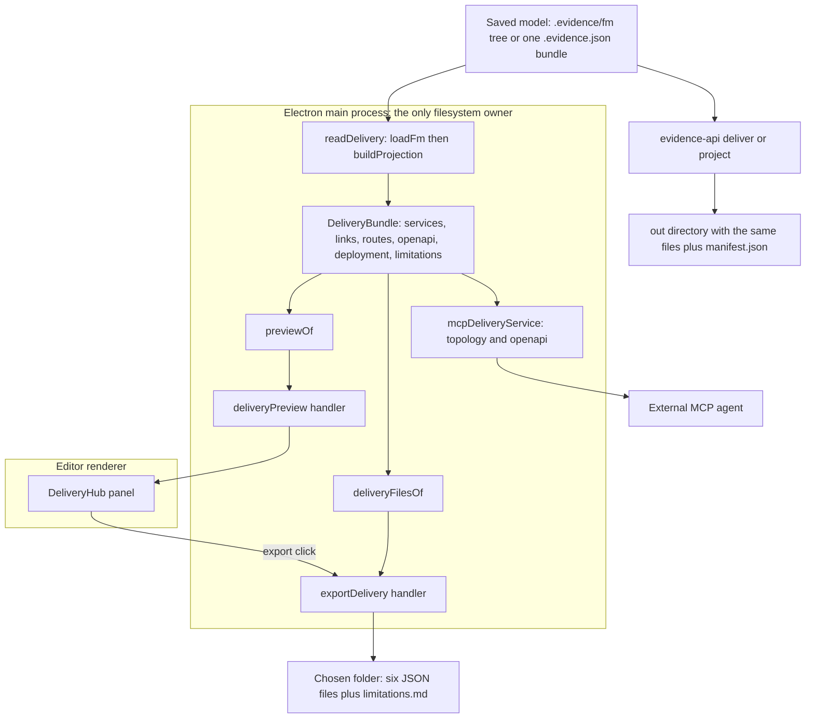

# Delivery hand-off: from model to deployable files

The hand-off answers one question a modeler asks once the model closes: *what does
this become when someone deploys it?* Everything on this page is a projection of the
**saved model on disk** — a `.evidence/fm` tree or one `*.evidence.json` bundle —
never of the unsaved canvas. The source comment states the reason plainly: what a
colleague receives has to describe what was saved, and the preview exists so the
modeler reads the boundaries before writing files into a folder they will have to
explain (`repo://apps/desktop/src/main/deliveryIpc.ts#L27-L33`).

Three consumers share one projection step, and one of them is a terminal:

| Consumer | Entry point | Writes anything? |
| --- | --- | --- |
| Delivery hub panel in the editor | `deliveryPreview` IPC | no |
| Export-to-folder button in the same panel | `exportDelivery` IPC | yes, into a folder the user picks |
| External MCP agent | `get_delivery_topology`, `export_openapi_contract` | no |
| Terminal user | `evidence-api deliver` / `project` | yes, into `--out` inside the project |

The renderer owns no filesystem access at all: `window.evidenceAPI.projects` exposes
only the two promise-returning calls, and the directory picker plus every write live
in the main process
(`repo://apps/desktop/src/shared/ipc.ts#L47-L49`,
`repo://apps/desktop/src/shared/ipc.ts#L98-L101`).

## Where the hand-off starts

The `交付` button in the editor header calls `onOpenDelivery`, which flips
`deliveryOpen` in the editor screen and renders the modal with the project's
`rootPath`
(`repo://apps/desktop/src/renderer/components/TopHeader.tsx#L187-L195`,
`repo://apps/desktop/src/renderer/screens/EditorScreen.tsx#L505-L512`). The panel is a
modal (`aria-modal`, labelled `交付中心`) that mounts `useDeliveryHub(rootPath, true)`,
and that hook immediately reads the preview — there is no "load delivery" button,
because a hand-off whose shape is unknown is not useful to look at
(`repo://apps/desktop/src/renderer/state/useDeliveryHub.ts#L60-L95`).

## The preview is a projection, not a form

`registerDeliveryIpc` answers `evidence:project:delivery-preview` by normalizing the
root with `modelSourceOf(projectDirectoryOf(rootPath))` and passing it to `readDelivery`;
a bundle path and a tree path therefore reach the same reader
(`repo://apps/desktop/src/main/deliveryIpc.ts#L82-L97`).

`readDelivery` is the single projection step behind preview, export and both MCP reads
(`repo://apps/desktop/src/main/deliveryProjection.ts#L100-L113`):

1. `loadFm(modelRoot)`; if the loader returns no index, its diagnostic messages are
   joined into one thrown error.
2. `buildProjection({ index })`; if the resulting diagnostics contain an error, they
   are joined and thrown.
3. The projection is returned as the `DeliveryBundle`.

Two absences matter and are deliberate: the desktop path passes **no design overlay**
and **no FM check report**, and it does not run `validateProjection`. So the bundle
the hub shows is the model-derived baseline only, and a snapshot that would fail the
projection schema can still be previewed and exported here — see
[API projection](../contracts/api-projection.md) for what the CLI checks on top.

`previewOf` then reduces the bundle to what a reader checks first
(`repo://apps/desktop/src/main/deliveryProjection.ts#L58-L98`):

| Field | Content |
| --- | --- |
| `modelId`, `modelName`, `modelVersion` | identity shown in the panel header |
| `services[]` | `id`, `name`, `kind`, `contextRef`, `supplies`, `consumes`, `notes`, and `routeCount` |
| `links[]` | `id`, `from`, `to`, `kind`, `mode`, `label`, `viaRef` |
| `routes[]` | `method`, `path`, `summary`, `serviceId` |
| `limitations[]` | the model's own open questions, verbatim |

`routeCount` is counted from `bundle.routes` per `serviceId`. The comment is explicit
about why it is a count and not a filter: a service with no route exists in the
topology but answers nothing, and the hub should show that rather than hide it behind
a tidy table.

A model that cannot be projected yields `{ success: false, error }` and never a throw
across IPC. The hook stores the error, leaves `preview` null, and the panel shows the
message; the export button is disabled while `preview === null`, so a failed read
produces an explanation instead of an empty promise
(`repo://apps/desktop/src/main/deliveryIpc.ts#L88-L95`,
`repo://apps/desktop/src/renderer/state/useDeliveryHub.ts#L60-L95`,
`repo://apps/desktop/src/renderer/components/delivery/DeliveryHub.tsx#L53-L62`).

## What the panel actually shows

Three sections, in this order, each with its item count in the heading
(`repo://apps/desktop/src/renderer/components/delivery/DeliveryHub.tsx#L96-L190`):

- **服务边界** — one row per service: name, localized kind, `contextRef`, route
  count, notes. Kinds are rendered through a local label map (`channel` → 渠道前置,
  `fulfillment` → 核心履约, `domain` → 领域计算, `capability` → 能力支撑).
- **跨边界调用** — one row per link (from, to, label, localized mode: `sync` →
  同步调用, `async` → 异步回调), or the sentence `各服务之间没有直接调用。` when the
  model declares no crossings.
- **尚未闭环的能力** — the limitations list, or `没有未闭环项。`

The preview object also carries `routes`, and the export result reports a route count,
but the panel itself counts routes per service rather than listing every path: the
panel answers "which service answers this business moment", while the files carry the
schemas.

## The export writes the same bundle into a folder

`exportDelivery` reads the bundle **first**, then asks for a folder, then writes
(`repo://apps/desktop/src/main/deliveryIpc.ts#L99-L131`). The order is load-bearing:
a model that cannot be projected never opens a picker.

The dialog is a real `openDirectory` + `createDirectory` picker whose `defaultPath` is
`suggestedDeliveryDirectory(projectDirectoryOf(rootPath))` — the folder `delivery`
beside the project (`repo://apps/desktop/src/main/deliveryProjection.ts#L115-L117`).
Dismissing it returns `{ status: 'cancelled' }` and writes nothing, which the IPC spec
pins with a spy that must not be called
(`repo://apps/desktop/src/main/deliveryIpc.spec.ts#L192-L208`).

The files are exactly `deliveryFilesOf(bundle)` — one serialization of the same
projection, so the tree cannot drift from the document it was built from
(`repo://libs/evidence-api/src/delivery/files.ts#L10-L62`):

| File | Content |
| --- | --- |
| `openapi.json` | the OpenAPI 3.1 contract, paths named after business moments |
| `topology.json` | `schemaVersion`, model identity, `services`, `links`, `limitations` |
| `routes.json` | the full route list |
| `deployment.compose.json` | the compose sketch: one container per Context |
| `projection.json` | the whole snapshot, diagnostics and digests included |
| `http-journeys.json` | `{ runtimeValidated: false, journeys, hypermedia }` |
| `limitations.md` | only when `limitations.length > 0`, as prose the reviewer acts on |

Writing is `mkdir(directory, { recursive: true })` followed by one
`writeFile(path.join(directory, file.path), content, 'utf8')` per file
(`repo://apps/desktop/src/main/deliveryIpc.ts#L47-L56`). Three consequences are worth
knowing before relying on it:

- there is no staging directory and no rollback, so a write that fails midway leaves
  the files already written in the folder even though the call returns `failed`;
- no `manifest.json` is produced here — the integrity manifest belongs to the CLI
  renderer, not to this copy;
- the chosen destination is whatever the user picked; the desktop does not restrict it
  to the project, unlike `--out` in the CLI.

The result shape is the whole report a caller gets:

```jsonc
{
  "status": "saved",
  "directory": "/exports/procurement",
  "files": ["openapi.json", "topology.json", "routes.json", "deployment.compose.json", "projection.json", "http-journeys.json", "limitations.md"],
  "serviceCount": 2,
  "routeCount": 3
}
```

`status` is `saved`, `cancelled` or `failed`; the failure branch carries
`{ status: 'failed', error }` with the thrown message
(`repo://apps/desktop/src/shared/projects.ts#L136-L146`). The hook turns `saved` into
one status line naming the directory, the file names and both counts, `failed` into
`导出失败：…`, and `cancelled` into no notice at all
(`repo://apps/desktop/src/renderer/state/useDeliveryHub.ts#L27-L42`).

Because preview and export each call the projection themselves, the panel describes
the saved model as it was when the panel opened, and the folder receives the saved
model as it is when the button is pressed. Both are the same code path over disk, so
they cannot disagree about *how* a model is described; an edit in between is a
re-read, not a hidden cache.



One saved model, one projection step, and two destinations: a folder the user picks in
the app, and an output directory the CLI owns.

## The CLI is the same hand-off without a window

`evidence-api` ships one binary (`bin: evidence-api`) whose `deliver` and `project`
verbs are the terminal form of this workflow, with `deliver` an alias for `project`:
both pass the same path validation, load, projection, `renderOutputs` and `writeOutput`
(`repo://libs/evidence-api/src/cli.ts#L337-L362`,
`repo://libs/evidence-api/package.json#L10-L12`).

```bash
evidence-api deliver \
  --project-root /abs/project \
  --fm /abs/project/.evidence/fm \
  --out /abs/project/.evidence/api/generated
```

`--fm` also accepts a single `*.evidence.json` bundle. Compared with the hub export,
the CLI adds the inputs and guarantees the app does not have:

| Aspect | Desktop export | `deliver` / `project` |
| --- | --- | --- |
| Inputs | the saved model only | adds optional `--fm-check` report and `--api` route overlay |
| Destination | any folder the user picks | `--out`, default `<root>/.evidence/api/generated`, must stay inside the project |
| Path rules | none beyond the picker | `OUTPUT_OUTSIDE_PROJECT`, `OUTPUT_INPUT_CONFLICT`, `PATH_NOT_ABSOLUTE`, `PROJECT_ROOT_INVALID` |
| Validation | `hasErrors` on the projection diagnostics | additionally `validateProjection` against the projection schema |
| File set | the six delivery files plus `limitations.md` | the same plus `manifest.json` with input and per-output digests |
| Write | per-file, in place | staged sibling directory, renamed into place, previous tree restored on failure |

The write is gated on errors, not on gaps: a draft with an open question is still
written, and the process exits `3` to say "gaps only"; an error writes nothing and
leaves a previous export in place. The stdout report is the summary plus `out`, the
written `files` and `limitations`
(`repo://libs/evidence-api/src/cli.ts#L326-L362`,
`repo://libs/evidence-api/src/renderer/outputRenderer.ts#L41-L90`,
`repo://libs/evidence-api/src/renderer/outputRenderer.ts#L122-L175`). Full verb
semantics and exit codes are in [API projection](../contracts/api-projection.md);
what changes between two saved models is in
[contract diff and evolution](../contracts/api-diff-and-evolution.md).

## The MCP reads answer "what does this become" without writing

`createMcpDeliveryService` is wired into `createMcpRequestHandler` with everything
defaulted, so it reads through the very same `readDelivery`
(`repo://apps/desktop/src/main/main.ts#L96-L106`,
`repo://apps/desktop/src/main/mcpRequestHandler.ts#L105-L110`). The service exposes two
methods, one per agent-facing tool:

| MCP tool | Method | Returns |
| --- | --- | --- |
| `get_delivery_topology` | `topology(rootPath)` | model identity, services with `supplies`/`consumes`/`routeCount`, links as `from`/`to`/`kind`/`mode`/`label`, `limitations` |
| `export_openapi_contract` | `openapi(rootPath)` | model id and version, `pathCount`, the OpenAPI 3.1 `document`, `limitations` |

The docstring is the policy: neither writes anything, because a contract a caller
intends to deploy belongs in their repository, not in the modeler's project
(`repo://apps/desktop/src/main/mcpDeliveryService.ts#L10-L17`). The reduction is
deliberately lossy relative to the preview — link `id` and `viaRef` and service `notes`
are dropped — because an agent needs the boundary and the direction, not the modeler's
prose (`repo://apps/desktop/src/main/mcpDeliveryService.ts#L24-L53`). `pathCount` is
the number of keys in `bundle.openapi.paths`, so it counts paths, not operations.

Both calls resolve the active project root through the renderer's `get_app_state` and
throw `NO_ACTIVE_PROJECT` when nothing is open, so they are refused before touching the
filesystem; the tool descriptions also tell an agent to read these two instead of
inventing a service split. See
[MCP integration](../agents/mcp-integration.md) for the routing and transport that
carry these calls.

## What the hand-off refuses to invent

The hand-off is not allowed to close a gap by guessing. What the model cannot answer is
recorded and shipped (`repo://libs/evidence-api/src/delivery/modelDelivery.ts#L380-L407`):

- a fulfillment pair with no confirmation gets no confirmation callback, so each such
  pair is reported as unclosed;
- derived attributes need a rule runtime on the server, so the contract only declares
  where their values come from.

Those strings travel everywhere the delivery goes: into `projection.json` and
`topology.json`, into both MCP reads, and — only when there is at least one — into a
prose `limitations.md` that opens with "以下内容模型尚未给出答案，交付物按缺口保留，不做推测"
(`repo://libs/evidence-api/src/delivery/files.ts#L47-L59`).

Two more boundaries are preserved rather than filled in:

- A service's `consumes` lists the evidence-kind sockets its Context depends on and
  does not itself answer, so an unanswered capability stays visible as an obligation
  instead of being given a guessed provider. Capability links are always `async`,
  because the confirmation is produced on the supplier's own clock
  (`repo://libs/evidence-api/src/delivery/topology.ts#L80-L106`,
  `repo://libs/evidence-api/src/delivery/topology.ts#L248-L262`).
- The compose sketch keeps the projected services and dependency direction but treats
  images and ports as placeholders, and `http-journeys.json` states
  `runtimeValidated: false`: nothing has been executed against the journeys
  (`repo://libs/evidence-api/src/delivery/modelDelivery.ts#L306-L333`).

The services themselves are not invented either: one Context becomes exactly one
service, and the boundary is the Contract Context rather than the noun, so a promise
and its answer stay together
(`repo://libs/evidence-api/src/delivery/topology.ts#L10-L29`,
`repo://libs/evidence-api/src/delivery/topology.ts#L196-L212`).

## Failure modes the specs pin

| Situation | What the caller sees |
| --- | --- |
| model unreadable or projection has errors | preview `{ success: false, error }`, export `{ status: 'failed', error }`, nothing written |
| picker dismissed | `{ status: 'cancelled' }`, write never called |
| export succeeded | `saved` with directory, file names, `serviceCount`, `routeCount` |
| write fails midway | `failed` with the message; already-written files stay |
| no active project (MCP) | `NO_ACTIVE_PROJECT` before any read |

`deliveryIpc.spec.ts` fixes the artifact order and the preview/export contract, injecting
`build`, `write` and `showDirectoryDialog` so no test reads a project or touches the
disk (`repo://apps/desktop/src/main/deliveryIpc.spec.ts#L101-L208`).
`deliveryProjection.spec.ts` pins the invariant that matters most for a hand-off: the
same snapshot comes out of a `.evidence/fm` tree and out of a `*.evidence.json` bundle,
and malformed or statically inconsistent input is refused rather than exported
(`repo://apps/desktop/src/main/deliveryProjection.spec.ts#L17-L55`).
`DeliveryHub.spec.tsx` pins the three panel sections, the disabled export after a read
failure, and the notice naming the directory the main process reported
(`repo://apps/desktop/src/renderer/components/delivery/DeliveryHub.spec.tsx#L49-L99`).

## Related pages

- [API projection and the delivered file set](../contracts/api-projection.md) — the
  snapshot, its diagnostics, the CLI verbs and the manifest.
- [Desktop app shell](../desktop/app-shell.md) — where the delivery IPC handlers sit
  among the other main-process handlers.
- [MCP integration](../agents/mcp-integration.md) — how an external agent reaches
  `get_delivery_topology` and `export_openapi_contract`.
- [Sensors and stage gates](../agents/sensor-orchestration.md) — what must pass before a
  hand-off is worth making.
- [Contract diff and evolution](../contracts/api-diff-and-evolution.md) — what changes
  between two delivered models.
