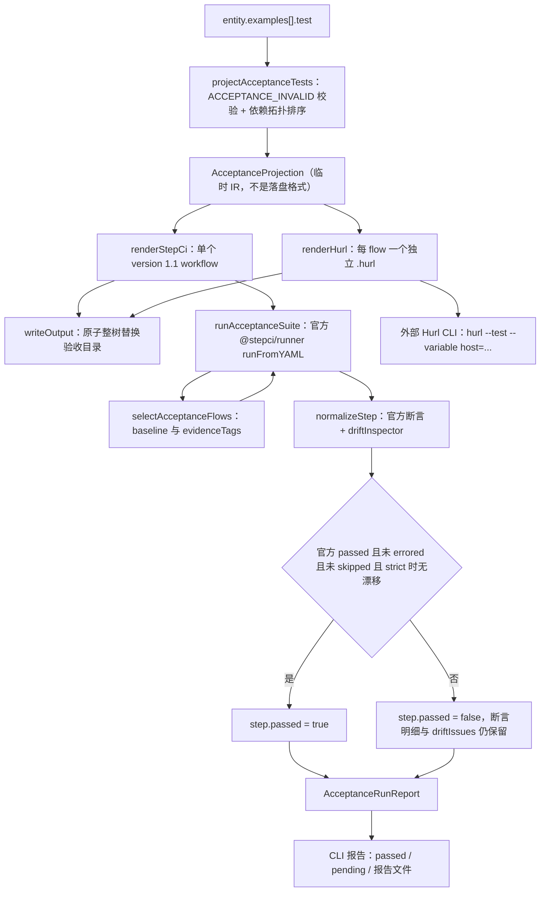

# 验收套件生成、HTTP 执行与漂移检查

`@evidence-poc/evidence-acceptance` 消费 `evidence-api` 的 API 投影，负责“模型声明的验收事实能不能在真实后端上跑出来”这一层：把内联 `examples[].test` 编译成原生 Step CI/Hurl 脚本、组合导出交付树、用官方 `@stepci/runner` 在进程内执行、归一化断言与响应漂移、按 regression/DoD 语义选择 flow 集合，并另外拥有原生 `oasdiff` 契约比较。依赖方向是单向的：`evidence-api` 没有反向依赖（`pnpm boundaries:drill` 用一条反向 import 探针证明它仍被 lint 拒绝），因此投影与运行时共享同一份模型事实，却不会互相拖入对方的运行时。

本页讲**生成、执行、gate 选择与漂移的机制**。命令名、参数、退出码、报告格式与 CI 用法见 [CLI 双门禁](./cli-governance.md)；契约与路由本身见 [API 投影](../contracts/api-projection.md) 与 [交付路由与差异](../contracts/delivery-routes-and-diff.md)。

## 入口与职责边界

| 入口                         | 预期消费者                    | 内容                                                                                                        |
| ---------------------------- | ----------------------------- | ----------------------------------------------------------------------------------------------------------- |
| `.`（包根，Node）            | Node 调用方                   | `renderDeliverables`、`projectAcceptanceTests`、两个渲染器、`runAcceptanceSuite`、漂移 inspector、`oasdiff` |
| `/runner`                    | HTTP 执行                     | `runAcceptanceSuite`、`validateAsOf`、`AcceptanceGate`、步骤/报告类型                                       |
| `/commands`                  | 统一 CLI 的 `evidence api …`  | `runApiCommand`/`runCli`/`runDiff`/`validatePaths` 与旧命令适配                                             |
| `/cli`                       | 已弃用的 `evidence-api` shim  | 可执行入口，弃用提示只写 stderr，程序化 import 静默                                                        |
| `/projection`（浏览器安全）  | 桌面 renderer                 | 只导出 `projectAcceptanceTests` 与三个投影类型                                                              |

只有 `runAcceptanceSuite` 这条路径会执行 HTTP 用例（CLI 在调用它之前另做一次 `HEAD` 探活），`evidence test` 是它的唯一调用方，`/commands` 的 `export-tests`/`inspect`/`diff` 都不连后端。Hurl 这条线在本仓库内**只生成不执行**：`.hurl` 由外部 Hurl CLI 跑，`evidence test` 明确拒绝 `*.hurl` 并提示改用外部 CLI。

## 端到端流程

上图是同一份模型事实走完“编译 → 原生脚本 → 执行 → 断言与漂移 → 选择与报告”的完整链路；Step CI 与 Hurl 在生成后分叉，前者由本库执行，后者交给外部工具。

## 从 `examples[].test` 到 `AcceptanceFlow`

投影入口是 `projectAcceptanceTests(model, routes = buildDeliveryRoutes(model))`。它先 `assertValidDomainModel`，再只为**带 `test` 元数据**的 example 建 case，`ref = \`${entity.id}#${example.label}\``。`test` 的可用字段由 schema 固定：`flow`、`actingRoleRef`、`asOf`、`basedOn`、`pathParameters`、`expectedStatus`、`inputs`、`expect`、`tags`；其中 `inputs` 覆盖只允许出现在显式的负向用例（`expectedStatus >= 400`），`expect` 的键必须是 `$` 开头的 JSONPath。

每条规则都是“要么正确映射，要么失败”，没有“跳过这一步”的分支，错误统一是 `ACCEPTANCE_INVALID: <ref>: <原因>`：

- **路由唯一性**：该实体必须恰好对应一条已建模的 `POST` 路由；0 条或 2 条以上都失败，不做猜测。
- **角色可调用**：`actingRoleRef` 必须在 `route.allowedPartyRoleRefs` 里，否则 `role '…' cannot call …`。
- **状态码已声明**：取 `expectedStatus`，否则取第一个 2xx；该状态必须出现在 `route.responses` 中，不允许发明后端没有声明的响应。
- **属性白名单**：`example.value` 的每个键都必须是 `route.outputFields` 的字段，拼错或多余属性直接失败。
- **必需输入**：正向用例里所有 `reason: 'caller'` 的必需字段都必须有值，缺一个就失败（负向用例由 `inputs` 决定）。

### 派生值 oracle

正向用例的业务期望值不是手写的：投影先把 `example.value` 里断言过的派生字段**删掉**（oracle 不许读自己的答案），再对 `route.derived` 逐条调用 `evaluateRuleOnExample(model, rule, { asOf, bindings })`。绑定按 `binding.ref` 解析：目标实体用当前 example 的值，其他实体用依赖祖先的已计算值，`cardinality: 'many'` 传列表；单值绑定必须**恰好**找到一个候选，否则报 `requires one example for … found N`。带 `type` 的绑定（沙箱注入 `now`/`asOf` 这类时钟别名）由 sandbox 负责，缺类型化字面量同样会失败。

逐轮求值直到没有进展；只要一轮里全部规则都失败就整体失败。若 example 里仍写着该派生值且与计算结果不一致，错误里出现 `disagrees`——这正是“模型自相矛盾时不要把矛盾编成绿灯”的边界。计算完成后再用 `route.fields` 组装请求体，因此派生值与业务时间**永远不是客户端输入**。

正向用例的断言就是这份计算后的完整值，路径形如 `$["total_amount"]`；负向用例的断言只来自 `expect`。两者叠加时若同一路径值不同，报 `conflicting assertion`。`int`/`uint` 这类整数在 CEL 边界上走 BigInt/UnsignedInt，落到 JSON 是精确十进制字符串，Step CI/Hurl 断言因此不经过 `Number` 舍入。

### 捕获与路径参数

路径模板 `{param}` 逐一解析：显式 `test.pathParameters[name] = { exampleRef, jsonpath }` 优先；否则按约定回退——`contractId` 找依赖里的合同实体、`requestId` 找依赖里的请求实体，要求恰好一个候选且该路由输出 `id`，再用 `$.id`。解析结果写到**生产者步骤**的 `captures` 上，变量名是生成序号 `capture_<steps.size>_<n>`，同一生产者、同一 jsonpath 复用同一变量名；消费步骤记 `parameters[name] = 变量名`。捕获源不是更早的步骤就失败，不允许前向引用。

### 顺序、分组与确定性

候选 case 先按 `ref` 排序，再 DFS 排序依赖：依赖必须已存在、必须同属一个 flow（跨 flow 依赖不解耦）、不能依赖被拒绝的操作（`expectedStatus >= 400`）、依赖时钟不能晚于本步，出现环直接报 `cyclic example dependencies`。随后按拓扑序把步骤推进各自 flow，`flow.tags` 取所有步骤 tags 的并集并排序，最后 flows 按 id 排序返回。整条路径不修改传入模型（spec 用 deep-equal 断言），同一模型重复投影得到相同结果。**`AcceptanceProjection` 是临时编译器 IR，不是用户可写的套件格式**，落盘的永远是原生脚本。

## 渲染成逐字节稳定的原生脚本

两个渲染器都先跑一次字面量护栏：`assertLiteralData` 检查要写进脚本的 example 数据是否含该格式的模板分隔符（Step CI 的 `${{`、Hurl 的 `{{`），命中即 `TEST_TEMPLATE_UNSUPPORTED`。原因是模板表达式只归编译器所有，模型数据里出现分隔符要么是注入、要么是误写，不能让它改变执行语义。

### Step CI

`renderStepCi` 输出单个 `version: '1.1'` workflow：

- 顶部固定注释 `# Generated from inline model examples. Do not edit. Test environment only.`，`name` 是 `<modelId> acceptance`。
- `env.host` 默认 `http://localhost:8080`（执行时被 `--target` 覆盖）；每个不同的 `asOf` 变成一个环境变量，第一个叫 `asOf`，其余 `asOf_2`、`asOf_3`…，从而保留同一 flow 里的时间线，而不是把所有步骤塌缩到一个时钟。
- `config: { concurrency: 1, continueOnFail: false }`：验收套件是有状态的业务序列，不能并发也不能“失败继续”。
- `tests` 的键是生成序号 `flow_1…flow_N`，`name` 才是 flow id（人读与筛选用）；`env.evidenceTags` 写入 JSON 字符串 `["flow:<id>", …tags]`，这是 gate 与 `--tag` 的机器可读入口。
- 每个 step：`name` 是 `entity#label`，`url` 为 `${{env.host}}` 拼上把 `{param}` 换成 `${{captures.<var>}}` 的路径，`method` 取路由方法，`followRedirects: false`，`timeout: '5s'`，头部带 `Content-Type`、`x-evidence-role`（actingRoleRef）与 `x-evidence-asof`（指向对应时钟变量），`json` 是请求体，`captures` 用 `jsonpath`，`check` 包含 `status`、正向用例的响应 `schema` 与 `jsonpath` 断言表。
- YAML 用 `defaultStringType: 'QUOTE_DOUBLE'` 序列化。Step CI Runner 按 YAML 1.1 解析，未加引号的 ISO 时间戳会变成 `Date`，再被它的模板 walker 用挂钟时间重建，所以这里必须逐字加引号。

`x-evidence-role`/`x-evidence-asof` 是测试协议的约定，不是生产授权或时钟控制：生产后端不得信任客户端 header。

### Hurl

`renderHurl` 每个 flow 输出一个独立文档 `flow-001.hurl`、`flow-002.hurl`…（序号 `padStart(3, '0')`），因此捕获绝不跨用例泄漏：

- 注释行 `# "<ref>"` 标出步骤来源，请求行是 `POST {{host}}<path>`，`{param}` 换成 ``。
- 头部同样写 `x-evidence-role`，但 `x-evidence-asof` 是**该步的字面量**——时钟覆盖是 Step CI 执行路径的能力，Hurl 文件要换时钟就得重新生成。
- 空行后是 `HTTP <status>`，可选的 `[Captures]`（`name: jsonpath "$…"`）与 `[Asserts]`（`jsonpath "$…" == <JSON 标量>`）。
- 对象/数组等值无法在 Hurl 里表达，遇到即 `HURL_UNSUPPORTED: … use Step CI`，而不是悄悄降级成“能过”的断言。

Hurl 的执行者是外部工具，例如 `hurl --test --variable host=http://127.0.0.1:8085 dist/acceptance/*.hurl`。仓库里没有 Hurl 解释器，`evidence test` 也只接受 Step CI YAML。

## 两种编译/发布路径

| 路径                                                     | 调用场景                     | 校验链                                                                                                       | 写盘                                   |
| -------------------------------------------------------- | ---------------------------- | ------------------------------------------------------------------------------------------------------------ | -------------------------------------- |
| `renderDeliverables(model, {openapi, tests, format})`    | `evidence export`            | `buildDelivery` → error diagnostics 即拒 → `assertOpenApiContract` → 投影 → 渲染                              | 不写，返回 `files` 与计数，调用方发布 |
| `exportAcceptanceTests({fm, out, format})`               | `evidence api export-tests`  | 源加载（issues → `FM_INVALID`）→ 路由/契约 → `assertOpenApiContract` → `validateDeliveryExamples` → 投影 → 渲染 | 全部成功后 `writeOutput` 原子整树替换  |

两者共同的纪律是**先全部编译成功再发布单个输出树**：`renderDeliverables` 失败时调用方不会 `mkdir`，`exportAcceptanceTests` 把 `writeOutput` 放在最后一行，因此模型校验或 schema 校验失败时旧套件字节保持不变（`exportTests.spec` 用“改坏 derived 金额后重跑，文件内容不变”覆盖）。`exportAcceptanceTests` 的默认目录是 `.evidence/api/acceptance`，与 `.evidence/api/generated` 的交付树分开，避免契约导出误删验收套件；切换 `--format` 时整树替换会把上一次的 `flow-*.hurl` 清掉。

## 进程内执行：官方 Step CI runner 的薄适配层

`runAcceptanceSuite(options)` 只负责“准备环境、改写该改的字段、把结果说清楚”，HTTP 执行与断言引擎完全由官方 `@stepci/runner` 提供。

1. **参数纪律**：`validateTargetUrl` 要求 HTTP(S) 且不含凭据、query、fragment 并去掉尾部斜杠；`validateAsOf` 要求严格 UTC RFC3339，并用 `toISOString()` 回比拒绝 `2 月 30 日`这类被归一化的日期；`timeoutMs` 必须是正整数且 ≤ 2147483647。
2. **套件形态**：`parseWorkflow` 要求 `version: '1.1'`、`tests` 是非空对象（不能是数组），拒绝 `include` 与 `config.loadTest`，每个 test 至少一个 step 且每个 step 都有 `http.url`。这些检查在选流前后各做一次，目的是**拒绝而非空跑**：把不认识的构造当成“没有用例”会得到一份假的绿灯。
3. **选流**：`selectAcceptanceFlows` 先按 gate/baseline/filter/tag 裁出 flow（见下节）。若 `gate: dod` + baseline + 无过滤得到 0 个 flow，返回 `selectedFlowCount: 0`、`steps: []` 与 `emptyReason`，表示“没有增量”而不是“后端跑过全绿”。
4. **按需改写**：启用漂移检查时把 `http.check.schema` 取出交给专用 inspector 并从官方 check 删除；给了 `asOf` 时先剔掉所有 `x-evidence-asof` 头再写入覆盖值；`timeoutMs` 注入成每步的 `http.timeout`（`${timeoutMs}ms`），否则沿用套件值或默认 `5s`。`asOf` **只改请求时钟，不重编业务期望值**，所以它可以故意制造时间漂移失败。
5. **执行**：`await import('@stepci/runner')` 惰性引入（避免 Node-only 依赖进入投影/浏览器消费者），再 `runFromYAML(stringify(workflow, QUOTE_DOUBLE), { path, env: { host, asOf? } })`。
6. **归一化**：每步输出 `id/flow/name/method/url/status/expectedStatus/passed/skipped/errored/durationMs/assertions/failureDetails/driftIssues`；`checks` 里嵌套的 `{ passed, expected, given }` 被摊平成 `AssertionResult`（路径如 `jsonpath.$.amount`），`source.http.check.status` 变成 `expectedStatus`，`source.http.url` 在缺少实际 URL 时用 `${{env.host}}` → target 替换兜底。
7. **通过规则**：`report.passed = result.passed && steps.length > 0 && steps.every(passed)`，单步 `passed` 还要求未 `errored`、未 `skipped`、以及 strict 模式下无漂移。跳过与超时都被保留在报告里：超时步骤带 `failureDetails`，后继步骤标 `skipped`，整体仍是红灯。

## 响应漂移检查

`createDriftInspector(schema)` 用 `Ajv2020`（`allErrors: true`、`strict: false`、`validateFormats: true` + `ajv-formats`）按标准 JSON Schema 2020-12 语义编译响应 schema：本地 `$ref` 由 AJV 解析，远端引用**从不抓取**（编译即失败），payload 不被修改，声明为开放 map 的对象保持开放。

错误被映射成四类 `DriftIssue`，附 RFC 6901 JSON Pointer（属性名做 `~0`/`~1` 转义）：

| 类别               | 触发关键字                                     |
| ------------------ | ---------------------------------------------- |
| `extraneous_field` | `additionalProperties`、`unevaluatedProperties` |
| `missing_required` | `required`                                     |
| `type_mismatch`    | `type`、`format`                               |
| `schema_mismatch`  | 其他（`minimum`、`oneOf` 等）                  |

只有拿到响应且步骤未跳过时才检查；响应不是合法 JSON 时记录一条 `keyword: 'parse'` 的漂移，而不是抛异常打断整轮。

`detectDrift` 与 `strictDrift` 的区别是**是否影响判定**：advisory 只把 `driftIssues` 挂到步骤上，`passed` 仍由官方断言决定；`strictDrift` 才把漂移计入 `step.passed` 的合取。任何一种模式下漂移都不会替换或覆盖其它断言结果——状态码与 JSONPath 的 `expected/actual/passed` 照样逐条报出，读者能同时看到“断言错在哪”和“schema 漂到哪”。这与桌面/MCP 的 `audit_production_drift`（比较 saved FM 与 OTLP trace 的 Evidence commits）是两种不同语义，HTTP 开关不能替代它。

## regression 与 DoD：按可执行语义选流

`selectAcceptanceFlows(current, { gate, baseline, filter, tags })` 决定“这次到底跑哪些 flow”，且始终选**完整 flow**，不切开有捕获依赖的步骤链。

- **regression + baseline**：执行 **baseline workflow 的全部 tests**，保护旧合同。它不是“当前套件里没被改动的那部分”，也不是拿当前快照冒充基线。
- **DoD + baseline**：遍历当前套件，按 flow `name` 与 baseline 对齐（任一侧内部重名直接报 `Ambiguous duplicate flow name`）；没有对应基线或 `fingerprint` 不同即入选，相同则跳过。
- **无 baseline**：只能按 `env.evidenceTags` 里显式的 `regression`/`dod` 标签选；两个 gate 都不能自动推测基线。
- **filter / tags**：`filter` 无通配符时是 flow 名子串，含 `*`/`?` 时按整名 glob；`tags` 可多值且要求全部命中。

`fingerprint` 比较的是**可执行语义**而不是生成产物字面量：先把 capture 变量名规范化成 `step:<name|index>:<canonical jsonpath>`，`${{captures.x}}` 替换成该映射，`${{env.x}}` 替换成 test/workflow 里的环境值（`host` 保持模板），再把 `http.check.schema` 各个 **schema 节点**上的文档注解（`examples`、`example`、`description`、`title`、`$comment`、`deprecated`、`default`、`readOnly`、`writeOnly` 与 `x-*`）剥掉后序列化。因此“换了生成序号”“改了一句 schema 描述”不会误报 DoD，而“改了一个 `type`”“改了业务 property 的约束”“改了业务时钟”会被检出；名为 `description`/`default` 的业务 property 与 `const` 数据不会被误删。

空选择默认是错误（`No acceptance flows selected; check baseline, --filter or --tag …`）。唯一例外是 gate 为 `dod`、有 baseline、且没有 `filter`/`tags`：此时返回空套件，调用方必须把它当作“无需增量”，不能统计成已执行通过。

## 浏览器安全 `/projection`

`/projection` 的整个实现只有一句注释加一个再导出：`/** Browser-safe acceptance compilation: no I/O, HTTP runner or native diff. */`，只暴露 `projectAcceptanceTests` 与 `AcceptanceProjection`/`AcceptanceFlow`/`AcceptanceStep`。它允许依赖 `evidence-api/delivery`（`buildDeliveryRoutes`、`buildDeliveryContract`、`componentName`、`compareText`）与 universal 模型引擎（`evidence-schema`、`evidence-model-core`），但**不得**引用 Node 包根、HTTP runner 或 native diff。

这条边界有三重保障：

- `tools/eslint/browser-platform.mjs` 对 `platform:browser` 项目禁 `node:*`/`fs`/`path`/`child_process`/`os`/`stream`，并把 `@evidence-poc/evidence-acceptance`（连同 `evidence-api`、`evidence-agent`）的**包根**列为受限 import，提示改用 `…/projection` 这类子入口。
- `pnpm boundaries:drill` 用两个探针证明规则仍在生效：`evidence-api` 反向依赖 acceptance 会形成循环依赖被拒；浏览器 feature 引 acceptance 包根会得到 `'@evidence-poc/evidence-acceptance' import is restricted`。
- runner 侧用惰性 `import('@stepci/runner')`，即使在 Node 根入口也不会把 runner 拖进浏览器打包图。

桌面 `ScenarioStudioModal` 使用该入口的方式说明了它的语义范围：它 clone 一份候选模型、按当前 flow 过滤 examples 后调 `projectAcceptanceTests`，只报告“可生成 N 步 HTTP 验收；保存后从交付中心导出 StepCI / Hurl。尚未运行后端”，失败则显示“验收投影尚未就绪”。也就是说浏览器里能回答“这套场景编译得出来吗、能编出几步”，但不会连后端、不会执行断言，也不会写文件。

## 失败语义速查

| 情形                                       | 语义                                                                                 |
| ------------------------------------------ | ------------------------------------------------------------------------------------ |
| 投影不合法（缺路由、角色、状态码、依赖…）  | `ACCEPTANCE_INVALID`，不渲染任何脚本                                                 |
| example 数据含模板分隔符                    | `TEST_TEMPLATE_UNSUPPORTED`（Step CI 的 `${{`、Hurl 的 `{{`）                         |
| Hurl 需要对象/数组等值                      | `HURL_UNSUPPORTED`，提示改用 Step CI                                                 |
| 套件含 `include`/`loadTest`/非 HTTP 步骤   | 抛错，不返回空绿                                                                     |
| 目标不可达、超时、步骤被跳过                | 步骤失败并保留错误/跳过标记，`report.passed = false`                                 |
| advisory 漂移                              | 记录 `driftIssues`，不影响 `passed`                                                  |
| strict 漂移                                | 只把该步 `passed` 置 false，其它断言结果原样保留                                     |
| 无增量 DoD                                 | `selectedFlowCount: 0` + `emptyReason` + `steps: []`，不是“已跑过全绿”                |
| pending（仅 `--allow-pending` + `--gate dod`） | 报告仍 `passed: false`，只是退出码 0 供探索；errored 或 strict 漂移不可豁免          |
| Hurl 套件                                  | 本库不执行，交外部 Hurl CLI                                                          |

Pending 不是成功：严格 CI 不传 `--allow-pending`，GitHub/GitLab 模板里也禁止出现它（以及 `allow_failure`/`continue-on-error`），所以未完成的 DoD 在流水线上永远是红灯。

## 代表测试与 fixture

- `scenarioProjector.spec`：tags 透传、依赖排序/派生断言/捕获、负向用例、9 类 fail-closed、歧义绑定、显式 JSONPath 捕获、模板注入拒绝、多 flow 隔离、Hurl 复杂等值拒绝。
- `stepCiCompatibility.spec`：用官方 `runFromYAML` 消费生成 YAML 并解链捕获（只做语法/线缆 smoke，不实现业务）。
- `acceptance.e2e.spec`：对独立后端进程（`examples/acceptance/backend.mjs` → dogfood backend）跑生成的套件；`--fault amount/clock/accept-derived/extra-field` 各自证明“错就红、修好就绿”，并校验随包实体 JSON Schema 与内联 examples 对齐。
- `acceptanceRunner.spec` / `acceptanceFailures.spec`：advisory vs strict 漂移、时钟覆盖与默认时钟、超时与 skipped 不返回绿、失败差异保留、非法套件与超时参数拒绝。
- `driftInspector.spec`：嵌套多余字段、`~1` 转义、开放 map、nullable/本地 `$ref`/组合、format 与数值约束、非法 schema 与远端 `$ref` 失败闭合。
- `exportTests.spec`：确定性、bundle 与源树逐字节一致、int/uint 精确、切换格式清理旧产物、模型失败不覆盖旧套件、路径纪律（`OUTPUT_INPUT_CONFLICT`/`OUTPUT_OUTSIDE_PROJECT`）、旧 test envelope 拒绝。
- `suiteSelection.spec`：regression 跑基线、DoD 取语义变化、schema 注解与 capture/clock 序号归一、空选择失败。
- `scenarioStudioIntegration.spec`：Scenario Studio 克隆场景经聚合、投影、两个渲染器往返。
- fixture 统一来自 `evidence-api/testing` 的 `createAcceptanceModel`/`EXAMPLE_AS_OF`，投影、导出与 runner 测试共用同一批模型，不复制也不走私有路径。

相关：[CLI 双门禁](./cli-governance.md) · [API 投影](../contracts/api-projection.md) · [交付路由与差异](../contracts/delivery-routes-and-diff.md) · [校验与模拟](../model/checks-and-simulation.md) · [验证策略](../testing/verification-strategy.md) · [构建与打包](../operations/build-and-package.md)
