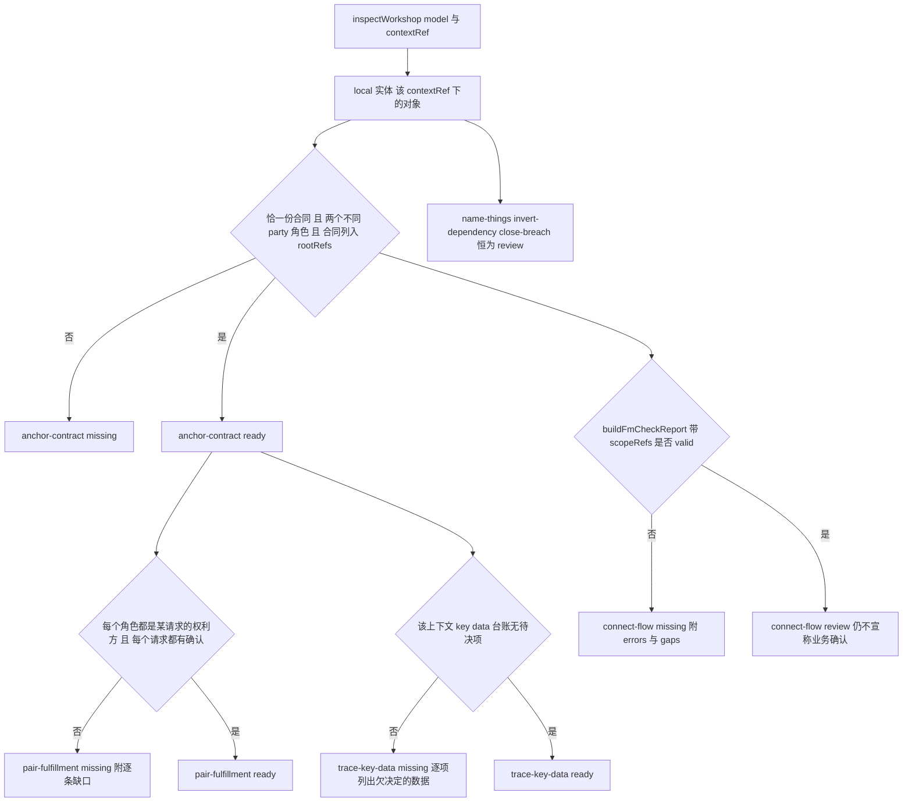
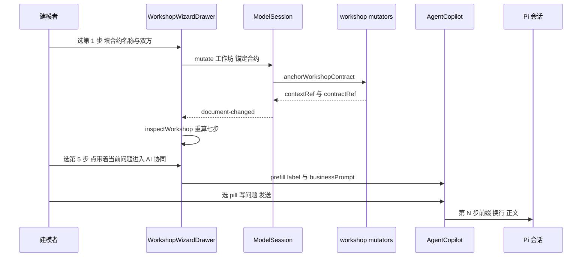

# 七步共创工作坊

共创工作坊是这套系统的建模主线：不填表、不画类图，而是按七个业务问题逐步把「谁要求谁交付什么、凭什么凭证、违约怎么补偿」问成一个履约模型。七步的顺序本身是一条论证链——先有合约再有义务，先有义务再有交易对象，先有对象再有算法，先有正路再有违约路径；关键数据的归属放在违约之后，因为多数金额要等补偿路径确定才可判定。

本文讲这条序列怎么被执行：词表在 schema、检查器在 model-core、向导抽屉与 Copilot pills 在桌面上、七步的提问方式在提示词里。词表字段本身的清单见 [FM DSL 与共享词表](../language/fm-dsl.md)。

## 步骤不是模型属性

`WORKSHOP_STEPS` 的注释把边界写死：这不是模型的属性，磁盘上没有任何东西记录“当前是第几步”；它只是保证所有谈建模的表面用同一套名字，免得 chips 与指令各自漂移。

因此：

- 模型里**没有** workshop 实体、没有 `currentStep` 字段、没有“进度”落盘；进度是每次读模型现场算出来的（`inspectWorkshop`）。
- 桌面上的“当前步骤”是 `AgentCopilot` 的一个 React state（`selection`），跨轮保留，但不进模型、不进 undo、不写文件。
- Agent 侧没有任何步骤状态可读，所以建模者必须用**消息前缀**说出来：`workshopStepFocus` 打印 `【第 N 步 · label】`，`REVERSE_CONTRACT_MODE.focus` 打印 `【无合同逆推 · 从凭证与追责推导合约】`，前缀随正文一起发出。

同一份词表被四处读取：

| 消费方 | 用法 |
| --- | --- |
| `@evidence-poc/evidence-schema` | 定义并导出 `WORKSHOP_STEPS`、`WORKSHOP_STEP_IDS`、`isWorkshopStepId`、`workshopStepRank`、`workshopStepFocus`、`REVERSE_CONTRACT_MODE`，并有 spec 守护 id 唯一与 1-based 序号 |
| `WorkshopStepSelector`（Copilot 作曲区） | 生成 `序号. label` 的 pills，`hint` 作 `title`，另加“无合同逆推”pill 与清除按钮 |
| `WorkshopWizardDrawer`（rail 抽屉） | 渲染七步导航与 `inspectWorkshop` 的三态文案，前两步给表单 |
| `WORKFLOW_PROMPT` / `ROLE_PROMPT` | 按同一顺序复述七步的推进规则；`prompts.spec.ts` 断言七个中文锚点在提示里按词表顺序出现 |

## 七步与其结构检查输入

`inspectWorkshop(model, contextRef)` 永远返回七条（`WORKSHOP_STEPS.map`），顺序即词表顺序。每步状态只由可观察结构事实推导：

| # | id | 业务提问（`businessPrompt` 摘要） | 结构检查输入 | 可能状态 |
| --- | --- | --- | --- | --- |
| 1 | `anchor-contract` | 这份业务以哪份协议或订单为依据，约定双方是谁 | 该 `contextRef` 下恰一份 `contract`；合同有两个不同 `roleRefs` 且都解析为该 Context 内的 `role.party`；合同列入 `context.rootRefs` | `ready` / `missing` |
| 2 | `pair-fulfillment` | 谁要求谁交付什么、何时截止、由谁出具哪张凭证 | 每个角色都至少是一项请求的 `responsibleRoleRef`；每个请求在 `graph.fulfillmentPairs()` 里都有确认端 | `ready` / `missing` |
| 3 | `name-things` | 交易的货物、服务或资产是什么，计价与资格判定是否需要独立组件 | 无（机器无法判定业务计算是否完整） | 恒 `review` |
| 4 | `invert-dependency` | 更换支付、物流或开票供应商会不会迫使主合约改变 | 无（不强制每个业务都引入第三方） | 恒 `review` |
| 5 | `close-breach` | 超时、断供、拒付后如何补偿，继续违约最终由谁处理 | 无（没有补偿边不等于业务必然缺失） | 恒 `review` |
| 6 | `trace-key-data` | 每个金额、数量、期限由谁提供，或按哪条规则计算 | `buildKeyDataLedger(model).decisionOwed` 在该 `contextRef` 内为空，且第 1 步已锚定 | `ready` / `missing` |
| 7 | `connect-flow` | 签约前从哪些渠道形成合同，履约后有哪些结算或补充协议 | `buildFmCheckReport({ model, scopeRefs: [contextRef] })` 的 `valid`（该上下文范围内的静态一致性与完整性） | `review`（通过）/ `missing`（不通过） |

第 2、6 步的门是 `anchored && …`：锚点不成立时它们一起 `missing`。第 7 步只看“上下文存在且范围检查通过”，所以它通过时的状态是 `review` 而不是 `ready`——`gaps` 里原样写着“静态检查不代表业务确认，也不代表后端 HTTP 验收通过”。

上图是七步状态的推导路径：只有第 1、2、6 步能到 `ready`，第 7 步最好也只是 `review`，第 3、4、5 步没有任何机器判据。

## 三种状态不能混用

`ready` / `missing` / `review` 的界线是这一页最容易被误读的地方：

- **`ready`（结构就绪）** 只表示可观察的结构事实成立。`inspectWorkshop` 的注释直接写明这是“可观察的结构事实”，不是“业务已经认可”的断言；向导界头也重复这句话。
- **`missing`（待补充）** 是结构缺口，并且 `gaps` 里给出具体中文定位：哪个角色还没作为权利方出现、哪项请求还缺确认、哪个 `实体.属性` 还欠一项数据来源决定、范围内有哪些静态错误。一项请求都没有时先给 `请先添加一项成对履约。`。
- **`review`（待人工核对）** 是机器**不能**判定、只能由人决定的事：名称与计算器／检查器边界、易变供应商是否真该反转、违约补偿与责任终点是否合理、宏流程是否成立。第 3、4、5 步无论模型多完整都恒为 `review`。

传一个不存在的 `contextRef` 时不会得到“已完成”的假象：第 1、2、6、7 步都退化为 `missing`（spec 断言 `inspectWorkshop(before, 'absent')[0].status === 'missing'`），第 3、4、5 步仍然是 `review`。

## 一次 mutate 建出锚点

`anchorWorkshopContract(draft, { label, partyA, partyB })` 是整个工作坊的入口，它一次写完“上下文 + 双方角色 + 根合约”三件东西，注释直接声明：必须在 `session.mutate` 内调用，三者是一个 undo 单元。

1. `text()` 校验三个字段非空（错误文案 `请填写…。`），并 trim；`partyA === partyB` 时抛 `请区分合约双方的角色名称。`
2. `nextId` 在 `entities`/`rules`/`relationships` 的 id 集合里找第一个空号，依次得到 `context.workshop.N`、两个 `role.workshop.N`、`contract.workshop.N`。
3. 上下文实体（`category: 'context'`、`kind: 'contract'`，label 为 `${label}上下文`）；两个 party 角色带 `contextRef`。
4. `createContractMutator` 写合同：`roleRefs` 指向上述两个角色，`attributes` 只有 `signed_at`（签署时间）——合约是双边协议、只有一个签署时刻，所以工作坊不额外编造字段。
5. `createContractMutator` 同时把合同写进该 Context 的 `rootRefs`，并拒绝已声明 `rootRefs` 的上下文（`context.rootMissing`）。这让“合约 Context 恰一个根合约”成为创建路径上的硬约束，也解释了 `inspectWorkshop` 为什么要检查 `rootRefs.includes(contract.id)`。
6. 把 `contextRef` push 进 `manifest.entryContextRefs`，所以空白工作区的第一份合同不会留下空的 manifest 根（spec 专门断言这一点，并断言 undo 后实体与 `entryContextRefs` 一起清空）。

返回 `{ contextRef, contractRef }`，调用方据此设置下拉选中项与画布焦点。

## 成对创建履约，不编造依据

`addWorkshopFulfillment` 是第 2 步的写入路径，它的关键设计是“只登记建模者说出的依据，不替他算”：

- 权利方与义务方必须不同（`权利方与义务方不能相同。`），履约要求、完成凭证、截止依据三项都必须由人填写。
- 请求 `request.workshop.N` 带 `started_at` 与 `expired_at`（`expired_at.meaning` 就是填进来的截止依据），确认 `confirmation.workshop.N` 带 `confirmed_at`；都交给 `createFulfillmentPairMutator`，并附 `contractReferenceId: relation.workshop-contract`，于是请求从创建那一刻就引用根合约，而不是等追责时才补。
- `notes` 写成 `截止依据：…；如可由已建模输入计算，请继续绑定派生规则。`——把“依据文本”和“派生规则”分开，不把一句话当成截止时间。
- 不写 `examples`、不填字面值：spec 断言成对创建后请求的 `examples` 仍为 `undefined`，金额与时间仍要走关键数据台账（见 [关键数据与来源](../language/key-data-and-provenance.md)）。
- 不生成任何补偿或法律救济结构。第 5 步的补偿路径由 Agent 的 `add_breach_compensation` 写，工作坊 mutator 只把该步留在 `review`。

底层 `createFulfillmentPairMutator` 的 guard 在这里全部生效：`requireContractContext`、`requireRootContract`、两次 `requireRoleBoundByContract`、`assertMandatoryTime`（请求必须有 `started_at`/`expired_at`，确认必须有 `confirmed_at`）。spec 传一个未被根合同绑定的角色，`session.mutate` 抛错后 `getDocument()` 返回的仍是 before 那个对象——recipe 中途失败不发布任何部分改动，与 [受控模型变更、会话与历史](../model/commands-and-session.md) 的原子事务语义一致。

## 桌面向导与 Copilot 的协作

工作坊在桌面上有两块界面，分工不是重复而是交接：抽屉负责**结构 + 检查**，Copilot 负责**提问 + 写入模型**。

`WorkshopWizardDrawer` 接收 `session`、`onFocus(id)`、`onReview(text)`：

- 合约下拉列出模型里所有 `contract` 实体，默认取第一份；换选项就是换 `contextRef`，`useMemo` 重算七步进度。没有合约时下拉只有“尚未建立合约”，七步全退化。
- 步骤导航是七个按钮（`aria-current="step"`），后缀状态文案映射 `ready → 结构就绪`、`review → 待人工核对`、其余 `待补充`；正文只显示**当前步骤**的 `gaps`。
- 只有前两步给表单：第 1 步三个文本输入 + “建立合约与双方”；第 2 步权利方／义务方下拉（默认值取 `contract.roleRefs`）+ 三个文本输入 + “成对添加履约项”。两者都调 `session.mutate(..., '工作坊：锚定合约' | '工作坊：成对添加履约')`，成功后用 `onFocus` 把画布挪到新合同或新请求。
- 第 3 步起不再给表单，只给“带着当前问题进入 AI 协同”：`onReview(\`${step.label}：${step.businessPrompt}\`)`。`EditorScreen` 把它写成 `copilotPrefill = { token, text }` 并把 rail 切到 `copilot`，于是问题原文落进 Copilot 的输入框。
- 失败不吞：`commit()` 捕获异常写进 `role="alert"`，模型保持原样。
- 另有“定位当前合约”按钮，纯导航。

`AgentCopilot` 侧的步骤 pill 是同一套词表的第二种用法：

- `WorkshopStepSelector` 在作曲区上方渲染两组 pill：七个步骤（`序号. label`，`hint` 作 `title`，再点一次即取消 `onSelect(active ? null : step.id)`）与“无合同逆推”，并有 `× 清除当前步骤`。
- 选择类型是 `AgentWorkshopSelection = WorkshopStepId | 'reverse-contract' | null`：步骤与模式**互斥**地占同一个槽位，所以作曲区永远不必解释两个前缀谁优先。
- 发送时解析前缀：`null` 发纯文本；逆推模式发 `REVERSE_CONTRACT_MODE.focus`；否则发 `workshopStepFocus(id)`；最终消息是 `${prefix}\n${text}`。
- 选择是粘的：同一个步骤可以连问几轮，头部在空闲且已选步骤时显示“本轮已带阶段前缀”。
- prefill 通道只填不提交：`AgentCopilot` 在 token 变化时把文本写进 composer（composer 非空则空行追加），聚焦并调用 `onPrefillConsumed()` 防止重放；`EditorScreen` 的 spec 断言点完按钮后“访谈内容”等于 `第 N 步 label：businessPrompt`，且没有发出 prompt、没有保存。

上图是一次典型交接：抽屉把结构写进模型并用 `inspectWorkshop` 复核，提问与后续写入交给带前缀的 Agent 轮次；两条路径都只调 `session.mutate`，都不自行落盘。

## 两条前缀，一份提示词

Agent 如何理解前缀写在提示词里，而不是写在代码里：

- `WORKFLOW_PROMPT` 开头：“每一轮只推进下列七步中的一步。用户点名了某一步，就以那一步为本轮焦点；没有点名时，从当前模型最靠前的缺口接着走。”随后按词表顺序列出七步，并点名各步该用的算子（`introduce_fulfillment_pair`、`isolate_domain_calculator`、`roleify_and_invert_dependency`、`add_breach_compensation` 等）。
- `ROLE_PROMPT` 作为主持人的边界重申一次：“用户指出‘按第 N 步来’时，把那一步当作本轮焦点，其余步骤保持原状。”
- 没有合约可读时，`WORKFLOW_PROMPT` 给出“从凭证逆推”三问：哪些凭证必须留存与追溯、每张凭证主张了谁的权责、违约时凭什么追责；三问收敛出的双边同意就是根合同。这正是“无合同逆推”pill 的前缀所指的那条开场路径。

提示词并不 import 词表，它复述文本；`prompts.spec.ts` 用七个中文锚点在 `WORKFLOW_PROMPT` 中的位置断言顺序与看板一致，防的就是两处文本漂移。工具层细节见 [Pi 运行时与提示词装配](../agents/pi-harness.md)。

## 边界与失败语义

- **结构就绪不是业务确认**，也不代表后端 HTTP 验收通过；第 7 步通过时也只给 `review`。
- **缺依据就报错，不给默认值**：空字段抛 `请填写…。`，同名的双方角色直接拒绝，截止依据必须由人给出；没有依据时结果是缺口而不是一个看起来合理的日期。
- **不伪造法律救济**：工作坊 mutator 只登记截止依据文本，补偿与责任终点留给人（第 5 步 `review`）或 Agent 的补偿算子。
- **重复提交新建而不是就地修改**：每次“建立合约与双方”都会新开一个合约上下文；同一上下文里再写合同会被 `createContractMutator` 拒绝，所以“一个合约上下文恰一个根合约”在创建侧就是硬约束。
- **原子性靠 recipe**：向导与 Copilot 的写入都是一次 `session.mutate`，中途抛错整批不提交，失败后模型与历史都不变。
- **进度是读数，不是状态**：`inspectWorkshop` 每次从模型重算，没有缓存、没有落盘，所以它不会因为某人点了“下一步”而变绿。

## 守护测试

| 测试 | 钉住什么 |
| --- | --- |
| `libs/evidence-schema/src/ast/workshop.spec.ts` | 七步各带 label/hint、id 唯一、1-based 序号、`workshopStepFocus` 文案、非法步骤被 `isWorkshopStepId` 拒绝、逆推模式前缀包含 label |
| `libs/evidence-model-core/src/workshop/workshop.spec.ts` | 空白工作区锚定后 manifest 根非空且 `validate()` 通过、undo 清干净；锚定后 `[0] ready`／`[1] missing`；成对创建后 graph 有该对、`examples` 未伪造、undo/redo 回放正确；坏角色抛错不发布部分改动、三处 `review` 恒 `review`、未知 context 第 1 步 `missing` |
| `apps/desktop/src/renderer/components/wizard/WorkshopWizardDrawer.spec.tsx` | 填表建合约与履约对只写 session、不触发 AI 通道；第 5 步读到 `review` 文案后“带着当前问题”把文本回传 |
| `apps/desktop/src/renderer/screens/EditorScreen.spec.tsx` | 从 rail 打开工作坊、选第 5 步、点交接按钮后 Copilot composer 被预填，且没有发出 prompt 与保存 |
| `libs/desktop/feature-agent/src/components/agent/AgentCopilot.spec.tsx` | 步骤 pill 随消息发出、跨轮粘性、清除后回到纯文本、无合同逆推发自己的前缀 |
| `libs/evidence-agent/src/prompts/prompts.spec.ts` | 七步锚点在 `WORKFLOW_PROMPT` 中按看板顺序出现，且包含“从凭证逆推”开场 |

相关：[FM DSL 与共享词表](../language/fm-dsl.md) · [受控模型变更、会话与历史](../model/commands-and-session.md) · [关键数据与来源](../language/key-data-and-provenance.md) · [工作区界面与交互入口](../desktop/workspace-surfaces.md) · [导入与补丁审阅](../desktop/ingestion-and-patch-review.md) · [Pi 运行时](../agents/pi-harness.md)
