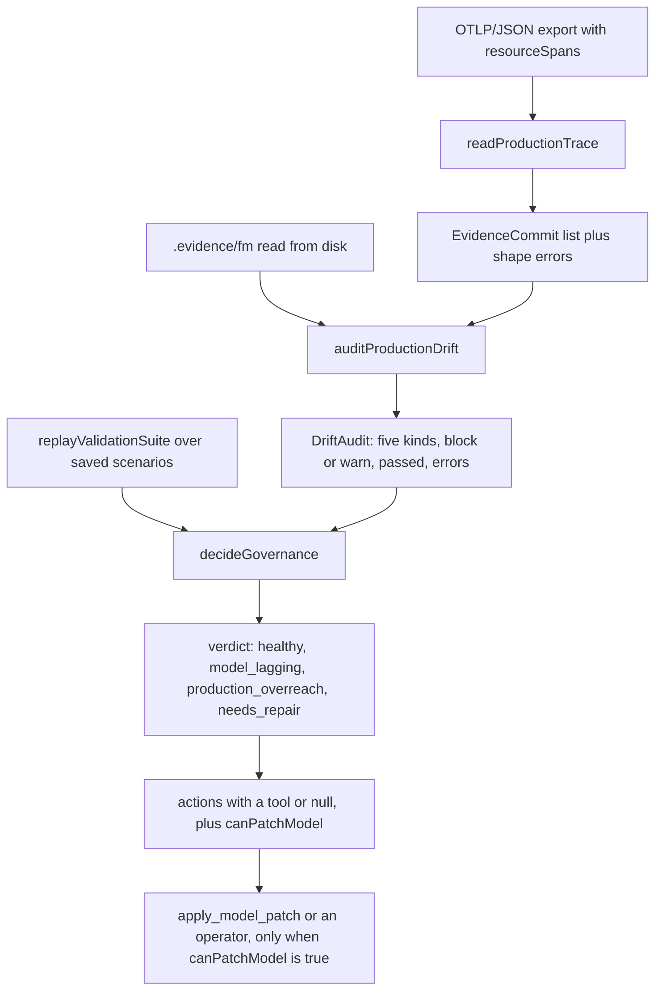
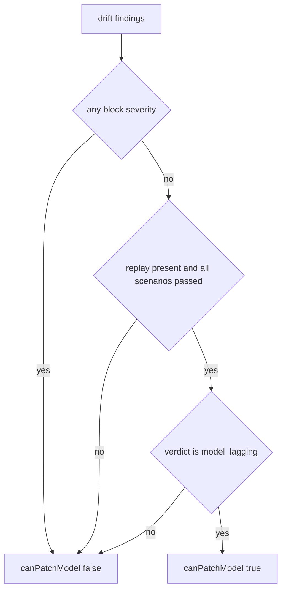

# Production drift, replay and governance decisions

Every other workflow on this wiki starts from a business narrative and asks what the
model should become. This one starts from what a service already did. Two questions
drive it, and they are answered by different code:

| Question | Implementation | Where a reader meets it |
| --- | --- | --- |
| do the model's own scenarios still hold | `replayValidationSuite` behind `createSimulationService().replay` | `run_scenario_replay`, sandbox replay tab |
| does production still match the model | `readProductionTrace` + `auditProductionDrift` behind `auditDrift` | `audit_production_drift`, drift radar tab |
| which side moves, and may the model be edited | `decideGovernance` plus `GOVERNANCE_PROMPT` | the agent turn itself; no IPC channel and no MCP tool of its own |

Both reads run in the desktop main process against the **saved** model on disk. The
service comment states the reason: an audit is about what was saved and deployed, and
a canvas with unsaved edits would make the answer describe a model no service is
running (`repo://apps/desktop/src/main/mcpSimulationService.ts#L16-L24`). The same
discipline holds at the audit boundary, where the model is read for each call rather
than taken from the session
(`repo://libs/evidence-modeling-orchestrator/src/sensors/native/nativeDriftAudit.ts#L1-L30`),
and both services reach the tree through `modelSourceOf`, which resolves a project root
to `.evidence/fm` and leaves a `*.evidence.json` bundle path as it is
(`repo://apps/desktop/src/main/modelSource.ts#L1-L26`).

## The loop in one picture

The trace is read as facts, the model as intent, and the decision is taken over both
plus the replay counts.

## Reading a trace: a span is a commit only when it names Evidence

`readProductionTrace` takes an already-parsed OTLP/JSON document — the shape a
collector, a test fixture or a `curl` of the tracing backend produces
(`repo://libs/evidence-modeling-orchestrator/src/telemetry/productionTrace.ts#L1-L13`).
It walks `resourceSpans[]`, then each element's `scopeSpans[].spans[]`, and counts
every span it inspects into `spanCount`, so a summary can say how much was read, not
just what matched (`repo://libs/evidence-modeling-orchestrator/src/telemetry/productionTrace.ts#L142-L175`).

The attribute keys it understands are exported as `TRACE_ATTRIBUTE_KEYS`
(`repo://libs/evidence-modeling-orchestrator/src/telemetry/productionTrace.ts#L44-L57`):

| Key | Meaning | Effect |
| --- | --- | --- |
| `fm.evidence.ref` | the Evidence Entity this span instantiated | **required**; without it the span is context and is passed over silently |
| `fm.context.ref` | the context the service believes it writes into | becomes `contextRef`, `null` when absent |
| `fm.fulfillment.request.ref` + `fm.fulfillment.status` | what the span claims the request did | a `fulfillment` record only when both are present and the status is exactly `completed` or `breached` |
| `fm.value.<attribute>` | one Evidence attribute the service wrote | the prefix is stripped, so `fm.value.amount` becomes `values.amount` |
| `service.name` | which service produced the span | a span-level value wins over the resource-level one, because a sidecar may emit on another service's behalf; `unknown-service` when neither exists |

Values are decoded out of OTLP `AnyValue` wrappers rather than compared as text:
`stringValue`, `boolValue`, `doubleValue`, `arrayValue` and `kvlistValue` map to their
JSON equivalents, and `intValue` — which OTLP encodes as a string — is converted with
`Number`, so `{"intValue": "19900"}` compares numerically against a modeled number
(`repo://libs/evidence-modeling-orchestrator/src/telemetry/productionTrace.ts#L59-L128`).

Three rules make the commit list trustworthy:

- a span without `fm.evidence.ref` is **not** a business commit and is skipped without
  complaint — health checks and `SELECT` spans never appear as drift;
- a span that names Evidence but carries no `traceId`/`spanId` is reported as
  `path: names Evidence '<ref>' but carries no traceId/spanId` and skipped, because the
  audit cannot place it; the reader keeps going instead of aborting
  (`repo://libs/evidence-modeling-orchestrator/src/telemetry/productionTrace.ts#L250-L268`);
- shape problems are collected as `path: message` strings (`trace: must be an object`,
  `trace/resourceSpans: must be an array`) and travel with the audit as `errors`.

`at` comes from `startTimeUnixNano` divided to milliseconds, and is `null` when the
export carries no usable value; `operation` is the span name and falls back to the
Evidence ref. Commits are sorted by `at` then `spanId`, so ordering is the time the
services reported, not the order the export happened to list them.

## The five drift kinds, and the direction each implies

`auditProductionDrift` emits one finding per disagreement and counts them per kind
(`repo://libs/evidence-modeling-orchestrator/src/sensors/native/driftSensor.ts#L173-L370`).
Severity is not per finding; it is a fixed property of the kind:

| Kind | Default severity | Triggered when | Who moves | Licensed action and tool |
| --- | --- | --- | --- | --- |
| `UNMODELED_EVIDENCE_COMMITTED` | `block` | `fm.evidence.ref` is not a modeled Evidence entity | model lags behind the business | `adopt_production_change` via `roleify_and_invert_dependency` |
| `UNMODELED_ATTRIBUTE_WRITTEN` | `warn` | a written `fm.value.*` is not declared on that entity | either side; the modeler decides | `adopt_production_change` via `apply_model_patch` |
| `DERIVED_VALUE_SUPPLIED` | `block` | a written attribute is declared with `derivedByRuleRef` | production overreach — the service moves | `raise_blocking_ticket`, `tool: null` |
| `CROSS_CONTEXT_WRITE` | `warn` | the commit's `contextRef` is not the entity's modeled context, including a context the model does not have | production overreach — the service moves | `move_write_to_owner` via `apply_model_patch` |
| `BREACH_WITHOUT_FOLLOW_UP` | `warn` | a `breached` fulfillment has no model breach rule, or no follow-up commit in the trace | model lags behind the business | `close_compensation_gap` via `add_breach_compensation` |

The `block` split is exactly two kinds — `isBlocking` names them, everything else is a
warning (`repo://libs/evidence-modeling-orchestrator/src/sensors/native/driftSensor.ts#L99-L102`).
That split is a statement about what an audit may wave through, not about which side
moves: an unmodeled Evidence may well mean the model has to grow, but a business fact no
contract covers must not pass review, and a value the model computes must never be
absorbed at all. The direction of the repair is decided by `decideGovernance` below.

The comparison itself is small enough to state exactly:

- **the reference must be Evidence.** A ref that resolves to a non-Evidence entity (a
  context, a role) is treated like a missing one, because the audit cannot reason about
  its rights and traceability. That finding short-circuits the rest of the commit
  (`repo://libs/evidence-modeling-orchestrator/src/sensors/native/driftSensor.ts#L195-L216`).
- **cross-context needs a claim.** The finding is raised only when the trace states a
  `contextRef` and it differs from the entity's modeled one — a commit that names no
  context is not accused. Two messages exist because the two cases read differently:
  a modeled context written by the wrong service, and a `contextRef` the model never
  declared (`repo://libs/evidence-modeling-orchestrator/src/sensors/native/driftSensor.ts#L218-L251`).
- **supplied derived values are skipped when empty.** The check first requires a
  declared attribute; if it has `derivedByRuleRef` and the service wrote a value that is
  not `undefined`/`null`, that is the finding. A modeled-but-empty derived field is
  tolerated, and a derived field never produces an "unmodeled" finding as well
  (`repo://libs/evidence-modeling-orchestrator/src/sensors/native/driftSensor.ts#L253-L300`).
- **a breach is judged by what follows it.** `breachOf` looks for a rule of kind
  `breach` bound to the breached request, and treats the rule's other bindings as
  confirmations. With no rule at all the finding says the model never declared a breach
  judgement; with a rule it checks whether *any* other commit in the same context has a
  different Evidence ref and is not one of those confirmations. The tolerance is
  deliberate — the compensation may live in another team's trace — and the remediation
  says so (`repo://libs/evidence-modeling-orchestrator/src/sensors/native/driftSensor.ts#L130-L170`,
  `repo://libs/evidence-modeling-orchestrator/src/sensors/native/driftSensor.ts#L302-L360`).

Every finding carries `evidenceRef`, `contextRef`, a `commit` pointer (`traceId`,
`spanId`, `serviceName`, `operation`, `at`), a `modelExpectation` naming the rule or
context the model expected, and a `remediation` sentence written as business advice.
`driftId` is derived from the kind, the ref, the trace/span and the message, so the same
disagreement keeps the same id across runs.

## What `passed` means, and what the errors are

`passed` is `true` when no finding has `block` severity
(`repo://libs/evidence-modeling-orchestrator/src/sensors/native/driftSensor.ts#L357-L370`).
It is *not* "the trace was readable". A document that is not an OTLP export returns
`passed: true` with an empty commit list and `errors: ['trace/resourceSpans: must be an
array']`, which `driftSensor.spec.ts` pins deliberately
(`repo://libs/evidence-modeling-orchestrator/src/sensors/native/driftSensor.spec.ts#L239-L259`).
A consumer that reads only `passed` would therefore report a clean audit over a trace it
never parsed, and the folding step below exists to prevent exactly that.

`runNativeDriftAudit` adds the other half: model source problems are merged into the same
`errors` list, de-duplicated, because an audit that could not see the whole model must
not read like a clean comparison
(`repo://libs/evidence-modeling-orchestrator/src/sensors/native/nativeDriftAudit.ts#L20-L30`).

## Folding a drift audit into the sensor report

`driftIssues` is the one conversion from an audit to the vocabulary the rest of the sensor
report already uses
(`repo://libs/evidence-modeling-orchestrator/src/sensors/sensorReport.ts#L161-L190`):

| Audit field | `SensorIssue` field |
| --- | --- |
| `findings[].severity` | `severity`, unchanged (`block` or `warn`) |
| `findings[].kind` | `code`, so a rule can be read by kind |
| `findings[].message` | `message` |
| `findings[].evidenceRef` | `targetNodeId`, omitted when `null` |
| `findings[].contextRef` | `contextRef` |
| `findings[].remediation` | `suggestion` |
| `errors[]` | one `warn` `DRIFT_TRACE_UNREADABLE` per message, with the advice to check that the export is OTLP/JSON and carries `resourceSpans` |

Every issue is tagged `source: 'audit_drift'`. `buildSensorReport` accepts the drift
report as an optional input and folds it after the FM check and the key-data ledger;
`finalizeSensorReport` then de-duplicates by `issueId`, recomputes the three counters,
and derives `passed` from `blockCount === 0` plus `isStageGateReady` from the gate, the
ledger and API coverage (`repo://libs/evidence-modeling-orchestrator/src/sensors/sensorReport.ts#L318-L409`).
`sensorReport.spec.ts` pins the properties that matter: severity survives, the evidence
ref becomes `targetNodeId`, an unreadable trace becomes a warning rather than an empty
clean audit, and a single blocking drift makes the whole report fail
(`repo://libs/evidence-modeling-orchestrator/src/sensors/sensorReport.spec.ts#L231-L295`).

No ordinary desktop sensor run passes a drift report: `runNativeDriftAudit` is reached
through the MCP tool and the radar, so drift reaches a user as an audit result in the
same vocabulary rather than as part of the status-bar run — see
[sensor orchestration](../agents/sensor-orchestration.md) for how the rest of the report
is built.

## `decideGovernance`: which side moves

The policy is a pure function of what the sensors reported, so the orchestrator's audit
and the desktop's status bar can feed the same decision without either package depending
on the other, and the loop may retry or ask a person but may not reinterpret a finding on
the way (`repo://libs/evidence-agent-core/src/governance/governanceLoop.ts#L1-L12`).

`actionFor` maps one finding kind to one action, and the action names the macro tool that
would perform it — or `null` when the action is a person's decision
(`repo://libs/evidence-agent-core/src/governance/governanceLoop.ts#L78-L125`). Its
`target` is the finding's `evidenceRef`, falling back to its `contextRef`. An unknown
kind is never guessed at: it becomes `raise_blocking_ticket` with `tool: null` and the
kind quoted in the reason.

`decideGovernance` then folds the findings and the replay counts into one verdict
(`repo://libs/evidence-agent-core/src/governance/governanceLoop.ts#L142-L205`):

| Action | Verdict it contributes |
| --- | --- |
| `adopt_production_change` | `model_lagging` |
| `close_compensation_gap` | `model_lagging` |
| `move_write_to_owner` | `production_overreach` |
| `raise_blocking_ticket` | `production_overreach` |
| `repair_model` | `needs_repair` |

The verdict is the strongest claim present, ranked `production_overreach` over
`needs_repair` over `model_lagging` over `healthy`. A failing replay appends a
`repair_model` action (tool `run_sensors`, the agent's own sensor tool) with the reason
"fix the model before talking about absorbing a production change", but it does not
outrank a production overreach: a service writing a derived field is still a service
defect even when the baseline is red.

`rationale` is one line per signal group — a sentence saying production and the model do
not diverge when there is no drift, one line per finding prefixed with the blocking or
warning marker, and either `n/m scenarios passed replay` or the statement that no replay
result exists, so this turn does not confirm the model still holds.

### Why a failing replay closes the patch path

`canPatchModel` requires all four conditions at once: no blocking drift, a replay that
did not fail, a replay that was supplied at all, and a `model_lagging` verdict. The last
condition is easy to miss — a `healthy` verdict yields `false`, because there is nothing
to absorb when production already matches. The consequence is stated at the construction
site: the model has to be green before it may absorb a production change, or the repair
would be built on a broken baseline.

A replay is considered failed when `passedCount < scenarioCount`; the policy does not run
anything itself, so it trusts the counts its caller supplies. Missing replay data is
treated as "not confirmed" rather than "fine", which is why the rationale carries the
literal line `没有回放结果：本轮不确认模型仍然成立。` and `canPatchModel` stays `false`.

The spec pins each half of that contract
(`repo://libs/evidence-agent-core/src/governance/governanceLoop.spec.ts#L1-L133`): a
warn-only breach (`BREACH_WITHOUT_FOLLOW_UP`) is the one case that yields
`canPatchModel: true`; a blocking unmodeled Evidence gives `model_lagging` but still
`false`, because absorbing it needs a person first; a supplied derived value gives
`production_overreach`, a null tool, and `false`; a 2-of-3 replay gives `needs_repair`
and `false`; and an overreach alongside a broken replay ranks above the repair.

## The governance turn

The verdict has no channel of its own: neither the simulation IPC handlers nor the MCP
request handler call `decideGovernance`. It is exported from `evidence-agent-core` for
whoever orchestrates the turn, and the turn's instructions are a separate prompt
(`repo://libs/evidence-agent-core/src/index.ts#L8-L17`).

`GOVERNANCE_PROMPT` is the reverse-direction counterpart of the workshop workflow
(`repo://libs/evidence-agent-core/src/prompts/governance.ts#L1-L35`). It tells the agent
to:

- read facts first with `audit_production_drift` and `run_scenario_replay` instead of
  recalling whether a service is compliant, and to keep `block` and `warn` as two
  different problems in the answer;
- classify before acting — model lagging (unmodeled Evidence or field, breach with no
  follow-up) means the model moves; production overreach (a derived field written by the
  service, or a write into someone else's context) must not be accommodated by editing
  the model; an unclassifiable drift goes to a person unchanged;
- change the model only through `apply_model_patch` and the existing operators
  (`add_breach_compensation`, `roleify_and_invert_dependency`), one class of drift per
  turn, naming the trace and span it came from;
- re-run the replay afterwards and stop if it is no longer green, reporting the failing
  scenario and the finished edits together without an automatic rollback;
- close by stating what was adopted, what was refused and what was left for a person —
  none of the three may be omitted, and nothing unverified may be claimed fixed.

`GOVERNANCE_INSTRUCTIONS` keeps the role, red lines and operator sections and swaps only
the workflow, because a repair writes the same model a workshop does; the desktop
runtime does not select it today
(`repo://libs/evidence-agent-core/src/prompts/index.ts#L39-L51`,
`repo://apps/desktop/src/main/agentRuntime.ts#L151-L190`). See
[the modeling method](../agents/modeling-method.md) for the prompt-pairing guards that
keep the workshop and governance variants from drifting apart.

## Two desktop surfaces on the same main-process services

The sandbox and the radar are one panel with two tabs, opened from the editor header and
mounted by the editor screen with the project root
(`repo://apps/desktop/src/renderer/screens/EditorScreen.tsx#L513-L519`). The panel's own
comment gives the reason they share a dialog: they are two questions about one model, and
a modeler who just watched a step fail is the person most likely to open the trace
(`repo://apps/desktop/src/renderer/components/simulation/SimulationSandbox.tsx#L26-L40`).
Neither hook reads a file: `registerSimulationIpc` answers three channels — replay,
drift, trace dialog — through `createSimulationService`, the same factory the MCP tools
use (`repo://apps/desktop/src/main/simulationIpc.ts#L17-L30`).

**Replay tab.** `useSimulationReplay(rootPath, tab === 'replay')` loads summaries when the
tab becomes active and resets when it is left. The cursor starts at `0` when the reply
has frames and `-1` otherwise; `stepForward` and `stepBack` clamp instead of wrapping, and
`atEnd` disables the next-step button on the last frame. Playback is a cursor rather than
a timer on purpose — stepping forward twice must always show the same two frames, because
a sandbox that drifted on its own would be the one thing an audit cannot use. A request
counter drops replies from an earlier load, so a late response cannot reopen a frame (`repo://apps/desktop/src/renderer/state/useSimulation.ts#L1-L143`). The panel shows
the scenario list with step counts and pass flags, then per frame the acting role, the
instantiated Evidence, the derivations, the fulfillment states and the checkpoints, with a
locate-on-canvas button that calls `onFocusEntity(frame.entityRef)`
(`repo://apps/desktop/src/renderer/components/simulation/SimulationSandbox.tsx#L104-L300`).

**Drift tab.** `useDriftAudit(rootPath)` owns `{audit, tracePath, loading, error}`.
`pickAndAudit` asks main for a file (`pickTrace`, an `openFile` dialog filtered to
`json`), then calls the drift channel with `{rootPath, tracePath}`; main reads the file,
`JSON.parse`s it, and hands the parsed document to `auditDrift`, so a non-JSON file fails
as `不是 JSON` with no audit call at all
(`repo://apps/desktop/src/main/simulationIpc.ts#L33-L115`,
`repo://apps/desktop/src/main/simulationIpc.spec.ts#L100-L132`). Cancelling the picker
returns `{canceled: true}` and keeps the previous audit on screen rather than clearing it.
The tab header names the file that was audited and shows `没有阻塞漂移` or `存在阻塞漂移`;
each finding is a card with the severity badge, the localized kind label from
`DRIFT_KIND_LABELS`, the Evidence ref, the message and the remediation. The card does not
show `contextRef` or `modelExpectation` — those stay in the audit object for an agent or a
caller, not for the panel (`repo://apps/desktop/src/renderer/components/simulation/SimulationSandbox.tsx#L320-L435`).

## The MCP tool

`audit_production_drift` is a read-only tool whose input is the already-parsed OTLP/JSON
document, not a path — an external agent exports the trace on its own side and sends the
document (`repo://libs/evidence-mcp/src/server/toolset.ts#L413-L430`). Its description
states the direction explicitly: the remedy for a blocking item is not to change the model
to accommodate the code. `run_scenario_replay` sits beside it with an optional
`scenarioId`, returning summaries for every scenario and frames only for the one that was
named.

The main process routes the call to the simulation service after resolving the active
project root through `get_app_state`, and throws `NO_ACTIVE_PROJECT` when nothing is open,
so the audit is refused before it touches the filesystem
(`repo://apps/desktop/src/main/mcpRequestHandler.ts#L58-L123`). The reply is projected to
the agent-facing shape in `driftOf`: `modelId`, `spanCount`, `commitCount`, `counts`,
each finding's `kind`, `severity`, `message`, `evidenceRef`, `contextRef` and
`remediation`, plus `passed` and `errors`
(`repo://apps/desktop/src/main/mcpSimulationService.ts#L62-L77`). The projection drops
`driftId`, the `commit` pointer and `modelExpectation`, so an agent gets the classification
and the remedy but not the span coordinates; the desktop panel works from the same
projected type.

Both simulation reads degrade instead of throwing: an unreadable model directory yields
`passed: false` with the read error in `errors`, which the spec pins as expected behaviour
(`repo://apps/desktop/src/main/mcpSimulationService.ts#L79-L152`,
`repo://apps/desktop/src/main/mcpSimulationService.spec.ts#L122-L135`).

The radar and the tool are therefore two doors into one audit: the difference is only who
supplies the trace — a file the modeler picked, parsed in main, or a document the caller
already exported — and in both cases the model side is re-read from `.evidence/fm`, never
taken from the canvas. See [MCP integration](../agents/mcp-integration.md) for the
transport and the rest of the toolset.

## Failure behaviour

| Situation | Result |
| --- | --- |
| trace file is not JSON | drift IPC rejects with `不是 JSON: …`; the service is never called; the previous audit stays (`repo://apps/desktop/src/main/simulationIpc.ts#L33-L40`) |
| document has no `resourceSpans` | `errors: ['trace/resourceSpans: must be an array']`, no commits, and `passed: true` — so read the errors, not only the flag |
| span names Evidence but has no ids | one error naming the ref, that commit skipped, the rest of the trace still read |
| unknown `fm.fulfillment.status` | the fulfillment claim is dropped (`null`), so the breach check does not fire |
| only warnings (cross-context, unmodeled field, breach gap) | audit `passed: true`; `decideGovernance` can still license a patch |
| any `block` finding | audit `passed: false`; `canPatchModel` is `false` even when the verdict is `model_lagging` |
| replay fails a scenario | verdict `needs_repair`, `repair_model` action with `run_sensors`, patch path closed |
| no replay supplied | rationale says the model is not confirmed; `canPatchModel` `false` |
| unknown scenario id | replay `passed: false` with `unknown scenario id '<id>'` |
| model directory unreadable | replay and audit both `passed: false` with the read error in `errors` |
| `audit_production_drift` with no project open | `NO_ACTIVE_PROJECT` from the request handler |

## Tests that protect this contract

- `driftSensor.spec.ts` covers the accept case, one case per kind with its severity and
  `modelExpectation`, the "breach with no rule at all" message, and the fact that a shape
  error travels into `errors` while `passed` stays `true`
  (`repo://libs/evidence-modeling-orchestrator/src/sensors/native/driftSensor.spec.ts#L66-L259`).
- `productionTrace.spec.ts` pins the commit rule, silent skipping of non-business spans,
  fulfillment decoding with an unknown status ignored, the unplaceable-commit error, all
  five OTLP value kinds, ordering by reported time, and both refusal messages
  (`repo://libs/evidence-modeling-orchestrator/src/telemetry/productionTrace.spec.ts#L35-L180`).
- `governanceLoop.spec.ts` pins the verdict per finding kind, the healthy case with
  `canPatchModel: false`, the failing-replay gate, the missing-replay gate, the ranking of
  overreach above a broken replay, and the unknown-kind hand-off
  (`repo://libs/evidence-agent-core/src/governance/governanceLoop.spec.ts#L1-L133`).
- `apps/desktop/src/main/governanceLoop.spec.ts` proves the pieces agree on one saved
  model: the sandbox's frames walk a payment from request to confirmation, a matching trace
  licenses no change, a service-written `expired_at` is refused, and a breach with no
  follow-up offers `add_breach_compensation`
  (`repo://apps/desktop/src/main/governanceLoop.spec.ts#L87-L218`).
- `SimulationSandbox.spec.tsx` pins frame-by-frame playback, the scenario-specific replay
  request, the canvas focus callback, the drift card with kind label and remedy, and that a
  cancelled picker leaves the previous state alone
  (`repo://apps/desktop/src/renderer/components/simulation/SimulationSandbox.spec.tsx#L66-L191`).

## Related pages

- [Checks and simulation](../model/checks-and-simulation.md) — what a replay actually
  proves and where its report fields come from.
- [Sensors, severity folding and the stage gate](../agents/sensor-orchestration.md) — how
  drift findings fold into the one `SensorReport` and what the gate reads.
- [MCP integration](../agents/mcp-integration.md) — `audit_production_drift` and
  `run_scenario_replay` as part of the agent toolset.
- [The canvas and the inspector](../desktop/canvas-and-inspector.md) — the editor surface
  that hosts the sandbox panel and receives its focus requests.
- [Delivery hand-off](delivery-handoff.md) — the forward direction, from the same saved
  sources to deployable files.
